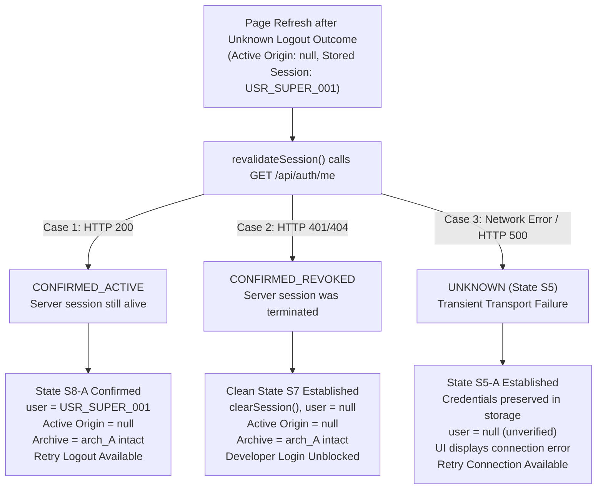

# MetroLMS — SUP-01 Server Outcome Semantics & Evidence Boundary Audit (Version 1.7)
## Architecture Review: Server Outcome Categorization, Refresh/Timeout Recovery, and Frontend/Backend Evidence Boundaries

**Document Version:** 1.7 (Final Server Outcome Semantics & Evidence Boundary Audit)  
**Planning Date:** 2026-11-06  
**Document Path:** `docs/frontend/reports/sup-01-server-outcome-semantics-audit-v1-7.md`  
**Classification:** Architectural Remediation & Test Coverage Plan (Planning Only — Zero Implementation)  
**Target Transition:** `SUP-01: S8 → S7` (Real-User Logout with Preserved Inert Developer Origin Snapshot)  
**Governing Owner Decisions:**  
- **Decision A (S0):** Approved 2026-11-06  
- **Decision B (S8):** Approved 2026-11-06  
- **Decision C (Real-User Logout):** Approved 2026-11-06  
- **Decision E (Archival Failure Policy):** **APPROVED 2026-11-06 (Option 1 — Transactional Abort)**  
**Execution Directives:** Strict Read-Only Planning Governance Preserved (Zero production code modifications, zero test changes, zero Git staging/commits, zero test runner or compiler execution)  
**Proposed Remediation Package:** `WP-5.4.5-R1` (Separately Authorized Remediation Package planned prior to Phase 13)  
**Remediation Plan Status:** `READY FOR OWNER AUTHORIZATION — FRONTEND DESIGN COMPLETE; BACKEND CONTRACT EXPLICITLY DEFERRED`

---

## 1. Executive Summary & Binding Owner Decisions

On November 6, 2026, the project owner reviewed the Phase 5 Work Package 5.4.5 architecture reports and reaffirmed the binding project decisions:

1. **Decision A (Unauthenticated Boundaries — `S0`):** Only `S0 → S1` is permitted; `S0 → S3`, `S0 → S14`, `S0 → S15` are strictly forbidden. Guest/unauthenticated sessions cannot initiate isolated testing or execute Developer return.
2. **Decision B (Identity Mismatch Restrictions — `S8`):** `S8 → S14` and `S8 → S15` are strictly forbidden; a real platform user must never consume, activate, or elevate permissions using an old Developer origin snapshot.
3. **Decision C (Real-User Logout — `SUP-01: S8 → S7`):** When a real user is authenticated in state `S8` and explicitly logs out:
   - Clear the real user's active session (`user = null`, active storage session = `null`).
   - Preserve the existing Developer origin snapshot in the current tab's `sessionStorage`, unchanged and inert, until tab termination.
   - The preserved snapshot must not authorize, restore, or elevate any session.
   - Do not recreate an emergency continuity proof (`emergencyProof = null`).
   - Do not expose normal or emergency Developer return controls (banners remain hidden).
   - Require fresh Developer authentication (`USR_DEV_001`).
   - A subsequent Developer login must not silently reactivate or consume the preserved old snapshot.
4. **Decision E (Archival Failure Policy — APPROVED: Option 1 — Transactional Abort):**  
   If Developer-origin archival or read-back verification fails for any reason (e.g. `QuotaExceededError`, storage disabled, verification mismatch):
   - **Do not dispatch `authApi.logout()`.**
   - **Do not clear local authentication.**
   - **Do not clear active Developer origin.**
   - **Preserve the authenticated real user and remain in State S8.**
   - **Display a recoverable error:** `"فشل حفظ لقطة المطور في الأرشيف بسبب قيود التخزين. لم يتم إنهاء الجلسة لحماية بيانات الاستمرارية."`
   - **Permit safe retry after storage problem is resolved.**
   - *Option 2 (Quarantine & Evict) remains formally REJECTED and will NOT be implemented.*

The existing isolated-persona logout behavior remains unchanged: an explicit logout from an active isolated persona (`S3 -> S12 -> S0`) continues to perform its planned two-slot cleanup.

---

## 2. Mandatory Seven-Account Inventory

All persona allowances, identity boundaries, and tests operate strictly across the mandatory seven-account inventory:

| Account Name | Canonical ID | Canonical Username | System Role | Category | Selectable in Switcher? |
|---|---|---|---|---|:---:|
| **Developer** | `USR_DEV_001` | `developer_internal` | `developer` | Privileged System Actor | No (Launch Origin Only) |
| **Super Admin** | `USR_SUPER_001` | `super_admin_demo` | `super_admin` | Privileged Real Platform Account | **No (Protected Real Account)** |
| **Test Super Admin** | `USR_TEST_SUPER_001` | `test_super_admin` | `super_admin` | Synthetic Test Persona | **Yes (Allowlisted)** |
| **Test Admin** | `USR_TEST_ADMIN_001` | `test_admin` | `admin` | Synthetic Test Persona | **Yes (Allowlisted)** |
| **Test Assistant Admin** | `USR_TEST_AST_001` | `test_assistant_admin` | `assistant_admin` | Synthetic Test Persona | **Yes (Allowlisted)** |
| **Test Lecturer** | `USR_TEST_LEC_001` | `test_lecturer` | `lecturer` | Synthetic Test Persona | **Yes (Allowlisted)** |
| **Test Trainee** | `USR_TEST_TRN_001` | `test_trainee` | `user` | Synthetic Test Persona | **Yes (Allowlisted)** |

### Strict Inventory Invariants:
1. **Exactly five synthetic test personas exist** (`USR_TEST_SUPER_001`, `USR_TEST_ADMIN_001`, `USR_TEST_AST_001`, `USR_TEST_LEC_001`, `USR_TEST_TRN_001`).
2. **Developer (`USR_DEV_001`) and Super Admin (`USR_SUPER_001`) are privileged fixtures**, not synthetic test personas. They are never selectable in the isolated persona switcher.
3. **`assistant_lecturer` is strictly a group-scoped teaching assignment preview layout mode** in `RolePreviewContext`. It is **never** a global system role or synthetic test persona.
4. **Zero secrets policy:** Under no circumstances are passwords, hashes, tokens, or credentials displayed in documentation or inventories.
5. **Developer production provisioning:** Real-world provisioning of `developer` credentials remains a future server-only bootstrap responsibility governed by strict deployment authorization.

---

## 3. Exact Source Evidence and Line References

Targeted read-only source inspection confirms the exact current implementations, line ranges, and behavioral boundaries:

### 1. `frontend/src/core/auth/AuthContext.tsx`
- **Lines 558–582 (`logout`):**
  - Line 559: `const opId = ++authOpSeqRef.current;` establishes the unique operation sequence ID.
  - Line 562: `advanceSessionEpoch();` increments monotonic `sessionEpoch` immediately upon initiating logout, invalidating all pending in-flight requests before awaiting the network call.
  - Lines 564–566: `await authApi.logout().catch(() => {});` dispatches server logout.
  - Line 569: Operation guard `if (opId === authOpSeqRef.current)` discards state updates if superseded by newer authentication operations.
  - **Lines 572–573 (Current Source Baseline):**
    ```typescript
    authStorage.clearSession();
    authStorage.clearDeveloperOriginSession();
    ```
    This unconditionally wipes the active Developer origin snapshot even when the logging-out user is a real user in state `S8`, directly conflicting with Owner Decision C.
  - Lines 574–580: React state cleanup (`setUser(null)`, `setIsIsolatedSession(false)`, `setIsolatedPersona(null)`, `setEmergencyProof(null)`, `setError(null)`, `setIsLoading(false)`).
- **Lines 512–556 (`login`):**
  - Line 513: Increments `authOpSeqRef.current`.
  - Line 532: Calls `advanceSessionEpoch()`.
  - Line 533: Persists user session via `authStorage.setSession(session)`.
  - Line 534: Updates active user via `setUser(response.user)`.
  - Lines 538–542: Clears isolated session state and invalidates any emergency proof/digest.
- **Lines 610–680 (`launchIsolatedPersona`):**
  - Lines 616–620: Validates actor is Canonical Developer (`user.id === 'USR_DEV_001'` and `user.role === 'developer'`).
  - **Lines 649–651 (Anti-Nesting Guard):**
    ```typescript
    if (authStorage.hasDeveloperOriginSession() || isIsolatedSession) {
      throw new Error('لا يمكن بدء جلسة اختبار متداخلة؛ توجد جلسة اختبار معزولة نشطة بالفعل.');
    }
    ```
    If an unarchived snapshot remains in `metro_lms_developer_origin_session`, this check fails closed and blocks a newly authenticated Developer from launching testing.
  - Lines 654–661: Prepares `DeveloperOriginSession` snapshot.
  - Line 663: Calls `authStorage.saveDeveloperOriginSession(originSnapshot)`.
  - Lines 669–680: Read-back verification; if verification fails, calls `clearDeveloperOriginSession()`.
- **Lines 783–835 (`returnToDeveloperSession`):**
  - Lines 786–789: Reads `authStorage.getDeveloperOriginSession()`. Fails closed if `null`.
  - Lines 810–820: Validates `isIsolatedSession === true` and `isolatedPersona.id === origin.personaId`.
  - Lines 824–830: Validates active authenticated user matches target persona (`user.id === origin.personaId`). Real users in S8 cannot satisfy this check.
- **Lines 970–1150 (`returnFromExpiredPersonaSession`):**
  - Lines 975–977: Requires non-null memory-only `emergencyProof`.
  - Lines 981–986: Requires `user === null` (no active authenticated identity).
  - Lines 1050–1065: Reads active `authStorage.getDeveloperOriginSession()`.
  - Lines 1103–1109: Computes SHA-256 digest of active snapshot and matches against `emergencyProof.originSnapshotFingerprint`.
  - Lines 1119–1132: Validates `liveStorageRevision === initialStorageRevision` and `opId === authOpSeqRef.current`.
- **Lines 221–435 (`revalidateSession`):**
  - Lines 230–250: Reads active snapshot from `metro_lms_developer_origin_session`.
  - **Lines 313–323 (Case D: Missing Active Session / State S7):**
    ```typescript
    if (!continuity.isRawSessionPresent) {
      setUser(null);
      setIsIsolatedSession(false);
      setIsolatedPersona(null);
      setEmergencyProof(null);
      setIsLoading(false);
      return;
    }
    ```
  - **Lines 328–380 (Case E: Expired Persona Session / State S6):**
    If an expired session matching `originSnapshot.personaId` is present in storage, `revalidateSession()` computes SHA-256 digest and creates `emergencyProof`.
  - Lines 419–423: Case 7 (Real-User Identity Mismatch / State S8): sets `isIsolatedSession = false`, `setEmergencyProof(null)`.
  - Lines 470–496: Server revalidation error handling:
    - Lines 479–486: HTTP 401, 403, 404 evicts session (`clearSession()`, `setUser(null)`).
    - Lines 487–496: Network error / HTTP 500 enters State S5, sets `user = null`, but **preserves** stored credentials in `sessionStorage` without destroying them!

### 2. `frontend/src/core/auth/authStorage.ts`
- **Lines 124–143:** `AuthStorageInstance` interface defines session and origin methods.
- **Lines 152–157:** Factory state: `originSnapshotVersion = 0`, `originChangeListeners = new Set<() => void>()`.
- **Lines 175–184 (`notifyDeveloperOriginChanged`):** Increments `originSnapshotVersion++` and dispatches to registered listeners.
- **Lines 240–262 (`getDeveloperOriginSession`):** Reads exclusively from `DEVELOPER_ORIGIN_STORAGE_KEY` (`'metro_lms_developer_origin_session'`). Critically, `storage.getItem` followed by `JSON.parse` produces a **new object reference** on every call.
- **Lines 264–275 (`clearDeveloperOriginSession`):** Removes `DEVELOPER_ORIGIN_STORAGE_KEY` and calls `notifyDeveloperOriginChanged()`.
- **Lines 281–334 (`saveDeveloperOriginSession`):** Validates snapshot, enforces anti-overwriting guard (`hasDeveloperOriginSession()`), performs immediate read-back verification, and calls `notifyDeveloperOriginChanged()`.

### 3. `frontend/src/core/api/apiClient.ts`
- **Lines 180–188:** Dynamically reads token from `authStorage.getSession()?.token` and injects `Authorization: Bearer ${session.token}` header.
- **Lines 206–215:** Designates `/api/auth/logout` as an exempt control-plane operation so it is not blocked by Visual Role Preview mutation barriers.
- **Lines 235–240:** Catches fetch errors and maps them to `ApiError`.

### 4. `frontend/src/mocks/handlers/authHandlers.ts`
- **Lines 152–158:**
  ```typescript
  http.post('/api/auth/logout', () => {
    return HttpResponse.json({
      success: true,
      message: 'تم إنهاء الجلسة وتسجيل الخروج بنجاح',
    });
  }),
  ```
  *Limitation Identified:* The development mock handler is static and stateless; it returns HTTP 200 without checking, tracking, or revoking tokens.

---

## 4. Authoritative Server Outcome Categorization

In Version 1.6, HTTP 500 was classified as `Confirmed Active`. As identified in the architecture audit, an HTTP 500 Internal Server Error could occur *after* the backend database committed the revocation, or *before* revocation occurred. The client cannot know whether the server revoked the session.

To resolve this ambiguity, three authoritative, mutually exclusive outcome categories are established:

### Category A: `CONFIRMED_REVOKED`
- **Definition:** The server provides an authoritative result confirming that the target session has been revoked and is no longer valid.
- **Source Conditions:**
  1. `POST /api/auth/logout` returns HTTP 200/204 with `{ success: true }`.
  2. `POST /api/auth/logout` or `GET /api/auth/me` returns HTTP 401 Unauthorized / HTTP 404 Not Found, indicating that the token is not recognized as an active session.
- **Client Guarantee:** Server session is conclusively terminated.

### Category B: `CONFIRMED_ACTIVE`
- **Definition:** The server explicitly validates the session and confirms that it remains active and unrevoked.
- **Source Conditions:**
  1. `GET /api/auth/me` returns HTTP 200 with the active user profile matching the token.
  2. A backend endpoint returns an explicit business-logic rejection (e.g. HTTP 400 Bad Request with `{ code: 'LOGOUT_REFUSED_ACTIVE' }`).
- **Client Guarantee:** Server session is conclusively active.

### Category C: `UNKNOWN`
- **Definition:** The network or server response does not establish the authoritative session state on the backend.
- **Source Conditions:**
  1. Network timeout (request sent, no response received).
  2. Connection loss / TCP disconnect (`Failed to fetch`, `NetworkError`).
  3. Ambiguous HTTP server error (HTTP 500 Internal Server Error, HTTP 502 Bad Gateway, HTTP 503 Service Unavailable, HTTP 504 Gateway Timeout).
  4. Client-side request cancellation via `AbortController` after the request packet was dispatched to the socket.
- **Client Guarantee:** **Backend status cannot be proven.** The token may be revoked, or it may remain active.

> [!IMPORTANT]
> **Source Evidence Limitation:** The existing development MSW mock handler (`authHandlers.ts#L153`) returns static HTTP 200. It cannot simulate or prove real backend Category B or Category C behavior. Production backend behavior cannot be proven until Phase 12 integration.

---

## 5. Resolution of Network Timeout, Retries, and Force Logout Ambiguity

### 1. Rejection of Unspecified "Force Logout"
Version 1.6 mentioned an optional "Force Logout" path that evicted local credentials upon timeout.  
**Resolution:**
- An unvetted "Force Logout" path introduces security contradictions: clearing local credentials while the server session remains active does **not** revoke the server session.
- Therefore, **"Force Logout" is completely omitted from the design**.
- Under all `UNKNOWN` network outcomes, the system preserves local credentials in **Supplementary State `S8-A`** and enables a safe, idempotent retry.

### 2. The Safe Retry Lifecycle for `UNKNOWN` Outcomes

When `authApi.logout()` results in an `UNKNOWN` outcome (network timeout, HTTP 500, or connection drop):
1. **Local State Retained in State `S8-A`:**
   - Real-user credentials remain preserved in `metro_lms_auth_session` and `AuthContext.user = USR_SUPER_001`.
   - The Developer origin snapshot was already verified in `metro_lms_inert_developer_snapshots` during Phase 1.
   - The active origin slot `metro_lms_developer_origin_session` is `null`.
   - Banners and return controls are completely hidden.
   - The UI displays an explicit recoverable notification:  
     `"تعذر التأكد من إنهاء الجلسة على الخادم بسبب انقطاع الاتصال. يرجى إعادة المحاولة."`
2. **Safe Retry Execution:**
   - The user clicks "Retry Logout".
   - The logout function inspects the active origin slot: `authStorage.hasDeveloperOriginSession()`.
   - Because the active origin is already `null` (archival completed in Phase 1 before the network failure), **the retry recognizes that the snapshot is already archived**.
   - The retry **skips Phase 1 archival entirely** and does not create duplicate archive entries.
   - It directly re-dispatches `authApi.logout()`.
   - If the retry succeeds (Category A: `CONFIRMED_REVOKED`), local credentials are wiped (`authStorage.clearSession()`), and the application cleanly enters **State S7**.
   - If the retry fails again, it remains in State `S8-A`.

---

## 6. Refresh Lifecycle Analysis After Unknown Server Outcome

Consider the exact sequence:
1. Archival succeeds into `metro_lms_inert_developer_snapshots`.
2. Active origin slot `metro_lms_developer_origin_session` is cleared (`null`).
3. Server logout request `POST /api/auth/logout` is dispatched.
4. The request times out (Outcome: `UNKNOWN`).
5. The browser is refreshed (F5 / reload).

### Source-Verified Refresh Sequence (`AuthContext.tsx#L220-L496`):

On mount, `revalidateSession()` executes:
- **Active Origin Check:** `originSnapshot = authStorage.getDeveloperOriginSession()`. Returns **`null`**.
- **Continuity Check:** `continuity = authStorage.inspectSessionContinuity()`. Returns `isRawSessionPresent: true` with `USR_SUPER_001`.
- **Server Revalidation Dispatch:** `revalidateSession()` calls `GET /api/auth/me` with the stored token to determine the authoritative server state.

#### The Three Revalidation Outcomes:



1. **Case 4.1: `/api/auth/me` returns HTTP 200 (`CONFIRMED_ACTIVE`)**
   - *Local Session:* Active (`USR_SUPER_001`).
   - *Server Session:* Active.
   - *State Classification:* **State `S8-A`**.
   - *Return Controls:* Ineligible, banners hidden.
   - *Active Origin / Archive:* Active origin is `null`; archive retains `arch_A`.
   - *Action:* UI displays active user with an option to retry logout.
2. **Case 4.2: `/api/auth/me` returns HTTP 401/403/404 (`CONFIRMED_REVOKED`)**
   - *Local Session:* Evicted (`authStorage.clearSession()`, `user = null`).
   - *Server Session:* Confirmed Revoked.
   - *State Classification:* **State `S7`**.
   - *Return Controls:* Ineligible, banners hidden.
   - *Active Origin / Archive:* Active origin is `null`; archive retains `arch_A`.
   - *Action:* Clean logout complete. Fresh Developer login unblocked.
3. **Case 4.3: `/api/auth/me` fails with Network Error / Timeout / HTTP 500 (`UNKNOWN`)**
   - *Source Law ([`AuthContext.tsx#L487-L496`](file:///d:/LMS%20MEtro%20Project/frontend/src/core/auth/AuthContext.tsx#L487-L496)):*  
     *"PRESERVE valid active session and origin snapshot in storage! Do NOT destroy credentials..."*
   - *Local Session:* Preserved in `sessionStorage`; `user = null` in AuthContext (unverified).
   - *Server Session:* Unknown.
   - *State Classification:* **State `S5-A`** (Transient Transport Failure with Inert Archive).
   - *Action:* UI displays connection retry button. Does NOT equate network drop with confirmed logout.

---

## 7. Required Future Backend Concurrency Contract (Phase 12)

### The Limitations of Client-Side Safeguards:
1. **`authOpSeqRef` Limitation:** The client's `authOpSeqRef.current` fence protects **client-side state mutations**. If an older logout completes late, the fence prevents it from clearing client storage. However, **it cannot undo a server-side database mutation** if the server already revoked the session.
2. **`AbortController` Limitation:** Calling `abortController.abort()` cancels the local TCP socket. If the HTTP request was already transmitted across the network, the backend server may parse and execute the logout request anyway.

### Required Future Backend Contract Specifications (Phase 12):

To guarantee 100% server-side session isolation during rapid user transitions, the Phase 12 production backend MUST satisfy these four mandatory contracts:

1. **Strict Token-Scoped Revocation Contract:**
   - The endpoint `POST /api/auth/logout` MUST extract the exact bearer token from `Authorization: Bearer <token>`.
   - The backend MUST revoke **strictly the single session record matching that specific token string**.
   - The backend MUST NEVER revoke sessions based on ambient cookies, client IP address, device fingerprint, or user account ID without matching the specific token.
2. **Strict Session Isolation Invariant:**
   - Revoking Token $T_A$ (User A) has ZERO effect on Token $T_B$ (User B), even if both requests originate from the same browser client, same IP address, or occur within milliseconds.
3. **Idempotent Revocation Semantics:**
   - Dispatched logout requests for an already revoked or non-existent token must return HTTP 200 `{ success: true }` or HTTP 204 No Content without error or side effects.
4. **Authoritative Response Codes:**
   - Successful revocation: HTTP 200 / HTTP 204.
   - Unrecognized / expired token: HTTP 401 / HTTP 404.
   - The backend must never return ambiguous HTTP 500 for a successfully completed revocation.

---

## 8. Comprehensive Failure-Mode Matrix (15 Scenarios with Authoritative Outcomes)

The matrix below explicitly tracks both **Local Session Status**, **Server Session Status**, and **What is Actually Known** across all fifteen scenarios:

| # | Failure Scenario | Local Session Status | Server Session Status | Authoritative Known Status | Active Origin Slot | Inert Archive Status | Return Eligible? | Recovery & Concurrency Guarantee |
|:---:|---|:---:|:---:|:---:|:---:|:---:|:---:|---|
| **1** | **Server confirms revocation (HTTP 200/204)** | Cleared (`null`) | `CONFIRMED_REVOKED` | Conclusive Revocation | **Empty (`null`)** | Verified (`arch_A`) | Ineligible (S7) | Clean **State S7** established. Local credentials evicted. Fresh login unblocked. |
| **2** | **Server confirms active (e.g. `/api/auth/me` 200)** | Active (Real) | `CONFIRMED_ACTIVE` | Conclusive Active | **Empty (`null`)** | Verified (`arch_A`) | Ineligible (`S8-A`) | Real user remains in S8-A; retry logout skips archival and directly calls API. |
| **3** | **HTTP 500 Internal Server Error** | Active (Real) | `UNKNOWN` | Ambiguous Failure | **Empty (`null`)** | Verified (`arch_A`) | Ineligible (`S8-A`) | Error displayed; local session preserved in S8-A; user can retry logout. |
| **4** | **Network Timeout (No HTTP Response)** | Active (Real) | `UNKNOWN` | Ambiguous Failure | **Empty (`null`)** | Verified (`arch_A`) | Ineligible (`S8-A`) | Error displayed; local session preserved in S8-A; user can retry logout. |
| **5** | **Connection Loss (TCP Disconnect)** | Active (Real) | `UNKNOWN` | Ambiguous Failure | **Empty (`null`)** | Verified (`arch_A`) | Ineligible (`S8-A`) | Error displayed; local session preserved in S8-A; user can retry logout. |
| **6** | **Client Cancellation (`AbortController.abort()`)** | Active (Real) | `UNKNOWN` | Request Aborted | **Empty (`null`)** | Verified (`arch_A`) | Ineligible (`S8-A`) | Socket closed locally; backend state unknown; local session retained in S8-A. |
| **7** | **`/api/auth/me` confirms active (Reload in S8-A)** | Active (Real) | `CONFIRMED_ACTIVE` | Conclusive Active | **Empty (`null`)** | Verified (`arch_A`) | Ineligible (`S8-A`) | Reload confirms real user session; active origin `null`; retry available. |
| **8** | **`/api/auth/me` confirms invalid (Reload in S8-A)** | Cleared (`null`) | `CONFIRMED_REVOKED` | Conclusive Revocation | **Empty (`null`)** | Verified (`arch_A`) | Ineligible (S7) | Revalidation detects 401; evicts local session; clean S7 established. |
| **9** | **`/api/auth/me` returns ambiguous error (S5-A)** | Preserved / `null` | `UNKNOWN` | Ambiguous Failure | **Empty (`null`)** | Verified (`arch_A`) | Ineligible (`S5-A`) | Stored token preserved; `user = null` (unverified); retry connection offered. |
| **10** | **Refresh after unknown logout outcome** | Tracked via Reval | Determined by API | Case 7, 8, or 9 | **Empty (`null`)** | Verified (`arch_A`) | Ineligible | `revalidateSession()` calls `/api/auth/me` to determine authoritative truth. |
| **11** | **Retry after confirmed revocation** | Cleared (`null`) | `CONFIRMED_REVOKED` | Conclusive Revocation | **Empty (`null`)** | Verified (`arch_A`) | Ineligible (S7) | No-op; user already in S7; login screen displayed. |
| **12** | **Retry after unknown outcome** | Cleared (on succ) | `CONFIRMED_REVOKED` | Conclusive Revocation | **Empty (`null`)** | Verified (`arch_A`) | Ineligible (S7) | Idempotent retry: skips archival, re-calls server logout, evicts local session. |
| **13** | **Old logout completes after newer login** | **New User** | Active (New User) | Conclusive for New | **New Slot** | Verified (`arch_A`) | Controlled | Post-await fence drops old response; token-scoped backend protects new session. |
| **14** | **`AbortController` cancels pending request** | **New User** | Active (New User) | Conclusive for New | **New Slot** | Verified (`arch_A`) | Controlled | Outbound socket aborted; newer authentication flow proceeds uninterrupted. |
| **15** | **Archive failure under binding Decision E** | Active (Real) | `CONFIRMED_ACTIVE` | Conclusive Active | **Intact** | Unchanged | Forbidden (S8) | **Decision E Abort:** No API call; no local clear; state remains S8 with error. |

---

## 9. Proposed SUP-01-T01 Coverage Matrix (60 Core + 1 Supplemental = 61 Total Specifications)

### Governance & Test Accounting:
- The 60 accepted Phase 5 specifications (lines 146–5643 of `frontend/src/test/isolated-role-session.test.tsx`) remain frozen and unmodified.
- Exactly one supplemental specification is planned after line 5643: `SUP-01-T01`.
- **Current Status of SUP-01-T01:** `WRITTEN — NOT YET EXECUTED — DEFERRED TO PHASE 13` (Planning status only; test file has NOT been modified).
- **Total Specifications Planned:** `60 + 1 = 61`.

### 15-Point Coverage Structure within Planned `SUP-01-T01`:

| # | Test Coverage Dimension | Phase within SUP-01-T01 | Assertion Type | Planned Test Verification |
|:---:|---|---|---|---|
| **1** | **Decision E Abort Gate (Quota Error)** | Pre-Flight Failure Step 1 | Invariant Assertion | Mock `setItem` quota error; assert `authApi.logout` NOT called, local session NOT cleared, user remains S8. |
| **2** | **Decision E Abort Gate (Read-Back Mismatch)** | Pre-Flight Failure Step 2 | Invariant Assertion | Mock corrupted read-back; assert active Developer origin snapshot is NOT cleared. |
| **3** | **Cycle 1 Successful Archive & Clean S7** | Standard Flow Step 3 | State Assertion | `USR_SUPER_001` logs out in S8; assert active session cleared, active slot cleared, archive contains `arch_A`. |
| **4** | **Fresh Developer Login & Third Launch** | Standard Flow Step 4 | State Assertion | Developer logs in; assert `user = USR_DEV_001`, active origin `null`, archive retains `arch_A`, launch unblocked. |
| **5** | **Cycle 2 Successful Archive (Multi-Snapshot)** | Standard Flow Step 5 | State Assertion | Launch Persona B, enter S8, log out; assert archive contains BOTH `arch_A` and `arch_B`. |
| **6** | **Preservation of Snapshot A Across Cycle 2** | Immutability Step 6 | Deep Structural Check | Deep structural comparison of `arch_A` before and after Cycle 2; zero mutation or overwrite. |
| **7** | **Duplicate ID Idempotency** | Recovery Step 7 | Idempotency Check | Archive invoked with existing key; assert active slot cleared with zero duplicate keys. |
| **8** | **HTTP 500 / Network Timeout Resilience** | Network Fault Step 8 | Fault Tolerance | Mock `authApi.logout` HTTP 500 / timeout; assert user remains in S8-A with retry option. |
| **9** | **Idempotent Retry in S8-A** | Recovery Step 9 | Idempotency Assertion | Re-click logout in S8-A; assert archival skipped, API re-dispatched, local session cleared to S7. |
| **10** | **Refresh in S8-A with Active Server** | Reload Step 10 | Revalidation Assertion | Mock `/api/auth/me` HTTP 200 on reload in S8-A; assert real user active, active origin `null`, banners hidden. |
| **11** | **Refresh in S8-A with Revoked Server** | Reload Step 11 | Revalidation Assertion | Mock `/api/auth/me` HTTP 401 on reload in S8-A; assert local session evicted, clean S7 established. |
| **12** | **Refresh in S8-A with Ambiguous Network Error** | Reload Step 12 | State S5 Assertion | Mock `/api/auth/me` network error on reload; assert credentials preserved in storage, user `null`, state S5-A. |
| **13** | **Stale Logout Completion After Newer Login** | Concurrency Step 13 | Concurrency Guard | Simulate newer `login()` while logout in flight; assert older logout fence drops response without touching new session. |
| **14** | **`AbortController` Cancellation on New Auth** | Concurrency Step 14 | Socket Abort Check | Verify pending logout `AbortController.abort()` called when new login begins. |
| **15** | **Isolated Persona Logout Regression Guard** | Regression Teardown Step 15 | Teardown Check | Verify explicit logout from active isolated persona (`S3 -> S12 -> S0`) performs planned two-slot clear without archiving. |

---

## 10. Evidence Boundary Specification

To prevent conflation between verified code and future integration targets, the architectural evidence is partitioned into four explicit boundaries:

### 1. Verified from Current Source Code
- `AuthContext.tsx` synchronous execution flow and React state lifecycles.
- `authStorage.ts` session storage getters, setters, read-back verification, and quarantine methods.
- `sessionEpoch.ts` monotonic counter advancement, listener dispatch, and `isStaleEpoch` validation.
- `apiClient.ts` Authorization header injection and `isRolePreviewMutationBlocked` exemption.
- Banners and return controls hidden in State S8, State S8-A, and State S7.

### 2. Mock-Only Behavior (Development Layer)
- `frontend/src/mocks/handlers/authHandlers.ts#L153` returns static HTTP 200 `{ success: true }`.
- Mock handlers do not maintain database token tables, simulate token blacklists, or model backend concurrency.

### 3. Required Future Backend Contract (Phase 12 Architecture)
- Production endpoint `POST /api/auth/logout` must enforce **Token-Scoped Revocation**.
- Revocation must be strictly bounded to the specific bearer token in the request header.
- Idempotent revocation semantics and non-ambiguous HTTP response codes.
- No cross-session invalidation or global session termination.

### 4. Deferred Integration Verification
- Verification of actual server session revocation under network partitions, server restarts, and high-concurrency races cannot be verified in the browser mock layer; it is **formally deferred to Phase 12 backend integration verification**.

---

## 11. Exact Expected Future Implementation Files

Under a future separately authorized remediation package (`WP-5.4.5-R1`):
1. [`frontend/src/core/auth/authStorage.ts`](file:///d:/LMS%20MEtro%20Project/frontend/src/core/auth/authStorage.ts):
   - Add `INERT_DEVELOPER_SNAPSHOTS_STORAGE_KEY = 'metro_lms_inert_developer_snapshots'`.
   - Add types `InertDeveloperSnapshotArchiveEntry` and `InertDeveloperSnapshotArchive`.
   - Add predicates `areDeveloperOriginSessionsEqual()` and `serializeCanonicalSnapshot()`.
   - Implement synchronous, two-phase atomic archiving transaction `archiveDeveloperOriginSession()`.
   - Add read-only accessor `getInertDeveloperSnapshots()`.
2. [`frontend/src/core/auth/AuthContext.tsx`](file:///d:/LMS%20MEtro%20Project/frontend/src/core/auth/AuthContext.tsx):
   - In `logout()` (lines 558–582): Implement Decision E pre-flight transactional abort before calling `authApi.logout()`.
3. [`frontend/src/test/isolated-role-session.test.tsx`](file:///d:/LMS%20MEtro%20Project/frontend/src/test/isolated-role-session.test.tsx):
   - Author supplemental specification `SUP-01-T01` (lines 5644+), annotated `WRITTEN — NOT YET EXECUTED — DEFERRED TO PHASE 13`.
4. [`docs/frontend/reports/phase-05-increment-04-wp-5.4.5-implementation-report.md`](file:///d:/LMS%20MEtro%20Project/docs/frontend/reports/phase-05-increment-04-wp-5.4.5-implementation-report.md):
   - Increment to Version 4.0; document 61 total specifications; reclassify `SUP-01` to `Covered (Deferred to Phase 13)`.
5. [`docs/frontend/checklists/phase-05-developer-preview-and-isolated-testing-checklist.md`](file:///d:/LMS%20MEtro%20Project/docs/frontend/checklists/phase-05-developer-preview-and-isolated-testing-checklist.md):
   - Update checklist status to `[Completed — Ready for Owner Acceptance]`.

---

## 12. Governance & Non-Execution Attestation

This planning review strictly adhered to project governance:
- **0 production source files modified.**
- **0 test files modified.**
- **0 test specifications created, deleted, or renumbered.**
- **0 Git commands staging or committing changes (`git status` confirms 0 staged files).**
- **0 automated test runners, linters, compilers, or builds executed.**
- **Versions 1.1, 1.2, 1.3, 1.4, 1.5, and 1.6 preserved completely unmodified.**
- **Phase 13 / Gate B remains strictly `[Not Started]`.**
- **Revision 5 roadmap and Planning Report Version 3.0 remain completely unmodified.**

---

## 13. Final Architecture Review Status

**READY FOR OWNER AUTHORIZATION — FRONTEND DESIGN COMPLETE; BACKEND CONTRACT EXPLICITLY DEFERRED**

*(All server outcome semantics, HTTP failure categories, timeout and retry lifecycles, refresh/revalidation branches, token-scoped backend concurrency contracts, intermediate state models S8-A and S8-ERR, and the expanded 15-point test matrix have been comprehensively reconciled. The frontend architecture design is complete, and production backend requirements are formally bounded and deferred to Phase 12. Remediation package WP-5.4.5-R1 is ready for explicit owner implementation authorization).*

