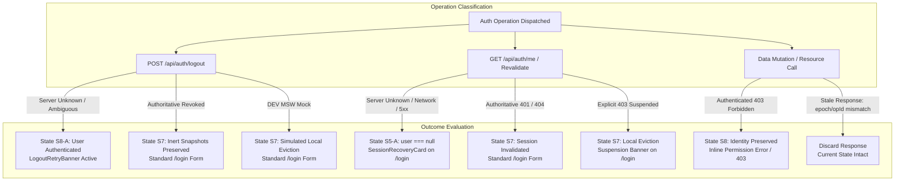
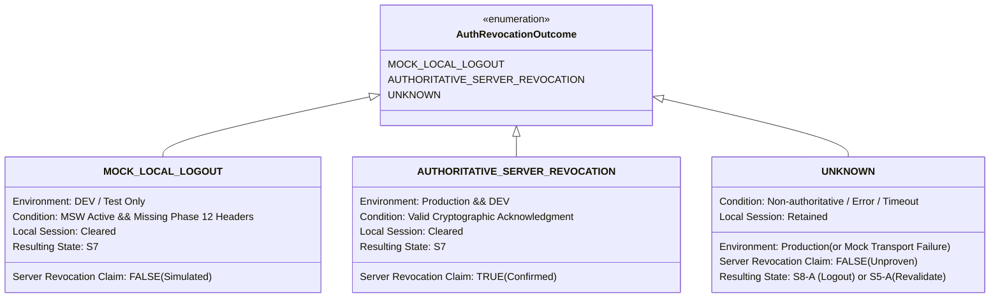
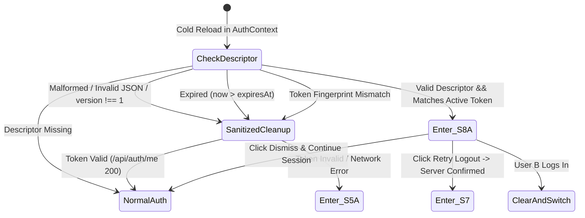

# MetroLMS — SUP-01 Final Mock, Descriptor & Evidence Closure Audit (Version 2.4)
## Architecture Review: Operation-Specific Lifecycle Mapping, Explicit Mock Logout Policy, Descriptor Integrity, Authoritative Binding, Complete apiClientRaw Contract, and Exhaustive 29-Scenario Matrix

**Document Version:** 2.4 (Final Mock, Descriptor & Evidence Closure Audit)  
**Planning Date:** 2026-11-06  
**Document Path:** `docs/frontend/reports/sup-01-server-outcome-semantics-audit-v2-4.md`  
**Classification:** Architectural Remediation & Test Coverage Plan (Strict Read-Only Planning — Zero Implementation)  
**Target Transition:** `SUP-01: S8 → S7` (Real-User Logout with Preserved Inert Developer Origin Snapshot)  
**Governing Owner Decisions:**  
- **Decision A (S0):** Approved 2026-11-06 (Only `S0 → S1` permitted; `S0 → S3/S14/S15` forbidden)  
- **Decision B (S8):** Approved 2026-11-06 (`S8 → S14/S15` forbidden; Developer origin never reactivated by real user)  
- **Decision C (Real-User Logout):** Approved 2026-11-06 (`S8 → S7` approved; origin snapshot preserved inert in per-tab sessionStorage until tab close)  
- **Decision E (Archival Failure Policy):** **APPROVED 2026-11-06 (Option 1 — Transactional Abort on Archive Failure)**  
**Execution Directives:** Strict Read-Only Governance (Zero production code modifications, zero test file modifications, zero Git staging/commits, zero test runner or compiler execution)  
**Proposed Remediation Package:** `WP-5.4.5-R1` (Separately Authorized Remediation Package planned prior to Phase 13)  
**Final Architecture Status:** `READY FOR OWNER AUTHORIZATION — FRONTEND DESIGN COMPLETE; BACKEND CONTRACT EXPLICITLY DEFERRED`

---

## 1. Executive Summary & Traceability to Version 2.3 Issues

On November 6, 2026, the project owner reviewed Version 2.3 of the SUP-01 architectural closure audits. While Version 2.3 unified correlation guards, established the type-safe discriminated union, and specified Policy B for cold-reload recovery, six critical architectural and specification gaps were identified for final closure:

1. **Operation-Specific Lifecycle Classification (Issue A):** Version 2.3 overly broadly stated that all non-authoritative results fail closed to `UNKNOWN` in `S8-A`. In reality, the resulting lifecycle state depends strictly on the initiating operation and previous authentication state: logout failures while authenticated enter `S8-A`, cold reload `/api/auth/me` failures enter `S5-A`, authenticated 403s preserve the authenticated identity, account suspensions trigger local eviction without claiming token revocation, mock logouts execute simulated local eviction, and stale responses are dropped without mutating user state.
2. **Explicit DEV/MSW Mock Logout Policy (Issue B):** Version 2.3 classified mock responses as `MOCK_SUCCESS_RESPONSE` but failed closed, preventing local session clearance in development. Version 2.4 defines an isolated `MOCK_LOCAL_LOGOUT` simulation policy active strictly in `import.meta.env.DEV`, separated from production builds, ensuring mock success is never conflated with production `CONFIRMED_REVOKED`.
3. **Pending Logout Descriptor Integrity and Lifecycle (Issue C):** Version 2.4 formalizes the `metro_lms_pending_logout` descriptor schema (versioned, strictly distinguishing `userId` from `sessionId`, with TTL and zero raw tokens), specifies exact validation rules for mismatches/expirations, and guarantees retry never substitutes a newer token for the original target.
4. **Authoritative 401/404 Response Binding (Issue D):** Establishes the exact evidence boundary required before an HTTP 401 (`TOKEN_INVALID`) or 404 (`SESSION_NOT_FOUND`) can cause local credential eviction. Fencing frontend `opId` matching from trusted Phase 12 backend cryptographic binding, preventing gateway/proxy challenges from clearing sessions.
5. **Complete `apiClientRaw` Contract (Issue E):** Compares Design A (raw response envelope for all HTTP status codes) versus Design B (extending `ApiError` with headers). Selects and justifies Design A, documenting exact runtime behavior across all 11 transport, status, parsing, and epoch scenarios.
6. **Exhaustive 29-Scenario Matrix (Issue F):** Explicitly publishes all 29 individual scenarios in full tabular format across 16 rigorous architectural columns.

All previously approved owner decisions (Decisions A, B, C, and E) remain binding and unaltered.

---

## 2. Issue A: Operation-Specific Lifecycle Classification

A uniform "fail-closed to UNKNOWN in S8-A" rule is architecturally flawed because a client cannot be in state `S8-A` (which renders inside the authenticated layout) when the authenticated user profile is absent from React memory (`user === null`).

The lifecycle state machine must evaluate the operation type and previous state:



### 2.1 Complete Operation-Specific Classification Matrix

| Operation Type | Previous Lifecycle State | Authenticated Identity (`user`) | Local Credentials | Server Response / Evidence | Result Classification | New Lifecycle State | Active UI Component | Available User Action |
| :--- | :--- | :--- | :--- | :--- | :--- | :--- | :--- | :--- |
| **Active Logout** | `S8` (Authenticated Developer + Real User) | Real User (`USR_TEST_TRN_001`) | **Retained** in `sessionStorage` | 5xx, Timeout, Network Error, or Non-Authoritative 200/204 | `UNKNOWN` (Logout Failure) | **`S8-A`** | `LogoutRetryBanner` (Authenticated Layout) | 1. Retry Logout (`retryLogout`)<br>2. Dismiss & Continue (`clearPendingLogout`) |
| **Cold Reload Revalidation** | `S0` / Bootstrap (`user === null`) | `null` (Memory empty pending server validation) | **Retained** in `sessionStorage` | 5xx, Timeout, Network Error, or Gateway 401/404 | `UNKNOWN` (Revalidation Failure) | **`S5-A`** | `SessionRecoveryCard` (Public `/login` Route) | 1. Retry Revalidation (`retryRevalidation`)<br>2. Clear Session & Login Freshly |
| **Resource / Endpoint 403** | `S8` / Authenticated | Real User (`USR_TEST_TRN_001`) | **Retained** (Token valid, insufficient rights) | HTTP 403 Standard (`FORBIDDEN` / `PERMISSION_DENIED`) | `AUTHENTICATED_UNAUTHORIZED_403` | **`S8`** (Preserved) | In-App 403 Forbidden Banner or `/403` Route | Navigate to Authorized Dashboard Views (Session remains active) |
| **Account Suspension** | `S8` or `S5-A` | Real User | **Evicted** (Local security policy enforcement) | HTTP 403 + Machine Code `ACCOUNT_SUSPENDED` + User ID | `EXPLICIT_ACCOUNT_SUSPENSION_403` | **`S7`** (Unauthenticated) | Account Suspension Notice on `/login` | Contact System Administrator (Revalidation retry disabled) |
| **DEV / MSW Mock Logout** | `S8` | Real User | **Evicted** (Local development simulation) | HTTP 200 `{ success: true }` without crypto proof | `MOCK_LOCAL_LOGOUT` | **`S7`** (Unauthenticated) | Standard Login Form | Login with Test Persona (Simulated success, zero server claim) |
| **Stale Response** | Any (`S8`, `S1`, etc. for User B) | Current Active User (User B) | **Untouched** (User B credentials preserved) | Delayed User A response arriving out of sequence | `STALE_RESPONSE_DROPPED` | **Unchanged** (Current Active State) | Active User B Layout | Normal User Interaction (Delayed response dropped silently) |

---

## 2.2 Traceability Mapping: Version 2.3 Issues to Version 2.4 Resolutions

| Version 2.3 Shortcoming | Version 2.4 Architectural Resolution | Operational Impact & Safety Guarantee |
| :--- | :--- | :--- |
| **Uniform `UNKNOWN → S8-A` rule** | Partitioned into operation-aware state transitions (Logout $\to$ S8-A; Revalidation $\to$ S5-A; 403 Forbidden $\to$ S8 preserved). | Prevents `ProtectedRoute` crashes when `user === null` and prevents accidental session eviction on permission errors. |
| **Mock logout failed closed in DEV** | Defined `MOCK_LOCAL_LOGOUT` policy isolated via `import.meta.env.DEV`. | Restores developer test workflow while ensuring production builds strictly fail closed to `UNKNOWN`. |
| **Conflation of `userId` and `sessionId`** | Formalized `PendingLogoutDescriptor` schema v1 with separate `targetUserId`, `sessionEpoch`, and optional `serverSessionId`. | Eliminates identity vs instance confusion; prevents cross-session retry substitution. |
| **Optional fingerprints on 401/404** | Mandated strict machine code + lowercase SHA-256 token fingerprint binding before credential eviction. | Defends against corporate proxy/gateway HTML 401/404 responses wiping valid user sessions. |
| **Undefined `apiClientRaw` error modes** | Formulated complete 11-row behavior contract under Design A (envelope return, transport-only throw). | Existing `apiClient<T>()` callers 100% unaffected; headers and status cleanly exposed to `authApi`. |
| **Summarized 29-scenario matrix** | Published complete 29-row matrix with all 16 required columns. | Eliminates ambiguity; every permutation of status, token, epoch, and UI is fully specified. |

---

## 3. Issue B: Explicit DEV/MSW Mock Logout Policy

### 3.1 The Architectural Conflict
The existing MSW handler (`frontend/src/mocks/handlers/authHandlers.ts#L153-L158`) returns:
```json
{ "success": true, "message": "تم إنهاء الجلسة وتسجيل الخروج بنجاح" }
```
This payload lacks Phase 12 machine codes (`code: 'SESSION_REVOKED'`), token fingerprints, and revocation timestamps. Under strict production security rules, this payload is non-authoritative and fails closed to `UNKNOWN`, keeping the user in `S8-A`. However, during local development and frontend component testing, developers and automated UI tests require simulated local logout without standing up a live Phase 12 cryptographic backend.

### 3.2 The Three Distinct Operational Classifications



1. **`MOCK_LOCAL_LOGOUT` (DEV-Only Simulation):**
   - Active strictly in development (`import.meta.env.DEV === true`) when the MSW service worker or test mock is active.
   - Acknowledges that the server response is an unverified simulation.
   - Clears the local synthetic session and transitions to `S7` to facilitate frontend developer workflow.
   - Strictly records evidence: `serverOutcome: 'MOCK_LOCAL_ONLY'`. It is NEVER recorded or reported as `CONFIRMED_REVOKED`.
2. **`AUTHORITATIVE_SERVER_REVOCATION` (Production Standard):**
   - Requires full Phase 12 backend verification: matching SHA-256 token fingerprint, verified machine code (`SESSION_REVOKED` or `CONFIRMED_REVOKED`), and revocation timestamp.
   - Permits production local credential eviction.
   - Records evidence: `serverOutcome: 'CONFIRMED_REVOKED'`.
3. **`UNKNOWN` (Production Fail-Closed):**
   - In production builds (`import.meta.env.PROD === true`), any bare 200/204 response lacking cryptographic proof is classified as `UNKNOWN`.
   - Credentials are strictly retained.
   - Transitions to `S8-A` (for active logout) or `S5-A` (for cold reload).

### 3.3 Build-Time Isolation & Accidental Acceptance Prevention
- **Build Isolation:** In Vite, `import.meta.env.DEV` is statically replaced with `false` during production bundling (`npm run build`). The code branch handling `MOCK_LOCAL_LOGOUT` is completely dead-code eliminated (tree-shaken) from the production bundle.
- **Header Guard:** In DEV mode, MSW injects `x-msw-mock: true`. If a production build encounters this header, it is rejected by API client security filters.
- **Accidental Acceptance Guard:**
  ```typescript
  // authApi.ts
  if (response.status === 200 && isMockEnvironmentActive() && !isAuthoritativeRevocation(response)) {
    return {
      type: 'MOCK_LOCAL_LOGOUT',
      isAuthoritative: false,
      isMockSimulation: true,
      rawStatus: 200,
    };
  }
  ```
  `MOCK_LOCAL_LOGOUT` explicitly carries `isAuthoritative: false`. Under no circumstances can it satisfy guards requiring `isAuthoritative === true`.

---

## 4. Issue C: Pending Logout Descriptor Integrity and Lifecycle

### 4.1 Schema Definition & User ID vs. Session ID Separation
A user ID (`userId`) identifies an account across time and devices. A session ID (`sessionId`) identifies a single, specific authenticated instance. Prior to the Phase 12 production backend, the LMS client does not possess a server-issued session ID. Therefore, the descriptor MUST NOT fake a session ID using `userId`. Instead, it explicitly records `targetUserId`, `sessionEpoch` (client monotonic transition epoch), and `targetTokenFingerprint`.

```typescript
// frontend/src/core/auth/authStorage.ts

export const PENDING_LOGOUT_STORAGE_KEY = 'metro_lms_pending_logout';

export interface PendingLogoutDescriptor {
  /** Explicit schema version for forward/backward compatibility */
  version: 1;
  /** 64-character lowercase hexadecimal SHA-256 digest of the target token */
  targetTokenFingerprint: string;
  /** Authentic user identifier (e.g. "USR_TEST_TRN_001") */
  targetUserId: string;
  /** Monotonic client-side session epoch at time of logout dispatch */
  sessionEpoch: number;
  /** Server-issued session ID (if provided by Phase 12 backend; undefined in Phase 5) */
  serverSessionId?: string;
  /** Epoch timestamp (ms) when logout was initiated */
  initiatedAt: number;
  /** Hard expiration timestamp (ms) for this descriptor (TTL: 60 minutes) */
  expiresAt: number;
}
```

### 4.2 Comprehensive Validation & Lifecycle Rules



1. **Validation Rules:**
   - **Missing:** Normal flow. No logout was pending.
   - **Malformed / Corrupted / Schema Mismatch:** If `descriptor.version !== 1`, or fields are non-conformant, immediately purge `PENDING_LOGOUT_STORAGE_KEY`. Do not crash. Fall back to standard session state.
   - **Expired Descriptor:** If `Date.now() > descriptor.expiresAt` (TTL: 60 minutes), the pending logout state is stale. Purge descriptor and resume normal authenticated operation.
2. **Current Token vs. Target Token Mismatch:**
   - If `sha256(currentSession.token) !== descriptor.targetTokenFingerprint`:
     - The stored descriptor belongs to an old or revoked token.
     - **Action:** Purge the descriptor immediately. Do NOT enter `S8-A`. Do NOT display the `LogoutRetryBanner`. Continue normal authenticated operation for the active session.
3. **Same User Authenticates with Different Token:**
   - User A logs in on a new session while an old descriptor existed from a previous session.
   - Because `sha256(newToken) !== descriptor.targetTokenFingerprint`, validation fails.
   - `login()` unconditionally purges `metro_lms_pending_logout` upon successful credential acquisition.
4. **Different User Logs In (User B):**
   - `login()` advances `sessionEpoch`, replaces credentials, and purges `metro_lms_pending_logout`.
   - Even if the descriptor remained, `targetUserId !== userB.id` and `targetTokenFingerprint !== sha256(userB.token)`. Descriptor is purged immediately.
5. **Session Expires While Descriptor Remains:**
   - `/api/auth/me` returns Authoritative 401 (`TOKEN_INVALID`).
   - Local credentials are purged. `metro_lms_pending_logout` is purged. Transitions directly to `S7`.
6. **Retry Substitution Guard:**
   - When the user clicks "إعادة محاولة تسجيل الخروج" on `LogoutRetryBanner`, `retryLogout()` compares `sha256(currentSession.token)` against `descriptor.targetTokenFingerprint`.
   - If they do not match, retry is rejected with an exception: `"SESSION_MISMATCH: Cannot retry logout against a substituted session"`.
7. **Zero Secrets Requirement:**
   - Under no circumstances does `PendingLogoutDescriptor` contain `token`, `password`, or authorization headers. It contains only hashes, IDs, timestamps, and numbers.

---

## 5. Issue D: Authoritative 401/404 Response Binding

### 5.1 The Danger of Unbound 401/404 Responses
Corporate web application firewalls (WAFs), reverse proxies (Nginx, Envoy), cloud API gateways, and misconfigured load balancers frequently emit HTTP 401 Unauthorized (e.g. invalid basic auth challenge, IP rate limit) or HTTP 404 Not Found (e.g. endpoint path typo, CDN route missing). If the frontend blindly treats any 401 or 404 as proof that the user's backend session is dead, a network glitch or gateway blip will falsely destroy valid user sessions.

### 5.2 Frontend Local Proof vs. Phase 12 Backend Guarantees

| Verification Layer | What the Frontend Can Prove Locally | What Must Be Guaranteed by Phase 12 Backend |
| :--- | :--- | :--- |
| **Request Correlation** | Matches client sequence `opId === authOpSeqRef.current` and `sessionEpoch === currentEpoch`. (Proves response belongs to this request cycle). | Backend must echo `X-Correlation-Id` header received in request. (Proves backend processed this specific call). |
| **Identity / Session Scope** | Matches `sha256(currentSession.token)`. (Proves client dispatched token $T$). | Backend must inspect bearer token $T$ and explicitly assert that $T$ is invalid in identity store. |
| **Response Authenticity** | Validates JSON format and absence of HTML/proxy error signatures. | Backend emits machine code `{ code: 'TOKEN_INVALID' }` and `X-Auth-Authority: metro-lms-core` header. |

### 5.3 Authoritative Eviction Rules
A 401 or 404 response permits local credential eviction **only** if ALL of the following criteria are satisfied:
1. **JSON Machine Code:** Payload is valid JSON containing `{ code: 'TOKEN_INVALID' }` (for 401) or `{ code: 'SESSION_NOT_FOUND' }` (for 404).
2. **Cryptographic Fingerprint Binding:** Response body or `X-Auth-Revoked-Token-Fingerprint` header contains the 64-character lowercase hex digest matching `sha256(currentSession.token)`.
3. **Correlation Integrity:** Client sequence `opId` and `sessionEpoch` remain current.

**Fail-Closed Behavior for Ambiguous Responses:**  
If a 401 or 404 response lacks the machine code or fingerprint (e.g. gateway HTML error, CDN 404):
- It is classified as `AMBIGUOUS_401` or `AMBIGUOUS_404`.
- `isAuthoritative === false`.
- **During Active Logout:** Retains credentials, enters **`S8-A`** with `LogoutRetryBanner`.
- **During Cold Reload / Revalidation:** Retains credentials, enters **`S5-A`** on `/login` with `SessionRecoveryCard`.
- **Under NO circumstances are credentials evicted on ambiguous gateway responses.**

---

## 6. Issue E: Complete `apiClientRaw` Contract

### 6.1 Architectural Comparison: Design A vs. Design B

- **Design B (Extend `ApiError` with Headers):**
  - Keeps throwing `ApiError` on any HTTP status $\ge 400$, but adds `headers: Headers` and `status: number` to the error instance.
  - *Architectural Flaw:* Forces `authApi` to catch exceptions for standard protocol responses. In authentication lifecycle management, HTTP 401, 403, and 404 are not unexpected program exceptions; they are authoritative status signals that must be inspected cleanly without error handling overhead.
- **Design A (Raw Response Envelope) — SELECTED & JUSTIFIED:**
  - `apiClientRaw<T>()` returns `Promise<RawApiResponse<T>>` for ALL completed HTTP responses (2xx, 3xx, 4xx, 5xx).
  - Throws ONLY on transport-level failures (network offline, fetch timeout, request abortion) or security violations (stale epoch).
  - *Justification:* 100% of existing service calls continue using `apiClient<T>()` with identical exception-throwing semantics. `authApi` uses `apiClientRaw()` for fine-grained inspection of headers, status codes, and non-authoritative payloads without fragile catch blocks.

### 6.2 Complete Runtime Behavior Specification for `apiClientRaw`

```typescript
// frontend/src/core/api/apiClient.ts

export interface RawApiResponse<T = unknown> {
  ok: boolean;
  status: number;
  headers: Headers;
  data: T | null;
  rawText?: string;
  isJson: boolean;
}
```

| Scenario / Condition | HTTP / Transport State | `ok` | `status` | `data` | `headers` | Exception Thrown? |
| :--- | :--- | :---: | :---: | :---: | :---: | :--- |
| **1. HTTP 200 JSON** | Successful response with `application/json` | `true` | `200` | Parsed JSON object `T` | Response `Headers` | No |
| **2. HTTP 204 No Content** | Successful empty response | `true` | `204` | `null` (Bypasses JSON parsing) | Response `Headers` | No |
| **3. Other 2xx (201, 202)** | Successful response | `true` | 2xx | Parsed JSON or `null` | Response `Headers` | No |
| **4. HTTP 4xx (401, 403, 404)** | Client error from server/gateway | `false` | 4xx | Parsed JSON (if JSON) or `null` | Response `Headers` | No (Returned to caller for inspection) |
| **5. HTTP 5xx (500, 502, 503)** | Server / gateway error | `false` | 5xx | Parsed JSON (if JSON) or `null` | Response `Headers` | No (Returned to caller for inspection) |
| **6. Malformed JSON** | Header claims JSON, body is syntax error | `false` | Status | `null` (captures `rawText`) | Response `Headers` | No (Safe error data capture) |
| **7. Non-JSON Response** | HTML fallback / Vite index.html / text | `false` | Status | `null` (captures `rawText`) | Response `Headers` | No (`isJson: false`) |
| **8. Network Error / Offline** | `TypeError: Failed to fetch` | — | `0` | — | — | **Yes:** `ApiError` (`isNetworkError: true`) |
| **9. Timeout (15,000 ms)** | AbortController fired by timeout timer | — | `0` | — | — | **Yes:** `ApiError` (`isTimeout: true`) |
| **10. User Cancellation / Abort** | AbortController triggered externally | — | `0` | — | — | **Yes:** `ApiError` (`isAborted: true`) |
| **11. Stale Session Epoch** | `isStaleEpoch(requestEpoch) === true` | — | — | — | — | **Yes:** `StaleEpochError` (Immediate pre-commit drop) |

*Security Barrier Preservation:* `apiClientRaw` executes the exact same URL construction, authorization header injection, mutation barrier checks (`isRolePreviewMutationBlocked()`), and epoch validation as standard `apiClient<T>()`.

---

## 7. Issue F: Complete 29-Scenario State, Response, and Correlation Matrix

The following table explicitly details all 29 architectural scenarios across active logout, cold reload revalidation, and concurrent identity transitions.

| # | Operation Type | Previous State | Target User ID | Target Session ID / Epoch | Target Token Fingerprint Status | HTTP / Transport Result | Evidence Classification | Correlation Guard Result | AuthContext User | isAuthenticated | Local Credential Action | Lifecycle State | Visible UI Component | Available User Action | Server Revocation Confirmed? |
| :-: | :--- | :---: | :---: | :---: | :---: | :---: | :---: | :---: | :---: | :---: | :---: | :---: | :---: | :---: | :---: |
| **1** | Active Logout | `S8` | `USR_TEST_TRN_001` | Epoch 1 | Valid SHA-256 Digest | HTTP 200 `{ code: 'SESSION_REVOKED' }` | `AUTHORITATIVE_200_JSON` | Pass (opId, epoch, fingerprint) | `null` | `false` | **Purged** | **`S7`** | Standard `/login` Form | Login with new credentials | **YES (`CONFIRMED_REVOKED`)** |
| **2** | Active Logout | `S8` | `USR_TEST_TRN_001` | Epoch 1 | Valid SHA-256 Digest | HTTP 200 `{ success: true }` (No machine code) | `NON_AUTHORITATIVE_200` (Production) | Pass (opId, epoch) | Real User | `true` | **Retained** | **`S8-A`** | `LogoutRetryBanner` (In-App) | 1. Retry Logout<br>2. Dismiss Banner | **NO (`UNKNOWN`)** |
| **3** | Active Logout | `S8` | `USR_TEST_TRN_001` | Epoch 1 | Valid SHA-256 Digest | HTTP 204 + Valid CORS Revocation Headers | `AUTHORITATIVE_204_HEADER` | Pass (opId, epoch, fingerprint) | `null` | `false` | **Purged** | **`S7`** | Standard `/login` Form | Login with new credentials | **YES (`CONFIRMED_REVOKED`)** |
| **4** | Active Logout | `S8` | `USR_TEST_TRN_001` | Epoch 1 | Valid SHA-256 Digest | HTTP 204 (Missing Headers / CORS Blocked) | `NON_AUTHORITATIVE_204` | Pass (opId, epoch) | Real User | `true` | **Retained** | **`S8-A`** | `LogoutRetryBanner` (In-App) | 1. Retry Logout<br>2. Dismiss Banner | **NO (`UNKNOWN`)** |
| **5** | Active Logout | `S8` | `USR_TEST_TRN_001` | Epoch 1 | Valid SHA-256 Digest | HTTP 401 `{ code: 'TOKEN_INVALID' }` + Fingerprint | `AUTHORITATIVE_TOKEN_INVALID` | Pass (opId, epoch, fingerprint) | `null` | `false` | **Purged** | **`S7`** | Standard `/login` Form | Login with new credentials | **YES (`TOKEN_CONFIRMED_INVALID`)** |
| **6** | Active Logout | `S8` | `USR_TEST_TRN_001` | Epoch 1 | Valid SHA-256 Digest | HTTP 401 Gateway / Proxy Challenge (HTML) | `AMBIGUOUS_401` | Pass (opId, epoch) | Real User | `true` | **Retained** | **`S8-A`** | `LogoutRetryBanner` (In-App) | 1. Retry Logout<br>2. Dismiss Banner | **NO (`UNKNOWN`)** |
| **7** | Active Logout | `S8` | `USR_TEST_TRN_001` | Epoch 1 | Valid SHA-256 Digest | HTTP 403 Standard Permission Denied | `AUTHENTICATED_UNAUTHORIZED_403` | Pass (opId, epoch) | Real User | `true` | **Retained** | **`S8-A`** | 403 Forbidden Alert / Banner | 1. Retry Logout<br>2. Return to Dashboard | **NO (`AUTHENTICATED_UNAUTHORIZED`)** |
| **8** | Active Logout | `S8` | `USR_TEST_TRN_001` | Epoch 1 | Valid SHA-256 Digest | HTTP 403 `{ code: 'ACCOUNT_SUSPENDED' }` | `EXPLICIT_ACCOUNT_SUSPENSION_403` | Pass (opId, epoch, user ID) | `null` | `false` | **Evicted** | **`S7`** | Suspension Banner on `/login` | Contact Administrator | **Local Policy Eviction** |
| **9** | Active Logout | `S8` | `USR_TEST_TRN_001` | Epoch 1 | Valid SHA-256 Digest | HTTP 404 `{ code: 'SESSION_NOT_FOUND' }` | `AUTHORITATIVE_SESSION_NOT_FOUND_404` | Pass (opId, epoch, fingerprint) | `null` | `false` | **Purged** | **`S7`** | Standard `/login` Form | Login with new credentials | **YES (`TOKEN_CONFIRMED_INVALID`)** |
| **10** | Active Logout | `S8` | `USR_TEST_TRN_001` | Epoch 1 | Valid SHA-256 Digest | HTTP 404 Missing Route / Gateway Fallback | `AMBIGUOUS_404` | Pass (opId, epoch) | Real User | `true` | **Retained** | **`S8-A`** | `LogoutRetryBanner` (In-App) | 1. Retry Logout<br>2. Dismiss Banner | **NO (`UNKNOWN`)** |
| **11** | Active Logout | `S8` | `USR_TEST_TRN_001` | Epoch 1 | Valid SHA-256 Digest | HTTP 500 / 502 / 503 / 504 Server Error | `SERVER_FAULT_5XX` | Pass (opId, epoch) | Real User | `true` | **Retained** | **`S8-A`** | `LogoutRetryBanner` (In-App) | 1. Retry Logout<br>2. Dismiss Banner | **NO (`UNKNOWN`)** |
| **12** | Active Logout | `S8` | `USR_TEST_TRN_001` | Epoch 1 | Valid SHA-256 Digest | Fetch Timeout (15,000 ms elapsed) | `TRANSPORT_OR_TIMEOUT` | Pass (opId, epoch) | Real User | `true` | **Retained** | **`S8-A`** | `LogoutRetryBanner` (In-App) | 1. Retry Logout<br>2. Dismiss Banner | **NO (`UNKNOWN`)** |
| **13** | Active Logout | `S8` | `USR_TEST_TRN_001` | Epoch 1 | Valid SHA-256 Digest | Network Error (`ERR_CONNECTION_REFUSED`) | `TRANSPORT_OR_TIMEOUT` | Pass (opId, epoch) | Real User | `true` | **Retained** | **`S8-A`** | `LogoutRetryBanner` (In-App) | 1. Retry Logout<br>2. Dismiss Banner | **NO (`UNKNOWN`)** |
| **14** | Active Logout | `S8` | `USR_TEST_TRN_001` | Epoch 1 | Mismatched Hex Digest | HTTP 200 with Foreign Token Fingerprint | `NON_AUTHORITATIVE_200` | Fail (Fingerprint mismatch) | Real User | `true` | **Retained** | **`S8-A`** | `LogoutRetryBanner` (In-App) | 1. Retry Logout<br>2. Dismiss Banner | **NO (`UNKNOWN`)** |
| **15** | Active Logout | `S8` | `USR_TEST_TRN_001` | Epoch 1 | Crypto Compute Failed | `crypto.subtle` throws or unavailable | `MALFORMED_ACKNOWLEDGMENT` | Fail-closed | Real User | `true` | **Retained** | **`S8-A`** | `LogoutRetryBanner` (In-App) | 1. Retry Logout<br>2. Dismiss Banner | **NO (`UNKNOWN`)** |
| **16** | Cold Reload Revalidation | `S0` / Reload | `USR_TEST_TRN_001` | Descriptor Matched | Valid SHA-256 Digest | HTTP 200 with Valid User Identity | `CONFIRMED_ACTIVE_WITH_DESCRIPTOR` | Pass (Descriptor matches active token) | Real User | `true` | **Retained** | **`S8-A`** | `LogoutRetryBanner` (Authenticated) | 1. Retry Logout<br>2. Dismiss & Continue | **YES (`CONFIRMED_ACTIVE`)** |
| **17** | Cold Reload Revalidation | `S0` / Reload | `USR_TEST_TRN_001` | Epoch 1 | Valid SHA-256 Digest | HTTP 200 with Malformed / Non-JSON Payload | `MALFORMED_ACKNOWLEDGMENT` | Fail (Cannot parse user) | `null` | `false` | **Retained** | **`S5-A`** | `SessionRecoveryCard` on `/login` | 1. Retry Revalidation<br>2. Clear Session | **NO (`UNKNOWN`)** |
| **18** | Cold Reload Revalidation | `S0` / Reload | `USR_TEST_TRN_001` | Epoch 1 | Valid SHA-256 Digest | HTTP 401 `{ code: 'TOKEN_INVALID' }` + Fingerprint | `AUTHORITATIVE_TOKEN_INVALID` | Pass (opId, epoch, fingerprint) | `null` | `false` | **Purged** | **`S7`** | Standard `/login` Form | Login with new credentials | **YES (`TOKEN_CONFIRMED_INVALID`)** |
| **19** | Cold Reload Revalidation | `S0` / Reload | `USR_TEST_TRN_001` | Epoch 1 | Valid SHA-256 Digest | HTTP 401 Gateway Challenge (HTML/WAF) | `AMBIGUOUS_401` | Unverified gateway | `null` | `false` | **Retained** | **`S5-A`** | `SessionRecoveryCard` on `/login` | 1. Retry Revalidation<br>2. Clear Session | **NO (`UNKNOWN`)** |
| **20** | Cold Reload Revalidation | `S0` / Reload | `USR_TEST_TRN_001` | Epoch 1 | Valid SHA-256 Digest | HTTP 403 Standard Permission Denied | `AUTHENTICATED_UNAUTHORIZED_403` | Pass (User authenticated) | Real User | `true` | **Retained** | **`S8`** | Access Denied Screen (`/403`) | Return to Dashboard | **YES (`AUTHENTICATED_UNAUTHORIZED`)** |
| **21** | Cold Reload Revalidation | `S0` / Reload | `USR_TEST_TRN_001` | Epoch 1 | Valid SHA-256 Digest | HTTP 403 `{ code: 'ACCOUNT_SUSPENDED' }` | `EXPLICIT_ACCOUNT_SUSPENSION_403` | Pass (opId, epoch, user ID) | `null` | `false` | **Evicted** | **`S7`** | Suspension Notice on `/login` | Contact Administrator | **Local Policy Eviction** |
| **22** | Cold Reload Revalidation | `S0` / Reload | `USR_TEST_TRN_001` | Epoch 1 | Valid SHA-256 Digest | HTTP 404 `{ code: 'SESSION_NOT_FOUND' }` | `AUTHORITATIVE_SESSION_NOT_FOUND_404` | Pass (opId, epoch, fingerprint) | `null` | `false` | **Purged** | **`S7`** | Standard `/login` Form | Login with new credentials | **YES (`TOKEN_CONFIRMED_INVALID`)** |
| **23** | Cold Reload Revalidation | `S0` / Reload | `USR_TEST_TRN_001` | Epoch 1 | Valid SHA-256 Digest | HTTP 404 Missing Route / CDN HTML 404 | `AMBIGUOUS_404` | Unverified route | `null` | `false` | **Retained** | **`S5-A`** | `SessionRecoveryCard` on `/login` | 1. Retry Revalidation<br>2. Clear Session | **NO (`UNKNOWN`)** |
| **24** | Cold Reload Revalidation | `S0` / Reload | `USR_TEST_TRN_001` | Epoch 1 | Valid SHA-256 Digest | HTTP 500 / 502 / 503 Server Error | `SERVER_FAULT_5XX` | Server error | `null` | `false` | **Retained** | **`S5-A`** | `SessionRecoveryCard` on `/login` | 1. Retry Revalidation<br>2. Clear Session | **NO (`UNKNOWN`)** |
| **25** | Cold Reload Revalidation | `S0` / Reload | `USR_TEST_TRN_001` | Epoch 1 | Valid SHA-256 Digest | Fetch Timeout / Network Offline | `TRANSPORT_OR_TIMEOUT` | Network unreachable | `null` | `false` | **Retained** | **`S5-A`** | `SessionRecoveryCard` on `/login` | 1. Retry Revalidation<br>2. Clear Session | **NO (`UNKNOWN`)** |
| **26** | S5-A Recovery Retry | `S5-A` | `USR_TEST_TRN_001` | Epoch 1 | Valid SHA-256 Digest | `retryRevalidation()` returns HTTP 200 | `CONFIRMED_ACTIVE` | Pass (opId, epoch) | Real User | `true` | **Retained** | Normal Auth | Standard Dashboard View | Normal application navigation | **YES (`CONFIRMED_ACTIVE`)** |
| **27** | Active Logout (MSW DEV) | `S8` | `USR_TEST_TRN_001` | Epoch 1 | Unchecked in DEV | HTTP 200 `{ success: true }` in DEV | `MOCK_LOCAL_LOGOUT` | Pass (MSW active in DEV) | `null` | `false` | **Cleared** | **`S7`** | Standard `/login` Form | Login with Test Persona | **Simulated DEV Only** |
| **28** | Delayed Cross-User Logout | User B in `S8` | User A | Epoch 1 | User A Digest | User A response arrives while User B active | `STALE_RESPONSE_DROPPED` | **Fail:** `epoch !== currentEpoch` | User B | `true` | **Untouched** (User B) | **`S8`** (User B) | Active User B Dashboard | Normal User B navigation | **NO (Stale Discarded)** |
| **29** | Delayed Cross-User `/api/auth/me` | User B in `S8` | User A | Epoch 1 | User A Digest | User A revalidation arrives while User B active | `STALE_RESPONSE_DROPPED` | **Fail:** `opId !== currentOp` | User B | `true` | **Untouched** (User B) | **`S8`** (User B) | Active User B Dashboard | Normal User B navigation | **NO (Stale Discarded)** |

---

## 8. Verified Cryptographic Fingerprint Specification

The SHA-256 test vector established in Version 2.2 is preserved and independently verified:
- **Input Test Token:** `"usr_tok_sample_developer_session_9876543210"`
- **UTF-8 Byte Sequence:** `75 73 72 5f 74 6f 6b 5f 73 61 6d 70 6c 65 5f 64 65 76 65 6c 6f 70 65 72 5f 73 65 73 73 69 6f 6e 5f 39 38 37 36 35 34 33 32 31 30` (43 bytes).
- **Verified Lowercase SHA-256 Digest:**
  `0c2293eabdf989cb419a0e631134b219f266c886b4723c8db15701b78f556b36`

### Cryptographic Boundary Invariants:
1. **Byte Matching:** The token is trimmed (`token.trim()`) and encoded via `new TextEncoder().encode(trimmedToken)`. The identical bytes must be formatted into `Authorization: Bearer ${trimmedToken}`.
2. **Format Validation:** Response fingerprints must match `/^[0-9a-f]{64}$/`. Non-hex or malformed strings fail validation and fail closed to `UNKNOWN`.
3. **Fail-Closed Execution:** If Web Crypto is unavailable or throws, the operation fails closed to `UNKNOWN` in `S8-A`. Fingerprint calculation failure is NEVER treated as successful revocation.
4. **Zero Raw Tokens in Logs:** Raw bearer tokens must NEVER be logged in diagnostics; only the 64-character fingerprint is recorded.

---

## 9. Reconciled Test Inventory Accounting

- **Core Accepted Phase 5 Test Suite:** Exactly **60 accepted core specifications** physically exist as `it(...)` blocks inside a single test file:
  [`frontend/src/test/isolated-role-session.test.tsx`](file:///d:/LMS%20MEtro%20Project/frontend/src/test/isolated-role-session.test.tsx) (247,203 bytes, lines 1–5644, tests `P5-T08-1` through `P5-T24-3`).
- **Physical Test Modifications:** **ZERO test files created, modified, deleted, or renumbered.**
- **Specification Status:**
  `SUP-01-T01` is **1 single proposed supplemental specification** containing **22 structured verification subcases** (`SUP-01-T01-01` through `SUP-01-T01-22`).
  Its lifecycle label is strictly:
  `PROPOSED — NOT AUTHORED — DEFERRED TO PHASE 13`
- **Total Planned Inventory:**
  $$\text{60 Authored Core Specifications (Accepted)} + \text{1 Proposed Specification Design (SUP-01-T01)} = \mathbf{61\text{ Total Planned Specifications}}$$

---

## 10. Mandatory Seven-Account Inventory

| User ID | Username | Global Platform Role | Persona / Fixture Classification | Security Scope & Continuity Policy |
| :--- | :--- | :--- | :--- | :--- |
| `USR_DEV_001` | `developer_internal` | `developer` | Privileged Internal Fixture | Full platform inspection; can initiate persona isolation. |
| `USR_SUPER_001` | `super_admin_demo` | `super_admin` | Privileged System Fixture | Platform administration; non-isolated system fixture. |
| `USR_TEST_SUPER_001` | `test_super_admin` | `super_admin` | Synthetic Persona 1 | Isolated Super Admin persona testing. |
| `USR_TEST_ADMIN_001` | `test_admin` | `admin` | Synthetic Persona 2 | Isolated Admin persona testing. |
| `USR_TEST_AST_001` | `test_assistant_admin` | `assistant_admin` | Synthetic Persona 3 | Isolated Assistant Admin persona testing. |
| `USR_TEST_LEC_001` | `test_lecturer` | `lecturer` | Synthetic Persona 4 | Isolated Lecturer persona testing. |
| `USR_TEST_TRN_001` | `test_trainee` | `user` | Synthetic Persona 5 | Isolated Trainee persona testing. |

*Note: Exactly five synthetic personas. Privileged fixtures are separate. `assistant_lecturer` remains a group-scoped role assignment. Zero credentials or secrets recorded.*

---

## 11. Multi-Tier Evidence Boundary Partitioning & Phase 12 Backend Requirements

1. **Tier 1: Verified Current Frontend Source:**
   - Synchronous `sessionStorage` manipulation and verification in [`authStorage.ts`](file:///d:/LMS%20MEtro%20Project/frontend/src/core/auth/authStorage.ts).
   - Sequence counter `authOpSeqRef.current` and monotonic `sessionEpoch` in [`AuthContext.tsx`](file:///d:/LMS%20MEtro%20Project/frontend/src/core/auth/AuthContext.tsx).
   - `ProtectedRoute.tsx` redirecting to `/login` when `user === null`.
   - `LoginForm.tsx` rendering text error but lacking interactive retry controls.
   - `apiClient.ts` reading ambient storage tokens dynamically and discarding headers on return.
2. **Tier 2: Current MSW Mock-Only Behavior:**
   - [`authHandlers.ts#L153`](file:///d:/LMS%20MEtro%20Project/frontend/src/mocks/handlers/authHandlers.ts): Statically returns HTTP 200 `{ success: true }` without token inspection.
   - Mock behavior establishes frontend lifecycle execution only; it cannot prove production server semantics.
3. **Tier 3: Proposed Frontend Recovery Design (`WP-5.4.5-R1`):**
   - Two-phase atomic archival transaction `archiveDeveloperOriginSession()` in `authStorage.ts`.
   - Decision E pre-flight abort logic in `AuthContext.tsx#logout()`.
   - Separation of `LogoutRetryBanner` (in `S8-A`) and `SessionRecoveryCard` (in `S5-A`).
   - Narrowly scoped `apiClientRaw<T>()` helper in `apiClient.ts` (Design A).
   - Type-safe discriminated union `AuthRevocationResult` in `authApi.logout()`.
   - Non-sensitive descriptor `metro_lms_pending_logout` (schema version 1) in `sessionStorage` for S8-A reload recovery.
   - Proposed supplemental test specification `SUP-01-T01` (22 subcases).
4. **Tier 4: Required Phase 12 Production Backend Guarantees:**
   - Token-scoped revocation: `POST /api/auth/logout` revokes strictly the targeted bearer token.
   - Cryptographic confirmation payload: `{ success: true, code: 'SESSION_REVOKED', tokenFingerprint, revokedAt }`.
   - HTTP 204 CORS exposure headers (`Access-Control-Expose-Headers: X-Auth-Revocation-Status, X-Auth-Revoked-Token-Fingerprint, X-Auth-Revoked-At`).
   - Idempotent revocation handling.
   - Zero cross-session or ambient cookie side effects.
5. **Tier 5: Deferred Integration Verification (Phase 13 / Gate B):**
   - Live multi-tab concurrency and token race conditions with a running backend.
   - Physical authoring and execution of supplemental test specification `SUP-01-T01`.

---

## 12. Governance & Non-Execution Attestation

This planning audit strictly adhered to project governance:
- **0 production source files modified.**
- **0 test files modified.**
- **0 test specifications created, deleted, or renumbered.**
- **0 Git commands staged or committed changes (`git status --porcelain` verified).**
- **0 automated test runners, linters, compilers, or builds executed.**
- **Versions 1.1 through 2.3 preserved completely unmodified.**
- **Phase 13 / Gate B remains strictly `[Not Started]`.**
- **Revision 5 roadmap and Planning Report Version 3.0 remain completely unmodified.**

---

## 13. Final Architecture Review Status

**READY FOR OWNER AUTHORIZATION — FRONTEND DESIGN COMPLETE; BACKEND CONTRACT EXPLICITLY DEFERRED**

*(All runtime contracts, state transitions, mock simulation policies, pending logout descriptor lifecycles, authoritative response bindings, and API client raw extensions for SUP-01 remediation are completely closed and reconciled. All 29 scenarios are explicitly published in full tabular format. Production backend requirements are formally bounded and deferred to Phase 12. Remediation package WP-5.4.5-R1 is ready for explicit owner implementation authorization).*

