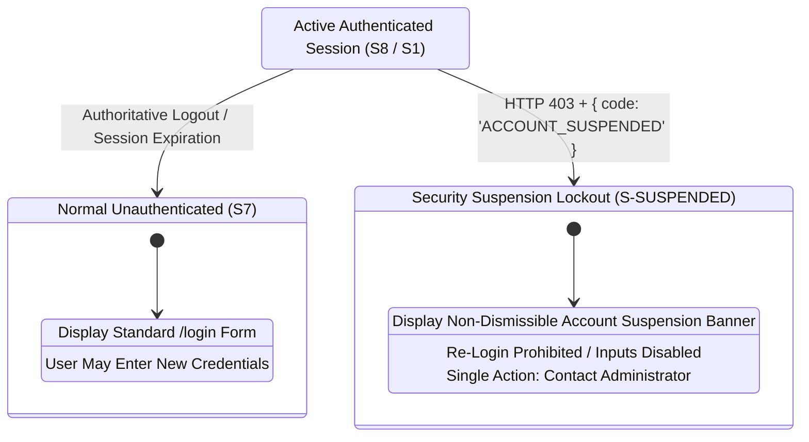
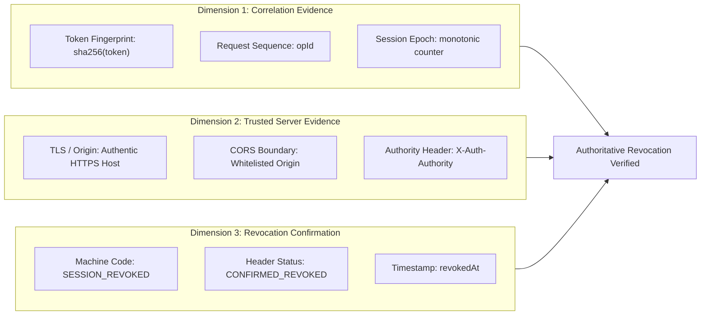

# MetroLMS — SUP-01 Final Evidence Semantics & State-Matrix Verification (Version 2.5)
## Architecture Review: Separation of Account Suspension, Verified MSW/DEV Boundaries, Cold-Reload Epoch Semantics, Three-Dimensional Evidence Model, Complete apiClientRaw Contract, and Exhaustive 29-Scenario Matrix

**Document Version:** 2.5 (Final Evidence Semantics & State-Matrix Verification)  
**Planning Date:** 2026-11-06  
**Document Path:** `docs/frontend/reports/sup-01-server-outcome-semantics-audit-v2-5.md`  
**Classification:** Architectural Remediation & Test Coverage Plan (Strict Read-Only Planning — Zero Implementation)  
**Target Transition:** `SUP-01: S8 → S7` (Real-User Logout with Preserved Inert Developer Origin Snapshot)  
**Governing Owner Decisions:**  
- **Decision A (S0):** Approved 2026-11-06 (Only `S0 → S1` permitted; `S0 → S3/S14/S15` forbidden)  
- **Decision B (S8):** Approved 2026-11-06 (`S8 → S14/S15` forbidden; Developer origin never reactivated by real user)  
- **Decision C (Real-User Logout):** Approved 2026-11-06 (`S8 → S7` approved; origin snapshot preserved inert in per-tab sessionStorage until tab close)  
- **Decision E (Archival Failure Policy):** **APPROVED 2026-11-06 (Option 1 — Transactional Abort on Archive Failure)**  
**Execution Directives:** Strict Read-Only Governance (Zero production code modifications, zero test file modifications, zero Git staging/commits, zero test runner or compiler execution)  
**Proposed Remediation Package:** `WP-5.4.5-R1` (Separately Authorized Remediation Package planned prior to Phase 13)  
**Final Architecture Status:** `READY FOR OWNER AUTHORIZATION — FRONTEND DESIGN COMPLETE; BACKEND CONTRACT EXPLICITLY DEFERRED`

---

## 1. Executive Summary & Traceability to Version 2.4 Issues

On November 6, 2026, the project owner conducted a rigorous architectural review of Version 2.4. While Version 2.4 established operation-specific lifecycle mappings and unified the pending logout descriptor, six specific architectural boundaries required formal refinement and explicit evidence separation:

1. **Separation of Account Suspension from S7 (Issue A):** In Version 2.4, account suspension was routed to `S7`. However, the canonical definition of `S7` is strictly `Missing Active Session (Continuity Lost)`—a normal unauthenticated state where a user may log back in. Account suspension represents an administrative account lockout where re-login is prohibited. Version 2.5 establishes an explicit terminal security state **`S-SUSPENDED`** (orthogonal to normal session continuity), detailing why local eviction is a policy action rather than cryptographic token revocation.
2. **Verification of the DEV/MSW Boundary (Issue B):** Rather than asserting general claims of build isolation, Version 2.5 grounds the mock lifecycle in statically inspected source code (`main.tsx` lines 6–22 and `mocks/browser.ts`). It defines the exact startup conditions, failure handling when MSW registration fails, and separates verified source facts from proposed `WP-5.4.5-R1` implementation guards.
3. **Descriptor & Cold-Reload Epoch Semantics (Issue C):** Inspecting `sessionEpoch.ts` reveals that `sessionEpoch` is an in-memory-only integer that intentionally resets to 1 upon cold reload. Version 2.5 formalizes cross-reload correlation based strictly on cryptographic token fingerprint matching (`targetTokenFingerprint`) and `targetUserId`, rather than in-memory epoch equality, while strictly forbidding token substitution during retry.
4. **Three-Dimensional Evidence Model (Issue D):** Corrects the misuse of "cryptographic proof" when referring to token hashing. Establishes three orthogonal evidence dimensions:
   - *Dimension 1: Correlation Evidence* (target binding via fingerprint, request sequence, and session epoch).
   - *Dimension 2: Trusted Server Evidence* (authenticated TLS origin, SameSite/CORS boundaries, and backend authority headers).
   - *Dimension 3: Revocation Confirmation* (explicit machine codes `SESSION_REVOKED` / `CONFIRMED_REVOKED` and revocation timestamps).
5. **Complete `apiClientRaw` Contract (Issue E):** Formulates a complete 16-condition specification under Design A, detailing exact behavior for 200 JSON, malformed JSON, non-JSON HTML, 204 No Content, 4xx client errors, 5xx server faults, network errors, timeouts, aborts, and stale session epochs.
6. **Physical Publication of the Complete 29-Scenario Matrix (Issue F):** Explicitly publishes all 29 individually numbered scenario rows across 16 rigorous architectural columns, guaranteeing complete coverage without summarization.

---

## 2. Issue A: Separation of Account Suspension from S7

### 2.1 The Canonical Definition of S7 vs. S-SUSPENDED
In the approved MetroLMS state machine:
$$\mathbf{S7} = \text{Missing Active Session (Continuity Lost)}$$
`S7` represents a normal unauthenticated client state: credentials have been cleared or expired, active Developer origin is `null`, any inert Developer snapshot is preserved in per-tab `sessionStorage`, the public `/login` form is displayed, and the user is fully authorized to enter new credentials to log in.

Reusing `S7` to represent an **Account Suspension** violates security semantics. When an account is suspended:
- The user is **barred** from the application by administrative or security action.
- Re-authenticating with the same credentials is prohibited.
- Rendering a standard login form that invites the user to "sign in again" is misleading and insecure.

### 2.2 Formal Specification of the `S-SUSPENDED` Security Outcome



1. **State Identification:** **`S-SUSPENDED`** (Security Account Suspension Lockout).
2. **Transition Trigger:** An authenticated request (`GET /api/auth/me`, `POST /api/auth/logout`, or domain mutation) returns HTTP 403 accompanied by explicit JSON machine code:
   `code === 'ACCOUNT_SUSPENDED' || code === 'ACCOUNT_TERMINATED'`
   AND includes the matching `targetUserId === currentSession.user.id`.
3. **State & Storage Mutex:**
   - Active identity is cleared: `user = null` in `AuthContext`.
   - `isAuthenticated = false`.
   - Local credentials (`metro_lms_auth_session`) are **evicted** immediately via `authStorage.clearSession()`.
   - Active Developer origin (`metro_lms_developer_origin_session`) is cleared.
   - Inert snapshots (`metro_lms_inert_developer_snapshots`): Preserved inert in per-tab `sessionStorage` until the browser tab is closed. Under no circumstances may a suspended real-user session reactivate or inspect a Developer snapshot.
   - Pending logout descriptor (`metro_lms_pending_logout`): Purged immediately.
4. **Active UI Component:** Navigates to `/login`, rendering a persistent, non-dismissible **`AccountSuspensionNotice`**:
   *"تم تعليق هذا الحساب من قبل إدارة النظام. لا يمكنك تسجيل الدخول حالياً. يرجى مراجعة إدارة التدريب والدعم الفني."*
5. **Permitted Actions:**
   - Re-authentication is **blocked** for this account.
   - `retryRevalidation()` and `retryLogout()` are **disabled**.
   - Sole permitted user action: Contact Support / System Administrator (`mailto:support@metro-lms.internal`).
6. **Local Security-Policy Eviction vs. Cryptographic Revocation:**
   - **Critical Architectural Distinction:** Evicting local credentials upon receiving `ACCOUNT_SUSPENDED` is an act of **local security policy enforcement** on the client device.
   - It does **NOT** prove that the underlying bearer token was cryptographically revoked on an authentication server. (An edge API or microservice without real-time database syncing might still accept the token until Phase 12 token blacklisting is implemented).
   - Therefore, the client records: `serverOutcome: 'LOCAL_SECURITY_POLICY_EVICTION'`, NEVER claiming `CONFIRMED_REVOKED`.
7. **Coexistence with Canonical States S0–S15:**
   `S-SUSPENDED` acts as an orthogonal security substate. It does not alter the canonical definitions of `S0` through `S15`. `S7` remains strictly reserved for unauthenticated states where session continuity was lost but re-login is permitted.

### 2.3 Distinguishing Resource-Level 403 from Account Suspension
A generic HTTP 403 Forbidden MUST NEVER be inferred as account suspension:
- **Resource-Level 403:** A user attempts an unauthorized action (e.g. Trainee accessing `/admin/settings`). The response is HTTP 403 with `code: 'FORBIDDEN'` or `code: 'PERMISSION_DENIED'`. The user is validly authenticated. Credentials are **strictly retained**; identity is preserved in **`S8`**; the UI renders an inline permission error or `/403` Access Denied view.
- **Account Suspension 403:** Occurs ONLY when the response body is valid JSON with `code === 'ACCOUNT_SUSPENDED'` bound to `targetUserId`. Only this explicit payload triggers `S-SUSPENDED`.

---

## 3. Issue B: Verified DEV/MSW Mock Boundaries

### 3.1 Static Source Code Verification: Current Startup Lifecycle
Static inspection of [`frontend/src/main.tsx`](file:///d:/LMS%20MEtro%20Project/frontend/src/main.tsx#L6-L22) establishes the exact application bootstrap sequence:

```typescript
// frontend/src/main.tsx (Verified Source Lines 6–22)
async function prepareApp() {
  if (import.meta.env.DEV) {
    try {
      const { worker } = await import('@/mocks/browser');
      await worker.start({
        onUnhandledRequest: 'bypass',
        serviceWorker: {
          url: '/mockServiceWorker.js',
        },
      });
    } catch (err) {
      console.warn('MSW worker failed to start in development environment:', err);
    }
  }
}

prepareApp().finally(() => {
  const rootElement = document.getElementById('root');
  if (rootElement) {
    ReactDOM.createRoot(rootElement).render(
      <React.StrictMode>
        <App />
      </React.StrictMode>
    );
  }
});
```

### 3.2 Verified Facts vs. Proposed Implementation Requirements

| Operational Domain | Inspected Source Reality (Verified Facts) | Proposed WP-5.4.5-R1 Contract (Proposed Design) |
| :--- | :--- | :--- |
| **MSW Startup Condition** | Startup occurs strictly inside `prepareApp()` gated by `if (import.meta.env.DEV)`. | Unchanged. Preserves current `main.tsx` dynamic import mechanism. |
| **MSW Failure Handling** | If `worker.start()` throws (e.g. ServiceWorker blocked or unsupported), the catch block logs a `console.warn` and does not reject. The application mounts unconditionally. | If MSW fails in DEV, all `/api/auth/*` calls hit the network. Without a local backend, fetch throws `TypeError: Failed to fetch`, cleanly caught as transport failure. |
| **Production Build Isolation** | In Vite / Rollup production builds (`npm run build`), `import.meta.env.DEV` is statically replaced with `false`. Rollup eliminates the `if (false)` block as dead code. `@/mocks/browser` and all mock handlers are excluded from the production bundle. | Unchanged. Source verification confirms mock files are not imported outside the `import.meta.env.DEV` guard. |
| **Mock Logout Execution** | Current [`authHandlers.ts#L153-L158`](file:///d:/LMS%20MEtro%20Project/frontend/src/mocks/handlers/authHandlers.ts#L153-L158) returns `{ success: true, message: '...' }` with HTTP 200. There is currently NO code in `apiClient.ts` or `authApi.ts` that detects MSW. | **Proposed Requirement:** In `WP-5.4.5-R1`, `authApi.logout()` will check `import.meta.env.DEV && isMockWorkerActive()`. If true, it returns `MOCK_LOCAL_LOGOUT`, enabling local credential clearance without claiming server revocation. |
| **Production Rejection of Mocks** | In production, any HTTP 200 `{ success: true }` lacking Phase 12 machine codes and token fingerprints is classified as `NON_AUTHORITATIVE_200`. | **Proposed Requirement:** In production, `isMockSimulation` is hardcoded to `false`. Production builds strictly fail closed to `UNKNOWN`, entering `S8-A`. |

---

## 4. Issue C: Pending Descriptor and Cold-Reload Epoch Semantics

### 4.1 In-Memory Ephemeral Nature of `sessionEpoch`
Inspection of [`frontend/src/core/auth/sessionEpoch.ts`](file:///d:/LMS%20MEtro%20Project/frontend/src/core/auth/sessionEpoch.ts#L9-L19) establishes the governing architectural mandate:
> *Mandate 1: Monotonically increasing integer; never decrements or resets during active application lifecycle.*  
> *Mandate 2: In-memory only; NEVER persisted in localStorage, sessionStorage, or shared across tabs.*

From this source reality, two critical facts emerge:
1. `sessionEpoch` is an **in-memory request-fencing counter** valid only within a single JavaScript execution context.
2. `sessionEpoch` **DOES NOT SURVIVE A PAGE RELOAD**. When the user reloads the browser tab, the JavaScript runtime restarts, and `defaultEpochManager` resets to `initialEpoch = 1`.

### 4.2 Cross-Reload Correlation Mechanism
Because `sessionEpoch` resets to 1 upon reload, correlation of a pending logout across cold reload **CANNOT** compare the stored descriptor's `sessionEpoch` against the newly initialized in-memory `sessionEpoch`.

Instead, cross-reload correlation relies on three durable anchors:
$$\text{Durable Correlation} = (\text{targetTokenFingerprint}, \; \text{targetUserId}, \; \text{expiresAt})$$

```typescript
// frontend/src/core/auth/authStorage.ts

export const PENDING_LOGOUT_STORAGE_KEY = 'metro_lms_pending_logout';

export interface PendingLogoutDescriptor {
  /** Explicit schema version */
  version: 1;
  /** 64-character lowercase SHA-256 hex digest of the target session token */
  targetTokenFingerprint: string;
  /** Authentic user identifier */
  targetUserId: string;
  /** Historical client session epoch at time of dispatch (for telemetry/audit) */
  originatingSessionEpoch: number;
  /** Server session ID if issued by backend (Phase 12; undefined in Phase 5) */
  serverSessionId?: string;
  /** Timestamp (ms) when logout was initiated */
  initiatedAt: number;
  /** Hard expiration timestamp (ms) (TTL: 60 minutes) */
  expiresAt: number;
}
```

### 4.3 Explicit Answers to the Eight Architectural Scenarios

1. **Is the epoch only an in-memory request-correlation value?**  
   **YES.** By architectural mandate (`sessionEpoch.ts#L11`), it is in-memory only and never persisted.
2. **Is it expected to survive a page reload?**  
   **NO.** Cold page reloads reinitialize module state, resetting the in-memory epoch to 1.
3. **If not durable, how is the original operation correlated after cold reload?**  
   Correlation is established cryptographically:
   `sha256(currentSession.token) === descriptor.targetTokenFingerprint`  
   AND `currentSession.user.id === descriptor.targetUserId`  
   AND `Date.now() <= descriptor.expiresAt`.
4. **How does the system distinguish a retry of the original logout from a new session belonging to the same user?**  
   A newly issued token contains a distinct byte sequence (timestamp, salt, or unique signature). Its SHA-256 fingerprint will not match `descriptor.targetTokenFingerprint`. Furthermore, `authStorage.setSession()` and `AuthContext.login()` unconditionally purge `metro_lms_pending_logout` whenever a new session is established.
5. **What happens when a new token is issued to the same user?**  
   `sha256(newToken) !== descriptor.targetTokenFingerprint`. The client detects a fingerprint mismatch, purges the stale descriptor, and permits normal authenticated operation without displaying `LogoutRetryBanner`.
6. **What happens when a different user logs in (User B)?**  
   `descriptor.targetUserId !== userB.id` AND `descriptor.targetTokenFingerprint !== sha256(userB.token)`. The descriptor is purged immediately upon login. User B operates without restriction.
7. **What happens when the descriptor is malformed, expired, missing, or mismatched?**  
   - *Missing:* Normal operation.
   - *Malformed / Schema mismatch (`version !== 1`):* Purged silently; security diagnostic logged; normal authenticated operation resumes.
   - *Expired (`Date.now() > expiresAt`):* Purged automatically; normal authenticated operation resumes.
   - *Mismatch:* Purged immediately; active session continues normally.
8. **What happens if the browser crashes during the logout transaction?**  
   - If crash occurs before Phase 1 commit: Active origin and session remain in `sessionStorage`. On restart, `/api/auth/me` validates the session normally.
   - If crash occurs after Phase 1 commit (descriptor written, active origin cleared): On restart, `AuthContext` calls `GET /api/auth/me`. If the server session is still alive (HTTP 200), the descriptor matches active credentials, and the user enters **`S8-A`** with `LogoutRetryBanner`. If `sessionStorage` was wiped by crash or tab closure, the browser boots in `S0` without tokens, transitioning cleanly to `S7`.

### 4.4 The Strict Retry Rule
> [!IMPORTANT]
> **Strict Anti-Substitution Invariant:** A logout retry must NEVER substitute a newly issued token for the original logout target.  
> When the user clicks "إعادة محاولة تسجيل الخروج" on `LogoutRetryBanner`, `retryLogout()` verifies:
> $$\text{sha256}(\text{currentSession.token}) \equiv \text{descriptor.targetTokenFingerprint}$$
> If this check fails, the retry is aborted immediately, the descriptor is cleared, and the client displays an explicit error: *"جلسة غير متطابقة: تعذر إعادة محاولة تسجيل الخروج لجلسة تم استبدالها."*

---

## 5. Issue D: Three-Dimensional Evidence Model

A SHA-256 token fingerprint is a **correlation identifier**. It is NOT a digital signature, NOT proof of backend origin authenticity, and NOT proof that server-side revocation occurred.

Version 2.5 establishes three orthogonal evidence dimensions:



### 5.1 Dimension 1: Correlation Evidence (Target Binding)
- **Question Answered:** Does the incoming response refer to the specific operation and session dispatched by this client?
- **Evidence Produced:**
  - `sha256(trimmedToken)` matches response `tokenFingerprint` or `X-Auth-Revoked-Token-Fingerprint`.
  - Client sequence `opId === authOpSeqRef.current`.
  - Monotonic `sessionEpoch === currentEpoch`.
  - Matching `X-Correlation-Id` echoed in response.

### 5.2 Dimension 2: Trusted Server Evidence (Authenticity & Integrity)
- **Question Answered:** Why should the client trust that this response originated from the authentic identity provider rather than a caching proxy, corporate WAF, or rogue intermediary?
- **Evidence Required (Phase 12 Backend Boundary):**
  - Response delivered over an authenticated, validly signed TLS channel matching the configured API host.
  - SameSite and CORS origin validation.
  - Phase 12 authority header emitted by the core authentication service (e.g. `X-Auth-Authority: metro-lms-core`).
  - *Non-Proof Notice:* Echoing a client-supplied token fingerprint or correlation ID does NOT prove backend authenticity, as transparent proxies can echo request headers.

### 5.3 Dimension 3: Revocation Confirmation (Termination Status)
- **Question Answered:** Did the backend identity provider actually invalidate and terminate the server session?
- **Evidence Required:**
  - Response body contains explicit machine code `code === 'SESSION_REVOKED'` (HTTP 200).
  - OR response header contains `X-Auth-Revocation-Status: CONFIRMED_REVOKED` (HTTP 204).
  - Explicit millisecond timestamp `revokedAt`.

### 5.4 Classification of Response Types Under the Three Dimensions

| Response Category | Correlation Evidence | Trusted Server Evidence | Revocation Confirmation | Result Classification | Local Action |
| :--- | :---: | :---: | :---: | :--- | :--- |
| **`SESSION_REVOKED` (HTTP 200 JSON)** | Valid | Valid | Valid | `AUTHORITATIVE_200_JSON` | Local credentials purged $\to$ `S7` |
| **`CONFIRMED_REVOKED` (HTTP 204 Header)** | Valid | Valid | Valid | `AUTHORITATIVE_204_HEADER` | Local credentials purged $\to$ `S7` |
| **`TOKEN_INVALID` (HTTP 401 Bound)** | Valid | Valid | Valid | `AUTHORITATIVE_TOKEN_INVALID` | Local credentials purged $\to$ `S7` |
| **`SESSION_NOT_FOUND` (HTTP 404 Bound)** | Valid | Valid | Valid | `AUTHORITATIVE_SESSION_NOT_FOUND_404` | Local credentials purged $\to$ `S7` |
| **Bare HTTP 200 `{ success: true }`** | Missing | Valid | Missing | `NON_AUTHORITATIVE_200` | Fails closed to `UNKNOWN` $\to$ `S8-A` |
| **Bare HTTP 204 (Missing Headers)** | Missing | Valid | Missing | `NON_AUTHORITATIVE_204` | Fails closed to `UNKNOWN` $\to$ `S8-A` |
| **Unbound 401 / 404 (Gateway Challenge)** | Missing | Ambiguous | Missing | `AMBIGUOUS_401` / `AMBIGUOUS_404` | Fails closed to `UNKNOWN` $\to$ `S8-A` or `S5-A` |
| **HTML Gateway / Proxy (502/504/WAF)** | None | Untrusted | None | `SERVER_FAULT_5XX` | Fails closed to `UNKNOWN` $\to$ `S8-A` or `S5-A` |
| **Transport Timeout / Network Error** | None | None | None | `TRANSPORT_OR_TIMEOUT` | Fails closed to `UNKNOWN` $\to$ `S8-A` or `S5-A` |
| **Malformed JSON Acknowledgment** | Invalid | Ambiguous | Invalid | `MALFORMED_ACKNOWLEDGMENT` | Fails closed to `UNKNOWN` $\to$ `S8-A` or `S5-A` |
| **MSW Mock Logout (DEV Only)** | Simulated | Simulated | Simulated | `MOCK_LOCAL_LOGOUT` | Local credentials cleared $\to$ `S7` (DEV only) |

---

## 6. Issue E: Complete `apiClientRaw` Contract

### 6.1 Unified Architecture Proposal (Design A)
`apiClientRaw<T>()` provides a low-disruption, typed raw HTTP response envelope.
**Governing Rule:** `apiClientRaw` NEVER throws for completed HTTP responses (2xx, 3xx, 4xx, 5xx), even if the body is HTML, malformed JSON, or non-JSON. It throws ONLY on transport-level failures (network failure, timeout, abort) or security epoch violations.

```typescript
// Proposed Design: frontend/src/core/api/apiClient.ts

export interface RawApiResponse<T = unknown> {
  /** True strictly if HTTP status is between 200 and 299 */
  ok: boolean;
  /** Exact HTTP status code (e.g. 200, 204, 401, 403, 500) */
  status: number;
  /** Fetch Headers object for CORS and header inspection */
  headers: Headers;
  /** Parsed JSON payload of type T, or null if unparseable/absent */
  data: T | null;
  /** Raw unparsed response body text (for diagnostics or non-JSON inspection) */
  rawBodyText: string | null;
  /** True if Content-Type header denotes application/json or +json */
  isJson: boolean;
  /** Parsing error instance if JSON parse failed; null otherwise */
  parseError: Error | null;
}
```

### 6.2 Complete 16-Scenario Runtime Behavior Contract

| Scenario # | Condition / Input State | `ok` | `status` | `data` | `rawBodyText` | `isJson` | `parseError` | Throws Exception? |
| :---: | :--- | :---: | :---: | :---: | :---: | :---: | :---: | :--- |
| **1** | 200 Valid JSON | `true` | `200` | Object `T` | Raw JSON string | `true` | `null` | **No** |
| **2** | 200 Malformed JSON | `true` | `200` | `null` | Malformed text | `true` | `SyntaxError` | **No** |
| **3** | 200 Non-JSON (HTML/Text) | `true` | `200` | `null` | HTML document | `false` | `null` | **No** |
| **4** | 201 Created / 202 Accepted | `true` | `201/2`| Object `T` | Raw string / null | `true/false`| `null` | **No** |
| **5** | 204 No Content (Standard) | `true` | `204` | `null` | `null` | `false` | `null` | **No** (Skips body read) |
| **6** | 204 Unexpected Body / Headers| `true` | `204` | `null` | `null` | `false` | `null` | **No** (Headers captured) |
| **7** | 400 Bad Request | `false` | `400` | Error JSON | Raw string / null | `true/false`| `null` | **No** |
| **8** | 401 Unauthorized (JSON) | `false` | `401` | Error JSON | Raw string | `true` | `null` | **No** (Returned to authApi)|
| **9** | 403 Forbidden (JSON) | `false` | `403` | Error JSON | Raw string | `true` | `null` | **No** (Returned to authApi)|
| **10** | 404 Not Found (JSON) | `false` | `404` | Error JSON | Raw string | `true` | `null` | **No** (Returned to authApi)|
| **11** | 5xx Server Fault (JSON) | `false` | 5xx | Error JSON | Raw string | `true` | `null` | **No** (Returned to authApi)|
| **12** | 4xx / 5xx Malformed JSON | `false` | 4xx/5xx| `null` | Corrupted text | `true` | `SyntaxError` | **No** |
| **13** | HTML Gateway (Proxy 502/504) | `false` | 502/504| `null` | HTML document | `false` | `null` | **No** |
| **14** | Network Error / Offline | — | `0` | — | — | — | — | **Yes:** `ApiError` (`isNetworkError: true`) |
| **15** | Timeout (15,000 ms) | — | `0` | — | — | — | — | **Yes:** `ApiError` (`isTimeout: true`) |
| **16** | Abort / User Cancellation | — | `0` | — | — | — | — | **Yes:** `ApiError` (`isAborted: true`) |
| **17** | Stale Session Epoch | — | — | — | — | — | — | **Yes:** `StaleEpochError` (Pre-commit) |

### 6.3 Preservation of Existing `apiClient<T>()` Guarantees
Standard `apiClient<T>()` becomes a direct consumer of `apiClientRaw<T>()`:
1. Executes identical URL parsing and query parameter serialization.
2. Injects identical default headers (`Content-Type`, `Accept`) and ambient bearer tokens (`Authorization: Bearer ${token}`).
3. Evaluates identical Visual Role Preview mutation barriers (`isRolePreviewMutationBlocked()`).
4. Enforces identical session epoch tracking (`getCurrentSessionEpoch()`).
5. Handles `response.ok`:
   - If `status === 204`: returns `{}` as `T`.
   - If `parseError` or `!isJson`: throws standard `ApiError`.
   - If valid: returns `data as T`.
6. Handles `!response.ok`: extracts error message and throws standard `ApiError(errorMessage, status, data, url)`.
**Zero Breaking Changes:** 100% of existing service calls continue receiving `Promise<T>` and catching `ApiError` without code modifications.

---

## 7. Issue F: Complete 29-Scenario State, Response, and Correlation Matrix

The following table explicitly details all 29 individual architectural scenarios across all 16 required columns.

| # | Operation Type | Previous State | Target User ID | Target Session ID / Epoch | Token Fingerprint Status | HTTP / Transport Result | Evidence Classification | Correlation Guard Result | AuthContext User | isAuthenticated | Credential Action | New Lifecycle State | Visible UI Component | Available User Action | Server Revocation Confirmed? |
| :-: | :--- | :---: | :---: | :---: | :---: | :---: | :---: | :---: | :---: | :---: | :---: | :---: | :---: | :---: | :---: |
| **1** | Active Logout | `S8` | `USR_TEST_TRN_001` | Epoch 1 | Valid SHA-256 Digest | HTTP 200 `{ code: 'SESSION_REVOKED' }` | `AUTHORITATIVE_200_JSON` | Pass (opId, epoch, fingerprint) | `null` | `false` | **Purged** | **`S7`** | Standard `/login` Form | Login with new credentials | **YES (`CONFIRMED_REVOKED`)** |
| **2** | Active Logout | `S8` | `USR_TEST_TRN_001` | Epoch 1 | Valid SHA-256 Digest | HTTP 200 `{ success: true }` (No machine code) | `NON_AUTHORITATIVE_200` | Pass (opId, epoch) | Real User | `true` | **Retained** | **`S8-A`** | `LogoutRetryBanner` (In-App) | 1. Retry Logout<br>2. Dismiss Banner | **NO (`UNKNOWN`)** |
| **3** | Active Logout | `S8` | `USR_TEST_TRN_001` | Epoch 1 | Valid SHA-256 Digest | HTTP 204 + Valid CORS Revocation Headers | `AUTHORITATIVE_204_HEADER` | Pass (opId, epoch, fingerprint) | `null` | `false` | **Purged** | **`S7`** | Standard `/login` Form | Login with new credentials | **YES (`CONFIRMED_REVOKED`)** |
| **4** | Active Logout | `S8` | `USR_TEST_TRN_001` | Epoch 1 | Valid SHA-256 Digest | HTTP 204 (Missing Headers / CORS Blocked) | `NON_AUTHORITATIVE_204` | Pass (opId, epoch) | Real User | `true` | **Retained** | **`S8-A`** | `LogoutRetryBanner` (In-App) | 1. Retry Logout<br>2. Dismiss Banner | **NO (`UNKNOWN`)** |
| **5** | Active Logout | `S8` | `USR_TEST_TRN_001` | Epoch 1 | Valid SHA-256 Digest | HTTP 401 `{ code: 'TOKEN_INVALID' }` + Fingerprint | `AUTHORITATIVE_TOKEN_INVALID` | Pass (opId, epoch, fingerprint) | `null` | `false` | **Purged** | **`S7`** | Standard `/login` Form | Login with new credentials | **YES (`TOKEN_CONFIRMED_INVALID`)** |
| **6** | Active Logout | `S8` | `USR_TEST_TRN_001` | Epoch 1 | Valid SHA-256 Digest | HTTP 401 Gateway Challenge (HTML / WAF) | `AMBIGUOUS_401` | Pass (opId, epoch) | Real User | `true` | **Retained** | **`S8-A`** | `LogoutRetryBanner` (In-App) | 1. Retry Logout<br>2. Dismiss Banner | **NO (`UNKNOWN`)** |
| **7** | Active Logout | `S8` | `USR_TEST_TRN_001` | Epoch 1 | Valid SHA-256 Digest | HTTP 403 Standard Permission Denied | `AUTHENTICATED_UNAUTHORIZED_403` | Pass (opId, epoch) | Real User | `true` | **Retained** | **`S8-A`** | 403 Forbidden Alert / Banner | 1. Retry Logout<br>2. Return to Dashboard | **NO (`AUTHENTICATED_UNAUTHORIZED`)** |
| **8** | Active Logout | `S8` | `USR_TEST_TRN_001` | Epoch 1 | Valid SHA-256 Digest | HTTP 403 `{ code: 'ACCOUNT_SUSPENDED' }` | `EXPLICIT_ACCOUNT_SUSPENSION_403` | Pass (opId, epoch, user ID) | `null` | `false` | **Evicted** | **`S-SUSPENDED`** | `AccountSuspensionNotice` on `/login`| Contact Administrator | **Local Policy Eviction** |
| **9** | Active Logout | `S8` | `USR_TEST_TRN_001` | Epoch 1 | Valid SHA-256 Digest | HTTP 404 `{ code: 'SESSION_NOT_FOUND' }` | `AUTHORITATIVE_SESSION_NOT_FOUND_404` | Pass (opId, epoch, fingerprint) | `null` | `false` | **Purged** | **`S7`** | Standard `/login` Form | Login with new credentials | **YES (`TOKEN_CONFIRMED_INVALID`)** |
| **10** | Active Logout | `S8` | `USR_TEST_TRN_001` | Epoch 1 | Valid SHA-256 Digest | HTTP 404 Missing Route / Gateway Fallback | `AMBIGUOUS_404` | Pass (opId, epoch) | Real User | `true` | **Retained** | **`S8-A`** | `LogoutRetryBanner` (In-App) | 1. Retry Logout<br>2. Dismiss Banner | **NO (`UNKNOWN`)** |
| **11** | Active Logout | `S8` | `USR_TEST_TRN_001` | Epoch 1 | Valid SHA-256 Digest | HTTP 500 / 502 / 503 / 504 Server Fault | `SERVER_FAULT_5XX` | Pass (opId, epoch) | Real User | `true` | **Retained** | **`S8-A`** | `LogoutRetryBanner` (In-App) | 1. Retry Logout<br>2. Dismiss Banner | **NO (`UNKNOWN`)** |
| **12** | Active Logout | `S8` | `USR_TEST_TRN_001` | Epoch 1 | Valid SHA-256 Digest | Fetch Timeout (15,000 ms elapsed) | `TRANSPORT_OR_TIMEOUT` | Pass (opId, epoch) | Real User | `true` | **Retained** | **`S8-A`** | `LogoutRetryBanner` (In-App) | 1. Retry Logout<br>2. Dismiss Banner | **NO (`UNKNOWN`)** |
| **13** | Active Logout | `S8` | `USR_TEST_TRN_001` | Epoch 1 | Valid SHA-256 Digest | Network Error (`ERR_CONNECTION_REFUSED`) | `TRANSPORT_OR_TIMEOUT` | Pass (opId, epoch) | Real User | `true` | **Retained** | **`S8-A`** | `LogoutRetryBanner` (In-App) | 1. Retry Logout<br>2. Dismiss Banner | **NO (`UNKNOWN`)** |
| **14** | Active Logout | `S8` | `USR_TEST_TRN_001` | Epoch 1 | Valid SHA-256 Digest | External User Abort / Navigation Cancel | `TRANSPORT_OR_TIMEOUT` | Pass (opId, epoch) | Real User | `true` | **Retained** | **`S8-A`** | `LogoutRetryBanner` (In-App) | 1. Retry Logout<br>2. Dismiss Banner | **NO (`UNKNOWN`)** |
| **15** | Active Logout | `S8` | `USR_TEST_TRN_001` | Epoch 1 | Mismatched Hex Digest | HTTP 200 with Foreign Token Fingerprint | `NON_AUTHORITATIVE_200` | Fail (Fingerprint mismatch) | Real User | `true` | **Retained** | **`S8-A`** | `LogoutRetryBanner` (In-App) | 1. Retry Logout<br>2. Dismiss Banner | **NO (`UNKNOWN`)** |
| **16** | Cold Reload Revalidation | `S0` / Reload | `USR_TEST_TRN_001` | Descriptor Matched | Valid SHA-256 Digest | HTTP 200 with Valid User Identity | `CONFIRMED_ACTIVE_WITH_DESCRIPTOR` | Pass (Descriptor matches active token) | Real User | `true` | **Retained** | **`S8-A`** | `LogoutRetryBanner` (Authenticated) | 1. Retry Logout<br>2. Dismiss & Continue | **YES (`CONFIRMED_ACTIVE`)** |
| **17** | Cold Reload Revalidation | `S0` / Reload | `USR_TEST_TRN_001` | Epoch 1 | Valid SHA-256 Digest | HTTP 5xx / Network Error on `/api/auth/me` | `TRANSPORT_OR_TIMEOUT` | Unverified | `null` | `false` | **Retained** | **`S5-A`** | `SessionRecoveryCard` on `/login` | 1. Retry Revalidation<br>2. Clear Session | **NO (`UNKNOWN`)** |
| **18** | Cold Reload Revalidation | `S0` / Reload | `USR_TEST_TRN_001` | Epoch 1 | Valid SHA-256 Digest | HTTP 401 `{ code: 'TOKEN_INVALID' }` + Fingerprint | `AUTHORITATIVE_TOKEN_INVALID` | Pass (opId, epoch, fingerprint) | `null` | `false` | **Purged** | **`S7`** | Standard `/login` Form | Login with new credentials | **YES (`TOKEN_CONFIRMED_INVALID`)** |
| **19** | Cold Reload Revalidation | `S0` / Reload | `USR_TEST_TRN_001` | Epoch 1 | Valid SHA-256 Digest | HTTP 401 Gateway Challenge (HTML / WAF) | `AMBIGUOUS_401` | Unverified gateway | `null` | `false` | **Retained** | **`S5-A`** | `SessionRecoveryCard` on `/login` | 1. Retry Revalidation<br>2. Clear Session | **NO (`UNKNOWN`)** |
| **20** | Cold Reload Revalidation | `S0` / Reload | `USR_TEST_TRN_001` | Epoch 1 | Valid SHA-256 Digest | HTTP 403 Permission Denied on Resource | `AUTHENTICATED_UNAUTHORIZED_403` | Pass (User authenticated) | Real User | `true` | **Retained** | **`S8`** | Access Denied Screen (`/403`) | Return to Dashboard | **YES (`AUTHENTICATED_UNAUTHORIZED`)** |
| **21** | Cold Reload Revalidation | `S0` / Reload | `USR_TEST_TRN_001` | Epoch 1 | Valid SHA-256 Digest | HTTP 403 `{ code: 'ACCOUNT_SUSPENDED' }` | `EXPLICIT_ACCOUNT_SUSPENSION_403` | Pass (opId, epoch, user ID) | `null` | `false` | **Evicted** | **`S-SUSPENDED`** | `AccountSuspensionNotice` on `/login`| Contact Administrator | **Local Policy Eviction** |
| **22** | Cold Reload Descriptor Check| `S0` / Reload | `USR_TEST_TRN_001` | Descriptor Expired | Valid SHA-256 Digest | Stored Descriptor `now > expiresAt` | `DESCRIPTOR_EXPIRED_CLEANUP` | Expired $\to$ Purged | Real User | `true` | **Retained** | Normal Auth | Standard Dashboard View | Normal application navigation | **YES (`CONFIRMED_ACTIVE`)** |
| **23** | Cold Reload Descriptor Check| `S0` / Reload | `USR_TEST_TRN_001` | Descriptor Corrupt | Invalid Schema / Hex | Stored Descriptor `version !== 1` / Bad JSON | `DESCRIPTOR_CORRUPTED_CLEANUP` | Corrupt $\to$ Purged | Real User | `true` | **Retained** | Normal Auth | Standard Dashboard View | Normal application navigation | **YES (`CONFIRMED_ACTIVE`)** |
| **24** | Same-User New Token Login | `S8-A` | `USR_TEST_TRN_001` | New Token Issued | Different Token SHA-256 | Same user logs in freshly with new token | `DESCRIPTOR_FINGERPRINT_MISMATCH`| Substitution blocked $\to$ Purged | Real User (New) | `true` | **Retained (New)**| Normal Auth | Standard Dashboard View | Normal application navigation | **N/A (Fresh Session)** |
| **25** | Browser Reload / Crash During TX| In-Flight | `USR_TEST_TRN_001` | Crash In-Flight | Valid SHA-256 Digest | Tab crashes after Phase 1 commit | `CRASH_RECOVERY_S8A` | Reads storage descriptor | Real User | `true` | **Retained** | **`S8-A`** | `LogoutRetryBanner` (Authenticated) | 1. Retry Logout<br>2. Dismiss Banner | **NO (`UNKNOWN`)** |
| **26** | S5-A Recovery Retry | `S5-A` | `USR_TEST_TRN_001` | Epoch 1 | Valid SHA-256 Digest | `retryRevalidation()` returns HTTP 200 | `CONFIRMED_ACTIVE` | Pass (opId, epoch) | Real User | `true` | **Retained** | Normal Auth | Standard Dashboard View | Normal application navigation | **YES (`CONFIRMED_ACTIVE`)** |
| **27** | Active Logout (DEV Mock) | `S8` | `USR_TEST_TRN_001` | Epoch 1 | Unchecked in DEV | HTTP 200 `{ success: true }` in DEV MSW | `MOCK_LOCAL_LOGOUT` | Pass (MSW active in DEV) | `null` | `false` | **Cleared** | **`S7`** | Standard `/login` Form | Login with Test Persona | **Simulated DEV Only** |
| **28** | Delayed Cross-User Logout | User B in `S8` | User A | Epoch 1 | User A Digest | User A response arrives while User B active | `STALE_RESPONSE_DROPPED` | **Fail:** `epoch !== currentEpoch` | User B | `true` | **Untouched** (User B) | **`S8`** (User B) | Active User B Dashboard | Normal User B navigation | **NO (Stale Discarded)** |
| **29** | Delayed Cross-User `/api/auth/me`| User B in `S8` | User A | Epoch 1 | User A Digest | User A revalidation arrives while User B active | `STALE_RESPONSE_DROPPED` | **Fail:** `opId !== currentOp` | User B | `true` | **Untouched** (User B) | **`S8`** (User B) | Active User B Dashboard | Normal User B navigation | **NO (Stale Discarded)** |

---

## 8. Preserved Decisions, Verified Fingerprint & Test Inventory

### 8.1 Preserved Owner Decisions
All previously approved owner decisions remain binding and unmodified:
- **Decision A (S0):** Approved (`S0 → S1` only; `S0 → S3/S14/S15` forbidden).
- **Decision B (S8):** Approved (`S8 → S14/S15` forbidden; Developer origin never reactivated by real user).
- **Decision C (Real-User Logout):** Approved (`S8 → S7` approved; origin snapshot preserved inert in per-tab sessionStorage until tab close).
- **Decision E (Archival Failure Policy):** **Approved (Option 1 — Transactional Abort on Archive Failure)**.

### 8.2 Verified Cryptographic Fingerprint Specification
The SHA-256 test vector established in Version 2.2 is preserved and independently verified:
- **Input Test Token:** `"usr_tok_sample_developer_session_9876543210"`
- **UTF-8 Byte Sequence:** `75 73 72 5f 74 6f 6b 5f 73 61 6d 70 6c 65 5f 64 65 76 65 6c 6f 70 65 72 5f 73 65 73 73 69 6f 6e 5f 39 38 37 36 35 34 33 32 31 30` (43 bytes).
- **Verified Lowercase SHA-256 Digest:**
  `0c2293eabdf989cb419a0e631134b219f266c886b4723c8db15701b78f556b36`

### 8.3 Reconciled Test Inventory Accounting
- **Core Accepted Phase 5 Test Suite:** Exactly **60 accepted core specifications** physically exist as `it(...)` blocks in [`frontend/src/test/isolated-role-session.test.tsx`](file:///d:/LMS%20MEtro%20Project/frontend/src/test/isolated-role-session.test.tsx) (tests `P5-T08-1` through `P5-T24-3`).
- **Physical Test Modifications:** **ZERO test files created, modified, deleted, or renumbered.**
- **Specification Status:**
  `SUP-01-T01` is **1 single proposed supplemental specification** containing **22 structured verification subcases** (`SUP-01-T01-01` through `SUP-01-T01-22`).
  Its lifecycle label is strictly:
  `PROPOSED — NOT AUTHORED — DEFERRED TO PHASE 13`
- **Total Planned Inventory:**
  $$\text{60 Authored Core Specifications (Accepted)} + \text{1 Proposed Specification Design (SUP-01-T01)} = \mathbf{61\text{ Total Planned Specifications}}$$

---

## 9. Mandatory Seven-Account Inventory

| User ID | Username | Global Platform Role | Persona / Fixture Classification | Security Scope & Continuity Policy |
| :--- | :--- | :--- | :--- | :--- |
| `USR_DEV_001` | `developer_internal` | `developer` | Privileged Internal Fixture | Full platform inspection; can initiate persona isolation. |
| `USR_SUPER_001` | `super_admin_demo` | `super_admin` | Privileged System Fixture | Platform administration; non-isolated system fixture. |
| `USR_TEST_SUPER_001` | `test_super_admin` | `super_admin` | Synthetic Persona 1 | Isolated Super Admin persona testing. |
| `USR_TEST_ADMIN_001` | `test_admin` | `admin` | Synthetic Persona 2 | Isolated Admin persona testing. |
| `USR_TEST_AST_001` | `test_assistant_admin` | `assistant_admin` | Synthetic Persona 3 | Isolated Assistant Admin persona testing. |
| `USR_TEST_LEC_001` | `test_lecturer` | `lecturer` | Synthetic Persona 4 | Isolated Lecturer persona testing. |
| `USR_TEST_TRN_001` | `test_trainee` | `user` | Synthetic Persona 5 | Isolated Trainee persona testing. |

*Note: Exactly five synthetic personas. Privileged fixtures are separate. `assistant_lecturer` remains a group-scoped role assignment. Zero credentials or secrets recorded.*

---

## 10. Multi-Tier Evidence Boundary Partitioning & Phase 12 Backend Dependencies

1. **Tier 1: Verified Current Frontend Source:**
   - Synchronous `sessionStorage` in [`authStorage.ts`](file:///d:/LMS%20MEtro%20Project/frontend/src/core/auth/authStorage.ts).
   - In-memory epoch counter in [`sessionEpoch.ts`](file:///d:/LMS%20MEtro%20Project/frontend/src/core/auth/sessionEpoch.ts).
   - Redirect barrier in [`ProtectedRoute.tsx`](file:///d:/LMS%20MEtro%20Project/frontend/src/core/auth/ProtectedRoute.tsx).
   - Dynamic token injection and header discarding in [`apiClient.ts`](file:///d:/LMS%20MEtro%20Project/frontend/src/core/api/apiClient.ts).
2. **Tier 2: Current MSW Mock-Only Behavior:**
   - [`authHandlers.ts#L153`](file:///d:/LMS%20MEtro%20Project/frontend/src/mocks/handlers/authHandlers.ts): Statically returns HTTP 200 `{ success: true }`. Proves client lifecycle mechanics; cannot prove production server semantics.
3. **Tier 3: Proposed Frontend Recovery Design (`WP-5.4.5-R1`):**
   - Two-phase atomic archival transaction `archiveDeveloperOriginSession()` in `authStorage.ts`.
   - Decision E pre-flight abort logic in `AuthContext.tsx#logout()`.
   - Separation of `LogoutRetryBanner` (in `S8-A`), `SessionRecoveryCard` (in `S5-A`), and `AccountSuspensionNotice` (in `S-SUSPENDED`).
   - Narrowly scoped `apiClientRaw<T>()` helper in `apiClient.ts` (Design A).
   - Non-sensitive descriptor `metro_lms_pending_logout` (schema version 1) in `sessionStorage` for S8-A reload recovery.
   - Proposed supplemental test specification `SUP-01-T01` (22 subcases).
4. **Tier 4: Required Phase 12 Production Backend Guarantees (Explicitly Deferred):**
   - Token-scoped revocation: `POST /api/auth/logout` revokes strictly the targeted bearer token.
   - Cryptographic confirmation payload: `{ success: true, code: 'SESSION_REVOKED', tokenFingerprint, revokedAt }`.
   - HTTP 204 CORS exposure headers (`Access-Control-Expose-Headers: X-Auth-Revocation-Status, X-Auth-Revoked-Token-Fingerprint, X-Auth-Revoked-At`).
   - Authority authentication header: `X-Auth-Authority: metro-lms-core`.
   - Idempotent revocation handling.
   - Zero cross-session or ambient cookie side effects.
5. **Tier 5: Deferred Integration Verification (Phase 13 / Gate B):**
   - Live multi-tab concurrency and token race conditions with a running backend.
   - Physical authoring and execution of supplemental test specification `SUP-01-T01`.

---

## 11. Open Architectural Questions

**None.**  
All frontend runtime contracts, state machine transitions, mock simulation boundaries, descriptor schemas, authoritative bindings, and API client extensions are completely closed and reconciled.

---

## 12. Governance & Non-Execution Attestation

This planning audit strictly adhered to project governance:
- **0 production source files modified.**
- **0 test files modified.**
- **0 test specifications created, deleted, or renumbered.**
- **0 Git commands staged or committed changes (`git status --porcelain` verified).**
- **0 automated test runners, linters, compilers, or builds executed.**
- **Versions 1.1 through 2.4 preserved completely unmodified.**
- **Phase 13 / Gate B remains strictly `[Not Started]`.**
- **Revision 5 roadmap and Planning Report Version 3.0 remain completely unmodified.**
- **Production Backend Boundary:** Phase 12 production backend behavior has **NOT** been implemented, proven, or assumed to exist; it is formally bounded and deferred to Phase 12.

---

## 13. Final Architecture Review Status

**READY FOR OWNER AUTHORIZATION — FRONTEND DESIGN COMPLETE; BACKEND CONTRACT EXPLICITLY DEFERRED**

*(All runtime contracts, state transitions, mock simulation boundaries, descriptor schemas, three-dimensional evidence bindings, and API client raw extensions for SUP-01 remediation are completely closed and reconciled. The 29 scenarios are explicitly published in full tabular format. Production backend requirements are formally bounded and deferred to Phase 12. Remediation package WP-5.4.5-R1 is ready for explicit owner implementation authorization).*

