# MetroLMS — SUP-01 Evidence Classification, Snapshot Preservation & Full Matrix Publication (Version 2.6)
## Architecture Review: Corrected Three-Dimensional Evidence Model, Developer Origin Preservation in S-SUSPENDED, Pending Descriptor Recovery Semantics, Full 17-Scenario apiClientRaw Contract, and Exhaustive 29-Scenario State Matrix

**Document Version:** 2.6 (Evidence Classification, Snapshot Preservation & Full Matrix Publication)  
**Planning Date:** 2026-11-06  
**Document Path:** `docs/frontend/reports/sup-01-server-outcome-semantics-audit-v2-6.md`  
**Classification:** Architectural Remediation & Test Coverage Plan (Strict Read-Only Planning — Zero Implementation)  
**Target Transition:** `SUP-01: S8 → S7` (Real-User Logout with Preserved Inert Developer Origin Snapshot)  
**Governing Owner Decisions:**  
- **Decision A (S0):** Approved 2026-11-06 (Only `S0 → S1` permitted; `S0 → S3/S14/S15` forbidden)  
- **Decision B (S8):** Approved 2026-11-06 (`S8 → S14/S15` forbidden; Developer origin never reactivated by real user)  
- **Decision C (Real-User Logout):** Approved 2026-11-06 (`S8 → S7` approved; origin snapshot preserved inert in per-tab sessionStorage until tab close)  
- **Decision E (Archival Failure Policy):** **APPROVED 2026-11-06 (Option 1 — Transactional Abort on Archive Failure)**  
**Execution Directives:** Strict Read-Only Governance (Zero production code modifications, zero test file modifications, zero Git staging/commits, zero test runner or compiler execution)  
**Proposed Remediation Package:** `WP-5.4.5-R1` (Separately Authorized Remediation Package planned prior to Phase 13)  
**Final Architecture Status:** `READY FOR OWNER AUTHORIZATION — FRONTEND DESIGN COMPLETE; BACKEND CONTRACT EXPLICITLY DEFERRED`

---

## 1. Executive Summary & Traceability to Version 2.5 Issues

Version 2.6 conducts an independent architectural audit and correction of Version 2.5, resolving six specific evidence and state-matrix inconsistencies:

1. **Three-Dimensional Evidence Model Correction (Issue A):** Disentangles correlation evidence (token fingerprints, sequence IDs, epochs) from trusted server evidence (TLS transport to configured API host) and revocation confirmation status (`SESSION_REVOKED` / `CONFIRMED_REVOKED`). Eliminates false claims regarding CORS, SameSite, and static headers as proof of authenticity. Classifies all 13 response types individually with respect to credential eviction, active identity retention, server revocation confirmation, and audit logging. Corrects the misclassification of `TOKEN_INVALID` and `SESSION_NOT_FOUND`, establishing that they prove the session is dead/inactive but do *not* prove that this logout request caused the revocation.
2. **Reconciliation of S-SUSPENDED & Developer Origin Snapshot Preservation (Issue B):** Reconciles the introduction of `S-SUSPENDED` with binding Owner Decision C (which mandates preserving the Developer origin snapshot inert in per-tab `sessionStorage` until tab termination). Formulates Option 1 (Preserve Inert Snapshot under Decision C) versus Option 2 (Complete Purge Security Exception), clearly marking Option 2 as requiring a separate explicit owner decision.
3. **Pending Descriptor Recovery Semantics Correction (Issue C):** Eliminates the hazardous assumption that purging a descriptor implies normal authenticated operation. Distinguishes descriptor evaluation from session revalidation: purging a corrupt, expired, or mismatched descriptor leaves the session subject to independent `/api/auth/me` revalidation. Enforces strict anti-substitution during retry.
4. **Physical Publication of Complete 17-Scenario `apiClientRaw` Matrix (Issue D):** Expands and physically displays all 17 individual runtime scenarios covering 200 JSON, 200 malformed JSON, 200 non-JSON HTML, 201, 202, 204 empty, 204 with unexpected body, 400, 401, 403, 404, 5xx, HTML gateway responses, network failure, timeout, abort, and stale session epoch.
5. **Physical Publication of Complete 29-Scenario State Matrix (Issue E):** Displays all 29 individually numbered scenario rows across all 16 required columns, fully incorporating trusted versus untrusted origin, suspension snapshot options, inactive tokens without logout proof, and unverified revalidation outcomes.
6. **Explicit Owner Decisions Inventory (Issue F):** Documents the sole remaining owner policy choice (handling of inert Developer snapshots upon real-user suspension) while preserving all previously approved decisions.

---

## 2. Corrected Three-Dimensional Evidence Model

```mermaid
flowchart TD
    subgraph Dimension 1: Correlation Evidence
        D1_A["Token Fingerprint: sha256(trimmedToken)"]
        D1_B["Target User ID: targetUserId"]
        D1_C["Request Sequence: opId (In-Memory)"]
        D1_D["Session Epoch: monotonic counter (In-Memory)"]
        D1_E["Server Session ID: (Phase 12 Backend)"]
    end

    subgraph Dimension 2: Trusted Server Evidence
        D2_A["Authenticated HTTPS Transport to API Origin"]
        D2_B["Direct TLS Termination at Trusted Host"]
        D2_C["Future Backend Design: Cryptographically Signed Assertions"]
    end

    subgraph Dimension 3: Target Revocation Status
        D3_A["Explicit Logout Revocation (SESSION_REVOKED / CONFIRMED_REVOKED)"]
        D3_B["Independently Inactive Session (TOKEN_INVALID / SESSION_NOT_FOUND)"]
        D3_C["Unknown Server Outcome (5xx / Timeout / Net Error / Bare 200)"]
        D3_D["Local Policy Eviction (ACCOUNT_SUSPENDED)"]
        D3_E["DEV Mock Simulation (MOCK_LOCAL_LOGOUT)"]
    end

    D1_A & D1_B & D1_C --> EVAL["Architectural Evaluation"]
    D2_A & D2_B --> EVAL
    D3_A & D3_B & D3_C & D3_D & D3_E --> EVAL
```



### 2.1 Dimension 1: Correlation Evidence (Target Binding Only)
Correlation evidence proves that an incoming response corresponds to the specific operation, token, and user dispatched by the client.
- **Evidence Fields:**
  - `sha256(trimmedToken)`: 64-character lowercase hexadecimal digest. **Correlation evidence only.** It binds the response to the target token; it is NOT a digital signature, NOT proof of origin authenticity, and NOT proof that server revocation occurred.
  - `targetUserId`: Global user account identifier (e.g. `USR_TEST_TRN_001`).
  - `opId`: Monotonic client operation sequence integer (`authOpSeqRef.current`). Fences out-of-order responses within the same identity. **In-memory only; resets to 0 on reload.**
  - `sessionEpoch`: Monotonic session transition integer. Fences across authenticated identity changes. **In-memory only; resets to 1 on reload.**
  - `serverSessionId`: Server-issued session instance identifier (Phase 12 backend; strictly `undefined` in Phase 5).
- **Durability Across Page Reloads:**
  - *Durable in `sessionStorage`:* `targetTokenFingerprint`, `targetUserId`, `serverSessionId` (when available), and `originatingSessionEpoch` (stored for telemetry/historical context only).
  - *Non-Durable (In-Memory Only):* Active `sessionEpoch` and `opId`. Cross-reload correlation relies strictly on `targetTokenFingerprint` and `targetUserId`.

### 2.2 Dimension 2: Trusted Server Evidence (Transport & Origin Authenticity)
Version 2.5 incorrectly cited CORS, SameSite, and static headers as authenticity proofs. These claims are formally corrected:
- **CORS is NOT backend authentication:** Cross-Origin Resource Sharing is a browser-enforced security filter governing cross-origin read access. A malicious or misconfigured server can emit `Access-Control-Allow-Origin: *`. CORS never proves who generated the payload.
- **SameSite is NOT response authenticity:** SameSite is a cookie transmission policy preventing ambient cookie inclusion on cross-site requests. It provides zero proof of response data integrity.
- **Static Authority Headers are NOT cryptographic signatures:** A static header such as `X-Auth-Authority: metro-lms-core` can be emitted, stripped, or injected by caching reverse proxies, CDN edge servers, or WAFs. It must NOT independently establish backend trust.
- **Echoed Fingerprints do NOT prove authenticity:** Any transparent proxy or mock handler can echo a request header or calculate a hash.
- **The Actual Phase 12 Trust Contract:**
  1. *Transport Security:* Valid TLS connection terminating directly at the authentic, configured API origin (e.g. `https://api.metro-lms.internal`).
  2. *Application-Level Assertions (Future Backend Design):* Establishing cryptographic proof of response authenticity requires a signed response assertion (such as an asymmetric Ed25519 or RSA-SHA256 signature over `(targetFingerprint, code, timestamp)` or signed JWT from the core identity service). **This is an explicit Phase 12 backend architectural requirement, NOT an existing feature.** In Phase 5, transport security to the trusted origin is the sole transport guarantee.

### 2.3 Dimension 3: Target Revocation & Session Status
Responses must be categorized into five mutually exclusive outcome states:
1. **Explicitly Confirmed Revocation by Logout:** The targeted token was actively invalidated and terminated as a direct result of this logout request.
2. **Independently Inactive Session:** The targeted token is invalid or expired in the database. Crucially, this does **NOT** prove that this logout request caused the revocation; the session may have expired via TTL or been revoked previously in another session.
3. **Target Session Not Found:** The session record does not exist on the server. Does not prove this logout request caused revocation.
4. **Unknown Server Outcome:** Network drop, timeout, 5xx, bare 200/204 lacking machine codes, or ambiguous HTML proxy error. Server state remains unproven.
5. **DEV-Only Mock Local Logout:** Simulated synthetic session clearance in MSW/DEV environments.

### 2.4 Complete Classification of the 13 Response Types

| # | Response Variant | Local Eviction Allowed? | Active Identity Retained? | Server Revocation Confirmed? | Revocation Outcome Semantics | Audit Classification String |
| :-: | :--- | :---: | :---: | :---: | :--- | :--- |
| **1** | `SESSION_REVOKED` (200 JSON) | **YES** | `null` | **YES** | Confirmed Revocation caused by this logout | `LOGOUT_CONFIRMED_REVOKED` |
| **2** | `CONFIRMED_REVOKED` (204 Header) | **YES** | `null` | **YES** | Confirmed Revocation caused by this logout | `LOGOUT_CONFIRMED_REVOKED` |
| **3** | `TOKEN_INVALID` (401 Bound) | **YES** | `null` | **NO** | Session independently confirmed inactive (Unproven logout cause) | `SESSION_INDEPENDENTLY_INACTIVE` |
| **4** | `SESSION_NOT_FOUND` (404 Bound) | **YES** | `null` | **NO** | Session record absent on server (Unproven logout cause) | `SESSION_RECORD_NOT_FOUND` |
| **5** | Bare 200 `{ success: true }` | **NO** | Real User | **NO** | Unknown Server Outcome (Missing machine code) | `UNKNOWN_SERVER_OUTCOME_BARE_200` |
| **6** | Bare 204 (Missing Headers) | **NO** | Real User | **NO** | Unknown Server Outcome (Missing CORS exposure headers) | `UNKNOWN_SERVER_OUTCOME_BARE_204` |
| **7** | Unbound 401 / 404 (Gateway) | **NO** | Real User / `null` | **NO** | Unknown Server Outcome (Ambiguous proxy / WAF challenge) | `AMBIGUOUS_GATEWAY_CHALLENGE` |
| **8** | Generic 403 Forbidden | **NO** | Real User | **NO** | Authenticated Unauthorized (Token valid, insufficient rights) | `AUTHENTICATED_ROLE_DENIED` |
| **9** | Explicit Account Suspension | **YES** | `null` | **NO** | Local Security Policy Eviction (Account locked, token unproven) | `LOCAL_POLICY_ACCOUNT_SUSPENDED` |
| **10**| HTTP 5xx Server Fault | **NO** | Real User / `null` | **NO** | Unknown Server Outcome (Server / gateway error) | `SERVER_FAULT_UNKNOWN_OUTCOME` |
| **11**| Timeout / Network Failure | **NO** | Real User / `null` | **NO** | Unknown Server Outcome (Transport failure) | `TRANSPORT_FAILURE_UNKNOWN_OUTCOME` |
| **12**| Malformed Acknowledgment | **NO** | Real User / `null` | **NO** | Unknown Server Outcome (Unparseable body or corrupt schema) | `MALFORMED_RESPONSE_REJECTED` |
| **13**| Mock Success (DEV MSW) | **YES** (DEV) | `null` | **NO** | Simulated Local Eviction Only (Zero server claim) | `MOCK_LOCAL_LOGOUT_SIMULATED` |

---

## 3. Reconciliation of S-SUSPENDED & Developer Origin Snapshot Preservation

### 3.1 The Canonical Definition of S7 Preserved
$$\mathbf{S7} = \text{Missing Active Session (Continuity Lost)}$$
`S7` represents a routine unauthenticated client state: the active session ended normally or was cleared, Developer origin snapshots remain inert in per-tab `sessionStorage`, the standard `/login` form is rendered, and the user is fully permitted to sign in again.

### 3.2 The Policy Conflict in `S-SUSPENDED`
When an explicit account suspension (`ACCOUNT_SUSPENDED`) occurs, the client enters **`S-SUSPENDED`**, locking out the real user. Version 2.5 stated that the active origin was cleared, but left the fate of the archived inert snapshot (`metro_lms_inert_developer_snapshots`) in conflict with Owner Decision C.

**Binding Owner Decision C Mandate:**
> *Decision C (Approved 2026-11-06):* The Developer origin snapshot must remain preserved inert in per-tab `sessionStorage` until the browser tab is closed.

If a real user is suspended during persona preview, what happens to this archived Developer snapshot?

### 3.3 The Two Policy Alternatives

| Architectural Dimension | Option 1: Strict Continuity Preservation (Matches Decision C) | Option 2: Security Exception Lockdown (Requires Owner Decision) |
| :--- | :--- | :--- |
| **Governing Authority** | **Binding Owner Decision C (2026-11-06)** | **New Owner Policy Decision Required** |
| **Inert Snapshot Action** | **Retained inert** in per-tab `sessionStorage`. | **Purged immediately** from `sessionStorage`. |
| **Security Impact** | Suspended real user cannot access or reactivate the snapshot because `user === null` and the `AccountSuspensionNotice` UI provides zero return controls or authorization paths. However, developer credentials remain dormant in tab storage until tab closure. | Completely sterilizes browser storage on this tab, eliminating all tokens if the suspended user leaves the physical device unattended. |
| **Continuity Impact** | Developer session continuity is protected. If developer tooling or automated harnesses inspect the tab, the inert snapshot remains available for post-mortem analysis. | Permanently destroys Developer origin continuity for this tab session. Developer cannot resume their session from this tab. |
| **Recommendation** | **Default baseline implementation.** Adheres strictly to approved Decision C without silently overriding owner governance. | Formally presented to project owner for evaluation as a future security hardening policy. |

> [!IMPORTANT]
> **Owner Decision Governance:** Option 1 remains the binding architectural baseline under Decision C. Option 2 is formally submitted to the project owner as a separate governance choice. The frontend engineering team will not implement Option 2 without an explicit instruction.

---

## 4. Corrected Pending Descriptor Recovery Semantics

### 4.1 Ephemeral `sessionEpoch` & Cross-Reload Fencing
By architectural mandate (`sessionEpoch.ts#L11`), `sessionEpoch` is an in-memory-only integer that intentionally resets to `1` upon page reload. Therefore:
- The descriptor records `originatingSessionEpoch` for audit and telemetry only.
- Cross-reload correlation is governed strictly by cryptographic token binding:
  $$\text{Target Match} \iff \text{sha256}(\text{currentSession.token}) \equiv \text{descriptor.targetTokenFingerprint} \quad \land \quad \text{currentSession.user.id} \equiv \text{descriptor.targetUserId}$$

### 4.2 Comprehensive Descriptor Recovery & Revalidation Matrix
Purging an invalid, expired, or mismatched descriptor **NEVER** automatically resumes normal authenticated operation. The current session remains subject to independent `/api/auth/me` revalidation:

| Descriptor Condition | Descriptor Storage Action | Local Credentials Action | AuthContext Identity (`user`) | Must `/api/auth/me` Be Called? | Resulting Lifecycle State | Active UI Display | Retry Logout Allowed? |
| :--- | :---: | :---: | :---: | :---: | :---: | :--- | :---: |
| **1. Descriptor Absent** | None | Retained | Verified by `/api/auth/me` | Yes | Normal Auth (if 200) or S5-A (if 5xx) | Dashboard (if 200) or `/login` (if 5xx) | No |
| **2. Descriptor Malformed / Bad Schema** | **Purged** | Retained | Unverified until revalidation | Yes | Normal Auth (if 200) or S5-A (if 5xx) | Dashboard (if 200) or `SessionRecoveryCard` | No |
| **3. Descriptor Expired (`now > expiresAt`)** | **Purged** | Retained | Unverified until revalidation | Yes | Normal Auth (if 200) or S5-A (if 5xx) | Dashboard (if 200) or `SessionRecoveryCard` | No |
| **4. Fingerprint Mismatch + Valid Token** | **Purged** | Retained | Verified by `/api/auth/me` (200) | Yes | **Normal Auth** | Standard Dashboard | No |
| **5. Fingerprint Mismatch + Unverified Token** | **Purged** | Retained | Unverified (`/api/auth/me` 5xx) | Yes | **`S5-A`** | `SessionRecoveryCard` on `/login` | No |
| **6. Matching Active Target Session** | **Retained** | Retained | Real User (`/api/auth/me` 200) | Yes | **`S8-A`** | `LogoutRetryBanner` (In-App) | **YES** (`retryLogout`) |
| **7. Same User Authenticated with New Token**| **Purged** | Retained (New) | Real User (New Session) | Yes | **Normal Auth** | Standard Dashboard | **NO (Blocked)** |
| **8. Different User Login (User B)** | **Purged** | Replaced (User B)| User B | No (Fresh login) | **Normal Auth (User B)** | Dashboard (User B) | No |
| **9. Browser Crash During Logout Transaction**| **Retained** | Retained | Revalidated on reboot | Yes | **`S8-A`** (if alive) or `S7` (if 401) | `LogoutRetryBanner` (if alive) | **YES** (if in S8-A) |

### 4.3 Strict Anti-Substitution Guard
When `retryLogout()` is invoked from `LogoutRetryBanner`:
1. It reads `descriptor.targetTokenFingerprint`.
2. It computes `sha256(currentSession.token)`.
3. If they do not match, the operation is **aborted immediately**:
   - `metro_lms_pending_logout` is purged.
   - An explicit error is displayed: *"جلسة غير متطابقة: لا يمكن إعادة محاولة تسجيل الخروج لجلسة تم تجديدها أو استبدالها."*
   - Under no circumstances is the newly issued token transmitted to `/api/auth/logout`.

---

## 5. Complete 17-Scenario `apiClientRaw` Contract

### 5.1 Architecture & Security Barrier Preservation
`apiClientRaw<T>()` provides an un-abstracted response envelope while reusing 100% of the security barriers in [`frontend/src/core/api/apiClient.ts`](file:///d:/LMS%20MEtro%20Project/frontend/src/core/api/apiClient.ts):
- Identical base URL construction and query parameter formatting.
- Identical default headers (`Content-Type`, `Accept`) and authorization injection (`Authorization: Bearer ${token}`).
- Identical Visual Role Preview mutation barriers (`isRolePreviewMutationBlocked()`), maintaining the exemption for `POST /api/auth/logout`.
- Identical monotonic session epoch tracking (`getCurrentSessionEpoch()`).
- Identical timeout barriers (15,000 ms via `AbortController`).

Standard `apiClient<T>()` wraps `apiClientRaw<T>()`, maintaining 100% backward compatibility for all domain services.

```typescript
// Proposed Design: frontend/src/core/api/apiClient.ts

export interface RawApiResponse<T = unknown> {
  ok: boolean;
  status: number;
  headers: Headers;
  data: T | null;
  rawBodyText: string | null;
  isJson: boolean;
  parseError: Error | null;
}
```

### 5.2 Physical Publication of the Full 17-Scenario Runtime Matrix

| # | Runtime Scenario / Input State | HTTP Status | `ok` | Body Parsing Result | Returned Envelope or Thrown Error | Auth Classification Permitted? | Credential Mutation Permitted? |
| :-: | :--- | :---: | :---: | :--- | :--- | :---: | :---: |
| **1** | HTTP 200 Valid JSON | `200` | `true` | Parsed JSON object `T` | Envelope: `{ ok: true, status: 200, data: T, isJson: true }` | **YES** | **YES** (If Authoritative) |
| **2** | HTTP 200 Malformed JSON | `200` | `true` | `SyntaxError` (Parse failed) | Envelope: `{ ok: true, status: 200, data: null, parseError }` | **YES** (Classified Malformed) | **NO** (Fails closed) |
| **3** | HTTP 200 Non-JSON (HTML Fallback) | `200` | `true` | Not JSON (`isJson: false`) | Envelope: `{ ok: true, status: 200, data: null, rawBodyText }`| **YES** (Classified Malformed) | **NO** (Fails closed) |
| **4** | HTTP 201 Created | `201` | `true` | Parsed JSON object `T` | Envelope: `{ ok: true, status: 201, data: T, isJson: true }` | **YES** | **NO** (Not logout endpoint) |
| **5** | HTTP 202 Accepted | `202` | `true` | Parsed JSON or `null` | Envelope: `{ ok: true, status: 202, data, isJson }` | **YES** | **NO** (Unconfirmed async) |
| **6** | HTTP 204 Empty (Standard) | `204` | `true` | `null` (JSON parse skipped) | Envelope: `{ ok: true, status: 204, data: null, headers }` | **YES** (Inspects Headers) | **YES** (If Authoritative) |
| **7** | HTTP 204 Unexpected Body / Headers| `204` | `true` | `null` (Body ignored safely) | Envelope: `{ ok: true, status: 204, data: null, headers }` | **YES** (Inspects Headers) | **YES** (If Authoritative) |
| **8** | HTTP 400 Bad Request | `400` | `false` | Parsed error JSON or `null` | Envelope: `{ ok: false, status: 400, data, headers }` | **YES** | **NO** (Fails closed) |
| **9** | HTTP 401 Unauthorized (JSON) | `401` | `false` | Parsed error JSON | Envelope: `{ ok: false, status: 401, data, headers }` | **YES** (Evaluates Binding) | **YES** (If Bound) |
| **10**| HTTP 403 Forbidden (JSON) | `403` | `false` | Parsed error JSON | Envelope: `{ ok: false, status: 403, data, headers }` | **YES** (Evaluates Suspension) | **YES** (If Suspension) |
| **11**| HTTP 404 Not Found (JSON) | `404` | `false` | Parsed error JSON | Envelope: `{ ok: false, status: 404, data, headers }` | **YES** (Evaluates Binding) | **YES** (If Bound) |
| **12**| HTTP 5xx Server Fault (JSON) | 5xx | `false` | Parsed error JSON or `null` | Envelope: `{ ok: false, status: 5xx, data, headers }` | **YES** (Classified 5xx) | **NO** (Fails closed) |
| **13**| HTML Gateway / Proxy (502/504) | 502/4 | `false` | `null` (`isJson: false`) | Envelope: `{ ok: false, status, data: null, rawBodyText }` | **YES** (Classified Proxy 5xx) | **NO** (Fails closed) |
| **14**| Transport Failure / Network Error| `0` | — | None (Fetch threw) | **Throws:** `ApiError` (`isNetworkError: true`) | Handled in catch block | **NO** (Fails closed) |
| **15**| Transport Timeout (15,000 ms) | `0` | — | None (Aborted by timer) | **Throws:** `ApiError` (`isTimeout: true`) | Handled in catch block | **NO** (Fails closed) |
| **16**| External Abort / User Cancel | `0` | — | None (Aborted externally) | **Throws:** `ApiError` (`isAborted: true`) | Handled in catch block | **NO** (Fails closed) |
| **17**| Stale Session Epoch Detected | — | — | None (Epoch mismatch) | **Throws:** `StaleEpochError` | Discarded immediately | **NO** (Stale dropped) |

---

## 6. Physical Publication of the Complete 29-Scenario State Matrix

Every scenario is physically published across all 16 required columns.

| # | Operation Type | Previous State | Target User ID | Target Session ID / Epoch | Token Fingerprint Status | HTTP / Transport Result | Evidence Classification | Correlation Guard Result | AuthContext User | isAuthenticated | Credential Action | New Lifecycle State | Visible UI Component | Available User Action | Server Revocation Confirmed? |
| :-: | :--- | :---: | :---: | :---: | :---: | :---: | :---: | :---: | :---: | :---: | :---: | :---: | :---: | :---: | :---: |
| **1** | Active Logout | `S8` | `USR_TEST_TRN_001` | Epoch 1 | Valid SHA-256 Digest | HTTP 200 `{ code: 'SESSION_REVOKED' }` | `AUTHORITATIVE_200_JSON` | Pass (opId, epoch, fingerprint) | `null` | `false` | **Purged** | **`S7`** | Standard `/login` Form | Login with new credentials | **YES (`CONFIRMED_REVOKED`)** |
| **2** | Active Logout | `S8` | `USR_TEST_TRN_001` | Epoch 1 | Valid SHA-256 Digest | HTTP 200 `{ success: true }` (No machine code) | `NON_AUTHORITATIVE_200` | Pass (opId, epoch) | Real User | `true` | **Retained** | **`S8-A`** | `LogoutRetryBanner` (In-App) | 1. Retry Logout<br>2. Dismiss Banner | **NO (`UNKNOWN`)** |
| **3** | Active Logout | `S8` | `USR_TEST_TRN_001` | Epoch 1 | Valid SHA-256 Digest | HTTP 204 + Valid CORS Revocation Headers | `AUTHORITATIVE_204_HEADER` | Pass (opId, epoch, fingerprint) | `null` | `false` | **Purged** | **`S7`** | Standard `/login` Form | Login with new credentials | **YES (`CONFIRMED_REVOKED`)** |
| **4** | Active Logout | `S8` | `USR_TEST_TRN_001` | Epoch 1 | Valid SHA-256 Digest | HTTP 204 (Missing Headers / CORS Blocked) | `NON_AUTHORITATIVE_204` | Pass (opId, epoch) | Real User | `true` | **Retained** | **`S8-A`** | `LogoutRetryBanner` (In-App) | 1. Retry Logout<br>2. Dismiss Banner | **NO (`UNKNOWN`)** |
| **5** | Active Logout | `S8` | `USR_TEST_TRN_001` | Epoch 1 | Valid SHA-256 Digest | HTTP 401 `{ code: 'TOKEN_INVALID' }` + Fingerprint | `AUTHORITATIVE_TOKEN_INVALID` | Pass (opId, epoch, fingerprint) | `null` | `false` | **Purged** | **`S7`** | Standard `/login` Form | Login with new credentials | **NO (Independently Inactive)** |
| **6** | Active Logout | `S8` | `USR_TEST_TRN_001` | Epoch 1 | Valid SHA-256 Digest | HTTP 401 Gateway Challenge (HTML / WAF) | `AMBIGUOUS_401` | Pass (opId, epoch) | Real User | `true` | **Retained** | **`S8-A`** | `LogoutRetryBanner` (In-App) | 1. Retry Logout<br>2. Dismiss Banner | **NO (`UNKNOWN`)** |
| **7** | Active Logout | `S8` | `USR_TEST_TRN_001` | Epoch 1 | Valid SHA-256 Digest | HTTP 403 Generic Permission Denied | `AUTHENTICATED_UNAUTHORIZED_403` | Pass (opId, epoch) | Real User | `true` | **Retained** | **`S8-A`** | 403 Forbidden Alert / Banner | 1. Retry Logout<br>2. Return to Dashboard | **NO (`AUTHENTICATED_UNAUTHORIZED`)**|
| **8** | Active Logout | `S8` | `USR_TEST_TRN_001` | Epoch 1 | Valid SHA-256 Digest | HTTP 403 `{ code: 'ACCOUNT_SUSPENDED' }` | `EXPLICIT_ACCOUNT_SUSPENSION_403` | Pass (opId, epoch, user ID) | `null` | `false` | **Evicted** | **`S-SUSPENDED`** (Option 1) | `AccountSuspensionNotice` on `/login`| Contact Administrator | **Local Policy Eviction** |
| **9** | Active Logout | `S8` | `USR_TEST_TRN_001` | Epoch 1 | Valid SHA-256 Digest | HTTP 403 `{ code: 'ACCOUNT_SUSPENDED' }` | `EXPLICIT_ACCOUNT_SUSPENSION_403` | Pass (opId, epoch, user ID) | `null` | `false` | **Evicted (All Storage)**| **`S-SUSPENDED`** (Option 2) | `AccountSuspensionNotice` on `/login`| Contact Administrator | **Local Policy Eviction** |
| **10**| Active Logout | `S8` | `USR_TEST_TRN_001` | Epoch 1 | Valid SHA-256 Digest | HTTP 404 `{ code: 'SESSION_NOT_FOUND' }` | `AUTHORITATIVE_SESSION_NOT_FOUND_404`| Pass (opId, epoch, fingerprint) | `null` | `false` | **Purged** | **`S7`** | Standard `/login` Form | Login with new credentials | **NO (Session Not Found)** |
| **11**| Active Logout | `S8` | `USR_TEST_TRN_001` | Epoch 1 | Valid SHA-256 Digest | HTTP 404 Missing Route / Gateway Fallback | `AMBIGUOUS_404` | Pass (opId, epoch) | Real User | `true` | **Retained** | **`S8-A`** | `LogoutRetryBanner` (In-App) | 1. Retry Logout<br>2. Dismiss Banner | **NO (`UNKNOWN`)** |
| **12**| Active Logout | `S8` | `USR_TEST_TRN_001` | Epoch 1 | Valid SHA-256 Digest | HTTP 500 / 502 / 503 / 504 Server Fault | `SERVER_FAULT_5XX` | Pass (opId, epoch) | Real User | `true` | **Retained** | **`S8-A`** | `LogoutRetryBanner` (In-App) | 1. Retry Logout<br>2. Dismiss Banner | **NO (`UNKNOWN`)** |
| **13**| Active Logout | `S8` | `USR_TEST_TRN_001` | Epoch 1 | Valid SHA-256 Digest | Fetch Timeout (15,000 ms elapsed) | `TRANSPORT_OR_TIMEOUT` | Pass (opId, epoch) | Real User | `true` | **Retained** | **`S8-A`** | `LogoutRetryBanner` (In-App) | 1. Retry Logout<br>2. Dismiss Banner | **NO (`UNKNOWN`)** |
| **14**| Active Logout | `S8` | `USR_TEST_TRN_001` | Epoch 1 | Valid SHA-256 Digest | Network Error (`ERR_CONNECTION_REFUSED`) | `TRANSPORT_OR_TIMEOUT` | Pass (opId, epoch) | Real User | `true` | **Retained** | **`S8-A`** | `LogoutRetryBanner` (In-App) | 1. Retry Logout<br>2. Dismiss Banner | **NO (`UNKNOWN`)** |
| **15**| Active Logout | `S8` | `USR_TEST_TRN_001` | Epoch 1 | Mismatched Hex Digest | HTTP 200 with Foreign Token Fingerprint | `NON_AUTHORITATIVE_200` | Fail (Fingerprint mismatch) | Real User | `true` | **Retained** | **`S8-A`** | `LogoutRetryBanner` (In-App) | 1. Retry Logout<br>2. Dismiss Banner | **NO (`UNKNOWN`)** |
| **16**| Cold Reload Revalidation | `S0` / Reload | `USR_TEST_TRN_001` | Descriptor Matched | Valid SHA-256 Digest | HTTP 200 with Valid User Identity | `CONFIRMED_ACTIVE_WITH_DESCRIPTOR` | Pass (Descriptor matches active token) | Real User | `true` | **Retained** | **`S8-A`** | `LogoutRetryBanner` (Authenticated) | 1. Retry Logout<br>2. Dismiss & Continue | **YES (`CONFIRMED_ACTIVE`)** |
| **17**| Cold Reload Revalidation | `S0` / Reload | `USR_TEST_TRN_001` | Epoch 1 | Valid SHA-256 Digest | HTTP 5xx / Network Error on `/api/auth/me` | `TRANSPORT_OR_TIMEOUT` | Unverified | `null` | `false` | **Retained** | **`S5-A`** | `SessionRecoveryCard` on `/login` | 1. Retry Revalidation<br>2. Clear Session | **NO (`UNKNOWN`)** |
| **18**| Cold Reload Revalidation | `S0` / Reload | `USR_TEST_TRN_001` | Epoch 1 | Valid SHA-256 Digest | HTTP 401 `{ code: 'TOKEN_INVALID' }` + Fingerprint | `AUTHORITATIVE_TOKEN_INVALID` | Pass (opId, epoch, fingerprint) | `null` | `false` | **Purged** | **`S7`** | Standard `/login` Form | Login with new credentials | **NO (Independently Inactive)** |
| **19**| Cold Reload Revalidation | `S0` / Reload | `USR_TEST_TRN_001` | Epoch 1 | Valid SHA-256 Digest | HTTP 401 Gateway Challenge (HTML / WAF) | `AMBIGUOUS_401` | Unverified gateway | `null` | `false` | **Retained** | **`S5-A`** | `SessionRecoveryCard` on `/login` | 1. Retry Revalidation<br>2. Clear Session | **NO (`UNKNOWN`)** |
| **20**| Cold Reload Revalidation | `S0` / Reload | `USR_TEST_TRN_001` | Epoch 1 | Valid SHA-256 Digest | HTTP 403 Generic Permission Denied | `AUTHENTICATED_UNAUTHORIZED_403` | Pass (User authenticated) | Real User | `true` | **Retained** | **`S8`** | Access Denied Screen (`/403`) | Return to Dashboard | **YES (`AUTHENTICATED_UNAUTHORIZED`)**|
| **21**| Cold Reload Revalidation | `S0` / Reload | `USR_TEST_TRN_001` | Epoch 1 | Valid SHA-256 Digest | HTTP 403 `{ code: 'ACCOUNT_SUSPENDED' }` | `EXPLICIT_ACCOUNT_SUSPENSION_403` | Pass (opId, epoch, user ID) | `null` | `false` | **Evicted** | **`S-SUSPENDED`** | `AccountSuspensionNotice` on `/login`| Contact Administrator | **Local Policy Eviction** |
| **22**| Cold Reload Descriptor Check| `S0` / Reload | `USR_TEST_TRN_001` | Descriptor Expired | Valid SHA-256 Digest | Stored Descriptor `now > expiresAt` + ME 200 | `DESCRIPTOR_EXPIRED_CLEANUP` | Expired $\to$ Purged | Real User | `true` | **Retained** | **Normal Auth** | Standard Dashboard View | Normal application navigation | **YES (`CONFIRMED_ACTIVE`)** |
| **23**| Cold Reload Descriptor Check| `S0` / Reload | `USR_TEST_TRN_001` | Descriptor Expired | Valid SHA-256 Digest | Stored Descriptor `now > expiresAt` + ME 5xx | `DESCRIPTOR_EXPIRED_UNVERIFIED` | Expired $\to$ Purged | `null` | `false` | **Retained** | **`S5-A`** | `SessionRecoveryCard` on `/login` | 1. Retry Revalidation<br>2. Clear Session | **NO (`UNKNOWN`)** |
| **24**| Cold Reload Descriptor Check| `S0` / Reload | `USR_TEST_TRN_001` | Descriptor Mismatch| Valid SHA-256 Digest | Token Fingerprint Mismatch + ME 200 | `DESCRIPTOR_MISMATCH_CLEANUP` | Mismatch $\to$ Purged | Real User | `true` | **Retained** | **Normal Auth** | Standard Dashboard View | Normal application navigation | **YES (`CONFIRMED_ACTIVE`)** |
| **25**| Cold Reload Descriptor Check| `S0` / Reload | `USR_TEST_TRN_001` | Descriptor Mismatch| Valid SHA-256 Digest | Token Fingerprint Mismatch + ME 5xx | `DESCRIPTOR_MISMATCH_UNVERIFIED` | Mismatch $\to$ Purged | `null` | `false` | **Retained** | **`S5-A`** | `SessionRecoveryCard` on `/login` | 1. Retry Revalidation<br>2. Clear Session | **NO (`UNKNOWN`)** |
| **26**| Same-User New Token Login | `S8-A` | `USR_TEST_TRN_001` | New Token Issued | Different Token SHA-256 | Same user logs in freshly with new token | `DESCRIPTOR_FINGERPRINT_MISMATCH`| Substitution blocked $\to$ Purged | Real User (New) | `true` | **Retained (New)**| **Normal Auth** | Standard Dashboard View | Normal application navigation | **N/A (Fresh Session)** |
| **27**| S5-A Recovery Retry | `S5-A` | `USR_TEST_TRN_001` | Epoch 1 | Valid SHA-256 Digest | `retryRevalidation()` returns HTTP 200 | `CONFIRMED_ACTIVE` | Pass (opId, epoch) | Real User | `true` | **Retained** | **Normal Auth** | Standard Dashboard View | Normal application navigation | **YES (`CONFIRMED_ACTIVE`)** |
| **28**| Active Logout (DEV Mock) | `S8` | `USR_TEST_TRN_001` | Epoch 1 | Unchecked in DEV | HTTP 200 `{ success: true }` in DEV MSW | `MOCK_LOCAL_LOGOUT` | Pass (MSW active in DEV) | `null` | `false` | **Cleared** | **`S7`** | Standard `/login` Form | Login with Test Persona | **Simulated DEV Only** |
| **29**| Delayed Cross-User Logout | User B in `S8` | User A | Epoch 1 | User A Digest | User A response arrives while User B active | `STALE_RESPONSE_DROPPED` | **Fail:** `epoch !== currentEpoch` | User B | `true` | **Untouched** (User B) | **`S8`** (User B) | Active User B Dashboard | Normal User B navigation | **NO (Stale Discarded)** |

---

## 7. Reconciled Test Inventory & Mandatory Seven-Account Inventory

### 7.1 Preserved Test Suite Accounting
- **Core Accepted Phase 5 Test Suite:** Exactly **60 accepted core specifications** physically exist as `it(...)` blocks in [`frontend/src/test/isolated-role-session.test.tsx`](file:///d:/LMS%20MEtro%20Project/frontend/src/test/isolated-role-session.test.tsx) (`P5-T08-1` through `P5-T24-3`).
- **Physical Test Modifications:** **ZERO test files created, modified, deleted, or renumbered.**
- **Supplemental Proposal:** `SUP-01-T01` (1 specification with 22 structured subcases `SUP-01-T01-01` through `SUP-01-T01-22`), strictly labeled:  
  `PROPOSED — NOT AUTHORED — DEFERRED TO PHASE 13`
- **Total Planned Inventory:**
  $$\text{60 Authored Core Specifications (Accepted)} + \text{1 Proposed Specification Design (SUP-01-T01)} = \mathbf{61\text{ Total Planned Specifications}}$$

### 7.2 Mandatory Seven-Account Inventory
| User ID | Username | Global Platform Role | Persona / Fixture Classification | Security Scope & Continuity Policy |
| :--- | :--- | :--- | :--- | :--- |
| `USR_DEV_001` | `developer_internal` | `developer` | Privileged Internal Fixture | Full platform inspection; can initiate persona isolation. |
| `USR_SUPER_001` | `super_admin_demo` | `super_admin` | Privileged System Fixture | Platform administration; non-isolated system fixture. |
| `USR_TEST_SUPER_001` | `test_super_admin` | `super_admin` | Synthetic Persona 1 | Isolated Super Admin persona testing. |
| `USR_TEST_ADMIN_001` | `test_admin` | `admin` | Synthetic Persona 2 | Isolated Admin persona testing. |
| `USR_TEST_AST_001` | `test_assistant_admin` | `assistant_admin` | Synthetic Persona 3 | Isolated Assistant Admin persona testing. |
| `USR_TEST_LEC_001` | `test_lecturer` | `lecturer` | Synthetic Persona 4 | Isolated Lecturer persona testing. |
| `USR_TEST_TRN_001` | `test_trainee` | `user` | Synthetic Persona 5 | Isolated Trainee persona testing. |

*Note: Exactly five synthetic personas. Privileged fixtures are separate. `assistant_lecturer` remains a group-scoped role assignment. Zero credentials or secrets recorded.*

### 7.3 Verified SHA-256 Test Vector
- **Input Test Token:** `"usr_tok_sample_developer_session_9876543210"` (43 UTF-8 bytes)
- **Verified Lowercase SHA-256 Digest:**  
  `0c2293eabdf989cb419a0e631134b219f266c886b4723c8db15701b78f556b36`

---

## 8. Multi-Tier Evidence Boundary Partitioning & Explicit Phase 12 Backend Dependencies

1. **Tier 1: Verified Current Frontend Source:**
   - Synchronous storage in `authStorage.ts`, in-memory epoch in `sessionEpoch.ts`, redirect in `ProtectedRoute.tsx`, dynamic token injection in `apiClient.ts`.
2. **Tier 2: Current MSW Mock-Only Behavior:**
   - `authHandlers.ts#L153` returns static HTTP 200 `{ success: true }`. Proves client lifecycle mechanics; cannot prove production server semantics.
3. **Tier 3: Proposed Frontend Recovery Design (`WP-5.4.5-R1`):**
   - Two-phase atomic archival transaction `archiveDeveloperOriginSession()` in `authStorage.ts`.
   - Decision E pre-flight abort logic in `AuthContext.tsx#logout()`.
   - Separation of `LogoutRetryBanner` (in `S8-A`), `SessionRecoveryCard` (in `S5-A`), and `AccountSuspensionNotice` (in `S-SUSPENDED`).
   - Narrowly scoped `apiClientRaw<T>()` helper in `apiClient.ts` (Design A).
   - Non-sensitive descriptor `metro_lms_pending_logout` (schema v1) in `sessionStorage` for S8-A reload recovery.
   - Proposed supplemental test specification `SUP-01-T01` (22 subcases).
4. **Tier 4: Required Phase 12 Production Backend Guarantees (Explicitly Deferred):**
   - Token-scoped revocation: `POST /api/auth/logout` revokes strictly the targeted bearer token.
   - Cryptographic confirmation payload: `{ success: true, code: 'SESSION_REVOKED', tokenFingerprint, revokedAt }`.
   - HTTP 204 CORS exposure headers (`Access-Control-Expose-Headers: X-Auth-Revocation-Status, X-Auth-Revoked-Token-Fingerprint, X-Auth-Revoked-At`).
   - Authority authentication: Authenticated TLS endpoint termination at configured API host; future backend signed response assertion.
   - Idempotent revocation handling.
   - Zero cross-session or ambient cookie side effects.
5. **Tier 5: Deferred Integration Verification (Phase 13 / Gate B):**
   - Live multi-tab concurrency and token race conditions with a running backend.
   - Physical authoring and execution of supplemental test specification `SUP-01-T01`.

---

## 9. Explicit Owner Decisions Inventory

The following architectural decision is formally submitted to the project owner:

- **Pending Owner Decision F: Developer Origin Snapshot Disposal Upon Real-User Suspension:**
  - *Option 1 (Baseline — Governed by Decision C):* Preserve the Developer origin snapshot inert in per-tab `sessionStorage` until tab closure. Real user is locked out; no return controls or authorization paths exist.
  - *Option 2 (Security Hardening Exception):* Purge all storage keys including `metro_lms_inert_developer_snapshots` upon receiving `ACCOUNT_SUSPENDED`.
  - *Current Status:* Option 1 is implemented as the design baseline. Option 2 remains pending explicit owner decision and does not block frontend design closure.

All other governing decisions (**Decisions A, B, C, and E**) remain binding and unaltered.

---

## 10. Governance & Non-Execution Attestation

This planning audit strictly adhered to project governance:
- **0 production source files modified.**
- **0 test files modified, created, deleted, or renumbered.**
- **0 automated test runners (Vitest, Jest), linters (ESLint), compilers (TypeScript), or builds executed.**
- **0 Git commands staged or committed.**
- **Versions 1.1 through 2.5 preserved completely unmodified.**
- **Phase 13 / Gate B remains strictly `[Not Started]`.**
- **Production Backend Boundary:** Phase 12 production backend behavior has **NOT** been implemented, proven, or assumed to exist; it is formally bounded and deferred to Phase 12.

---

## 11. Final Architecture Review Status

**READY FOR OWNER AUTHORIZATION — FRONTEND DESIGN COMPLETE; BACKEND CONTRACT EXPLICITLY DEFERRED**

*(All runtime contracts, state transitions, mock simulation boundaries, descriptor schemas, three-dimensional evidence bindings, and API client raw extensions for SUP-01 remediation are completely closed, verified, and reconciled. Both the 17-scenario apiClientRaw matrix and the 29-scenario state matrix are physically published in full tabular format. Production backend requirements are formally bounded and deferred to Phase 12. Remediation package WP-5.4.5-R1 is ready for explicit owner implementation authorization).*

