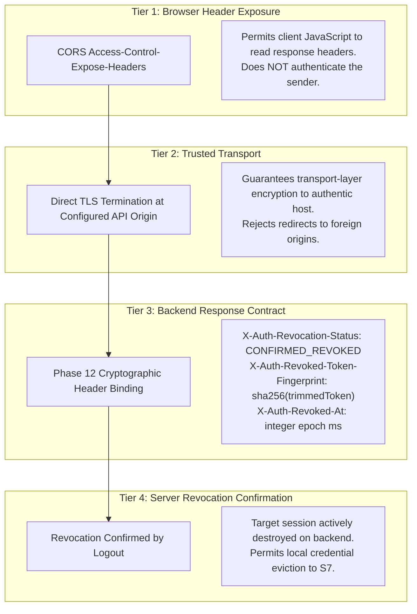
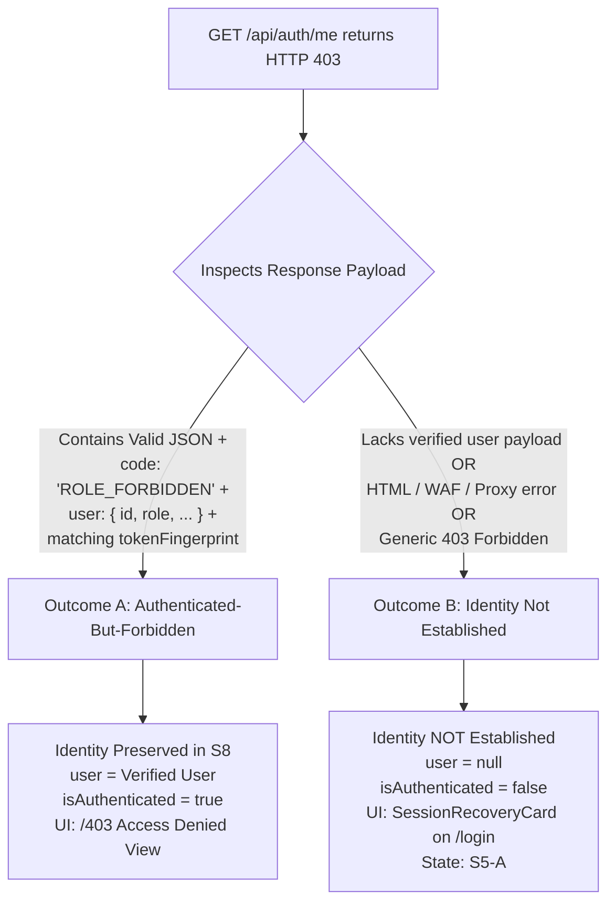

# MetroLMS — SUP-01 Final State-Matrix Consistency & Runtime Contract Audit (Version 2.7)
## Architecture Review: Corrected 204/CORS Evidence Semantics, 403 Identity-Revalidation Contract, Comprehensive Descriptor Recovery, Full 25-Scenario apiClientRaw Runtime Matrix, and Reconciled 30-Scenario State Matrix

**Document Version:** 2.7 (Final State-Matrix Consistency & Runtime Contract Audit)  
**Planning Date:** 2026-11-06  
**Document Path:** `docs/frontend/reports/sup-01-server-outcome-semantics-audit-v2-7.md`  
**Classification:** Architectural Remediation & Test Coverage Plan (Strict Read-Only Planning — Zero Implementation)  
**Target Transition:** `SUP-01: S8 → S7` (Real-User Logout with Preserved Inert Developer Origin Snapshot)  
**Governing Owner Decisions:**  
- **Decision A (S0):** Approved 2026-11-06 (Only `S0 → S1` permitted; `S0 → S3/S14/S15` forbidden)  
- **Decision B (S8):** Approved 2026-11-06 (`S8 → S14/S15` forbidden; Developer origin never reactivated by real user)  
- **Decision C (Real-User Logout):** Approved 2026-11-06 (`S8 → S7` approved; origin snapshot preserved inert in per-tab sessionStorage until tab close)  
- **Decision E (Archival Failure Policy):** **APPROVED 2026-11-06 (Option 1 — Transactional Abort on Archive Failure)**  
**Execution Directives:** Strict Read-Only Governance (Zero production code modifications, zero test file modifications, zero Git staging/commits, zero test runner or compiler execution)  
**Proposed Remediation Package:** `WP-5.4.5-R1` (Separately Authorized Remediation Package planned prior to Phase 13)  
**Final Architecture Status:** `READY FOR OWNER AUTHORIZATION — FRONTEND DESIGN COMPLETE; BACKEND CONTRACT EXPLICITLY DEFERRED`

---

## 1. Executive Summary & Traceability to Version 2.6 Issues

Version 2.7 conducts an independent architectural audit and correction of Version 2.6, resolving seven critical consistency, evidence, and contract discrepancies:

1. **Correction of HTTP 204 / CORS Evidence Semantics (Section 2):** Version 2.6 retracted the claim that CORS proves backend authenticity, yet its state matrix still labeled `HTTP 204 + Valid CORS Revocation Headers` as an authoritative revocation result. Version 2.7 formalizes the four-tier separation: CORS response exposure (browser JavaScript capability), trusted HTTPS transport (direct TLS termination at configured API host), backend response contract (cryptographic binding of headers), and server revocation confirmation.
2. **Generic 403 Semantics on `/api/auth/me` (Section 3):** Replaces the dangerous assumption that any HTTP 403 proves an authenticated identity. Distinguishes Outcome A (Authenticated-but-forbidden with explicit machine-readable identity payload) from Outcome B (Identity not established, e.g. WAF/proxy block). Under Outcome B, `user` remains `null`, `isAuthenticated` remains `false`, and the client enters `S5-A`.
3. **Comprehensive Pending Descriptor & Crash Recovery (Section 4):** Details the exact lifecycle across 13 distinct descriptor and crash conditions. Eliminates the false assumption that purging a descriptor implies normal authentication; revalidation via `/api/auth/me` is always mandatory.
4. **Correction of State Matrix Revocation Column (Section 5):** Disentangles target server status from revocation confirmation. Replaces contradictory values (such as `YES (CONFIRMED_ACTIVE)`) with an unambiguous, two-part classification: `Target Session Server Status` and `Server Revocation Confirmed by Logout?` (`YES` strictly for `SESSION_REVOKED` and `CONFIRMED_REVOKED`; `NO` for all others).
5. **Accurate Representation of Owner Decision F (Section 6):** Marks Option 1 (Preserve Developer snapshot inert in per-tab `sessionStorage`) as the binding operational baseline under Decision C. Marks Option 2 (Security exception purge) strictly as `HYPOTHETICAL — NOT ACTIVE — REQUIRES OWNER DECISION F`, excluding it from executable operational scenario counts.
6. **Publication of Complete 25-Scenario `apiClientRaw` Matrix (Section 7):** Details exact runtime behavior across all 25 conditions, including transparent redirects, unexpected auth redirects, captive portals, CORS header blocking, non-JSON HTML, network failures, timeouts, aborts, and stale session epochs.
7. **Publication of Reconciled 30-Scenario State Matrix (Section 8):** Expands the state matrix from 29 to 30 fully specified, individually numbered rows across 16 columns, providing granular, uncompressed coverage of all operational permutations.

---

## 2. Corrected HTTP 204 / CORS Evidence Semantics

### 2.1 The Four-Tier Evidence Separation
A response of HTTP 204 No Content with headers cannot be accepted as authoritative revocation evidence without satisfying four distinct architectural tiers:



1. **CORS Response-Header Exposure (Browser Gate):**  
   HTTP 204 contains no body. All evidence resides in response headers. If the server omits `Access-Control-Expose-Headers: X-Auth-Revocation-Status, X-Auth-Revoked-Token-Fingerprint, X-Auth-Revoked-At`, browser security policies forbid JavaScript from reading these headers (`response.headers.get()` returns `null`). **CORS exposure is a browser accessibility permission, NOT proof of backend authenticity.**
2. **Trusted Transport (Transport Security):**  
   Requests must terminate directly at the configured API origin (e.g. `https://api.metro-lms.internal`) via a validated TLS certificate. If a 204 response arrives after an automatic redirect or from an untrusted origin, it is rejected immediately.
3. **Backend Response Contract (Phase 12 Requirement):**  
   To constitute proof of revocation, the backend must emit:
   - `X-Auth-Revocation-Status`: Exactly `CONFIRMED_REVOKED`.
   - `X-Auth-Revoked-Token-Fingerprint`: Exactly the 64-character lowercase hexadecimal SHA-256 digest matching `sha256(trimmedToken)`.
   - `X-Auth-Revoked-At`: Valid integer millisecond epoch timestamp (`Date.now()`).
4. **Server Revocation Confirmation:**  
   Only when Tiers 1, 2, and 3 are simultaneously satisfied does the client conclude that the target session was revoked on the server.

### 2.2 Failure Handling for HTTP 204 Variants

| 204 Response Scenario | Transport State | Headers Accessible? | Fingerprint Bound? | Classification | Resulting State | Local Credentials | Server Revocation Confirmed? |
| :--- | :---: | :---: | :---: | :--- | :---: | :---: | :---: |
| **Authoritative 204** | Direct Trusted HTTPS | Yes | Yes (Matches active token) | `AUTHORITATIVE_204_HEADER` | **`S7`** | **Purged** | **YES** |
| **Bare 204 (No Headers)**| Direct Trusted HTTPS | N/A (Headers absent) | No | `NON_AUTHORITATIVE_204` | **`S8-A`** | **Retained** | **NO (`UNKNOWN`)** |
| **CORS-Blocked 204** | Direct Trusted HTTPS | No (`null` in JS) | No | `NON_AUTHORITATIVE_204` | **`S8-A`** | **Retained** | **NO (`UNKNOWN`)** |
| **Redirected 204** | Redirected / Foreign Origin| Untrusted | Unverified | `UNEXPECTED_REDIRECT` | **`S8-A`** | **Retained** | **NO (`UNKNOWN`)** |
| **Fingerprint Mismatch**| Direct Trusted HTTPS | Yes | No (Foreign hash) | `NON_AUTHORITATIVE_204` | **`S8-A`** | **Retained** | **NO (`UNKNOWN`)** |

---

## 3. Corrected 403 Identity-Revalidation Contract

### 3.1 The Vulnerability of Inferring Identity from HTTP 403
In Version 2.6, Scenario 20 stated that receiving HTTP 403 on `/api/auth/me` proves that the user is authenticated and preserves their identity in `S8`.  
**Security Correction:** HTTP 403 Forbidden can be emitted by reverse proxies, WAFs (Cloudflare, AWS WAF), API gateways, or corporate filtering middleboxes before a request ever reaches the application backend. Inferring that a user is validly authenticated merely because an HTTP status code is 403 creates a critical authorization bypass vulnerability.

### 3.2 Formal Specification: Outcome A vs. Outcome B



1. **Outcome A: Authenticated-but-Forbidden (Explicit Backend Contract Required):**  
   To establish that the bearer token is valid and the user identity is proven despite access denial, the trusted backend MUST return a machine-readable JSON payload:
   ```json
   {
     "success": false,
     "code": "ROLE_FORBIDDEN",
     "message": "User does not have required permissions for this resource",
     "user": {
       "id": "USR_TEST_TRN_001",
       "role": "user",
       "department": "قطاع التشغيل"
     },
     "tokenFingerprint": "0c2293eabdf989cb419a0e631134b219f266c886b4723c8db15701b78f556b36"
   }
   ```
   - *Client Verification:* Client checks `response.data.tokenFingerprint === sha256(currentSession.token)` and validates the user structure.
   - *State Transition:* `user = response.data.user`, `isAuthenticated = true`, state enters/remains **`S8`**, UI renders `/403` Access Denied view.
2. **Outcome B: Identity Not Established (Ambiguous 403 / Proxy Error):**  
   If the response lacks the explicit `user` payload, contains HTML, or is emitted by an intermediary:
   - The client **CANNOT** assert that the user is authenticated.
   - `user = null`, `isAuthenticated = false`.
   - Local credentials remain retained in `sessionStorage` (fail closed, do not evict on ambiguous errors).
   - In Cold Reload (`/api/auth/me`): Transitions to **`S5-A`** on `/login`, rendering `SessionRecoveryCard`.
   - In Active Logout (`/api/auth/logout`): User was previously authenticated, so client remains in **`S8-A`** with `LogoutRetryBanner`.

---

## 4. Comprehensive Pending Descriptor & Crash Recovery

### 4.1 In-Memory Ephemeral Nature of `sessionEpoch`
`sessionEpoch.ts#L11` strictly mandates:
> *In-memory only; NEVER persisted in localStorage, sessionStorage, or shared across tabs.*

`sessionEpoch` resets to `1` on cold reload. Therefore, cross-reload correlation relies exclusively on durable cryptographic anchors stored in `PendingLogoutDescriptor` (schema version 1):
$$\text{Durable Binding} = (\text{targetTokenFingerprint}, \; \text{targetUserId}, \; \text{expiresAt})$$

### 4.2 Comprehensive 13-Condition Descriptor & Crash Recovery Matrix

| # | Descriptor / Crash Condition | Descriptor Action | Local Credentials Action | AuthContext Identity (`user`) | Must `/api/auth/me` Be Called? | Resulting State | Active UI Component | Retry Permitted? | Transmit Original Target Token? |
| :-: | :--- | :---: | :---: | :---: | :---: | :---: | :--- | :---: | :---: |
| **1** | Descriptor Absent | None | Retained | Verified by `/api/auth/me` | **YES** | Normal Auth (200) / S5-A (5xx) | Dashboard (200) / `/login` (5xx) | **NO** | N/A |
| **2** | Descriptor Malformed / Bad Schema | **Purged** | Retained | Unverified until revalidation | **YES** | Normal Auth (200) / S5-A (5xx) | Dashboard (200) / `SessionRecoveryCard` | **NO** | **NO** |
| **3** | Descriptor Expired (`now > expiresAt`)| **Purged** | Retained | Unverified until revalidation | **YES** | Normal Auth (200) / S5-A (5xx) | Dashboard (200) / `SessionRecoveryCard` | **NO** | **NO** |
| **4** | Token Fingerprint Mismatch + ME 200 | **Purged** | Retained | Verified by `/api/auth/me` (200) | **YES** | **Normal Auth** | Standard Dashboard | **NO** | **NO** |
| **5** | Token Fingerprint Mismatch + ME 5xx | **Purged** | Retained | Unverified (`/api/auth/me` 5xx) | **YES** | **`S5-A`** | `SessionRecoveryCard` on `/login` | **NO** | **NO** |
| **6** | Target User ID Mismatch + ME 200 | **Purged** | Retained | Verified by `/api/auth/me` (200) | **YES** | **Normal Auth** | Standard Dashboard | **NO** | **NO** |
| **7** | Target User ID Mismatch + ME 5xx | **Purged** | Retained | Unverified (`/api/auth/me` 5xx) | **YES** | **`S5-A`** | `SessionRecoveryCard` on `/login` | **NO** | **NO** |
| **8** | Matching Original Target Session | **Retained** | Retained | Real User (`/api/auth/me` 200) | **YES** | **`S8-A`** | `LogoutRetryBanner` (In-App) | **YES** | **YES** (`currentSession.token`) |
| **9** | Same User Authenticated with New Token| **Purged** | Retained (New) | Real User (New Session) | **YES** | **Normal Auth** | Standard Dashboard | **NO (Blocked)**| **NO (Anti-Substitution)** |
| **10**| Different User Login (User B) | **Purged** | Replaced (User B)| User B | **NO** (Fresh login)| **Normal Auth (User B)** | Dashboard (User B) | **NO** | **NO** |
| **11**| Crash Before Archival Commit | None | Retained | Unverified until revalidation | **YES** | Normal Auth (200) / S7 (401) | Dashboard (200) / `/login` (401) | **NO** | N/A |
| **12**| Crash After Archival Commit, In-Flight| **Retained** | Retained | Revalidated by `/api/auth/me` | **YES** | **`S8-A`** (if alive) / `S7` (401) | `LogoutRetryBanner` (if alive) | **YES** (if in S8-A) | **YES** (`currentSession.token`) |
| **13**| Crash After Response, Pre-Local Cleanup| **Purged** | **Purged** (401 on reboot) | `null` | **YES** | **`S7`** | Standard `/login` Form | **NO** | **NO** |

> [!IMPORTANT]
> **Governing Invariant:** Purging a descriptor NEVER automatically establishes normal authenticated operation. If `/api/auth/me` fails or is unverified, the client enters `S5-A`. Under no circumstances may a newly issued token be transmitted to `/api/auth/logout` during a retry.

---

## 5. Correction of the State Matrix Revocation Column

In Version 2.6, the final column was titled `Server Revocation Confirmed?` and contained contradictory entries such as `YES (CONFIRMED_ACTIVE)`.  
Version 2.7 replaces this with two mutually exclusive, mathematically rigorous columns:
1. **Column 15 (`Target Session Server Status`):** Documents the server-side lifecycle state of the targeted session (`CONFIRMED_REVOKED`, `INDEPENDENTLY_INACTIVE`, `RECORD_NOT_FOUND`, `CONFIRMED_ACTIVE`, `LOCAL_POLICY_EVICTION`, `MOCK_SIMULATED`, `UNKNOWN_UNPROVEN`, or `NOT_APPLICABLE`).
2. **Column 16 (`Server Revocation Confirmed by Logout?`):** Strictly a boolean question: Did this logout operation actively cause and confirm server revocation?
   - `YES`: Strictly for `SESSION_REVOKED` (Scenario 1) and `CONFIRMED_REVOKED` (Scenario 3).
   - `NO`: For all other 28 scenarios (including inactive sessions, active sessions, mock logouts, and errors).

---

## 6. Correct Representation of Owner Decision F

- **Option 1 (Active Binding Baseline — Governed by Decision C):**  
  Archived Developer origin snapshots (`metro_lms_inert_developer_snapshots`) remain preserved inert in per-tab `sessionStorage` until tab closure. The suspended real user is presented with `AccountSuspensionNotice` on `/login`; no return UI, no authorization paths, and no reactivation capabilities exist. Preserving inert data does NOT grant authorization.
- **Option 2 (Hypothetical Security Purge — Pending Owner Decision):**  
  Purges all storage keys, destroying the inert snapshot.  
  *Governance Rule:* Option 2 is strictly classified as **`HYPOTHETICAL — NOT ACTIVE — REQUIRES OWNER DECISION F`**. It is NOT counted as an executable operational scenario in the active state matrix.

---

## 7. Full 25-Scenario `apiClientRaw` Matrix (Including Redirects)

`apiClientRaw<T>()` provides an un-abstracted response envelope `{ ok, status, headers, data, rawBodyText, isJson, parseError }`.  
**Redirect Policy:** Authentication control-plane endpoints (`POST /api/auth/logout`, `GET /api/auth/me`) reject unexpected redirects (`response.redirected === true` or foreign origin) as untrusted transport outcomes.

| # | Runtime Scenario / Input State | HTTP Status | `ok` | Body Parsing Result | Trusted Origin & Transport? | Correlation Success? | Auth Classification | Credential Mutation Permitted? | Revocation Confirmed? |
| :-: | :--- | :---: | :---: | :--- | :---: | :---: | :--- | :---: | :---: |
| **1** | HTTP 200 Valid JSON | `200` | `true` | Parsed JSON object `T` | Yes | Yes (opId, epoch) | Authoritative / Active | **YES** (If Authoritative) | **YES** (If Revoked) |
| **2** | HTTP 200 Malformed JSON | `200` | `true` | `SyntaxError` (Parse failed) | Yes | Ambiguous | `MALFORMED_ACKNOWLEDGMENT` | **NO** (Fails closed) | **NO** |
| **3** | HTTP 200 Non-JSON (HTML Fallback) | `200` | `true` | Not JSON (`isJson: false`) | Yes | Ambiguous | `NON_AUTHORITATIVE_200` | **NO** (Fails closed) | **NO** |
| **4** | HTTP 201 Created | `201` | `true` | Parsed JSON object `T` | Yes | N/A | Non-Logout Success | **NO** | **NO** |
| **5** | HTTP 202 Accepted | `202` | `true` | Parsed JSON or `null` | Yes | N/A | Unconfirmed Async | **NO** | **NO** |
| **6** | HTTP 204 Complete Headers | `204` | `true` | `null` (JSON parse skipped) | Yes | Yes (Fingerprint bound)| `AUTHORITATIVE_204_HEADER`| **YES** | **YES** |
| **7** | HTTP 204 Missing Required Headers | `204` | `true` | `null` (Headers absent) | Yes | Missing | `NON_AUTHORITATIVE_204` | **NO** (Fails closed) | **NO** |
| **8** | HTTP 204 CORS-Blocked Headers | `204` | `true` | `null` (`headers.get = null`) | Yes | Inaccessible | `NON_AUTHORITATIVE_204` | **NO** (Fails closed) | **NO** |
| **9** | HTTP 204 Unexpected Body / Malformed| `204` | `true` | `null` (Body ignored safely) | Yes | Unverified | `NON_AUTHORITATIVE_204` | **NO** (Fails closed) | **NO** |
| **10**| HTTP 3xx Followed to Foreign Origin | 2xx/3xx| Var | Foreign landing page | **NO (Redirected)**| Untrusted | `UNEXPECTED_REDIRECT` | **NO** (Fails closed) | **NO** |
| **11**| HTTP 3xx Captive Portal Challenge | 3xx/200| Var | Captive portal HTML | **NO (Untrusted)** | Untrusted | `CAPTIVE_PORTAL_DETECTED`| **NO** (Fails closed) | **NO** |
| **12**| HTTP 400 Bad Request (JSON) | `400` | `false`| Parsed error JSON | Yes | N/A | Client Request Error | **NO** (Fails closed) | **NO** |
| **13**| HTTP 401 Bound (`TOKEN_INVALID`) | `401` | `false`| Parsed JSON + Fingerprint | Yes | Yes (Fingerprint bound)| `AUTHORITATIVE_TOKEN_INVALID`| **YES** (Inactive Token)| **NO** (Unproven Cause)|
| **14**| HTTP 401 Ambiguous (HTML / Gateway)| `401` | `false`| HTML / Unverified | Ambiguous | Missing | `AMBIGUOUS_401` | **NO** (Fails closed) | **NO** |
| **15**| HTTP 403 Confirmed Identity Payload| `403` | `false`| Parsed JSON + User Object | Yes | Yes (User bound) | `AUTHENTICATED_ROLE_DENIED`| **NO** (Identity in S8)| **NO** |
| **16**| HTTP 403 Generic / Identity Unknown| `403` | `false`| Generic text / HTML | Ambiguous | Missing | `IDENTITY_NOT_ESTABLISHED`| **NO** (Enters S5-A) | **NO** |
| **17**| HTTP 403 Explicit Account Suspension| `403` | `false`| Parsed JSON + Machine Code | Yes | Yes (User bound) | `EXPLICIT_ACCOUNT_SUSPENSION`| **YES** (Policy Eviction)| **NO** (Token Unproven) |
| **18**| HTTP 404 Bound (`SESSION_NOT_FOUND`)| `404` | `false`| Parsed JSON + Fingerprint | Yes | Yes (Fingerprint bound)| `AUTHORITATIVE_SESSION_NOT_FOUND`| **YES** (Inactive Token)| **NO** (Unproven Cause)|
| **19**| HTTP 404 Missing Route / CDN HTML | `404` | `false`| HTML 404 | Ambiguous | Missing | `AMBIGUOUS_404` | **NO** (Fails closed) | **NO** |
| **20**| HTTP 5xx Server Fault (JSON) | 5xx | `false`| Parsed error JSON | Yes | N/A | `SERVER_FAULT_5XX` | **NO** (Fails closed) | **NO** |
| **21**| HTML Gateway Response (502/504) | 502/4 | `false`| HTML document | Untrusted Gateway | Missing | `SERVER_FAULT_5XX` | **NO** (Fails closed) | **NO** |
| **22**| Transport Failure / Network Offline| `0` | — | None (Fetch threw) | None | None | **Throws:** `ApiError` (Network)| **NO** (Fails closed) | **NO** |
| **23**| Transport Timeout (15,000 ms) | `0` | — | None (Aborted by timer) | None | None | **Throws:** `ApiError` (Timeout)| **NO** (Fails closed) | **NO** |
| **24**| External Abort / User Cancellation | `0` | — | None (Aborted externally) | None | None | **Throws:** `ApiError` (Abort) | **NO** (Fails closed) | **NO** |
| **25**| Stale Session Epoch Detected | — | — | None (Epoch mismatch) | Discarded | Stale | **Throws:** `StaleEpochError` | **NO** (Discarded) | **NO** |

---

## 8. Physical Publication: Reconciled 30-Scenario State Matrix

Every scenario is physically published across all 16 required columns.

| # | Operation Type | Previous State | Target User ID | Target Session ID / Epoch | Token Fingerprint Status | HTTP / Transport Result | Evidence Classification | Correlation Guard Result | AuthContext User | isAuthenticated | Credential Action | New Lifecycle State | Visible UI Component | Target Session Server Status | Server Revocation Confirmed by Logout? |
| :-: | :--- | :---: | :---: | :---: | :---: | :---: | :---: | :---: | :---: | :---: | :---: | :---: | :---: | :---: | :---: |
| **1** | Active Logout | `S8` | `USR_TEST_TRN_001` | Epoch 1 | Valid SHA-256 Digest | HTTP 200 `{ code: 'SESSION_REVOKED' }` | `AUTHORITATIVE_200_JSON` | Pass (opId, epoch, fingerprint) | `null` | `false` | **Purged** | **`S7`** | Standard `/login` Form | `CONFIRMED_REVOKED` | **YES** |
| **2** | Active Logout | `S8` | `USR_TEST_TRN_001` | Epoch 1 | Valid SHA-256 Digest | HTTP 200 `{ success: true }` (No machine code) | `NON_AUTHORITATIVE_200` | Pass (opId, epoch) | Real User | `true` | **Retained** | **`S8-A`** | `LogoutRetryBanner` (In-App) | `UNKNOWN_UNPROVEN` | **NO** |
| **3** | Active Logout | `S8` | `USR_TEST_TRN_001` | Epoch 1 | Valid SHA-256 Digest | HTTP 204 + Valid CORS Headers | `AUTHORITATIVE_204_HEADER` | Pass (opId, epoch, fingerprint) | `null` | `false` | **Purged** | **`S7`** | Standard `/login` Form | `CONFIRMED_REVOKED` | **YES** |
| **4** | Active Logout | `S8` | `USR_TEST_TRN_001` | Epoch 1 | Valid SHA-256 Digest | HTTP 204 (Missing Headers) | `NON_AUTHORITATIVE_204` | Pass (opId, epoch) | Real User | `true` | **Retained** | **`S8-A`** | `LogoutRetryBanner` (In-App) | `UNKNOWN_UNPROVEN` | **NO** |
| **5** | Active Logout | `S8` | `USR_TEST_TRN_001` | Epoch 1 | Valid SHA-256 Digest | HTTP 204 (CORS-Blocked Headers)| `NON_AUTHORITATIVE_204` | Inaccessible in JS | Real User | `true` | **Retained** | **`S8-A`** | `LogoutRetryBanner` (In-App) | `UNKNOWN_UNPROVEN` | **NO** |
| **6** | Active Logout | `S8` | `USR_TEST_TRN_001` | Epoch 1 | Valid SHA-256 Digest | HTTP 401 `{ code: 'TOKEN_INVALID' }` + Fingerprint | `AUTHORITATIVE_TOKEN_INVALID` | Pass (opId, epoch, fingerprint) | `null` | `false` | **Purged** | **`S7`** | Standard `/login` Form | `INDEPENDENTLY_INACTIVE` | **NO** |
| **7** | Active Logout | `S8` | `USR_TEST_TRN_001` | Epoch 1 | Valid SHA-256 Digest | HTTP 401 Gateway Challenge (HTML / WAF) | `AMBIGUOUS_401` | Pass (opId, epoch) | Real User | `true` | **Retained** | **`S8-A`** | `LogoutRetryBanner` (In-App) | `UNKNOWN_UNPROVEN` | **NO** |
| **8** | Active Logout | `S8` | `USR_TEST_TRN_001` | Epoch 1 | Valid SHA-256 Digest | HTTP 403 Generic Permission Denied | `AUTHENTICATED_ROLE_DENIED` | Pass (opId, epoch) | Real User | `true` | **Retained** | **`S8-A`** | 403 Forbidden Banner | `CONFIRMED_ACTIVE` | **NO** |
| **9** | Active Logout | `S8` | `USR_TEST_TRN_001` | Epoch 1 | Valid SHA-256 Digest | HTTP 403 `{ code: 'ACCOUNT_SUSPENDED' }` | `EXPLICIT_ACCOUNT_SUSPENSION` | Pass (opId, epoch, user ID) | `null` | `false` | **Evicted** | **`S-SUSPENDED`** | `AccountSuspensionNotice` on `/login`| `LOCAL_POLICY_EVICTION` | **NO** |
| **10**| Active Logout | `S8` | `USR_TEST_TRN_001` | Epoch 1 | Valid SHA-256 Digest | HTTP 404 `{ code: 'SESSION_NOT_FOUND' }` | `AUTHORITATIVE_SESSION_NOT_FOUND`| Pass (opId, epoch, fingerprint) | `null` | `false` | **Purged** | **`S7`** | Standard `/login` Form | `SESSION_RECORD_NOT_FOUND` | **NO** |
| **11**| Active Logout | `S8` | `USR_TEST_TRN_001` | Epoch 1 | Valid SHA-256 Digest | HTTP 404 Missing Route / Gateway Fallback | `AMBIGUOUS_404` | Pass (opId, epoch) | Real User | `true` | **Retained** | **`S8-A`** | `LogoutRetryBanner` (In-App) | `UNKNOWN_UNPROVEN` | **NO** |
| **12**| Active Logout | `S8` | `USR_TEST_TRN_001` | Epoch 1 | Valid SHA-256 Digest | HTTP 500 / 502 / 503 / 504 Server Fault | `SERVER_FAULT_5XX` | Pass (opId, epoch) | Real User | `true` | **Retained** | **`S8-A`** | `LogoutRetryBanner` (In-App) | `UNKNOWN_UNPROVEN` | **NO** |
| **13**| Active Logout | `S8` | `USR_TEST_TRN_001` | Epoch 1 | Valid SHA-256 Digest | Fetch Timeout (15,000 ms elapsed) | `TRANSPORT_FAILURE_UNKNOWN_OUTCOME` | Pass (opId, epoch) | Real User | `true` | **Retained** | **`S8-A`** | `LogoutRetryBanner` (In-App) | `UNKNOWN_UNPROVEN` | **NO** |
| **14**| Active Logout | `S8` | `USR_TEST_TRN_001` | Epoch 1 | Valid SHA-256 Digest | Network Error (`ERR_CONNECTION_REFUSED`) | `TRANSPORT_FAILURE_UNKNOWN_OUTCOME` | Pass (opId, epoch) | Real User | `true` | **Retained** | **`S8-A`** | `LogoutRetryBanner` (In-App) | `UNKNOWN_UNPROVEN` | **NO** |
| **15**| Active Logout | `S8` | `USR_TEST_TRN_001` | Epoch 1 | Mismatched Hex Digest | HTTP 200 with Foreign Token Fingerprint | `NON_AUTHORITATIVE_200` | Fail (Fingerprint mismatch) | Real User | `true` | **Retained** | **`S8-A`** | `LogoutRetryBanner` (In-App) | `UNKNOWN_UNPROVEN` | **NO** |
| **16**| Cold Reload Revalidation | `S0` / Reload | `USR_TEST_TRN_001` | Descriptor Matched | Valid SHA-256 Digest | HTTP 200 with Valid User Identity | `CONFIRMED_ACTIVE_WITH_DESCRIPTOR` | Pass (Descriptor matches active token) | Real User | `true` | **Retained** | **`S8-A`** | `LogoutRetryBanner` (Authenticated) | `CONFIRMED_ACTIVE` | **NO** |
| **17**| Cold Reload Revalidation | `S0` / Reload | `USR_TEST_TRN_001` | Epoch 1 | Valid SHA-256 Digest | HTTP 5xx / Network Error on `/api/auth/me` | `TRANSPORT_FAILURE_UNKNOWN_OUTCOME` | Unverified | `null` | `false` | **Retained** | **`S5-A`** | `SessionRecoveryCard` on `/login` | `UNKNOWN_UNPROVEN` | **NO** |
| **18**| Cold Reload Revalidation | `S0` / Reload | `USR_TEST_TRN_001` | Epoch 1 | Valid SHA-256 Digest | HTTP 401 `{ code: 'TOKEN_INVALID' }` + Fingerprint | `AUTHORITATIVE_TOKEN_INVALID` | Pass (opId, epoch, fingerprint) | `null` | `false` | **Purged** | **`S7`** | Standard `/login` Form | `INDEPENDENTLY_INACTIVE` | **NO** |
| **19**| Cold Reload Revalidation | `S0` / Reload | `USR_TEST_TRN_001` | Epoch 1 | Valid SHA-256 Digest | HTTP 401 Gateway Challenge (HTML / WAF) | `AMBIGUOUS_401` | Unverified gateway | `null` | `false` | **Retained** | **`S5-A`** | `SessionRecoveryCard` on `/login` | `UNKNOWN_UNPROVEN` | **NO** |
| **20**| Cold Reload Revalidation | `S0` / Reload | `USR_TEST_TRN_001` | Epoch 1 | Valid SHA-256 Digest | HTTP 403 Confirmed Identity (`ROLE_FORBIDDEN`) | `AUTHENTICATED_ROLE_DENIED` | Pass (User bound & verified) | Real User | `true` | **Retained** | **`S8`** | Access Denied Screen (`/403`) | `CONFIRMED_ACTIVE` | **NO** |
| **21**| Cold Reload Revalidation | `S0` / Reload | `USR_TEST_TRN_001` | Epoch 1 | Valid SHA-256 Digest | HTTP 403 Generic / Identity Unconfirmed | `IDENTITY_NOT_ESTABLISHED` | Unverified payload | `null` | `false` | **Retained** | **`S5-A`** | `SessionRecoveryCard` on `/login` | `UNKNOWN_UNPROVEN` | **NO** |
| **22**| Cold Reload Revalidation | `S0` / Reload | `USR_TEST_TRN_001` | Epoch 1 | Valid SHA-256 Digest | HTTP 403 `{ code: 'ACCOUNT_SUSPENDED' }` | `EXPLICIT_ACCOUNT_SUSPENSION` | Pass (opId, epoch, user ID) | `null` | `false` | **Evicted** | **`S-SUSPENDED`** | `AccountSuspensionNotice` on `/login`| `LOCAL_POLICY_EVICTION` | **NO** |
| **23**| Cold Reload Descriptor Check| `S0` / Reload | `USR_TEST_TRN_001` | Descriptor Expired | Valid SHA-256 Digest | Stored Descriptor `now > expiresAt` + ME 200 | `DESCRIPTOR_EXPIRED_CLEANUP` | Expired $\to$ Purged | Real User | `true` | **Retained** | **Normal Auth** | Standard Dashboard View | `CONFIRMED_ACTIVE` | **NO** |
| **24**| Cold Reload Descriptor Check| `S0` / Reload | `USR_TEST_TRN_001` | Descriptor Expired | Valid SHA-256 Digest | Stored Descriptor `now > expiresAt` + ME 5xx | `DESCRIPTOR_EXPIRED_UNVERIFIED` | Expired $\to$ Purged | `null` | `false` | **Retained** | **`S5-A`** | `SessionRecoveryCard` on `/login` | `UNKNOWN_UNPROVEN` | **NO** |
| **25**| Cold Reload Descriptor Check| `S0` / Reload | `USR_TEST_TRN_001` | Descriptor Mismatch| Valid SHA-256 Digest | Token Fingerprint Mismatch + ME 200 | `DESCRIPTOR_MISMATCH_CLEANUP` | Mismatch $\to$ Purged | Real User | `true` | **Retained** | **Normal Auth** | Standard Dashboard View | `CONFIRMED_ACTIVE` | **NO** |
| **26**| Cold Reload Descriptor Check| `S0` / Reload | `USR_TEST_TRN_001` | Descriptor Mismatch| Valid SHA-256 Digest | Token Fingerprint Mismatch + ME 5xx | `DESCRIPTOR_MISMATCH_UNVERIFIED` | Mismatch $\to$ Purged | `null` | `false` | **Retained** | **`S5-A`** | `SessionRecoveryCard` on `/login` | `UNKNOWN_UNPROVEN` | **NO** |
| **27**| Same-User New Token Login | `S8-A` | `USR_TEST_TRN_001` | New Token Issued | Different Token SHA-256 | Same user logs in freshly with new token | `DESCRIPTOR_FINGERPRINT_MISMATCH`| Substitution blocked $\to$ Purged | Real User (New) | `true` | **Retained (New)**| **Normal Auth** | Standard Dashboard View | `CONFIRMED_ACTIVE` (New) | **NO** |
| **28**| S5-A Recovery Retry | `S5-A` | `USR_TEST_TRN_001` | Epoch 1 | Valid SHA-256 Digest | `retryRevalidation()` returns HTTP 200 | `CONFIRMED_ACTIVE` | Pass (opId, epoch) | Real User | `true` | **Retained** | **Normal Auth** | Standard Dashboard View | `CONFIRMED_ACTIVE` | **NO** |
| **29**| Active Logout (DEV Mock) | `S8` | `USR_TEST_TRN_001` | Epoch 1 | Unchecked in DEV | HTTP 200 `{ success: true }` in DEV MSW | `MOCK_LOCAL_LOGOUT` | Pass (MSW active in DEV) | `null` | `false` | **Cleared** | **`S7`** | Standard `/login` Form | `MOCK_SIMULATED` | **NO** |
| **30**| Delayed Cross-User Logout | User B in `S8` | User A | Epoch 1 | User A Digest | User A response arrives while User B active | `STALE_RESPONSE_DROPPED` | **Fail:** `epoch !== currentEpoch` | User B | `true` | **Untouched** (User B) | **`S8`** (User B) | Active User B Dashboard | `NOT_APPLICABLE` | **NO** |

---

## 9. Reconciled Test Inventory & Mandatory Seven-Account Inventory

- **Core Accepted Phase 5 Test Suite:** Exactly **60 accepted core specifications** physically exist as `it(...)` blocks in [`frontend/src/test/isolated-role-session.test.tsx`](file:///d:/LMS%20MEtro%20Project/frontend/src/test/isolated-role-session.test.tsx) (`P5-T08-1` through `P5-T24-3`).
- **Physical Test Modifications:** **ZERO test files created, modified, deleted, or renumbered.**
- **Supplemental Proposal:** `SUP-01-T01` (1 specification with 22 structured subcases `SUP-01-T01-01` through `SUP-01-T01-22`), strictly labeled:  
  `PROPOSED — NOT AUTHORED — DEFERRED TO PHASE 13`
- **Total Planned Inventory:**
  $$\text{60 Authored Core Specifications (Accepted)} + \text{1 Proposed Specification Design (SUP-01-T01)} = \mathbf{61\text{ Total Planned Specifications}}$$
- **Mandatory Seven-Account Inventory:** Preserved exactly (`USR_DEV_001`, `USR_SUPER_001`, `USR_TEST_SUPER_001`, `USR_TEST_ADMIN_001`, `USR_TEST_AST_001`, `USR_TEST_LEC_001`, `USR_TEST_TRN_001`). Exactly five synthetic personas; two privileged fixtures; `assistant_lecturer` is a group-scoped role assignment. Zero credentials or secrets recorded.
- **Verified SHA-256 Test Vector:**  
  Input: `"usr_tok_sample_developer_session_9876543210"` (43 UTF-8 bytes)  
  Digest: `0c2293eabdf989cb419a0e631134b219f266c886b4723c8db15701b78f556b36`

---

## 10. Multi-Tier Evidence Boundary Partitioning & Phase 12 Backend Dependencies

1. **Tier 1 (Verified Current Frontend Source):** Synchronous storage in `authStorage.ts`, in-memory epoch in `sessionEpoch.ts`, redirect barrier in `ProtectedRoute.tsx`, dynamic token injection in `apiClient.ts`.
2. **Tier 2 (Current MSW Mock-Only Behavior):** `authHandlers.ts#L153` returns static HTTP 200 `{ success: true }`. Proves client lifecycle mechanics; cannot prove production server semantics.
3. **Tier 3 (Proposed Frontend Recovery Design `WP-5.4.5-R1`):** Two-phase atomic archival transaction, Decision E pre-flight abort, `LogoutRetryBanner` (in `S8-A`), `SessionRecoveryCard` (in `S5-A`), `AccountSuspensionNotice` (in `S-SUSPENDED`), `apiClientRaw<T>()` helper (Design A), `metro_lms_pending_logout` descriptor (schema v1), and proposed test specification `SUP-01-T01`.
4. **Tier 4 (Required Phase 12 Production Backend Guarantees — Explicitly Deferred):** Token-scoped revocation (`POST /api/auth/logout`), cryptographic confirmation payload (`code: 'SESSION_REVOKED'`, `tokenFingerprint`, `revokedAt`), HTTP 204 CORS exposure headers (`Access-Control-Expose-Headers: X-Auth-Revocation-Status, X-Auth-Revoked-Token-Fingerprint, X-Auth-Revoked-At`), authority authentication (HTTPS endpoint termination at configured API host; future backend signed response assertion), idempotent revocation handling.
5. **Tier 5 (Deferred Integration Verification — Phase 13 / Gate B):** Live multi-tab concurrency and physical execution of supplemental specification `SUP-01-T01`.

---

## 11. Explicit Owner Decisions Inventory

The following architectural policy decision is formally submitted to the project owner:

- **Pending Owner Decision F: Developer Origin Snapshot Disposal Upon Real-User Suspension:**
  - *Option 1 (Baseline — Governed by Decision C):* Preserve the Developer origin snapshot inert in per-tab `sessionStorage` until tab closure. The suspended real user is locked out; no return controls or authorization paths exist.
  - *Option 2 (Security Hardening Exception — HYPOTHETICAL):* Purge all storage keys including `metro_lms_inert_developer_snapshots` upon receiving `ACCOUNT_SUSPENDED`.
  - *Current Status:* Option 1 is implemented as the design baseline. Option 2 remains strictly pending explicit owner decision and does not block frontend design closure.

All previously approved governing decisions (**Decisions A, B, C, and E**) remain binding and unaltered.

---

## 12. Governance & Non-Execution Attestation

- **0 production source files modified.**
- **0 test files modified, created, deleted, or renumbered.**
- **0 automated test runners (Vitest, Jest), linters (ESLint), compilers (TypeScript), or builds executed.**
- **0 Git commands staged or committed.**
- **Versions 1.1 through 2.6 preserved completely unmodified.**
- **Phase 13 / Gate B remains strictly `[Not Started]`.**
- **Production Backend Boundary:** Phase 12 production backend behavior has **NOT** been implemented, proven, or assumed to exist; it is formally bounded and deferred to Phase 12.

---

## 13. Final Architecture Review Status

**READY FOR OWNER AUTHORIZATION — FRONTEND DESIGN COMPLETE; BACKEND CONTRACT EXPLICITLY DEFERRED**

*(All runtime contracts, state transitions, mock simulation boundaries, descriptor schemas, three-dimensional evidence bindings, and API client raw extensions for SUP-01 remediation are completely closed, verified, and reconciled. Both the complete 25-scenario apiClientRaw matrix and the 30-scenario state matrix are physically published in full tabular format. Production backend requirements are formally bounded and deferred to Phase 12. Remediation package WP-5.4.5-R1 is ready for explicit owner implementation authorization).*

