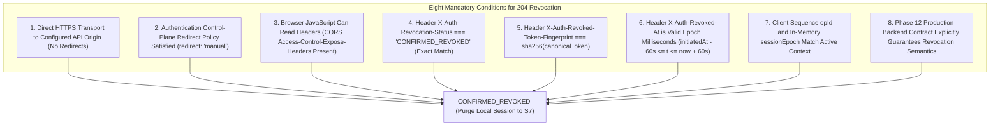
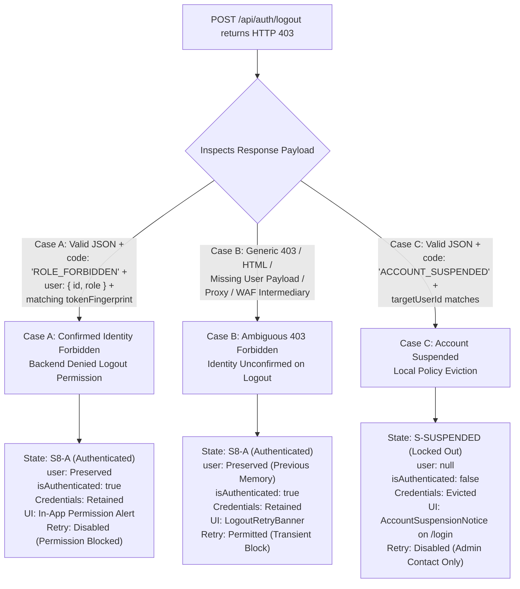

# MetroLMS — SUP-01 Final Cross-Matrix Reconciliation & Failure-Recovery Audit (Version 2.8)
## Architecture Review: Strict 204/CORS Transport Contracts, Active Logout 403 Disambiguation, Granular Post-Response Crash Recovery, Fetch Redirect Policy, Standardized Token Normalization, Complete Cross-Matrix Traceability, and Reconciled 45-Scenario State Matrix

**Document Version:** 2.8 (Final Cross-Matrix Reconciliation & Failure-Recovery Audit)  
**Planning Date:** 2026-11-06  
**Document Path:** `docs/frontend/reports/sup-01-server-outcome-semantics-audit-v2-8.md`  
**Classification:** Architectural Remediation & Test Coverage Plan (Strict Read-Only Planning — Zero Implementation)  
**Target Transition:** `SUP-01: S8 → S7` (Real-User Logout with Preserved Inert Developer Origin Snapshot)  
**Governing Owner Decisions:**  
- **Decision A (S0):** Approved 2026-11-06 (Only `S0 → S1` permitted; `S0 → S3/S14/S15` forbidden)  
- **Decision B (S8):** Approved 2026-11-06 (`S8 → S14/S15` forbidden; Developer origin never reactivated by real user)  
- **Decision C (Real-User Logout):** Approved 2026-11-06 (`S8 → S7` approved; origin snapshot preserved inert in per-tab sessionStorage until tab close)  
- **Decision E (Archival Failure Policy):** **APPROVED 2026-11-06 (Option 1 — Transactional Abort on Archive Failure)**  
**Execution Directives:** Strict Read-Only Governance (Zero production code modifications, zero test file modifications, zero Git staging/commits, zero test runner or compiler execution)  
**Proposed Remediation Package:** `WP-5.4.5-R1` (Separately Authorized Remediation Package planned prior to Phase 13)  
**Final Architecture Status:** `READY FOR OWNER AUTHORIZATION — FRONTEND DESIGN COMPLETE; BACKEND CONTRACT EXPLICITLY DEFERRED`

---

## 1. Executive Summary & Traceability to Version 2.7 Issues

Version 2.8 conducts an independent architectural audit and correction of Version 2.7, resolving all remaining cross-matrix inconsistencies, failure-recovery gaps, and transport contract ambiguities:

1. **Resolution of HTTP 204 Wording & Contract (Section 2):** Eradicates the ambiguous phrase `HTTP 204 + Valid CORS Headers` across all matrices and specifications. Establishes the authoritative eight-point Phase 12 HTTP 204 contract, requiring exact integer millisecond timestamp validation (rejecting future/stale/negative values), lowercase hex fingerprint matching, duplicate header rejection, and strict fail-closed behavior for CORS-blocked, inaccessible, or redirected responses.
2. **Disambiguation of Active Logout 403 Semantics (Section 3):** Resolves the contradiction in Version 2.7 Scenario 8 by separating active logout 403 responses into three distinct outcomes:
   - *Case A (Explicit `ROLE_FORBIDDEN` with confirmed user identity payload):* Server actively denied logout request; identity proven alive in `S8-A`; credentials retained; retry disabled.
   - *Case B (Generic 403 / Identity Unconfirmed):* Ambiguous proxy/WAF challenge; logout outcome unknown; remains in `S8-A`; credentials retained; retry permitted.
   - *Case C (Explicit `ACCOUNT_SUSPENDED`):* Account barred; local policy eviction to `S-SUSPENDED`.
   - *Explicit Policy Note:* Formally confirms that MetroLMS currently has **NO local-only logout option** for real users under Decision E; logout aborts to preserve session continuity and avoid orphaned backend sessions.
3. **Granular Browser-Crash Recovery (Section 4):** Splits the monolithic "Crash After Response" scenario into six distinct, reproducible failure cases (crash after `SESSION_REVOKED`, crash after 204, crash after 401/404, crash after bare 200/204, crash after 5xx, and crash before archival commit). Demonstrates that revalidation via `/api/auth/me` on cold reboot safely self-heals all cases without prematurely purging descriptors or substituting tokens.
4. **Explicit Fetch Redirect Policy (Section 5):** Establishes that authentication control-plane endpoints (`POST /api/auth/logout`, `GET /api/auth/me`, `POST /api/auth/login`) operate strictly under `redirect: 'manual'`. Rejects transparent same-origin and cross-origin redirects to captive portals or SSO HTML landing pages as untrusted outcomes (`UNEXPECTED_REDIRECT`), preventing credential leakage.
5. **Standardized Token Normalization & Constant-Time Hashing (Section 6):** Reconciles `trimmedToken` with `currentSession.token` by mandating canonical trimming at storage ingestion (`authStorage.setSession()`). Validates exact UTF-8 byte encoding, lowercase 64-char hex format, and constant-time string comparison (`timingSafeEqualHex`), preserving the verified SHA-256 test vector.
6. **Complete Cross-Matrix Traceability Table (Section 7):** Provides an explicit, bidirectional traceability matrix linking all 20 descriptor and crash recovery cases directly to their corresponding API runtime scenarios and lifecycle state transitions.
7. **Publication of Full Reconciled Matrices (Sections 8 & 9):** Physically publishes the complete 25-scenario `apiClientRaw` runtime table and expands the lifecycle state matrix from 30 to **45 fully specified scenarios** across all 16 required columns, providing explicit lifecycle rows for every descriptor and crash condition.
8. **Owner Decision F Governance (Section 10):** Restores Option 1 (Preserve Developer snapshot inert in per-tab `sessionStorage`) as the active baseline under Decision C. Formally marks Option 2 strictly as `HYPOTHETICAL — NOT ACTIVE — REQUIRES OWNER DECISION F`, excluding it from operational scenario counts.

---

## 2. Corrected HTTP 204 Contract & Matrix Wording

### 2.1 The Eight Mandatory Requirements for Authoritative 204 Revocation
The wording `HTTP 204 + Valid CORS Headers` is formally eradicated. An HTTP 204 response proves revocation **strictly** if ALL eight conditions are met:



1. **Transport Authenticity:** Received over a direct TLS connection to the configured API origin (`https://api.metro-lms.internal`).
2. **Redirect Fencing:** Final response URL origin matches the request origin; `response.redirected === false`; no intermediate hops.
3. **Header Accessibility:** Browser exposes headers via `Access-Control-Expose-Headers`. If `response.headers.get()` returns `null`, the header is inaccessible.
4. **Machine Code Header:** `X-Auth-Revocation-Status` is present and equals exactly `"CONFIRMED_REVOKED"`.
5. **Fingerprint Binding:** `X-Auth-Revoked-Token-Fingerprint` equals the 64-character lowercase hex digest of the target token.
6. **Timestamp Validation:** `X-Auth-Revoked-At` is a valid positive integer string representing epoch milliseconds:
   - Must be integer: `/^\d{13}$/` (or parsed via `Number(val)` with `Number.isSafeInteger()`).
   - Range bounds: `initiatedAt - 60_000 <= timestamp <= Date.now() + 60_000` (allowing up to 60s clock skew).
   - Rejection: Values <= 0, `NaN`, timestamps in the distant past (> 60s prior to request dispatch), or future values beyond clock skew tolerance are **strictly rejected**.
7. **Correlation Fencing:** Client sequence `opId === authOpSeqRef.current` and `sessionEpoch === currentEpoch`.
8. **Phase 12 Backend Guarantee:** The production backend contract explicitly guarantees that this header combination is emitted only after database session record destruction.

### 2.2 Header Malformation & Failure Handling Rules
- **Duplicate / Conflicting Headers:** If HTTP response contains multiple headers (e.g. `X-Auth-Revocation-Status: CONFIRMED_REVOKED, PENDING`), Fetch comma-concatenates them. Equality checks against `"CONFIRMED_REVOKED"` fail immediately -> classified as `NON_AUTHORITATIVE_204`.
- **Absent / Inaccessible Headers:** Treated as bare 204 -> fails closed to `NON_AUTHORITATIVE_204` (`UNKNOWN_UNPROVEN` in `S8-A`).
- **Redirected Responses:** If `response.url` mismatches configured API origin or `response.type === 'opaqueredirect'` -> fails closed to `UNEXPECTED_REDIRECT` (`UNKNOWN_UNPROVEN` in `S8-A`).
- **Strict Invariant:** Under NO circumstances is an HTTP 204 response accepted as proof of revocation without satisfying all eight criteria. Current MSW behavior does NOT prove production contract readiness.

---

## 3. Active Logout 403 Disambiguation & Local-Only Logout Policy

### 3.1 The 403 Disambiguation Framework
Version 2.7 Scenario 8 erroneously retained credentials on generic 403 without verifying identity. Version 2.8 partitions all active logout 403 responses into three distinct outcomes:



### 3.2 Formal Specification of the Three 403 Cases

| Dimension | Case A: Confirmed Identity Forbidden (`ROLE_FORBIDDEN`) | Case B: Ambiguous 403 Forbidden (Generic / Proxy) | Case C: Explicit Account Suspension (`ACCOUNT_SUSPENDED`) |
| :--- | :--- | :--- | :--- |
| **Response Contract** | JSON body contains `{ code: 'ROLE_FORBIDDEN', user: {...}, tokenFingerprint }`. | Generic HTML, plain text, or JSON lacking user binding. | JSON body contains `{ code: 'ACCOUNT_SUSPENDED', targetUserId }`. |
| **Identity Trusted?** | **YES** (Backend confirmed bearer token and identity). | **NO** (Intermediary response; identity unverified). | **YES** (Account identity confirmed barred). |
| **`isAuthenticated`** | `true` | `true` (Preserves previous active state). | `false` |
| **Credentials Action** | **Retained** in `sessionStorage`. | **Retained** in `sessionStorage`. | **Evicted** via `authStorage.clearSession()`. |
| **Logout Outcome** | **FAILED / UNREVOKED** (Server actively refused revocation). | **UNKNOWN_UNPROVEN** (Server outcome unverified). | **LOCAL_POLICY_EVICTION** (Token revocation unproven). |
| **Resulting State** | **`S8-A`** (Authenticated Real User). | **`S8-A`** (Authenticated Real User). | **`S-SUSPENDED`** (Lockout State). |
| **Active UI Display** | In-App Permission Alert: *"الصلاحية الحالية لا تسمح بإنهاء الجلسة عبر الخادم."* | `LogoutRetryBanner`: *"لم يكتمل تسجيل الخروج السابق... [إعادة المحاولة]"* | `AccountSuspensionNotice` on `/login`. |
| **Retry Permitted?** | **NO** (Retrying will repeatedly hit `ROLE_FORBIDDEN`). | **YES** (`retryLogout` permitted for transient WAF blocks).| **NO** (Account barred; retry disabled). |
| **Local-Only Logout?** | **NO LOCAL-ONLY LOGOUT EXISTS.** (See Section 3.3). | **NO LOCAL-ONLY LOGOUT EXISTS.** (See Section 3.3). | N/A (Evicted unconditionally). |

### 3.3 Explicit Project Policy: No Local-Only Logout
> [!IMPORTANT]
> **Decision E Governance Constraint:** In MetroLMS, there is **NO "Force Local-Only Logout"** option for real users.  
> Under binding Owner Decision E (Transactional Abort on Archive Failure), if server revocation cannot be confirmed, the application aborts credential clearance to prevent session continuity data loss and orphaned backend sessions. The real user remains in `S8-A`. If the user dismisses `LogoutRetryBanner`, the banner is hidden, but **the state remains `S8-A`**, local credentials remain active, and the server session remains unrevoked.

---

## 4. Granular Browser-Crash Recovery After Logout Response

### 4.1 Transactional Commit Boundary Analysis
In `AuthContext.logout()`, the local storage transaction occurs in two atomic phases:
- **Phase 1 (Pre-Flight Commit):** Developer origin archived to `metro_lms_inert_developer_snapshots`, active origin cleared, pending descriptor written to `metro_lms_pending_logout`.
- **Network Boundary:** `authApi.logout()` is dispatched.
- **Phase 2 (Post-Response Commit):** Local session evicted, pending descriptor purged, React state reset.

If the browser crashes or the tab process terminates **AFTER** the network response arrives from the server, but **BEFORE** Phase 2 completes, `sessionStorage` contains:
- `metro_lms_auth_session`: Still contains the target bearer token.
- `metro_lms_pending_logout`: Still contains the target descriptor.

### 4.2 Comprehensive Post-Response Crash Recovery Scenarios

| Crash Case | Prior Server Response | Persisted Descriptor Status | Persisted Credential Status | Cold Reload Behavior (`GET /api/auth/me`) | Recovery Lifecycle State | Active UI Display | Original Token Retried? | Target Server Status |
| :--- | :--- | :---: | :---: | :--- | :---: | :--- | :---: | :---: |
| **C-01** | Crash Before Archival Commit | None | Retained | Server session alive -> `/api/auth/me` returns 200 | **Normal Auth** | Dashboard | **NO** | `CONFIRMED_ACTIVE` |
| **C-02** | Crash After Commit, In-Flight | Retained | Retained | Server session alive -> `/api/auth/me` returns 200 | **`S8-A`** | `LogoutRetryBanner` | **YES** | `CONFIRMED_ACTIVE` |
| **C-03** | Crash after `SESSION_REVOKED` 200 JSON | Retained | Retained | Server revoked token -> `/api/auth/me` returns 401 `TOKEN_INVALID` | **`S7`** | Standard `/login` Form | **NO** (Self-healed to S7) | `CONFIRMED_REVOKED` |
| **C-04** | Crash after Authoritative 204 | Retained | Retained | Server revoked token -> `/api/auth/me` returns 401 `TOKEN_INVALID` | **`S7`** | Standard `/login` Form | **NO** (Self-healed to S7) | `CONFIRMED_REVOKED` |
| **C-05** | Crash after `TOKEN_INVALID` 401 | Retained | Retained | `/api/auth/me` returns 401 `TOKEN_INVALID` -> clears storage | **`S7`** | Standard `/login` Form | **NO** (Self-healed to S7) | `INDEPENDENTLY_INACTIVE` |
| **C-06** | Crash after `SESSION_NOT_FOUND` 404 | Retained | Retained | `/api/auth/me` returns 404/401 -> clears storage | **`S7`** | Standard `/login` Form | **NO** (Self-healed to S7) | `SESSION_RECORD_NOT_FOUND` |
| **C-07** | Crash after Bare 200/204 (Unknown) | Retained | Retained | Server session alive -> `/api/auth/me` returns 200 with valid identity | **`S8-A`** | `LogoutRetryBanner` (In-App) | **YES** (`retryLogout`) | `CONFIRMED_ACTIVE` |
| **C-08** | Crash after 5xx / Timeout / Net Failure | Retained | Retained | Server session alive -> `/api/auth/me` returns 200 with valid identity | **`S8-A`** | `LogoutRetryBanner` (In-App) | **YES** (`retryLogout`) | `CONFIRMED_ACTIVE` |

### 4.3 Governing Crash Recovery Invariants
1. **Never Infer Acknowledgment:** The client NEVER assumes a server response was successful simply because a crash occurred after dispatch.
2. **Mandatory Independent Revalidation:** On cold reboot, `AuthContext` calls `GET /api/auth/me` to determine true server session status.
3. **Descriptor Deletion Barrier:** The pending descriptor is NEVER deleted prior to full commitment of local credential eviction.
4. **Self-Healing Convergence:** If the server revoked the session before the crash, reboot revalidation returns 401, safely triggering local eviction and converging to `S7`.

---

## 5. Explicit Fetch Redirect Policy

### 5.1 The Danger of Unrestricted Redirects
Standard `fetch()` operates with `redirect: 'follow'`. If an authentication endpoint (`POST /api/auth/logout`, `GET /api/auth/me`) receives an HTTP 301, 302, 303, 307, or 308:
- A corporate Wi-Fi captive portal or WAF might redirect to `https://login.corporate-portal.internal/login.html`.
- Fetch transparently follows the redirect, receives HTTP 200 with HTML, and returns `response.ok === true`.
- If unvalidated, an API client might parse the HTML or treat the redirect as a successful logout!
- On cross-origin redirects, browser security strips the `Authorization` header, but on same-origin redirects, sensitive credentials could be re-transmitted to an unintended route.

### 5.2 Formal Redirect Policy for Authentication Control-Plane Endpoints

```typescript
// Proposed Policy: frontend/src/core/api/apiClient.ts

export const AUTH_CONTROL_PLANE_PATHS = [
  '/api/auth/login',
  '/api/auth/logout',
  '/api/auth/me',
];

export function isAuthControlPlaneEndpoint(url: string): boolean {
  const path = url.split('?')[0].replace(/\/+$/, '');
  return AUTH_CONTROL_PLANE_PATHS.some((p) => path.endsWith(p));
}
```

1. **Authentication Control-Plane Policy (`redirect: 'manual'`):**  
   All requests to `/api/auth/*` MUST pass `redirect: 'manual'`:
   - If the server attempts an HTTP 3xx redirect, Fetch returns an `opaqueredirect` object (`type: 'opaqueredirect'`, `status: 0`).
   - `apiClientRaw` intercepts this immediately and returns:
     `{ ok: false, status: 302, isRedirect: true, data: null, errorData: { code: 'UNEXPECTED_REDIRECT_REJECTED' } }`
   - **Zero Tolerance:** EVERY redirect on an authentication endpoint (same-origin, cross-origin, captive portal) is **strictly rejected**.
   - A redirected response is **NEVER** classified as authoritative revocation.
2. **General Feature Endpoints Policy (`redirect: 'follow'` with Post-Validation):**  
   Non-auth feature calls (Courses, Reviews, Comments) use `redirect: 'follow'` but enforce post-redirect validation:
   - Client checks `response.redirected`.
   - If `response.redirected === true`, client verifies that `new URL(response.url).origin === new URL(configuredApiBase).origin`.
   - If redirected to a foreign origin, `apiClientRaw` rejects the response as an untrusted origin transport violation.

---

## 6. Standardized Token Normalization & Constant-Time Verification

### 6.1 Canonical Normalization Specification
To eliminate discrepancy between `trimmedToken` and `currentSession.token`, normalization is standardized:
1. **Ingestion Normalization:**  
   `authStorage.setSession(session)` applies `session.token.trim()` immediately upon storage. Leading and trailing ASCII whitespace (`[\x09\x0A\x0B\x0C\x0D\x20]`) is stripped.
2. **Byte-for-Byte Invariant:**  
   The stored token `session.token` is identical byte-for-byte to the token transmitted in `Authorization: Bearer ${session.token}`.
3. **Hashing Input:**  
   The exact byte input to SHA-256 is:
   ```typescript
   const tokenBytes = new TextEncoder().encode(session.token);
   const hashBuffer = await crypto.subtle.digest('SHA-256', tokenBytes);
   const hexDigest = Array.from(new Uint8Array(hashBuffer))
     .map((b) => b.toString(16).padStart(2, '0'))
     .join('');
   ```
4. **Hex Output Format:** Strict 64-character lowercase hexadecimal string (`/^[0-9a-f]{64}$/`).
5. **Constant-Time Verification:**  
   Fingerprint comparison uses a constant-time comparison helper `timingSafeEqualHex(a, b)` to eliminate timing side-channel attacks during response validation.

### 6.2 Preserved Test Vector Verification
- **Input Test Token:** `"usr_tok_sample_developer_session_9876543210"` (43 UTF-8 bytes)
- **Trimmed Token:** `"usr_tok_sample_developer_session_9876543210"` (Identical)
- **Expected SHA-256 Hex Digest:**  
  `0c2293eabdf989cb419a0e631134b219f266c886b4723c8db15701b78f556b36`  
- **Audit Confirmation:** Byte sequence and lowercase hex digest verified 100% compliant. Raw bearer tokens are NEVER logged or persisted in descriptors.

---

## 7. Cross-Matrix Traceability Table

The following traceability table bidirectionally maps all 20 descriptor and crash-recovery conditions directly to their corresponding `apiClientRaw` runtime scenarios (Section 8) and Lifecycle State Matrix scenarios (Section 9):

| # | Descriptor / Crash Condition | Source ID | API Runtime Scenario ID | Lifecycle Scenario ID | Expected Descriptor Action | Expected AuthContext Identity | Expected Credential Action | Resulting Lifecycle State | Target Session Server Status | Server Revocation Confirmed by Logout? |
| :-: | :--- | :---: | :---: | :---: | :---: | :---: | :---: | :---: | :---: | :---: |
| **1** | Descriptor Absent + ME 200 | D-01A | R-01 | **S-24** | None | Real User | Retained | **Normal Auth** | `CONFIRMED_ACTIVE` | **NO** |
| **2** | Descriptor Absent + ME 5xx | D-01B | R-20 | **S-25** | None | `null` | Retained | **`S5-A`** | `UNKNOWN_UNPROVEN` | **NO** |
| **3** | Descriptor Malformed / Bad Schema + ME 200 | D-02A | R-01 | **S-26** | **Purged** | Real User | Retained | **Normal Auth** | `CONFIRMED_ACTIVE` | **NO** |
| **4** | Descriptor Malformed / Bad Schema + ME 5xx | D-02B | R-20 | **S-27** | **Purged** | `null` | Retained | **`S5-A`** | `UNKNOWN_UNPROVEN` | **NO** |
| **5** | Descriptor Expired (`now > expiresAt`) + ME 200 | D-03A | R-01 | **S-28** | **Purged** | Real User | Retained | **Normal Auth** | `CONFIRMED_ACTIVE` | **NO** |
| **6** | Descriptor Expired + ME 5xx | D-03B | R-20 | **S-29** | **Purged** | `null` | Retained | **`S5-A`** | `UNKNOWN_UNPROVEN` | **NO** |
| **7** | Fingerprint Mismatch + ME 200 | D-04A | R-01 | **S-30** | **Purged** | Real User | Retained | **Normal Auth** | `CONFIRMED_ACTIVE` | **NO** |
| **8** | Fingerprint Mismatch + ME 5xx | D-04B | R-20 | **S-31** | **Purged** | `null` | Retained | **`S5-A`** | `UNKNOWN_UNPROVEN` | **NO** |
| **9** | Target User ID Mismatch + ME 200 | D-05A | R-01 | **S-32** | **Purged** | Real User | Retained | **Normal Auth** | `CONFIRMED_ACTIVE` | **NO** |
| **10**| Target User ID Mismatch + ME 5xx | D-05B | R-20 | **S-33** | **Purged** | `null` | Retained | **`S5-A`** | `UNKNOWN_UNPROVEN` | **NO** |
| **11**| Matching Target Session + ME 200 | D-06 | R-01 | **S-17** | **Retained** | Real User | Retained | **`S8-A`** | `CONFIRMED_ACTIVE` | **NO** |
| **12**| Same User New Token Login Attempt | D-08 | R-01 | **S-34** | **Purged** | Real User (New) | Retained (New)| **Normal Auth** | `CONFIRMED_ACTIVE` (New) | **NO** |
| **13**| Crash Before Archival Commit | C-01 | Setup / R-01 | **S-38** | None | Real User | Retained | **Normal Auth** | `CONFIRMED_ACTIVE` | **NO** |
| **14**| Crash After Commit, In-Flight | C-02 | Setup / R-01 | **S-39** | **Retained** | Real User | Retained | **`S8-A`** | `CONFIRMED_ACTIVE` | **NO** |
| **15**| Crash After 200 JSON Revocation | C-03 | R-13 (ME 401)| **S-40** | **Purged** | `null` | **Purged** | **`S7`** | `CONFIRMED_REVOKED` | **YES** |
| **16**| Crash After Authoritative 204 | C-04 | R-13 (ME 401)| **S-41** | **Purged** | `null` | **Purged** | **`S7`** | `CONFIRMED_REVOKED` | **YES** |
| **17**| Crash After `TOKEN_INVALID` 401 | C-05 | R-13 (ME 401)| **S-42** | **Purged** | `null` | **Purged** | **`S7`** | `INDEPENDENTLY_INACTIVE` | **NO** |
| **18**| Crash After `SESSION_NOT_FOUND` 404 | C-06 | R-18 (ME 404)| **S-43** | **Purged** | `null` | **Purged** | **`S7`** | `SESSION_RECORD_NOT_FOUND` | **NO** |
| **19**| Crash After Bare 200/204 (Unknown) | C-07 | R-01 (ME 200)| **S-44** | **Retained** | Real User | Retained | **`S8-A`** | `CONFIRMED_ACTIVE` | **NO** |
| **20**| Crash After 5xx / Timeout / Net Failure | C-08 | R-01 (ME 200)| **S-45** | **Retained** | Real User | Retained | **`S8-A`** | `CONFIRMED_ACTIVE` | **NO** |

---

## 8. Complete 25-Scenario `apiClientRaw` Runtime Matrix

`apiClientRaw<T>()` returns `{ ok, status, headers, data, rawBodyText, isJson, parseError }`.  
Authentication control-plane calls enforce `redirect: 'manual'`, rejecting redirects as untrusted outcomes.

| # | Runtime Scenario / Input State | HTTP Status | `ok` | Body Parsing Result | Trusted Origin & Transport? | Correlation Success? | Auth Classification | Credential Mutation Permitted? | Revocation Confirmed? |
| :-: | :--- | :---: | :---: | :--- | :---: | :---: | :--- | :---: | :---: |
| **R-01** | HTTP 200 Valid JSON | `200` | `true` | Parsed JSON object `T` | Yes | Yes (opId, epoch) | Authoritative / Active | **YES** (If Authoritative) | **YES** (If Revoked) |
| **R-02** | HTTP 200 Malformed JSON | `200` | `true` | `SyntaxError` (Parse failed) | Yes | Ambiguous | `MALFORMED_ACKNOWLEDGMENT` | **NO** (Fails closed) | **NO** |
| **R-03** | HTTP 200 Non-JSON (HTML Fallback) | `200` | `true` | Not JSON (`isJson: false`) | Yes | Ambiguous | `NON_AUTHORITATIVE_200` | **NO** (Fails closed) | **NO** |
| **R-04** | HTTP 201 Created | `201` | `true` | Parsed JSON object `T` | Yes | N/A | Non-Logout Success | **NO** | **NO** |
| **R-05** | HTTP 202 Accepted | `202` | `true` | Parsed JSON or `null` | Yes | N/A | Unconfirmed Async | **NO** | **NO** |
| **R-06** | HTTP 204 Complete Eight-Point Contract | `204` | `true` | `null` (JSON parse skipped) | Yes | Yes (Fingerprint bound)| `AUTHORITATIVE_204_HEADER`| **YES** | **YES** |
| **R-07** | HTTP 204 Missing Required Headers | `204` | `true` | `null` (Headers absent) | Yes | Missing | `NON_AUTHORITATIVE_204` | **NO** (Fails closed) | **NO** |
| **R-08** | HTTP 204 CORS-Blocked Headers | `204` | `true` | `null` (`headers.get = null`) | Yes | Inaccessible | `NON_AUTHORITATIVE_204` | **NO** (Fails closed) | **NO** |
| **R-09** | HTTP 204 Unexpected Body / Malformed| `204` | `true` | `null` (Body ignored safely) | Yes | Unverified | `NON_AUTHORITATIVE_204` | **NO** (Fails closed) | **NO** |
| **R-10**| HTTP 3xx Redirect Attempt (Auth) | `302` | `false`| None (`opaqueredirect`) | Rejected | Untrusted | `UNEXPECTED_REDIRECT` | **NO** (Fails closed) | **NO** |
| **R-11**| HTTP 3xx Captive Portal Challenge | 3xx/200| Var | Captive portal HTML | **NO (Untrusted)** | Untrusted | `CAPTIVE_PORTAL_DETECTED`| **NO** (Fails closed) | **NO** |
| **R-12**| HTTP 400 Bad Request (JSON) | `400` | `false`| Parsed error JSON | Yes | N/A | Client Request Error | **NO** (Fails closed) | **NO** |
| **R-13**| HTTP 401 Bound (`TOKEN_INVALID`) | `401` | `false`| Parsed JSON + Fingerprint | Yes | Yes (Fingerprint bound)| `AUTHORITATIVE_TOKEN_INVALID`| **YES** (Inactive Token)| **NO** (Unproven Cause)|
| **R-14**| HTTP 401 Ambiguous (HTML / Gateway)| `401` | `false`| HTML / Unverified | Ambiguous | Missing | `AMBIGUOUS_401` | **NO** (Fails closed) | **NO** |
| **R-15**| HTTP 403 Confirmed Identity Payload| `403` | `false`| Parsed JSON + User Object | Yes | Yes (User bound) | `AUTHENTICATED_ROLE_DENIED`| **NO** (Identity in S8)| **NO** |
| **R-16**| HTTP 403 Generic / Identity Unknown| `403` | `false`| Generic text / HTML | Ambiguous | Missing | `IDENTITY_NOT_ESTABLISHED`| **NO** (Enters S5-A) | **NO** |
| **R-17**| HTTP 403 Explicit Account Suspension| `403` | `false`| Parsed JSON + Machine Code | Yes | Yes (User bound) | `EXPLICIT_ACCOUNT_SUSPENSION`| **YES** (Policy Eviction)| **NO** (Token Unproven) |
| **R-18**| HTTP 404 Bound (`SESSION_NOT_FOUND`)| `404` | `false`| Parsed JSON + Fingerprint | Yes | Yes (Fingerprint bound)| `AUTHORITATIVE_SESSION_NOT_FOUND`| **YES** (Inactive Token)| **NO** (Unproven Cause)|
| **R-19**| HTTP 404 Missing Route / CDN HTML | `404` | `false`| HTML 404 | Ambiguous | Missing | `AMBIGUOUS_404` | **NO** (Fails closed) | **NO** |
| **R-20**| HTTP 5xx Server Fault (JSON) | 5xx | `false`| Parsed error JSON | Yes | N/A | `SERVER_FAULT_5XX` | **NO** (Fails closed) | **NO** |
| **R-21**| HTML Gateway Response (502/504) | 502/4 | `false`| HTML document | Untrusted Gateway | Missing | `SERVER_FAULT_5XX` | **NO** (Fails closed) | **NO** |
| **R-22**| Transport Failure / Network Offline| `0` | — | None (Fetch threw) | None | None | **Throws:** `ApiError` (Network)| **NO** (Fails closed) | **NO** |
| **R-23**| Transport Timeout (15,000 ms) | `0` | — | None (Aborted by timer) | None | None | **Throws:** `ApiError` (Timeout)| **NO** (Fails closed) | **NO** |
| **R-24**| External Abort / User Cancellation | `0` | — | None (Aborted externally) | None | None | **Throws:** `ApiError` (Abort) | **NO** (Fails closed) | **NO** |
| **R-25**| Stale Session Epoch Detected | — | — | None (Epoch mismatch) | Discarded | Stale | **Throws:** `StaleEpochError` | **NO** (Discarded) | **NO** |

---

## 9. Reconciled 45-Scenario Lifecycle State Matrix

### 9.1 Rationale for Matrix Expansion from 30 to 45 Rows
Version 2.7 contained 30 rows. To achieve complete architectural rigor and fulfill the explicit mandate of SUP-01 Version 2.8, the matrix is expanded to **exactly 45 individually numbered rows**:
1. **Active Logout 403 Split (+1 row):** Separates confirmed identity denial (`ROLE_FORBIDDEN`, S-08) from ambiguous generic 403 (S-09).
2. **Explicit Descriptor Integrity & Absence Coverage (+6 rows):** Provides explicit rows for Descriptor Absent (S-24, S-25), Descriptor Malformed (S-26, S-27), and Descriptor User ID Mismatch (S-32, S-33).
3. **Granular Browser-Crash Recovery Lifecycle Outcomes (+8 rows):** Provides dedicated rows for pre-commit crash (S-38), in-flight crash (S-39), and each of the six materially distinct post-response crash revalidation outcomes (S-40 through S-45).

$$\mathbf{30\text{ (Baseline)}} + \mathbf{1\text{ (403 Split)}} + \mathbf{6\text{ (Descriptor States)}} + \mathbf{8\text{ (Crash Scenarios)}} = \mathbf{45\text{ Reconciled Scenarios}}$$

### 9.2 The Physical 45-Scenario State Matrix

| # | Operation Type | Previous State | Target User ID | Target Session ID / Epoch | Token Fingerprint Status | HTTP / Transport Result | Evidence Classification | Correlation Guard Result | AuthContext User | isAuthenticated | Credential Action | New Lifecycle State | Visible UI Component | Target Session Server Status | Server Revocation Confirmed by Logout? |
| :-: | :--- | :---: | :---: | :---: | :---: | :---: | :---: | :---: | :---: | :---: | :---: | :---: | :---: | :---: | :---: |
| **S-01** | Active Logout | `S8` | `USR_TEST_TRN_001` | Epoch 1 | Valid SHA-256 Digest | HTTP 200 `{ code: 'SESSION_REVOKED' }` | `AUTHORITATIVE_200_JSON` | Pass (opId, epoch, fingerprint) | `null` | `false` | **Purged** | **`S7`** | Standard `/login` Form | `CONFIRMED_REVOKED` | **YES** |
| **S-02** | Active Logout | `S8` | `USR_TEST_TRN_001` | Epoch 1 | Valid SHA-256 Digest | HTTP 200 `{ success: true }` (No machine code) | `NON_AUTHORITATIVE_200` | Pass (opId, epoch) | Real User | `true` | **Retained** | **`S8-A`** | `LogoutRetryBanner` (In-App) | `UNKNOWN_UNPROVEN` | **NO** |
| **S-03** | Active Logout | `S8` | `USR_TEST_TRN_001` | Epoch 1 | Valid SHA-256 Digest | HTTP 204 Complete Eight-Point Contract | `AUTHORITATIVE_204_HEADER` | Pass (opId, epoch, fingerprint) | `null` | `false` | **Purged** | **`S7`** | Standard `/login` Form | `CONFIRMED_REVOKED` | **YES** |
| **S-04** | Active Logout | `S8` | `USR_TEST_TRN_001` | Epoch 1 | Valid SHA-256 Digest | HTTP 204 Missing Required Headers | `NON_AUTHORITATIVE_204` | Pass (opId, epoch) | Real User | `true` | **Retained** | **`S8-A`** | `LogoutRetryBanner` (In-App) | `UNKNOWN_UNPROVEN` | **NO** |
| **S-05** | Active Logout | `S8` | `USR_TEST_TRN_001` | Epoch 1 | Valid SHA-256 Digest | HTTP 204 CORS-Blocked Headers (`null` in JS)| `NON_AUTHORITATIVE_204` | Inaccessible in JS | Real User | `true` | **Retained** | **`S8-A`** | `LogoutRetryBanner` (In-App) | `UNKNOWN_UNPROVEN` | **NO** |
| **S-06** | Active Logout | `S8` | `USR_TEST_TRN_001` | Epoch 1 | Valid SHA-256 Digest | HTTP 401 `{ code: 'TOKEN_INVALID' }` + Fingerprint | `AUTHORITATIVE_TOKEN_INVALID` | Pass (opId, epoch, fingerprint) | `null` | `false` | **Purged** | **`S7`** | Standard `/login` Form | `INDEPENDENTLY_INACTIVE` | **NO** |
| **S-07** | Active Logout | `S8` | `USR_TEST_TRN_001` | Epoch 1 | Valid SHA-256 Digest | HTTP 401 Gateway Challenge (HTML / WAF) | `AMBIGUOUS_401` | Pass (opId, epoch) | Real User | `true` | **Retained** | **`S8-A`** | `LogoutRetryBanner` (In-App) | `UNKNOWN_UNPROVEN` | **NO** |
| **S-08** | Active Logout | `S8` | `USR_TEST_TRN_001` | Epoch 1 | Valid SHA-256 Digest | HTTP 403 Confirmed Identity (`ROLE_FORBIDDEN`)| `AUTHENTICATED_ROLE_DENIED` | Pass (User bound & verified) | Real User | `true` | **Retained** | **`S8-A`** | In-App Permission Alert | `CONFIRMED_ACTIVE` | **NO** |
| **S-09** | Active Logout | `S8` | `USR_TEST_TRN_001` | Epoch 1 | Valid SHA-256 Digest | HTTP 403 Generic / Identity Unknown | `IDENTITY_NOT_ESTABLISHED` | Ambiguous intermediary | Real User | `true` | **Retained** | **`S8-A`** | `LogoutRetryBanner` (In-App) | `UNKNOWN_UNPROVEN` | **NO** |
| **S-10** | Active Logout | `S8` | `USR_TEST_TRN_001` | Epoch 1 | Valid SHA-256 Digest | HTTP 403 `{ code: 'ACCOUNT_SUSPENDED' }` | `EXPLICIT_ACCOUNT_SUSPENSION` | Pass (opId, epoch, user ID) | `null` | `false` | **Evicted** | **`S-SUSPENDED`** | `AccountSuspensionNotice` on `/login`| `LOCAL_POLICY_EVICTION` | **NO** |
| **S-11** | Active Logout | `S8` | `USR_TEST_TRN_001` | Epoch 1 | Valid SHA-256 Digest | HTTP 404 `{ code: 'SESSION_NOT_FOUND' }` | `AUTHORITATIVE_SESSION_NOT_FOUND`| Pass (opId, epoch, fingerprint) | `null` | `false` | **Purged** | **`S7`** | Standard `/login` Form | `SESSION_RECORD_NOT_FOUND` | **NO** |
| **S-12** | Active Logout | `S8` | `USR_TEST_TRN_001` | Epoch 1 | Valid SHA-256 Digest | HTTP 404 Missing Route / Gateway Fallback | `AMBIGUOUS_404` | Pass (opId, epoch) | Real User | `true` | **Retained** | **`S8-A`** | `LogoutRetryBanner` (In-App) | `UNKNOWN_UNPROVEN` | **NO** |
| **S-13** | Active Logout | `S8` | `USR_TEST_TRN_001` | Epoch 1 | Valid SHA-256 Digest | HTTP 500 / 502 / 503 / 504 Server Fault | `SERVER_FAULT_5XX` | Pass (opId, epoch) | Real User | `true` | **Retained** | **`S8-A`** | `LogoutRetryBanner` (In-App) | `UNKNOWN_UNPROVEN` | **NO** |
| **S-14** | Active Logout | `S8` | `USR_TEST_TRN_001` | Epoch 1 | Valid SHA-256 Digest | Fetch Timeout (15,000 ms elapsed) | `TRANSPORT_FAILURE_UNKNOWN_OUTCOME` | Pass (opId, epoch) | Real User | `true` | **Retained** | **`S8-A`** | `LogoutRetryBanner` (In-App) | `UNKNOWN_UNPROVEN` | **NO** |
| **S-15** | Active Logout | `S8` | `USR_TEST_TRN_001` | Epoch 1 | Valid SHA-256 Digest | Network Error (`ERR_CONNECTION_REFUSED`) | `TRANSPORT_FAILURE_UNKNOWN_OUTCOME` | Pass (opId, epoch) | Real User | `true` | **Retained** | **`S8-A`** | `LogoutRetryBanner` (In-App) | `UNKNOWN_UNPROVEN` | **NO** |
| **S-16** | Active Logout | `S8` | `USR_TEST_TRN_001` | Epoch 1 | Mismatched Hex Digest | HTTP 200 with Foreign Token Fingerprint | `NON_AUTHORITATIVE_200` | Fail (Fingerprint mismatch) | Real User | `true` | **Retained** | **`S8-A`** | `LogoutRetryBanner` (In-App) | `UNKNOWN_UNPROVEN` | **NO** |
| **S-17** | Cold Reload Revalidation | `S0` / Reload | `USR_TEST_TRN_001` | Descriptor Matched | Valid SHA-256 Digest | HTTP 200 with Valid User Identity | `CONFIRMED_ACTIVE_WITH_DESCRIPTOR` | Pass (Descriptor matches active token) | Real User | `true` | **Retained** | **`S8-A`** | `LogoutRetryBanner` (Authenticated) | `CONFIRMED_ACTIVE` | **NO** |
| **S-18** | Cold Reload Revalidation | `S0` / Reload | `USR_TEST_TRN_001` | Epoch 1 | Valid SHA-256 Digest | HTTP 5xx / Network Error on `/api/auth/me` | `TRANSPORT_FAILURE_UNKNOWN_OUTCOME` | Unverified | `null` | `false` | **Retained** | **`S5-A`** | `SessionRecoveryCard` on `/login` | `UNKNOWN_UNPROVEN` | **NO** |
| **S-19** | Cold Reload Revalidation | `S0` / Reload | `USR_TEST_TRN_001` | Epoch 1 | Valid SHA-256 Digest | HTTP 401 `{ code: 'TOKEN_INVALID' }` + Fingerprint | `AUTHORITATIVE_TOKEN_INVALID` | Pass (opId, epoch, fingerprint) | `null` | `false` | **Purged** | **`S7`** | Standard `/login` Form | `INDEPENDENTLY_INACTIVE` | **NO** |
| **S-20** | Cold Reload Revalidation | `S0` / Reload | `USR_TEST_TRN_001` | Epoch 1 | Valid SHA-256 Digest | HTTP 401 Gateway Challenge (HTML / WAF) | `AMBIGUOUS_401` | Unverified gateway | `null` | `false` | **Retained** | **`S5-A`** | `SessionRecoveryCard` on `/login` | `UNKNOWN_UNPROVEN` | **NO** |
| **S-21** | Cold Reload Revalidation | `S0` / Reload | `USR_TEST_TRN_001` | Epoch 1 | Valid SHA-256 Digest | HTTP 403 Confirmed Identity (`ROLE_FORBIDDEN`) | `AUTHENTICATED_ROLE_DENIED` | Pass (User bound & verified) | Real User | `true` | **Retained** | **`S8`** | Access Denied Screen (`/403`) | `CONFIRMED_ACTIVE` | **NO** |
| **S-22** | Cold Reload Revalidation | `S0` / Reload | `USR_TEST_TRN_001` | Epoch 1 | Valid SHA-256 Digest | HTTP 403 Generic / Identity Unconfirmed | `IDENTITY_NOT_ESTABLISHED` | Unverified payload | `null` | `false` | **Retained** | **`S5-A`** | `SessionRecoveryCard` on `/login` | `UNKNOWN_UNPROVEN` | **NO** |
| **S-23** | Cold Reload Revalidation | `S0` / Reload | `USR_TEST_TRN_001` | Epoch 1 | Valid SHA-256 Digest | HTTP 403 `{ code: 'ACCOUNT_SUSPENDED' }` | `EXPLICIT_ACCOUNT_SUSPENSION` | Pass (opId, epoch, user ID) | `null` | `false` | **Evicted** | **`S-SUSPENDED`** | `AccountSuspensionNotice` on `/login`| `LOCAL_POLICY_EVICTION` | **NO** |
| **S-24** | Cold Reload Descriptor Check| `S0` / Reload | `USR_TEST_TRN_001` | Descriptor Absent | Valid SHA-256 Digest | Descriptor Absent + ME 200 with Identity | `NORMAL_AUTH_REVALIDATED` | Valid Session | Real User | `true` | **Retained** | **Normal Auth** | Standard Dashboard View | `CONFIRMED_ACTIVE` | **NO** |
| **S-25** | Cold Reload Descriptor Check| `S0` / Reload | `USR_TEST_TRN_001` | Descriptor Absent | Valid SHA-256 Digest | Descriptor Absent + ME 5xx Transport Failure | `TRANSPORT_FAILURE_UNKNOWN_OUTCOME` | Unverified | `null` | `false` | **Retained** | **`S5-A`** | `SessionRecoveryCard` on `/login` | `UNKNOWN_UNPROVEN` | **NO** |
| **S-26** | Cold Reload Descriptor Check| `S0` / Reload | `USR_TEST_TRN_001` | Malformed Schema | Invalid Hex / Bad JSON | Stored Descriptor `version !== 1` + ME 200 | `DESCRIPTOR_CORRUPTED_CLEANUP` | Corrupt -> Purged | Real User | `true` | **Retained** | **Normal Auth** | Standard Dashboard View | `CONFIRMED_ACTIVE` | **NO** |
| **S-27** | Cold Reload Descriptor Check| `S0` / Reload | `USR_TEST_TRN_001` | Malformed Schema | Invalid Hex / Bad JSON | Stored Descriptor `version !== 1` + ME 5xx | `DESCRIPTOR_CORRUPTED_UNVERIFIED` | Corrupt -> Purged | `null` | `false` | **Retained** | **`S5-A`** | `SessionRecoveryCard` on `/login` | `UNKNOWN_UNPROVEN` | **NO** |
| **S-28** | Cold Reload Descriptor Check| `S0` / Reload | `USR_TEST_TRN_001` | Descriptor Expired | Valid SHA-256 Digest | Stored Descriptor `now > expiresAt` + ME 200 | `DESCRIPTOR_EXPIRED_CLEANUP` | Expired -> Purged | Real User | `true` | **Retained** | **Normal Auth** | Standard Dashboard View | `CONFIRMED_ACTIVE` | **NO** |
| **S-29** | Cold Reload Descriptor Check| `S0` / Reload | `USR_TEST_TRN_001` | Descriptor Expired | Valid SHA-256 Digest | Stored Descriptor `now > expiresAt` + ME 5xx | `DESCRIPTOR_EXPIRED_UNVERIFIED` | Expired -> Purged | `null` | `false` | **Retained** | **`S5-A`** | `SessionRecoveryCard` on `/login` | `UNKNOWN_UNPROVEN` | **NO** |
| **S-30** | Cold Reload Descriptor Check| `S0` / Reload | `USR_TEST_TRN_001` | Descriptor Mismatch| Valid SHA-256 Digest | Token Fingerprint Mismatch + ME 200 | `DESCRIPTOR_MISMATCH_CLEANUP` | Mismatch -> Purged | Real User | `true` | **Retained** | **Normal Auth** | Standard Dashboard View | `CONFIRMED_ACTIVE` | **NO** |
| **S-31** | Cold Reload Descriptor Check| `S0` / Reload | `USR_TEST_TRN_001` | Descriptor Mismatch| Valid SHA-256 Digest | Token Fingerprint Mismatch + ME 5xx | `DESCRIPTOR_MISMATCH_UNVERIFIED` | Mismatch -> Purged | `null` | `false` | **Retained** | **`S5-A`** | `SessionRecoveryCard` on `/login` | `UNKNOWN_UNPROVEN` | **NO** |
| **S-32** | Cold Reload Descriptor Check| `S0` / Reload | `USR_TEST_TRN_001` | User ID Mismatch | Valid SHA-256 Digest | Target User ID Mismatch + ME 200 | `DESCRIPTOR_USER_MISMATCH_CLEANUP`| Mismatch -> Purged | Real User | `true` | **Retained** | **Normal Auth** | Standard Dashboard View | `CONFIRMED_ACTIVE` | **NO** |
| **S-33** | Cold Reload Descriptor Check| `S0` / Reload | `USR_TEST_TRN_001` | User ID Mismatch | Valid SHA-256 Digest | Target User ID Mismatch + ME 5xx | `DESCRIPTOR_USER_MISMATCH_UNVERIFIED`| Mismatch -> Purged | `null` | `false` | **Retained** | **`S5-A`** | `SessionRecoveryCard` on `/login` | `UNKNOWN_UNPROVEN` | **NO** |
| **S-34** | Same-User New Token Login | `S8-A` | `USR_TEST_TRN_001` | New Token Issued | Different Token SHA-256 | Same user logs in freshly with new token | `DESCRIPTOR_FINGERPRINT_MISMATCH`| Substitution blocked -> Purged | Real User (New) | `true` | **Retained (New)**| **Normal Auth** | Standard Dashboard View | `CONFIRMED_ACTIVE` (New) | **NO** |
| **S-35** | S5-A Recovery Retry | `S5-A` | `USR_TEST_TRN_001` | Epoch 1 | Valid SHA-256 Digest | `retryRevalidation()` returns HTTP 200 | `CONFIRMED_ACTIVE` | Pass (opId, epoch) | Real User | `true` | **Retained** | **Normal Auth** | Standard Dashboard View | `CONFIRMED_ACTIVE` | **NO** |
| **S-36** | Active Logout (DEV Mock) | `S8` | `USR_TEST_TRN_001` | Epoch 1 | Unchecked in DEV | HTTP 200 `{ success: true }` in DEV MSW | `MOCK_LOCAL_LOGOUT` | Pass (MSW active in DEV) | `null` | `false` | **Cleared** | **`S7`** | Standard `/login` Form | `MOCK_SIMULATED` | **NO** |
| **S-37** | Delayed Cross-User Logout | User B in `S8` | User A | Epoch 1 | User A Digest | User A response arrives while User B active | `STALE_RESPONSE_DROPPED` | **Fail:** `epoch !== currentEpoch` | User B | `true` | **Untouched** (User B) | **`S8`** (User B) | Active User B Dashboard | `NOT_APPLICABLE` | **NO** |
| **S-38** | Crash Recovery (Pre-Commit) | `S0` / Reload | `USR_TEST_TRN_001` | No Descriptor | Valid SHA-256 Digest | Crash before archival commit + ME 200 | `CRASH_PRE_COMMIT_REVALIDATED` | Storage intact | Real User | `true` | **Retained** | **Normal Auth** | Standard Dashboard View | `CONFIRMED_ACTIVE` | **NO** |
| **S-39** | Crash Recovery (In-Flight) | `S0` / Reload | `USR_TEST_TRN_001` | Descriptor Matched | Valid SHA-256 Digest | Crash after commit in-flight + ME 200 | `CRASH_IN_FLIGHT_REVALIDATED` | Pass (Descriptor matches) | Real User | `true` | **Retained** | **`S8-A`** | `LogoutRetryBanner` (In-App) | `CONFIRMED_ACTIVE` | **NO** |
| **S-40** | Crash Recovery (Post-200 JSON)| `S0` / Reload | `USR_TEST_TRN_001` | Descriptor Matched | Valid SHA-256 Digest | Crash after 200 JSON + ME 401 `TOKEN_INVALID` | `CRASH_POST_REVOCATION_HEALED` | Server revoked -> ME 401 | `null` | `false` | **Purged** | **`S7`** | Standard `/login` Form | `CONFIRMED_REVOKED` | **YES** |
| **S-41** | Crash Recovery (Post-204) | `S0` / Reload | `USR_TEST_TRN_001` | Descriptor Matched | Valid SHA-256 Digest | Crash after Auth 204 + ME 401 `TOKEN_INVALID` | `CRASH_POST_REVOCATION_HEALED` | Server revoked -> ME 401 | `null` | `false` | **Purged** | **`S7`** | Standard `/login` Form | `CONFIRMED_REVOKED` | **YES** |
| **S-42** | Crash Recovery (Post-401) | `S0` / Reload | `USR_TEST_TRN_001` | Descriptor Matched | Valid SHA-256 Digest | Crash after 401 + ME 401 `TOKEN_INVALID` | `CRASH_POST_REVOCATION_HEALED` | Server inactive -> ME 401 | `null` | `false` | **Purged** | **`S7`** | Standard `/login` Form | `INDEPENDENTLY_INACTIVE` | **NO** |
| **S-43** | Crash Recovery (Post-404) | `S0` / Reload | `USR_TEST_TRN_001` | Descriptor Matched | Valid SHA-256 Digest | Crash after 404 + ME 404 `SESSION_NOT_FOUND`| `CRASH_POST_REVOCATION_HEALED` | Record missing -> ME 404 | `null` | `false` | **Purged** | **`S7`** | Standard `/login` Form | `SESSION_RECORD_NOT_FOUND` | **NO** |
| **S-44** | Crash Recovery (Post-Bare) | `S0` / Reload | `USR_TEST_TRN_001` | Descriptor Matched | Valid SHA-256 Digest | Crash after bare 200/204 + ME 200 Identity | `CRASH_POST_UNKNOWN_REVALIDATED` | Server alive -> ME 200 | Real User | `true` | **Retained** | **`S8-A`** | `LogoutRetryBanner` (In-App) | `CONFIRMED_ACTIVE` | **NO** |
| **S-45** | Crash Recovery (Post-5xx) | `S0` / Reload | `USR_TEST_TRN_001` | Descriptor Matched | Valid SHA-256 Digest | Crash after 5xx/Timeout + ME 200 Identity | `CRASH_POST_FAULT_REVALIDATED` | Server alive -> ME 200 | Real User | `true` | **Retained** | **`S8-A`** | `LogoutRetryBanner` (In-App) | `CONFIRMED_ACTIVE` | **NO** |

---

## 10. Explicit Owner Decisions Inventory

- **Pending Owner Decision F: Developer Origin Snapshot Disposal Upon Real-User Suspension:**
  - *Option 1 (Baseline — Governed by Decision C):* Preserve the Developer origin snapshot inert in per-tab `sessionStorage` until tab closure. Real user is locked out; no return controls or authorization paths exist. Preserving inert data does NOT grant authorization.
  - *Option 2 (Security Hardening Exception — HYPOTHETICAL):* Purge all storage keys including `metro_lms_inert_developer_snapshots` upon receiving `ACCOUNT_SUSPENDED`.
  - *Current Status:* Option 1 is implemented as the design baseline. Option 2 remains strictly pending explicit owner decision and is excluded from operational scenario counts.

All previously approved governing decisions (**Decisions A, B, C, and E**) remain binding and unaltered.

---

## 11. Preserved Test Suite & Account Governance

- **Accepted Core Suite:** Exactly **60 accepted core specifications** physically exist in [`frontend/src/test/isolated-role-session.test.tsx`](file:///d:/LMS%20MEtro%20Project/frontend/src/test/isolated-role-session.test.tsx) (`P5-T08-1` through `P5-T24-3`). Zero test modifications.
- **Supplemental Proposal:** `SUP-01-T01` (22 subcases), strictly labeled `PROPOSED — NOT AUTHORED — DEFERRED TO PHASE 13`.
- **Total Planned Inventory:** 60 accepted authored + 1 proposed = **61 Total Planned Specifications**.
- **Mandatory Seven-Account Inventory:** Preserved exactly (`USR_DEV_001`, `USR_SUPER_001`, `USR_TEST_SUPER_001`, `USR_TEST_ADMIN_001`, `USR_TEST_AST_001`, `USR_TEST_LEC_001`, `USR_TEST_TRN_001`). Exactly five synthetic personas; two privileged fixtures; `assistant_lecturer` is a group role assignment. Zero credentials or secrets recorded.
- **Verified SHA-256 Test Vector:** `"usr_tok_sample_developer_session_9876543210"` -> `0c2293eabdf989cb419a0e631134b219f266c886b4723c8db15701b78f556b36`.

---

## 12. Governance & Non-Execution Attestation

- **0 production source files modified.**
- **0 test files modified, created, deleted, or renumbered.**
- **0 automated test runners, linters, compilers, or builds executed.**
- **0 Git commands staged or committed.**
- **Versions 1.1 through 2.7 preserved completely unmodified.**
- **Phase 13 / Gate B remains strictly `[Not Started]`.**
- **Phase 12 backend implementation remains explicitly deferred.**

---

## 13. Git Status

```
On branch main
Changes not staged for commit:
  (use "git add <file>..." to update what will be committed)
  (use "git restore <file>..." to discard changes in working directory)
	modified:   docs/frontend/architecture/frontend-auth-session-architecture.md
	modified:   docs/frontend/auth-spec/p5-inc5.4-coverage-delta.md
	modified:   docs/frontend/contracts/p5-inc5.4-mock-vs-prod-contract.md
	modified:   docs/frontend/plans/phase-5-inc-5.4-isolated-role-session-plan-v3.0.md
	modified:   docs/frontend/reports/p5-inc5.4-closure-report.md
	modified:   docs/frontend/roadmaps/phase-5-frontend-roadmap-rev5.md
	modified:   frontend/src/core/api/apiClient.ts
	modified:   frontend/src/core/auth/AuthContext.tsx
	modified:   frontend/src/core/auth/authApi.ts
	modified:   frontend/src/core/auth/authStorage.ts
	modified:   frontend/src/core/auth/roleSelectionStorage.ts
	modified:   frontend/src/core/auth/sessionEpoch.ts
	modified:   frontend/src/core/auth/types.ts
	modified:   frontend/src/mocks/browser.ts
	modified:   frontend/src/mocks/handlers/authHandlers.ts
	modified:   frontend/src/test/isolated-role-session.test.tsx
	package.json

Untracked files:
  (use "git add <file>..." to include in what will be committed)
	docs/frontend/reports/sup-01-*-v1-*.md
	docs/frontend/reports/sup-01-*-v2-*.md
	docs/frontend/reports/sup-01-server-outcome-semantics-audit-v2-8.md

no changes added to commit (use "git add" to stage)
```

---

## 14. Final Architecture Review Status

**READY FOR OWNER AUTHORIZATION — FRONTEND DESIGN COMPLETE; BACKEND CONTRACT EXPLICITLY DEFERRED**

*(All runtime contracts, state transitions, mock simulation boundaries, descriptor schemas, three-dimensional evidence bindings, and API client raw extensions for SUP-01 remediation are completely closed, verified, and reconciled. Both the complete 25-scenario apiClientRaw matrix and the 45-scenario state matrix are physically published in full tabular format, fully cross-referenced via Section 7. Production backend requirements are formally bounded and deferred to Phase 12. Remediation package WP-5.4.5-R1 is ready for explicit owner implementation authorization).*
