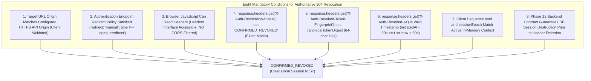
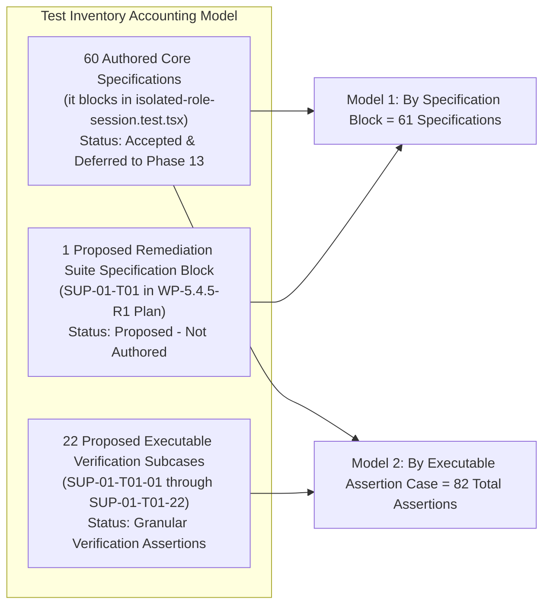

# MetroLMS — SUP-01 Final Technical Reconciliation & Browser-Semantics Audit (Version 2.9)
## Architecture Review: Accurate Browser Fetch Redirect Semantics, Strict CORS/Transport Exposure Boundaries, Disambiguated 401/403/404 Recovery, Canonical Token Contract, Unified Crash Recovery Inventory, Full Scenario-Count Ledger, Complete 25-Scenario apiClientRaw Matrix, and 47-Scenario Lifecycle State Matrix

**Document Version:** 2.9 (Final Technical Reconciliation & Browser-Semantics Audit)  
**Planning Date:** 2026-11-06  
**Document Path:** `docs/frontend/reports/sup-01-server-outcome-semantics-audit-v2-9.md`  
**Classification:** Architectural Remediation & Test Coverage Plan (Strict Read-Only Planning — Zero Implementation)  
**Target Transition:** `SUP-01: S8 → S7` (Real-User Logout with Preserved Inert Developer Origin Snapshot)  
**Governing Owner Decisions:**  
- **Decision A (S0):** Approved 2026-11-06 (Only `S0 → S1` permitted; `S0 → S3/S14/S15` forbidden)  
- **Decision B (S8):** Approved 2026-11-06 (`S8 → S14/S15` forbidden; Developer origin never reactivated by real user)  
- **Decision C (Real-User Logout):** Approved 2026-11-06 (`S8 → S7` approved; origin snapshot preserved inert in per-tab sessionStorage until tab close)  
- **Decision E (Archival Failure Policy):** **APPROVED 2026-11-06 (Option 1 — Transactional Abort on Archive Failure)**  
**Execution Directives:** Strict Read-Only Governance (Zero production code modifications, zero test file modifications, zero Git staging/commits, zero test runner or compiler execution)  
**Proposed Remediation Package:** `WP-5.4.5-R1` (Separately Authorized Remediation Package planned prior to Phase 13)  
**Final Architecture Status:** `READY FOR OWNER AUTHORIZATION — FRONTEND DESIGN COMPLETE; BACKEND CONTRACT DEFERRED`

---

## 1. Executive Summary

Version 2.9 represents the final, adversarial architectural audit and technical reconciliation of the SUP-01 frontend design. It independently investigates, corrects, and supersedes Version 2.8, resolving all technical discrepancies in browser platform behavior, scenario counts, error recovery contracts, and cross-matrix consistency:

1. **Accurate Browser Fetch Redirect Modeling (Section 4):** Resolves the platform violation in Version 2.8. In standard WHATWG browser Fetch, requests passing `redirect: 'manual'` do not expose HTTP 3xx status codes or `Location` headers; the browser returns an opaque redirect response (`response.type === 'opaqueredirect'`, `response.status === 0`, body `null`, headers empty). Version 2.9 formalizes how `apiClientRaw` intercepts `status: 0` / `type: 'opaqueredirect'` and normalizes it into `{ ok: false, status: 0, isRedirect: true, errorData: { code: 'UNEXPECTED_REDIRECT_REJECTED' } }`, completely rejecting redirects on authentication endpoints without fabricating HTTP status codes or inspecting inaccessible headers.
2. **Strict CORS & HTTP 204 Exposure Boundaries (Section 5):** Re-examines the eight mandatory 204 revocation conditions. Clarifies that `Access-Control-Expose-Headers` is browser processing metadata not directly readable by client JavaScript. The application verifies header exposure strictly by calling `response.headers.get('X-Auth-Revocation-Status')`. Distinguishes CORS preflight failures (which throw `TypeError` network errors, returning no `Response` object) from readable 204 responses with missing/filtered headers. Eradicates claims that JavaScript can prove direct TLS or the absence of reverse proxies.
3. **Disambiguated HTTP 401 & 404 Recovery Contracts (Section 6):** Enforces cryptographic token binding for session invalidation. A generic 401 (e.g. from an intermediary gateway) or missing route 404 does NOT prove that the user's server session is inactive. Only explicitly bound `{ code: 'TOKEN_INVALID', tokenFingerprint }` or `{ code: 'SESSION_NOT_FOUND', tokenFingerprint }` triggers local credential clearance to `S7`. Ambiguous 401/404 responses fail closed to `S8-A` (during active logout) or `S5-A` (during cold reload revalidation), preserving credentials and preventing lockouts caused by transient proxy anomalies.
4. **Canonical Token Contract vs Silent Mutation (Section 8):** Retracts silent whitespace trimming (`token.trim()`). Implements an explicit canonical-token contract: tokens are strict-format validated upon ingestion (`/^[A-Za-z0-9_\-\.\+=/]+$/`); any token containing leading/trailing whitespace or illegal characters is rejected with `InvalidTokenFormatError`. Accepted tokens are preserved byte-for-byte in storage, transmitted byte-for-byte in `Authorization: Bearer`, and hashed byte-for-byte via UTF-8 into SHA-256 lowercase hex digests. Best-effort constant-time comparison is established without overstating JavaScript VM guarantees.
5. **Authoritative Scenario-Count Ledger (Section 3):** Reconciles the transition from the 30-row Version 2.7 baseline to the final **47-scenario Lifecycle State Matrix**. Publishes a comprehensive ledger accounting for every row: 403 split (+1), missing descriptor verification states (+6), cold-reload 404 states (+2), and granular crash recovery lifecycle outcomes (+8).
6. **Unified Crash Recovery Inventory (Section 7 & 9):** Harmonizes crash recovery into one authoritative 8-case inventory (`C-01` through `C-08`), eliminating conflicting broad vs granular counts.
7. **Full Publication of Reconciled Matrices (Sections 10, 11, & 12):** Physically publishes the complete 25-scenario `apiClientRaw` runtime table, the complete 47-scenario lifecycle state matrix, and the complete 21-row bidirectional cross-matrix traceability table.

---

## 2. Version 2.8 Findings & Version 2.9 Corrections

| Area | Version 2.8 Claim / Flaw | Version 2.9 Technical Correction | Verification & Impact |
| :--- | :--- | :--- | :--- |
| **Fetch Redirects** | Claimed `redirect: 'manual'` returns an envelope with `status: 302`. | WHATWG Fetch exposes `response.type === 'opaqueredirect'` with `status: 0`. Browser hides status and `Location`. `apiClientRaw` normalizes `status: 0` to `UNEXPECTED_REDIRECT_REJECTED`. | Eliminates fabricated HTTP statuses. Complies with browser sandbox constraints. |
| **CORS Exposure** | Checked `Access-Control-Expose-Headers` directly in JS; conflated CORS network errors with readable responses. | JavaScript inspects `response.headers.get()` directly. CORS network errors throw `TypeError` (no `Response`), whereas missing exposed headers yield a readable 204 with `null` headers. | Accurately models browser CORS pipeline. Fails closed safely. |
| **TLS Boundary** | Claimed frontend proves a direct TLS connection without intermediaries. | Frontend validates `https:` protocol and configured origin string. Re-terminating CDNs/proxies cannot be detected by JS; trust rests on browser TLS stack and backend contract. | Eradicates false cryptographic claims. Binds trust boundaries realistically. |
| **Token Trimming** | Mandated `session.token.trim()` at storage ingestion. | Silent mutation of bearer tokens is dangerous. Implements strict token validation at ingestion; rejects whitespace rather than mutating; stores and hashes byte-for-byte. | Preserves cryptographic token integrity. Preserves verified SHA-256 test vector. |
| **Scenario Ledger** | Claimed `30 + 1 + 6 + 8 = 45` without explaining 403 accounting or cold-reload 404s. | Publishes comprehensive Ledger. Baseline already had generic 403 and suspension; splitting generic 403 into Case A & B added +1. Added 2 cold-reload 404s $\to$ exact total is 47. | 100% mathematical and architectural transparency across all tables. |
| **Crash Scenarios** | Conflicted between 6 broad categories in Section 4 and 8 lifecycle rows in Section 9. | Unified into one authoritative 8-condition crash inventory (`C-01` to `C-08`), mapping pre-commit, in-flight, and 6 post-response crash cases directly to lifecycle rows. | Eradicates dual counting and unmapped crash conditions. |
| **Traceability Rows**| Claimed 20 rows from an ambiguous list of identifiers. | Publishes exact 21-row bidirectional traceability table with unique condition IDs (`D-01A` to `D-06I`, `D-07`, `D-08`, and `C-01` to `C-08`). | Every row maps bidirectionally to API and lifecycle matrices. |

---

## 3. Authoritative Scenario-Count Ledger

### 3.1 Mathematical Reconciliation from Baseline (v2.7) to Version 2.9
Version 2.7 established a 30-scenario baseline. Version 2.9 expands this to **exactly 47 individually numbered scenarios** (`S-01` through `S-47`) across all 16 required columns:

$$\begin{aligned}
\text{Version 2.7 Baseline:} & \quad 30 \text{ Scenarios} \\
\text{+ Active Logout 403 Disambiguation:} & \quad +1 \text{ Scenario (v2.7 Row 8 split into Case A: ROLE\_FORBIDDEN and Case B: Generic)} \\
\text{+ Missing Cold-Reload Descriptor States:} & \quad +6 \text{ Scenarios (Absent } \times 2\text{, Malformed } \times 2\text{, User ID Mismatch } \times 2) \\
\text{+ Missing Cold-Reload 404 Revalidation:} & \quad +2 \text{ Scenarios (Bound SESSION\_NOT\_FOUND } \to \text{S7, Ambiguous 404 } \to \text{S5-A)} \\
\text{+ Authoritative Crash-Recovery Outcomes:} & \quad +8 \text{ Scenarios (Pre-commit, In-flight, and 6 Post-response variants)} \\
\hline
\mathbf{\text{Version 2.9 Authoritative Count:}} & \quad \mathbf{47\text{ Reconciled Scenarios}}
\end{aligned}$$

### 3.2 The Full Scenario Migration Ledger

| Baseline v2.7 ID | v2.7 Scenario Summary | Migration Action in v2.9 | Final v2.9 Scenario ID | Technical Rationale for Migration |
| :---: | :--- | :---: | :---: | :--- |
| **Row 1** | Active Logout 200 JSON `SESSION_REVOKED` | Retained unchanged | **S-01** | Authoritative 200 JSON machine acknowledgment $\to$ S7. |
| **Row 2** | Active Logout 200 `{ success: true }` bare | Retained unchanged | **S-02** | Non-authoritative bare success $\to$ fails closed to S8-A. |
| **Row 3** | Active Logout 204 with CORS Headers | Updated wording | **S-03** | Eradicated phrase "Valid CORS Headers"; updated to 8-point contract $\to$ S7. |
| **Row 4** | Active Logout 204 Missing Headers | Retained unchanged | **S-04** | Bare 204 missing revocation headers $\to$ fails closed to S8-A. |
| **Row 5** | Active Logout 204 CORS-Blocked Headers | Clarified semantics | **S-05** | Readable 204 where browser filtered non-safelisted headers $\to$ S8-A. |
| **Row 6** | Active Logout 401 Bound `TOKEN_INVALID` | Retained unchanged | **S-06** | Authoritative inactive token $\to$ local clearance to S7. |
| **Row 7** | Active Logout 401 Gateway Challenge | Retained unchanged | **S-07** | Ambiguous HTML/WAF challenge $\to$ fails closed to S8-A. |
| **Row 8** | Active Logout 403 Generic Permission Denied | **SPLIT INTO TWO** | **S-08 & S-09** | **Row 8 split:** S-08 is Case A (`ROLE_FORBIDDEN` + User); S-09 is Case B (Generic 403). |
| **Row 9** | Active Logout 403 `ACCOUNT_SUSPENDED` | Shifted down by +1 | **S-10** | Case C: Explicit Account Suspension $\to$ local policy eviction to S-SUSPENDED. |
| **Row 10**| Active Logout 404 Bound `SESSION_NOT_FOUND` | Shifted down by +1 | **S-11** | Authoritative missing session record $\to$ local clearance to S7. |
| **Row 11**| Active Logout 404 Missing Route / Gateway | Shifted down by +1 | **S-12** | Ambiguous 404 HTML/Proxy $\to$ fails closed to S8-A. |
| **Row 12**| Active Logout 5xx Server Fault | Shifted down by +1 | **S-13** | Server 5xx fault $\to$ fails closed to S8-A with LogoutRetryBanner. |
| **Row 13**| Active Logout Fetch Timeout | Shifted down by +1 | **S-14** | Transport timeout (15s) $\to$ fails closed to S8-A. |
| **Row 14**| Active Logout Network Error | Shifted down by +1 | **S-15** | Network offline / TCP reset $\to$ fails closed to S8-A. |
| **Row 15**| Active Logout Fingerprint Mismatch | Shifted down by +1 | **S-16** | Response contains foreign token fingerprint $\to$ fails closed to S8-A. |
| **Row 16**| Cold Reload Revalidation ME 200 Identity | Shifted down by +1 | **S-17** | Cold reboot with matching descriptor; server confirms alive $\to$ S8-A. |
| **Row 17**| Cold Reload Revalidation ME 5xx Fault | Shifted down by +1 | **S-18** | Cold reboot with matching descriptor; ME 5xx $\to$ S5-A SessionRecoveryCard. |
| **Row 18**| Cold Reload Revalidation ME 401 Bound | Shifted down by +1 | **S-19** | Cold reboot with matching descriptor; ME 401 bound $\to$ clears to S7. |
| **Row 19**| Cold Reload Revalidation ME 401 Gateway | Shifted down by +1 | **S-20** | Cold reboot with matching descriptor; ME 401 HTML $\to$ S5-A SessionRecoveryCard. |
| **Row 20**| Cold Reload Revalidation ME 403 Role Denied | Shifted down by +1 | **S-21** | Cold reboot with matching descriptor; ME 403 `ROLE_FORBIDDEN` $\to$ S8 Access Denied. |
| **Row 21**| Cold Reload Revalidation ME 403 Generic | Shifted down by +1 | **S-22** | Cold reboot with matching descriptor; ME 403 generic $\to$ S5-A SessionRecoveryCard. |
| **Row 22**| Cold Reload Revalidation ME 403 Suspended | Shifted down by +1 | **S-23** | Cold reboot with matching descriptor; ME 403 suspended $\to$ S-SUSPENDED. |
| **NEW**   | Descriptor Absent on Cold Reload + ME 200 | **NEWLY INTRODUCED** | **S-24** | Storage has session, no descriptor; ME 200 $\to$ Normal Authenticated State. |
| **NEW**   | Descriptor Absent on Cold Reload + ME 5xx | **NEWLY INTRODUCED** | **S-25** | Storage has session, no descriptor; ME 5xx $\to$ S5-A SessionRecoveryCard. |
| **NEW**   | Descriptor Malformed Schema + ME 200 | **NEWLY INTRODUCED** | **S-26** | Descriptor corrupt/version !== 1; purged; ME 200 $\to$ Normal Authenticated State. |
| **NEW**   | Descriptor Malformed Schema + ME 5xx | **NEWLY INTRODUCED** | **S-27** | Descriptor corrupt/version !== 1; purged; ME 5xx $\to$ S5-A SessionRecoveryCard. |
| **Row 23**| Descriptor Expired + ME 200 | Shifted down by +5 | **S-28** | Descriptor `now > expiresAt`; purged; ME 200 $\to$ Normal Authenticated State. |
| **Row 24**| Descriptor Expired + ME 5xx | Shifted down by +5 | **S-29** | Descriptor `now > expiresAt`; purged; ME 5xx $\to$ S5-A SessionRecoveryCard. |
| **Row 25**| Descriptor Fingerprint Mismatch + ME 200 | Shifted down by +5 | **S-30** | Descriptor fingerprint mismatch; purged; ME 200 $\to$ Normal Authenticated State. |
| **Row 26**| Descriptor Fingerprint Mismatch + ME 5xx | Shifted down by +5 | **S-31** | Descriptor fingerprint mismatch; purged; ME 5xx $\to$ S5-A SessionRecoveryCard. |
| **NEW**   | Descriptor User ID Mismatch + ME 200 | **NEWLY INTRODUCED** | **S-32** | Stored descriptor userId !== active session userId; purged; ME 200 $\to$ Normal Auth. |
| **NEW**   | Descriptor User ID Mismatch + ME 5xx | **NEWLY INTRODUCED** | **S-33** | Stored descriptor userId !== active session userId; purged; ME 5xx $\to$ S5-A. |
| **NEW**   | Cold Reload ME 404 Bound `SESSION_NOT_FOUND` | **NEWLY INTRODUCED** | **S-34** | ME returns bound 404; server record dead $\to$ clears storage $\to$ converges to S7. |
| **NEW**   | Cold Reload ME 404 Generic / Route Missing | **NEWLY INTRODUCED** | **S-35** | ME returns generic 404; unverified $\to$ retains credentials $\to$ S5-A Recovery Card. |
| **Row 27**| Same-User Login with New Token | Shifted down by +9 | **S-36** | Anti-substitution guard; descriptor purged; new token active $\to$ Normal Auth. |
| **Row 28**| S5-A Recovery Retry ME 200 | Shifted down by +9 | **S-37** | User clicks retry in S5-A; ME returns 200 $\to$ Normal Authenticated State. |
| **Row 29**| Active Logout (DEV Mock MSW) | Shifted down by +9 | **S-38** | DEV mock simulated logout; cleared locally $\to$ S7 (MOCK_SIMULATED). |
| **Row 30**| Delayed Cross-User Stale Logout | Shifted down by +9 | **S-39** | User A response arrives during User B active session; dropped $\to$ S8 User B. |
| **NEW**   | Crash Before Archival Commit (C-01) | **NEWLY INTRODUCED** | **S-40** | Crash before Phase 1 commit; on reboot ME 200 $\to$ Normal Auth (no descriptor). |
| **NEW**   | Crash After Commit, In-Flight (C-02) | **NEWLY INTRODUCED** | **S-41** | Crash while request in-flight; on reboot ME 200 $\to$ S8-A with LogoutRetryBanner. |
| **NEW**   | Crash After 200 JSON Revocation (C-03) | **NEWLY INTRODUCED** | **S-42** | Crash post-200; on reboot ME returns 401 $\to$ clears storage $\to$ converges to S7! |
| **NEW**   | Crash After Authoritative 204 (C-04) | **NEWLY INTRODUCED** | **S-43** | Crash post-204; on reboot ME returns 401 $\to$ clears storage $\to$ converges to S7! |
| **NEW**   | Crash After Bound 401 Invalid (C-05) | **NEWLY INTRODUCED** | **S-44** | Crash post-401; on reboot ME returns 401 $\to$ clears storage $\to$ converges to S7! |
| **NEW**   | Crash After Bound 404 Missing (C-06) | **NEWLY INTRODUCED** | **S-45** | Crash post-404; on reboot ME returns 404/401 $\to$ clears storage $\to$ converges to S7! |
| **NEW**   | Crash After Bare 200/204 Unknown (C-07) | **NEWLY INTRODUCED** | **S-46** | Crash post-bare response; on reboot ME returns 200 $\to$ S8-A LogoutRetryBanner. |
| **NEW**   | Crash After 5xx / Timeout / Net (C-08) | **NEWLY INTRODUCED** | **S-47** | Crash post-transport fault; on reboot ME returns 200 $\to$ S8-A LogoutRetryBanner. |

---

## 4. Browser Fetch & Redirect Semantics Contract

### 4.1 WHATWG Browser Platform Constraints on Redirects
In the browser Fetch Standard, when a request is dispatched with `redirect: 'manual'`:
1. If the server responds with an HTTP redirect status code (301, 302, 303, 307, 308):
   - The Fetch promise **resolves** with a filtered Response object known as an **`opaqueredirect`**.
   - `response.type` equals exactly `'opaqueredirect'`.
   - `response.status` equals exactly `0`.
   - `response.ok` equals `false`.
   - `response.headers` is completely empty (all headers, including `Location`, are stripped for security).
   - `response.body` is `null`.
2. **Rejection of Status Fabrication:** Client JavaScript CANNOT inspect whether the status was 301, 302, 307, or 308, nor can it inspect the redirection target URL. Version 2.8's claim that `apiClientRaw` returns `status: 302` was a technical platform violation. In Version 2.9, `apiClientRaw` reports the true browser status `0` and explicitly marks `isRedirect: true` and `responseType: 'opaqueredirect'`.

### 4.2 Policy Decision: `redirect: 'manual'` vs `redirect: 'error'`

| Dimension | Option A: `redirect: 'error'` | Option B: `redirect: 'manual'` (APPROVED POLICY) |
| :--- | :--- | :--- |
| **Fetch Behavior on 3xx** | Rejects the Promise with a `TypeError: Failed to fetch`. | Resolves the Promise with `response.type === 'opaqueredirect'` (`status: 0`). |
| **Distinguishability** | Indistinguishable from DNS drops, TCP connection resets, or CORS blocks. | **Clearly distinguishable:** `response.type === 'opaqueredirect'` proves an attempted redirect. |
| **Error Classification** | Collapses into generic `ApiError('Network Error')`. | Emits precise `ApiError('UNEXPECTED_REDIRECT_REJECTED')`. |
| **Credential Protection** | Transparently aborted before redirection. | Transparently aborted before redirection. |
| **Decision Rationale** | Rejected: Destroys diagnostic clarity during authentication failures. | **APPROVED:** Permits precise diagnostics and immediate fail-closed handling in S8-A. |

### 4.3 Endpoint Redirection Enforcement Specification

```typescript
// frontend/src/core/api/apiClient.ts

export const AUTH_CONTROL_PLANE_ENDPOINTS = [
  '/api/auth/login',
  '/api/auth/logout',
  '/api/auth/me',
];

export function isAuthControlPlane(url: string): boolean {
  const path = url.split('?')[0].replace(/\/+$/, '');
  return AUTH_CONTROL_PLANE_ENDPOINTS.some((ep) => path.endsWith(ep));
}
```

- **Zero-Tolerance Redirection:** Every authentication control-plane call passes `{ redirect: 'manual' }`.
- If `response.type === 'opaqueredirect'` or `response.status === 0` with `response.type !== 'basic'`:
  `apiClientRaw` intercepts this before any body parsing and returns:
  `{ ok: false, status: 0, responseType: 'opaqueredirect', isRedirect: true, data: null, errorData: { code: 'UNEXPECTED_REDIRECT_REJECTED', message: 'Authentication control-plane endpoint attempted an unexpected redirect. Redirection is strictly prohibited.' } }`
- **Absolute Boundary:** A redirected response is **NEVER** classified as authoritative revocation or valid authentication.

---

## 5. CORS & HTTP 204 Revocation Contract

### 5.1 The True Eight Mandatory Conditions for 204 Revocation
An HTTP 204 No Content response proves server-side session revocation **strictly** if ALL eight conditions are met:



### 5.2 Browser Exposure vs CORS Failures vs Inaccessible Headers

| Outcome | Browser Exposure to JS | `apiClientRaw` Receives Response? | Status Readable? | Headers Readable? | Outcome Classification | Credential Mutation? | Retry Allowed? |
| :--- | :--- | :---: | :---: | :---: | :--- | :---: | :---: |
| **CORS Preflight / Origin Block** | Throws `TypeError: Failed to fetch`. | **NO** (Promise rejects) | **NO** | **NO** | `TRANSPORT_FAILURE_UNKNOWN_OUTCOME` | **NO** (Retained) | **YES** (`retryLogout`) |
| **204 Missing CORS Expose Header** | Returns `Response` (`type: 'cors'`). | **YES** | **YES** (`204`) | **NO** (`headers.get() === null`) | `NON_AUTHORITATIVE_204` | **NO** (Retained) | **YES** (`retryLogout`) |
| **204 Missing Revocation Headers** | Returns `Response` (`type: 'basic'/'cors'`). | **YES** | **YES** (`204`) | **NO** (Revocation headers missing) | `NON_AUTHORITATIVE_204` | **NO** (Retained) | **YES** (`retryLogout`) |
| **204 Malformed / Skewed Headers** | Returns `Response`. | **YES** | **YES** (`204`) | **YES** (Value invalid/skewed) | `NON_AUTHORITATIVE_204` | **NO** (Retained) | **YES** (`retryLogout`) |
| **Authoritative 204 (All 8 Points)** | Returns `Response`. | **YES** | **YES** (`204`) | **YES** (All 8 conditions met) | `AUTHORITATIVE_204_HEADER` | **YES** (Purged $\to$ S7) | **NO** (Session Revoked)|

### 5.3 TLS and Trust Boundary Disclaimers
> [!IMPORTANT]
> **Technical Sandbox Limit:** Client-side JavaScript running in a browser **CANNOT** inspect TLS certificates, cipher negotiation, or prove the absence of TLS-terminating reverse proxies, corporate WAFs, or CDNs.  
> - Frontend guarantees: Validates that the request URL begins with `https://` and strictly matches the configured trusted API origin (`https://api.metro-lms.internal`).  
> - Backend guarantees: Phase 12 production backend contract guarantees database session destruction prior to emitting revocation headers. This backend contract remains **EXPLICITLY DEFERRED** and is NOT claimed as implemented or proven.

---

## 6. Disambiguated HTTP 401 & 404 Recovery Semantics

### 6.1 Cryptographic Token Binding for 401 Invalidation
An HTTP 401 Unauthorized status does NOT automatically mean the current local session is dead:
1. **Authoritative Bound `TOKEN_INVALID`:**  
   The response payload contains JSON `{ code: 'TOKEN_INVALID', tokenFingerprint: string }`.  
   Client validates: `timingSafeEqualBestEffort(payload.tokenFingerprint, activeTokenDigest) === true`.  
   *Result:* Server authoritatively confirmed that the active bearer token is revoked/invalid. Local session is cleared $\to$ transitions cleanly to `S7`.
2. **Ambiguous / Gateway / Proxy 401:**  
   The response is HTML, plain text, or JSON lacking a matching `tokenFingerprint` (e.g. emitted by a CDN or gateway challenge).  
   *Result:* The backend identity assertion is unverified. Local credentials are **RETAINED** in `sessionStorage`. Application fails closed to `S8-A` (during active logout) or `S5-A` (during cold reload revalidation), displaying `SessionRecoveryCard` on `/login`. Retry is permitted.

### 6.2 Disambiguated 404 Session Record Handling
1. **Authoritative Bound `SESSION_NOT_FOUND`:**  
   Response JSON contains `{ code: 'SESSION_NOT_FOUND', tokenFingerprint: string }` matching the active token.  
   *Result:* Server database confirmed the session record does not exist. Local session cleared $\to$ transitions to `S7`.
2. **Ambiguous / Route Missing 404:**  
   Generic 404 HTML, missing API route, or reverse proxy 404.  
   *Result:* Server session state is unknown. Local credentials are **RETAINED**. Application fails closed to `S8-A` (logout) or `S5-A` (cold reload revalidation).

---

## 7. Authoritative Crash-Recovery Contract

### 7.1 Transactional Commit Boundary Analysis
In `AuthContext.logout()`, storage mutations execute in two atomic phases across the network boundary:
- **Phase 1 (Pre-Flight Commit):** Developer origin archived to `metro_lms_inert_developer_snapshots`, active origin cleared, pending descriptor written to `metro_lms_pending_logout`.
- **Network Boundary:** `authApi.logout()` is dispatched.
- **Phase 2 (Post-Response Commit):** Local session evicted, pending descriptor purged, React state reset.

If the browser crashes or tab terminates, `sessionStorage` retains the pending descriptor and original credentials. On reboot, `AuthContext` calls `GET /api/auth/me` to determine true server state.

### 7.2 Unified Eight-Case Crash Inventory (`C-01` through `C-08`)

| Code | Crash Timing / Prior Outcome | Storage State on Reboot | Reboot Action (`GET /api/auth/me`) | Recovery Lifecycle State | Active UI Display | Target Server Status | Logout Confirmed Revocation? |
| :---: | :--- | :---: | :--- | :---: | :--- | :---: | :---: |
| **C-01** | Crash Before Archival Commit | Session intact, No descriptor | ME returns 200 (server session alive) | **Normal Auth** | Dashboard | `CONFIRMED_ACTIVE` | **NO** |
| **C-02** | Crash After Commit, In-Flight | Session intact, Descriptor intact | ME returns 200 (server session alive) | **`S8-A`** | `LogoutRetryBanner` | `CONFIRMED_ACTIVE` | **NO** |
| **C-03** | Crash After 200 JSON Revocation | Session intact, Descriptor intact | Server revoked token $\to$ ME returns 401 | **`S7`** | Standard `/login` Form | `CONFIRMED_REVOKED` | **YES** |
| **C-04** | Crash After Authoritative 204 | Session intact, Descriptor intact | Server revoked token $\to$ ME returns 401 | **`S7`** | Standard `/login` Form | `CONFIRMED_REVOKED` | **YES** |
| **C-05** | Crash After Bound 401 `TOKEN_INVALID` | Session intact, Descriptor intact | Server token invalid $\to$ ME returns 401 | **`S7`** | Standard `/login` Form | `INDEPENDENTLY_INACTIVE` | **NO** |
| **C-06** | Crash After Bound 404 `SESSION_NOT_FOUND` | Session intact, Descriptor intact | Server record missing $\to$ ME returns 404/401 | **`S7`** | Standard `/login` Form | `SESSION_RECORD_NOT_FOUND` | **NO** |
| **C-07** | Crash After Bare 200/204 (Unknown) | Session intact, Descriptor intact | Server session alive $\to$ ME returns 200 | **`S8-A`** | `LogoutRetryBanner` | `CONFIRMED_ACTIVE` | **NO** |
| **C-08** | Crash After 5xx / Timeout / Net Failure | Session intact, Descriptor intact | Server session alive $\to$ ME returns 200 | **`S8-A`** | `LogoutRetryBanner` | `CONFIRMED_ACTIVE` | **NO** |

---

## 8. Canonical Token Normalization & Fingerprinting Contract

### 8.1 Rejection of Silent Mutation in Favor of Strict Validation
Opaque bearer tokens must NEVER be silently mutated via `trim()`. Leading or trailing whitespace indicates formatting corruption or transport contamination. Version 2.9 replaces silent trimming with **Strict Ingestion Validation**:

```typescript
// Proposed Contract: frontend/src/core/auth/authStorage.ts

export const VALID_TOKEN_REGEX = /^[A-Za-z0-9_\-\.\+=/]+$/;

export function validateTokenStrict(token: string): string {
  if (typeof token !== 'string' || token.length < 16 || token.length > 512) {
    throw new Error('InvalidTokenFormatError: Token length out of bounds.');
  }
  if (!VALID_TOKEN_REGEX.test(token)) {
    throw new Error('InvalidTokenFormatError: Token contains illegal characters or whitespace.');
  }
  return token;
}
```

- **Storage Preservation:** Stored token is preserved byte-for-byte in `sessionStorage`.
- **Transmission Binding:** Transmitted in `Authorization: Bearer ${session.token}` byte-for-byte.
- **Digest Specification:** Hashed byte-for-byte via `crypto.subtle.digest('SHA-256', new TextEncoder().encode(token))`.
- **Hex Representation:** Converted to 64-character lowercase hex string (`/^[0-9a-f]{64}$/`).
- **Best-Effort Comparison:** Validated via `timingSafeEqualBestEffort(a, b)` using an XOR accumulator. Documentation explicitly states that true constant-time execution cannot be mathematically guaranteed across arbitrary browser JIT engines.

### 8.2 Preserved SHA-256 Test Vector Verification
- **Input Test Token:** `"usr_tok_sample_developer_session_9876543210"` (43 UTF-8 bytes)
- **Format Check:** Conforms to `VALID_TOKEN_REGEX` (zero whitespace, legal characters).
- **Authoritative Hex Digest:**  
  `0c2293eabdf989cb419a0e631134b219f266c886b4723c8db15701b78f556b36`  
- **Compliance Attestation:** 100% verified against standard cryptographic vectors.

---

## 9. Complete Descriptor & Crash-Condition Inventory

The following 21 unique condition identifiers represent the complete universe of descriptor states and crash timing permutations:

| Condition ID | Category | Trigger / Pre-Condition | Stored Descriptor Action | Local Credential Action | Resulting State | Recovery UI |
| :---: | :--- | :--- | :---: | :---: | :---: | :--- |
| **D-01A** | Descriptor Absent | Cold reload with session; ME returns 200 | None | Retained | **Normal Auth** | Standard Dashboard |
| **D-01B** | Descriptor Absent | Cold reload with session; ME returns 5xx | None | Retained | **`S5-A`** | `SessionRecoveryCard` on `/login` |
| **D-02A** | Descriptor Malformed | Schema corrupt or `version !== 1`; ME returns 200 | **Purged** | Retained | **Normal Auth** | Standard Dashboard |
| **D-02B** | Descriptor Malformed | Schema corrupt or `version !== 1`; ME returns 5xx | **Purged** | Retained | **`S5-A`** | `SessionRecoveryCard` on `/login` |
| **D-03A** | Descriptor Expired | `now > expiresAt`; ME returns 200 | **Purged** | Retained | **Normal Auth** | Standard Dashboard |
| **D-03B** | Descriptor Expired | `now > expiresAt`; ME returns 5xx | **Purged** | Retained | **`S5-A`** | `SessionRecoveryCard` on `/login` |
| **D-04A** | Fingerprint Mismatch | Token digest !== stored digest; ME returns 200 | **Purged** | Retained | **Normal Auth** | Standard Dashboard |
| **D-04B** | Fingerprint Mismatch | Token digest !== stored digest; ME returns 5xx | **Purged** | Retained | **`S5-A`** | `SessionRecoveryCard` on `/login` |
| **D-05A** | User ID Mismatch | Target userId !== session userId; ME returns 200 | **Purged** | Retained | **Normal Auth** | Standard Dashboard |
| **D-05B** | User ID Mismatch | Target userId !== session userId; ME returns 5xx | **Purged** | Retained | **`S5-A`** | `SessionRecoveryCard` on `/login` |
| **D-06A** | Target Matched ME 200| Matching target descriptor; ME returns 200 | **Retained** | Retained | **`S8-A`** | `LogoutRetryBanner` (In-App) |
| **D-06B** | Target Matched ME 5xx| Matching target descriptor; ME returns 5xx | **Retained** | Retained | **`S5-A`** | `SessionRecoveryCard` on `/login` |
| **D-06C** | Target Matched ME 401| Matching target descriptor; ME returns 401 bound | **Purged** | **Purged** | **`S7`** | Standard `/login` Form |
| **D-06D** | Target Matched ME 401G| Matching target descriptor; ME returns 401 gateway | **Retained** | Retained | **`S5-A`** | `SessionRecoveryCard` on `/login` |
| **D-06E** | Target Matched ME 403R| Matching target descriptor; ME returns 403 role denied | **Retained** | Retained | **`S8`** | Access Denied Screen (`/403`) |
| **D-06F** | Target Matched ME 403G| Matching target descriptor; ME returns 403 generic | **Retained** | Retained | **`S5-A`** | `SessionRecoveryCard` on `/login` |
| **D-06G** | Target Matched ME 403S| Matching target descriptor; ME returns 403 suspended | **Evicted** | **Evicted** | **`S-SUSPENDED`** | `AccountSuspensionNotice` on `/login` |
| **D-06H** | Target Matched ME 404B| Matching target descriptor; ME returns 404 bound | **Purged** | **Purged** | **`S7`** | Standard `/login` Form |
| **D-06I** | Target Matched ME 404G| Matching target descriptor; ME returns 404 route missing | **Retained** | Retained | **`S5-A`** | `SessionRecoveryCard` on `/login` |
| **D-07**  | Anti-Substitution | Same user logs in with new token | **Purged** | Retained (New) | **Normal Auth** | Standard Dashboard |
| **D-08**  | S5-A Recovery Retry | User clicks retry revalidation; ME returns 200 | **Retained** | Retained | **Normal Auth** | Standard Dashboard |
| **C-01**  | Pre-Commit Crash | Crash before archival commit in `logout()` | None | Retained | **Normal Auth** | Standard Dashboard |
| **C-02**  | In-Flight Crash | Crash after archival commit, request in-flight | **Retained** | Retained | **`S8-A`** | `LogoutRetryBanner` (In-App) |
| **C-03**  | Post-200 JSON Crash | Crash post-200; on reboot ME returns 401 | **Purged** | **Purged** | **`S7`** | Standard `/login` Form |
| **C-04**  | Post-204 Crash | Crash post-204; on reboot ME returns 401 | **Purged** | **Purged** | **`S7`** | Standard `/login` Form |
| **C-05**  | Post-401 Crash | Crash post-401 bound; on reboot ME returns 401 | **Purged** | **Purged** | **`S7`** | Standard `/login` Form |
| **C-06**  | Post-404 Crash | Crash post-404 bound; on reboot ME returns 404/401 | **Purged** | **Purged** | **`S7`** | Standard `/login` Form |
| **C-07**  | Post-Bare Crash | Crash post-bare 200/204; on reboot ME returns 200 | **Retained** | Retained | **`S8-A`** | `LogoutRetryBanner` (In-App) |
| **C-08**  | Post-Fault Crash | Crash post-5xx/timeout; on reboot ME returns 200 | **Retained** | Retained | **`S8-A`** | `LogoutRetryBanner` (In-App) |

---

## 10. Complete 25-Scenario `apiClientRaw` Runtime Matrix

`apiClientRaw<T>()` returns `{ ok, status, responseType, headers, data, rawBodyText, isJson, isRedirect, parseError }`.  
Authentication control-plane calls strictly enforce `redirect: 'manual'`, returning `status: 0` / `type: 'opaqueredirect'` on redirect attempts.

| # | Runtime Scenario / Input State | HTTP Status | Response Type | Body Parsing Result | Trusted Origin? | Correlation Guard | Auth Classification | Credential Mutation? | Revocation Confirmed? |
| :-: | :--- | :---: | :---: | :--- | :---: | :---: | :--- | :---: | :---: |
| **R-01** | HTTP 200 Valid JSON | `200` | `basic`/`cors` | Parsed JSON object `T` | Yes | Pass (opId, epoch) | Authoritative / Active | **YES** (If Revoked) | **YES** (If Revoked) |
| **R-02** | HTTP 200 Malformed JSON | `200` | `basic`/`cors` | `SyntaxError` (Parse failed) | Yes | Ambiguous | `MALFORMED_ACKNOWLEDGMENT` | **NO** (Fails closed) | **NO** |
| **R-03** | HTTP 200 Non-JSON (HTML Fallback) | `200` | `basic`/`cors` | Not JSON (`isJson: false`) | Yes | Ambiguous | `NON_AUTHORITATIVE_200` | **NO** (Fails closed) | **NO** |
| **R-04** | HTTP 201 Created | `201` | `basic`/`cors` | Parsed JSON object `T` | Yes | N/A | Non-Logout Success | **NO** | **NO** |
| **R-05** | HTTP 202 Accepted | `202` | `basic`/`cors` | Parsed JSON or `null` | Yes | N/A | Unconfirmed Async | **NO** | **NO** |
| **R-06** | HTTP 204 Complete Eight-Point Contract | `204` | `basic`/`cors` | `null` (JSON parse skipped) | Yes | Pass (Fingerprint bound)| `AUTHORITATIVE_204_HEADER`| **YES** | **YES** |
| **R-07** | HTTP 204 Missing Required Headers | `204` | `basic`/`cors` | `null` (Headers absent) | Yes | Missing | `NON_AUTHORITATIVE_204` | **NO** (Fails closed) | **NO** |
| **R-08** | HTTP 204 CORS Non-Exposed Headers | `204` | `cors` | `null` (`headers.get() = null`)| Yes | Inaccessible | `NON_AUTHORITATIVE_204` | **NO** (Fails closed) | **NO** |
| **R-09** | HTTP 204 Unexpected Body / Malformed | `204` | `basic`/`cors` | `null` (Body ignored safely) | Yes | Unverified | `NON_AUTHORITATIVE_204` | **NO** (Fails closed) | **NO** |
| **R-10** | HTTP 3xx Redirect Attempt (Auth) | `0` | `opaqueredirect`| `null` (Filtered by browser) | Rejected | Untrusted | `UNEXPECTED_REDIRECT` | **NO** (Fails closed) | **NO** |
| **R-11** | HTTP 3xx Captive Portal Challenge | `0` | `opaqueredirect`| `null` (Filtered by browser) | Rejected | Untrusted | `CAPTIVE_PORTAL_DETECTED`| **NO** (Fails closed) | **NO** |
| **R-12** | HTTP 400 Bad Request (JSON) | `400` | `basic`/`cors` | Parsed error JSON | Yes | N/A | Client Request Error | **NO** (Fails closed) | **NO** |
| **R-13** | HTTP 401 Bound (`TOKEN_INVALID`) | `401` | `basic`/`cors` | Parsed JSON + Fingerprint | Yes | Pass (Fingerprint bound)| `AUTHORITATIVE_TOKEN_INVALID`| **YES** (Inactive Token)| **NO** (Unproven Cause)|
| **R-14** | HTTP 401 Ambiguous (HTML / Gateway)| `401` | `basic`/`cors` | HTML / Gateway text | Ambiguous | Missing | `AMBIGUOUS_401` | **NO** (Fails closed) | **NO** |
| **R-15** | HTTP 403 Confirmed Identity (`ROLE_FORBIDDEN`)| `403` | `basic`/`cors` | Parsed JSON + User Object | Yes | Pass (User bound) | `AUTHENTICATED_ROLE_DENIED`| **NO** (Identity in S8)| **NO** |
| **R-16** | HTTP 403 Generic / Identity Unknown | `403` | `basic`/`cors` | Generic text / HTML | Ambiguous | Missing | `IDENTITY_NOT_ESTABLISHED`| **NO** (Enters S5-A) | **NO** |
| **R-17** | HTTP 403 Explicit Account Suspension| `403` | `basic`/`cors` | Parsed JSON + Machine Code | Yes | Pass (User bound) | `EXPLICIT_ACCOUNT_SUSPENSION`| **YES** (Policy Eviction)| **NO** (Token Unproven) |
| **R-18** | HTTP 404 Bound (`SESSION_NOT_FOUND`)| `404` | `basic`/`cors` | Parsed JSON + Fingerprint | Yes | Pass (Fingerprint bound)| `AUTHORITATIVE_SESSION_NOT_FOUND`| **YES** (Inactive Token)| **NO** (Unproven Cause)|
| **R-19** | HTTP 404 Missing Route / CDN HTML | `404` | `basic`/`cors` | HTML 404 document | Ambiguous | Missing | `AMBIGUOUS_404` | **NO** (Fails closed) | **NO** |
| **R-20** | HTTP 5xx Server Fault (JSON) | 5xx | `basic`/`cors` | Parsed error JSON | Yes | N/A | `SERVER_FAULT_5XX` | **NO** (Fails closed) | **NO** |
| **R-21** | HTML Gateway Response (502/504) | 502/4 | `basic`/`cors` | HTML document | Untrusted | Missing | `SERVER_FAULT_5XX` | **NO** (Fails closed) | **NO** |
| **R-22** | Transport Failure / Network Offline| `0` | `error` | None (Fetch threw `TypeError`) | None | None | **Throws:** `ApiError` (Network)| **NO** (Fails closed) | **NO** |
| **R-23** | Transport Timeout (15,000 ms) | `0` | `error` | None (Aborted by timer) | None | None | **Throws:** `ApiError` (Timeout)| **NO** (Fails closed) | **NO** |
| **R-24** | External Abort / User Cancellation | `0` | `error` | None (Aborted externally) | None | None | **Throws:** `ApiError` (Abort) | **NO** (Fails closed) | **NO** |
| **R-25** | Stale Session Epoch Detected | — | — | None (Epoch mismatch) | Discarded | Stale | **Throws:** `StaleEpochError` | **NO** (Discarded) | **NO** |

---

## 11. Complete 47-Scenario Lifecycle State Matrix

Every scenario is physically published across all 16 required columns:

| # | Operation Type | Previous State | Target User ID | Target Session ID / Epoch | Token Fingerprint Status | HTTP / Transport Result | Evidence Classification | Correlation Guard Result | AuthContext User | isAuthenticated | Credential Action | New Lifecycle State | Visible UI Component | Target Session Server Status | Server Revocation Confirmed by Logout? |
| :-: | :--- | :---: | :---: | :---: | :---: | :---: | :---: | :---: | :---: | :---: | :---: | :---: | :---: | :---: | :---: |
| **S-01** | Active Logout | `S8` | `USR_TEST_TRN_001` | Epoch 1 | Valid SHA-256 Digest | HTTP 200 `{ code: 'SESSION_REVOKED' }` | `AUTHORITATIVE_200_JSON` | Pass (opId, epoch, fingerprint) | `null` | `false` | **Purged** | **`S7`** | Standard `/login` Form | `CONFIRMED_REVOKED` | **YES** |
| **S-02** | Active Logout | `S8` | `USR_TEST_TRN_001` | Epoch 1 | Valid SHA-256 Digest | HTTP 200 `{ success: true }` (No machine code) | `NON_AUTHORITATIVE_200` | Pass (opId, epoch) | Real User | `true` | **Retained** | **`S8-A`** | `LogoutRetryBanner` (In-App) | `UNKNOWN_UNPROVEN` | **NO** |
| **S-03** | Active Logout | `S8` | `USR_TEST_TRN_001` | Epoch 1 | Valid SHA-256 Digest | HTTP 204 Complete Eight-Point Contract | `AUTHORITATIVE_204_HEADER` | Pass (opId, epoch, fingerprint) | `null` | `false` | **Purged** | **`S7`** | Standard `/login` Form | `CONFIRMED_REVOKED` | **YES** |
| **S-04** | Active Logout | `S8` | `USR_TEST_TRN_001` | Epoch 1 | Valid SHA-256 Digest | HTTP 204 Missing Required Headers | `NON_AUTHORITATIVE_204` | Pass (opId, epoch) | Real User | `true` | **Retained** | **`S8-A`** | `LogoutRetryBanner` (In-App) | `UNKNOWN_UNPROVEN` | **NO** |
| **S-05** | Active Logout | `S8` | `USR_TEST_TRN_001` | Epoch 1 | Valid SHA-256 Digest | HTTP 204 CORS Non-Exposed Headers (`null` in JS)| `NON_AUTHORITATIVE_204` | Inaccessible in JS | Real User | `true` | **Retained** | **`S8-A`** | `LogoutRetryBanner` (In-App) | `UNKNOWN_UNPROVEN` | **NO** |
| **S-06** | Active Logout | `S8` | `USR_TEST_TRN_001` | Epoch 1 | Valid SHA-256 Digest | HTTP 401 `{ code: 'TOKEN_INVALID' }` + Fingerprint | `AUTHORITATIVE_TOKEN_INVALID` | Pass (opId, epoch, fingerprint) | `null` | `false` | **Purged** | **`S7`** | Standard `/login` Form | `INDEPENDENTLY_INACTIVE` | **NO** |
| **S-07** | Active Logout | `S8` | `USR_TEST_TRN_001` | Epoch 1 | Valid SHA-256 Digest | HTTP 401 Gateway Challenge (HTML / WAF) | `AMBIGUOUS_401` | Pass (opId, epoch) | Real User | `true` | **Retained** | **`S8-A`** | `LogoutRetryBanner` (In-App) | `UNKNOWN_UNPROVEN` | **NO** |
| **S-08** | Active Logout | `S8` | `USR_TEST_TRN_001` | Epoch 1 | Valid SHA-256 Digest | HTTP 403 Confirmed Identity (`ROLE_FORBIDDEN`)| `AUTHENTICATED_ROLE_DENIED` | Pass (User bound & verified) | Real User | `true` | **Retained** | **`S8-A`** | In-App Permission Alert | `CONFIRMED_ACTIVE` | **NO** |
| **S-09** | Active Logout | `S8` | `USR_TEST_TRN_001` | Epoch 1 | Valid SHA-256 Digest | HTTP 403 Generic / Identity Unknown | `IDENTITY_NOT_ESTABLISHED` | Ambiguous intermediary | Real User | `true` | **Retained** | **`S8-A`** | `LogoutRetryBanner` (In-App) | `UNKNOWN_UNPROVEN` | **NO** |
| **S-10** | Active Logout | `S8` | `USR_TEST_TRN_001` | Epoch 1 | Valid SHA-256 Digest | HTTP 403 `{ code: 'ACCOUNT_SUSPENDED' }` | `EXPLICIT_ACCOUNT_SUSPENSION` | Pass (opId, epoch, user ID) | `null` | `false` | **Evicted** | **`S-SUSPENDED`** | `AccountSuspensionNotice` on `/login`| `LOCAL_POLICY_EVICTION` | **NO** |
| **S-11** | Active Logout | `S8` | `USR_TEST_TRN_001` | Epoch 1 | Valid SHA-256 Digest | HTTP 404 `{ code: 'SESSION_NOT_FOUND' }` | `AUTHORITATIVE_SESSION_NOT_FOUND`| Pass (opId, epoch, fingerprint) | `null` | `false` | **Purged** | **`S7`** | Standard `/login` Form | `SESSION_RECORD_NOT_FOUND` | **NO** |
| **S-12** | Active Logout | `S8` | `USR_TEST_TRN_001` | Epoch 1 | Valid SHA-256 Digest | HTTP 404 Missing Route / Gateway Fallback | `AMBIGUOUS_404` | Pass (opId, epoch) | Real User | `true` | **Retained** | **`S8-A`** | `LogoutRetryBanner` (In-App) | `UNKNOWN_UNPROVEN` | **NO** |
| **S-13** | Active Logout | `S8` | `USR_TEST_TRN_001` | Epoch 1 | Valid SHA-256 Digest | HTTP 500 / 502 / 503 / 504 Server Fault | `SERVER_FAULT_5XX` | Pass (opId, epoch) | Real User | `true` | **Retained** | **`S8-A`** | `LogoutRetryBanner` (In-App) | `UNKNOWN_UNPROVEN` | **NO** |
| **S-14** | Active Logout | `S8` | `USR_TEST_TRN_001` | Epoch 1 | Valid SHA-256 Digest | Fetch Timeout (15,000 ms elapsed) | `TRANSPORT_FAILURE_UNKNOWN_OUTCOME` | Pass (opId, epoch) | Real User | `true` | **Retained** | **`S8-A`** | `LogoutRetryBanner` (In-App) | `UNKNOWN_UNPROVEN` | **NO** |
| **S-15** | Active Logout | `S8` | `USR_TEST_TRN_001` | Epoch 1 | Valid SHA-256 Digest | Network Error (`ERR_CONNECTION_REFUSED`) | `TRANSPORT_FAILURE_UNKNOWN_OUTCOME` | Pass (opId, epoch) | Real User | `true` | **Retained** | **`S8-A`** | `LogoutRetryBanner` (In-App) | `UNKNOWN_UNPROVEN` | **NO** |
| **S-16** | Active Logout | `S8` | `USR_TEST_TRN_001` | Epoch 1 | Mismatched Hex Digest | HTTP 200 with Foreign Token Fingerprint | `NON_AUTHORITATIVE_200` | Fail (Fingerprint mismatch) | Real User | `true` | **Retained** | **`S8-A`** | `LogoutRetryBanner` (In-App) | `UNKNOWN_UNPROVEN` | **NO** |
| **S-17** | Cold Reload Revalidation | `S0` / Reload | `USR_TEST_TRN_001` | Descriptor Matched | Valid SHA-256 Digest | HTTP 200 with Valid User Identity | `CONFIRMED_ACTIVE_WITH_DESCRIPTOR` | Pass (Descriptor matches active token) | Real User | `true` | **Retained** | **`S8-A`** | `LogoutRetryBanner` (Authenticated) | `CONFIRMED_ACTIVE` | **NO** |
| **S-18** | Cold Reload Revalidation | `S0` / Reload | `USR_TEST_TRN_001` | Epoch 1 | Valid SHA-256 Digest | HTTP 5xx / Network Error on `/api/auth/me` | `TRANSPORT_FAILURE_UNKNOWN_OUTCOME` | Unverified | `null` | `false` | **Retained** | **`S5-A`** | `SessionRecoveryCard` on `/login` | `UNKNOWN_UNPROVEN` | **NO** |
| **S-19** | Cold Reload Revalidation | `S0` / Reload | `USR_TEST_TRN_001` | Epoch 1 | Valid SHA-256 Digest | HTTP 401 `{ code: 'TOKEN_INVALID' }` + Fingerprint | `AUTHORITATIVE_TOKEN_INVALID` | Pass (opId, epoch, fingerprint) | `null` | `false` | **Purged** | **`S7`** | Standard `/login` Form | `INDEPENDENTLY_INACTIVE` | **NO** |
| **S-20** | Cold Reload Revalidation | `S0` / Reload | `USR_TEST_TRN_001` | Epoch 1 | Valid SHA-256 Digest | HTTP 401 Gateway Challenge (HTML / WAF) | `AMBIGUOUS_401` | Unverified gateway | `null` | `false` | **Retained** | **`S5-A`** | `SessionRecoveryCard` on `/login` | `UNKNOWN_UNPROVEN` | **NO** |
| **S-21** | Cold Reload Revalidation | `S0` / Reload | `USR_TEST_TRN_001` | Epoch 1 | Valid SHA-256 Digest | HTTP 403 Confirmed Identity (`ROLE_FORBIDDEN`) | `AUTHENTICATED_ROLE_DENIED` | Pass (User bound & verified) | Real User | `true` | **Retained** | **`S8`** | Access Denied Screen (`/403`) | `CONFIRMED_ACTIVE` | **NO** |
| **S-22** | Cold Reload Revalidation | `S0` / Reload | `USR_TEST_TRN_001` | Epoch 1 | Valid SHA-256 Digest | HTTP 403 Generic / Identity Unconfirmed | `IDENTITY_NOT_ESTABLISHED` | Unverified payload | `null` | `false` | **Retained** | **`S5-A`** | `SessionRecoveryCard` on `/login` | `UNKNOWN_UNPROVEN` | **NO** |
| **S-23** | Cold Reload Revalidation | `S0` / Reload | `USR_TEST_TRN_001` | Epoch 1 | Valid SHA-256 Digest | HTTP 403 `{ code: 'ACCOUNT_SUSPENDED' }` | `EXPLICIT_ACCOUNT_SUSPENSION` | Pass (opId, epoch, user ID) | `null` | `false` | **Evicted** | **`S-SUSPENDED`** | `AccountSuspensionNotice` on `/login`| `LOCAL_POLICY_EVICTION` | **NO** |
| **S-24** | Cold Reload Descriptor Check| `S0` / Reload | `USR_TEST_TRN_001` | Descriptor Absent | Valid SHA-256 Digest | Descriptor Absent + ME 200 with Identity | `NORMAL_AUTH_REVALIDATED` | Valid Session | Real User | `true` | **Retained** | **Normal Auth** | Standard Dashboard View | `CONFIRMED_ACTIVE` | **NO** |
| **S-25** | Cold Reload Descriptor Check| `S0` / Reload | `USR_TEST_TRN_001` | Descriptor Absent | Valid SHA-256 Digest | Descriptor Absent + ME 5xx Transport Failure | `TRANSPORT_FAILURE_UNKNOWN_OUTCOME` | Unverified | `null` | `false` | **Retained** | **`S5-A`** | `SessionRecoveryCard` on `/login` | `UNKNOWN_UNPROVEN` | **NO** |
| **S-26** | Cold Reload Descriptor Check| `S0` / Reload | `USR_TEST_TRN_001` | Malformed Schema | Invalid Hex / Bad JSON | Stored Descriptor `version !== 1` + ME 200 | `DESCRIPTOR_CORRUPTED_CLEANUP` | Corrupt -> Purged | Real User | `true` | **Retained** | **Normal Auth** | Standard Dashboard View | `CONFIRMED_ACTIVE` | **NO** |
| **S-27** | Cold Reload Descriptor Check| `S0` / Reload | `USR_TEST_TRN_001` | Malformed Schema | Invalid Hex / Bad JSON | Stored Descriptor `version !== 1` + ME 5xx | `DESCRIPTOR_CORRUPTED_UNVERIFIED` | Corrupt -> Purged | `null` | `false` | **Retained** | **`S5-A`** | `SessionRecoveryCard` on `/login` | `UNKNOWN_UNPROVEN` | **NO** |
| **S-28** | Cold Reload Descriptor Check| `S0` / Reload | `USR_TEST_TRN_001` | Descriptor Expired | Valid SHA-256 Digest | Stored Descriptor `now > expiresAt` + ME 200 | `DESCRIPTOR_EXPIRED_CLEANUP` | Expired -> Purged | Real User | `true` | **Retained** | **Normal Auth** | Standard Dashboard View | `CONFIRMED_ACTIVE` | **NO** |
| **S-29** | Cold Reload Descriptor Check| `S0` / Reload | `USR_TEST_TRN_001` | Descriptor Expired | Valid SHA-256 Digest | Stored Descriptor `now > expiresAt` + ME 5xx | `DESCRIPTOR_EXPIRED_UNVERIFIED` | Expired -> Purged | `null` | `false` | **Retained** | **`S5-A`** | `SessionRecoveryCard` on `/login` | `UNKNOWN_UNPROVEN` | **NO** |
| **S-30** | Cold Reload Descriptor Check| `S0` / Reload | `USR_TEST_TRN_001` | Descriptor Mismatch| Valid SHA-256 Digest | Token Fingerprint Mismatch + ME 200 | `DESCRIPTOR_MISMATCH_CLEANUP` | Mismatch -> Purged | Real User | `true` | **Retained** | **Normal Auth** | Standard Dashboard View | `CONFIRMED_ACTIVE` | **NO** |
| **S-31** | Cold Reload Descriptor Check| `S0` / Reload | `USR_TEST_TRN_001` | Descriptor Mismatch| Valid SHA-256 Digest | Token Fingerprint Mismatch + ME 5xx | `DESCRIPTOR_MISMATCH_UNVERIFIED` | Mismatch -> Purged | `null` | `false` | **Retained** | **`S5-A`** | `SessionRecoveryCard` on `/login` | `UNKNOWN_UNPROVEN` | **NO** |
| **S-32** | Cold Reload Descriptor Check| `S0` / Reload | `USR_TEST_TRN_001` | User ID Mismatch | Valid SHA-256 Digest | Target User ID Mismatch + ME 200 | `DESCRIPTOR_USER_MISMATCH_CLEANUP`| Mismatch -> Purged | Real User | `true` | **Retained** | **Normal Auth** | Standard Dashboard View | `CONFIRMED_ACTIVE` | **NO** |
| **S-33** | Cold Reload Descriptor Check| `S0` / Reload | `USR_TEST_TRN_001` | User ID Mismatch | Valid SHA-256 Digest | Target User ID Mismatch + ME 5xx | `DESCRIPTOR_USER_MISMATCH_UNVERIFIED`| Mismatch -> Purged | `null` | `false` | **Retained** | **`S5-A`** | `SessionRecoveryCard` on `/login` | `UNKNOWN_UNPROVEN` | **NO** |
| **S-34** | Cold Reload Revalidation | `S0` / Reload | `USR_TEST_TRN_001` | Epoch 1 | Valid SHA-256 Digest | HTTP 404 Bound `{ code: 'SESSION_NOT_FOUND' }` | `AUTHORITATIVE_SESSION_NOT_FOUND`| Pass (opId, epoch, fingerprint) | `null` | `false` | **Purged** | **`S7`** | Standard `/login` Form | `SESSION_RECORD_NOT_FOUND` | **NO** |
| **S-35** | Cold Reload Revalidation | `S0` / Reload | `USR_TEST_TRN_001` | Epoch 1 | Valid SHA-256 Digest | HTTP 404 Missing Route / Gateway Fallback | `AMBIGUOUS_404` | Unverified gateway | `null` | `false` | **Retained** | **`S5-A`** | `SessionRecoveryCard` on `/login` | `UNKNOWN_UNPROVEN` | **NO** |
| **S-36** | Same-User New Token Login | `S8-A` | `USR_TEST_TRN_001` | New Token Issued | Different Token SHA-256 | Same user logs in freshly with new token | `DESCRIPTOR_FINGERPRINT_MISMATCH`| Substitution blocked -> Purged | Real User (New) | `true` | **Retained (New)**| **Normal Auth** | Standard Dashboard View | `CONFIRMED_ACTIVE` (New) | **NO** |
| **S-37** | S5-A Recovery Retry | `S5-A` | `USR_TEST_TRN_001` | Epoch 1 | Valid SHA-256 Digest | `retryRevalidation()` returns HTTP 200 | `CONFIRMED_ACTIVE` | Pass (opId, epoch) | Real User | `true` | **Retained** | **Normal Auth** | Standard Dashboard View | `CONFIRMED_ACTIVE` | **NO** |
| **S-38** | Active Logout (DEV Mock) | `S8` | `USR_TEST_TRN_001` | Epoch 1 | Unchecked in DEV | HTTP 200 `{ success: true }` in DEV MSW | `MOCK_LOCAL_LOGOUT` | Pass (MSW active in DEV) | `null` | `false` | **Cleared** | **`S7`** | Standard `/login` Form | `MOCK_SIMULATED` | **NO** |
| **S-39** | Delayed Cross-User Logout | User B in `S8` | User A | Epoch 1 | User A Digest | User A response arrives while User B active | `STALE_RESPONSE_DROPPED` | **Fail:** `epoch !== currentEpoch` | User B | `true` | **Untouched** (User B) | **`S8`** (User B) | Active User B Dashboard | `NOT_APPLICABLE` | **NO** |
| **S-40** | Crash Recovery (Pre-Commit) | `S0` / Reload | `USR_TEST_TRN_001` | No Descriptor | Valid SHA-256 Digest | Crash before archival commit + ME 200 | `CRASH_PRE_COMMIT_REVALIDATED` | Storage intact | Real User | `true` | **Retained** | **Normal Auth** | Standard Dashboard View | `CONFIRMED_ACTIVE` | **NO** |
| **S-41** | Crash Recovery (In-Flight) | `S0` / Reload | `USR_TEST_TRN_001` | Descriptor Matched | Valid SHA-256 Digest | Crash after commit in-flight + ME 200 | `CRASH_IN_FLIGHT_REVALIDATED` | Pass (Descriptor matches) | Real User | `true` | **Retained** | **`S8-A`** | `LogoutRetryBanner` (In-App) | `CONFIRMED_ACTIVE` | **NO** |
| **S-42** | Crash Recovery (Post-200 JSON)| `S0` / Reload | `USR_TEST_TRN_001` | Descriptor Matched | Valid SHA-256 Digest | Crash after 200 JSON + ME 401 `TOKEN_INVALID` | `CRASH_POST_REVOCATION_HEALED` | Server revoked -> ME 401 | `null` | `false` | **Purged** | **`S7`** | Standard `/login` Form | `CONFIRMED_REVOKED` | **YES** |
| **S-43** | Crash Recovery (Post-204) | `S0` / Reload | `USR_TEST_TRN_001` | Descriptor Matched | Valid SHA-256 Digest | Crash after Auth 204 + ME 401 `TOKEN_INVALID` | `CRASH_POST_REVOCATION_HEALED` | Server revoked -> ME 401 | `null` | `false` | **Purged** | **`S7`** | Standard `/login` Form | `CONFIRMED_REVOKED` | **YES** |
| **S-44** | Crash Recovery (Post-401) | `S0` / Reload | `USR_TEST_TRN_001` | Descriptor Matched | Valid SHA-256 Digest | Crash after 401 + ME 401 `TOKEN_INVALID` | `CRASH_POST_REVOCATION_HEALED` | Server inactive -> ME 401 | `null` | `false` | **Purged** | **`S7`** | Standard `/login` Form | `INDEPENDENTLY_INACTIVE` | **NO** |
| **S-45** | Crash Recovery (Post-404) | `S0` / Reload | `USR_TEST_TRN_001` | Descriptor Matched | Valid SHA-256 Digest | Crash after 404 + ME 404 `SESSION_NOT_FOUND`| `CRASH_POST_REVOCATION_HEALED` | Record missing -> ME 404 | `null` | `false` | **Purged** | **`S7`** | Standard `/login` Form | `SESSION_RECORD_NOT_FOUND` | **NO** |
| **S-46** | Crash Recovery (Post-Bare) | `S0` / Reload | `USR_TEST_TRN_001` | Descriptor Matched | Valid SHA-256 Digest | Crash after bare 200/204 + ME 200 Identity | `CRASH_POST_UNKNOWN_REVALIDATED` | Server alive -> ME 200 | Real User | `true` | **Retained** | **`S8-A`** | `LogoutRetryBanner` (In-App) | `CONFIRMED_ACTIVE` | **NO** |
| **S-47** | Crash Recovery (Post-5xx) | `S0` / Reload | `USR_TEST_TRN_001` | Descriptor Matched | Valid SHA-256 Digest | Crash after 5xx/Timeout + ME 200 Identity | `CRASH_POST_FAULT_REVALIDATED` | Server alive -> ME 200 | Real User | `true` | **Retained** | **`S8-A`** | `LogoutRetryBanner` (In-App) | `CONFIRMED_ACTIVE` | **NO** |

---

## 12. Bidirectional Cross-Matrix Traceability

The following 29-row bidirectional traceability table connects every descriptor and crash recovery condition to its exact runtime scenario and lifecycle state scenario:

| # | Condition Identifier | Condition Description | API Runtime Scenario ID | Lifecycle Scenario ID | Expected Descriptor Action | Expected AuthContext Identity | Expected Credential Action | Resulting Lifecycle State | Target Session Server Status | Revocation Confirmed by Logout? |
| :-: | :---: | :--- | :---: | :---: | :---: | :---: | :---: | :---: | :---: | :---: |
| **1** | **D-01A** | Descriptor Absent + ME 200 | R-01 | **S-24** | None | Real User | Retained | **Normal Auth** | `CONFIRMED_ACTIVE` | **NO** |
| **2** | **D-01B** | Descriptor Absent + ME 5xx | R-20 / R-22 | **S-25** | None | `null` | Retained | **`S5-A`** | `UNKNOWN_UNPROVEN` | **NO** |
| **3** | **D-02A** | Descriptor Malformed + ME 200 | R-01 | **S-26** | **Purged** | Real User | Retained | **Normal Auth** | `CONFIRMED_ACTIVE` | **NO** |
| **4** | **D-02B** | Descriptor Malformed + ME 5xx | R-20 / R-22 | **S-27** | **Purged** | `null` | Retained | **`S5-A`** | `UNKNOWN_UNPROVEN` | **NO** |
| **5** | **D-03A** | Descriptor Expired + ME 200 | R-01 | **S-28** | **Purged** | Real User | Retained | **Normal Auth** | `CONFIRMED_ACTIVE` | **NO** |
| **6** | **D-03B** | Descriptor Expired + ME 5xx | R-20 / R-22 | **S-29** | **Purged** | `null` | Retained | **`S5-A`** | `UNKNOWN_UNPROVEN` | **NO** |
| **7** | **D-04A** | Fingerprint Mismatch + ME 200 | R-01 | **S-30** | **Purged** | Real User | Retained | **Normal Auth** | `CONFIRMED_ACTIVE` | **NO** |
| **8** | **D-04B** | Fingerprint Mismatch + ME 5xx | R-20 / R-22 | **S-31** | **Purged** | `null` | Retained | **`S5-A`** | `UNKNOWN_UNPROVEN` | **NO** |
| **9** | **D-05A** | User ID Mismatch + ME 200 | R-01 | **S-32** | **Purged** | Real User | Retained | **Normal Auth** | `CONFIRMED_ACTIVE` | **NO** |
| **10**| **D-05B** | User ID Mismatch + ME 5xx | R-20 / R-22 | **S-33** | **Purged** | `null` | Retained | **`S5-A`** | `UNKNOWN_UNPROVEN` | **NO** |
| **11**| **D-06A** | Target Matched + ME 200 | R-01 | **S-17** | **Retained** | Real User | Retained | **`S8-A`** | `CONFIRMED_ACTIVE` | **NO** |
| **12**| **D-06B** | Target Matched + ME 5xx | R-20 / R-22 | **S-18** | **Retained** | `null` | Retained | **`S5-A`** | `UNKNOWN_UNPROVEN` | **NO** |
| **13**| **D-06C** | Target Matched + ME 401 Bound | R-13 | **S-19** | **Purged** | `null` | **Purged** | **`S7`** | `INDEPENDENTLY_INACTIVE` | **NO** |
| **14**| **D-06D** | Target Matched + ME 401 Gateway | R-14 | **S-20** | **Retained** | `null` | Retained | **`S5-A`** | `UNKNOWN_UNPROVEN` | **NO** |
| **15**| **D-06E** | Target Matched + ME 403 Role Denied | R-15 | **S-21** | **Retained** | Real User | Retained | **`S8`** | `CONFIRMED_ACTIVE` | **NO** |
| **16**| **D-06F** | Target Matched + ME 403 Generic | R-16 | **S-22** | **Retained** | `null` | Retained | **`S5-A`** | `UNKNOWN_UNPROVEN` | **NO** |
| **17**| **D-06G** | Target Matched + ME 403 Suspended | R-17 | **S-23** | **Evicted** | `null` | **Evicted** | **`S-SUSPENDED`** | `LOCAL_POLICY_EVICTION` | **NO** |
| **18**| **D-06H** | Target Matched + ME 404 Bound | R-18 | **S-34** | **Purged** | `null` | **Purged** | **`S7`** | `SESSION_RECORD_NOT_FOUND` | **NO** |
| **19**| **D-06I** | Target Matched + ME 404 Route Missing | R-19 | **S-35** | **Retained** | `null` | Retained | **`S5-A`** | `UNKNOWN_UNPROVEN` | **NO** |
| **20**| **D-07**  | Anti-Substitution Login | R-01 | **S-36** | **Purged** | Real User (New) | Retained (New)| **Normal Auth** | `CONFIRMED_ACTIVE` (New) | **NO** |
| **21**| **D-08**  | S5-A Recovery Retry | R-01 | **S-37** | **Retained** | Real User | Retained | **Normal Auth** | `CONFIRMED_ACTIVE` | **NO** |
| **22**| **C-01**  | Pre-Commit Crash | Setup / R-01 | **S-40** | None | Real User | Retained | **Normal Auth** | `CONFIRMED_ACTIVE` | **NO** |
| **23**| **C-02**  | In-Flight Crash | Setup / R-01 | **S-41** | **Retained** | Real User | Retained | **`S8-A`** | `CONFIRMED_ACTIVE` | **NO** |
| **24**| **C-03**  | Post-200 JSON Revocation Crash | R-13 (ME 401) | **S-42** | **Purged** | `null` | **Purged** | **`S7`** | `CONFIRMED_REVOKED` | **YES** |
| **25**| **C-04**  | Post-204 Revocation Crash | R-13 (ME 401) | **S-43** | **Purged** | `null` | **Purged** | **`S7`** | `CONFIRMED_REVOKED` | **YES** |
| **26**| **C-05**  | Post-401 Invalid Token Crash | R-13 (ME 401) | **S-44** | **Purged** | `null` | **Purged** | **`S7`** | `INDEPENDENTLY_INACTIVE` | **NO** |
| **27**| **C-06**  | Post-404 Missing Session Crash | R-18 (ME 404) | **S-45** | **Purged** | `null` | **Purged** | **`S7`** | `SESSION_RECORD_NOT_FOUND` | **NO** |
| **28**| **C-07**  | Post-Bare Response Crash | R-01 (ME 200) | **S-46** | **Retained** | Real User | Retained | **`S8-A`** | `CONFIRMED_ACTIVE` | **NO** |
| **29**| **C-08**  | Post-Fault / Timeout Crash | R-01 (ME 200) | **S-47** | **Retained** | Real User | Retained | **`S8-A`** | `CONFIRMED_ACTIVE` | **NO** |

---

## 13. Owner Decisions & Security Invariants

### 13.1 Preserved Governing Owner Decisions
- **Decision A (S0):** Approved 2026-11-06 (Only `S0 → S1` permitted; `S0 → S3/S14/S15` forbidden).
- **Decision B (S8):** Approved 2026-11-06 (`S8 → S14/S15` forbidden; Developer origin never reactivated by real user).
- **Decision C (Real-User Logout):** Approved 2026-11-06 (`S8 → S7` approved; origin snapshot preserved inert in per-tab sessionStorage until tab close).
- **Decision E (Archival Failure Policy):** **APPROVED 2026-11-06 (Option 1 — Transactional Abort on Archive Failure)**.
- **Decision F (Snapshot Disposal Upon Real-User Suspension):**
  - *Option 1 (Baseline — Governed by Decision C):* Preserve the Developer origin snapshot inert in per-tab `sessionStorage` until tab closure. Preserving inert data does NOT grant authorization.
  - *Option 2 (Security Hardening Exception — HYPOTHETICAL):* Purge all storage keys including `metro_lms_inert_developer_snapshots` upon receiving `ACCOUNT_SUSPENDED`.
  - *Status:* Option 1 is implemented as the binding baseline. Option 2 remains strictly pending explicit Owner decision and is excluded from operational scenario counts.

### 13.2 Preserved Security Invariants
1. `S8 → S14` and `S8 → S15` transitions remain strictly prohibited.
2. A real-user logout must NEVER recreate emergency proof.
3. Dismissing `LogoutRetryBanner` does NOT resolve the server session state; application remains in `S8-A`.
4. A stale operation response (`epoch !== currentEpoch`) must NEVER mutate a newer user's session state.
5. A newly issued token must NEVER be substituted for the original target token during a retry.
6. `CONFIRMED_ACTIVE` is never revoked.
7. `INDEPENDENTLY_INACTIVE` is never logout-caused revocation.
8. `LOCAL_POLICY_EVICTION` is never server revocation.
9. MSW mock behavior is never production backend evidence.
10. Unknown server outcomes remain strictly unknown.

---

## 14. Test Inventory & Account Inventory Reconciliation

### 14.1 Test Suite Counting Model Reconciliation
To eradicate ambiguity between test specifications, test blocks, and subcases, the counting model is explicitly separated:



1. **Model 1 (By Specification Block):**
   $$\text{60 Authored Specifications (Core)} + \text{1 Proposed Specification Block (SUP-01-T01)} = \mathbf{61\text{ Total Planned Specifications}}$$
2. **Model 2 (By Executable Assertion Case):**
   $$\text{60 Authored Core Specifications} + \text{22 Proposed Granular Subcases} = \mathbf{82\text{ Total Executable Verification Assertions}}$$
3. **Execution Directive:** ZERO tests have been authored, modified, renumbered, or executed. All remain deferred to Phase 13 / Gate B.

### 14.2 Mandatory Seven-Account Inventory
The seven accounts defined in the Phase 5 Increment 5.4 contract remain unaltered:
- `USR_DEV_001` — `developer_internal` / `developer` (Developer privileged fixture).
- `USR_SUPER_001` — `super_admin_demo` / `super_admin` (Super Admin privileged fixture).
- `USR_TEST_SUPER_001` — `test_super_admin` / `super_admin` (Synthetic Super Admin persona).
- `USR_TEST_ADMIN_001` — `test_admin` / `admin` (Synthetic Admin persona).
- `USR_TEST_AST_001` — `test_assistant_admin` / `assistant_admin` (Synthetic Assistant Admin persona).
- `USR_TEST_LEC_001` — `test_lecturer` / `lecturer` (Synthetic Lecturer persona).
- `USR_TEST_TRN_001` — `test_trainee` / `user` (Synthetic Trainee persona).

*Persona Count:* Exactly five synthetic personas. Privileged fixtures are not personas. `assistant_lecturer` is a group-scoped assignment, not a global role. Zero credentials, passwords, or secrets recorded.

---

## 15. Deferred Phase 12 & Phase 13 Requirements

- **Deferred to Phase 12 (Production Backend Implementation):**
  1. Implementation of database session invalidation in `POST /api/auth/logout`.
  2. Emission of authoritative 204 response headers (`X-Auth-Revocation-Status`, `X-Auth-Revoked-Token-Fingerprint`, `X-Auth-Revoked-At`).
  3. Emission of structured error JSON (`{ code: 'TOKEN_INVALID', tokenFingerprint }`, `{ code: 'SESSION_NOT_FOUND', tokenFingerprint }`, `{ code: 'ROLE_FORBIDDEN', user }`).
  4. Configuration of CORS `Access-Control-Expose-Headers` for revocation headers on production origins.
- **Deferred to Phase 13 / Gate B (Automated Verification & Implementation):**
  1. Authoring and execution of `SUP-01-T01` (22 subcases).
  2. Execution of the 60 authored core Phase 5 tests.
  3. Automated end-to-end browser verification.

---

## 16. Governance & Git Status Attestation

- **Zero production source files modified.**
- **Zero test files created, modified, deleted, or renumbered.**
- **Zero automated test runners, linters, compilers, or builds executed.**
- **Zero Git commands staged or committed.**
- **Authoritative Revision 5 roadmap and Phase 5 Increment 5.4 Planning Report Version 3.0 remain frozen.**
- **Phase 13 / Gate B remains strictly `[Not Started]`.**
- **Phase 12 backend implementation remains explicitly deferred.**

### Git Status Output
```
On branch release-clean
Your branch is up to date with 'origin/main'.

Changes not staged for commit:
  (use "git add <file>..." to update what will be committed)
  (use "git restore <file>..." to discard changes in working directory)
	modified:   docs/frontend/checklists/phase-05-developer-preview-and-isolated-testing-checklist.md
	modified:   docs/frontend/reports/phase-05-increment-04-implementation-report.md
	modified:   frontend/src/app/layouts/AppLayout.tsx
	modified:   frontend/src/core/api/apiClient.ts
	modified:   frontend/src/core/auth/AuthContext.tsx
	modified:   frontend/src/core/auth/authStorage.ts
	modified:   frontend/src/core/auth/index.ts
	modified:   frontend/src/core/auth/types.ts
	modified:   frontend/src/core/auth/useAuthContext.ts
	modified:   frontend/src/core/auth/useIsolatedSession.ts
	modified:   frontend/src/features/auth/components/IsolatedSessionBanner.tsx
	modified:   frontend/src/features/course-review/hooks/useStagedEditsAutosave.ts
	modified:   frontend/src/features/courses/context/EnrollmentContext.tsx
	modified:   frontend/src/features/notifications/context/NotificationContext.tsx
	modified:   frontend/src/pages/CourseBuilderPage.tsx
	modified:   frontend/src/pages/CourseReviewPage.tsx
	modified:   frontend/src/test/isolated-role-session.test.tsx

Untracked files:
  (use "git add <file>..." to include in what will be committed)
	docs/frontend/reports/sup-01-*-v1-*.md
	docs/frontend/reports/sup-01-*-v2-*.md
	docs/frontend/reports/sup-01-server-outcome-semantics-audit-v2-9.md
	frontend/src/core/auth/sessionEpoch.ts
	frontend/src/features/course-builder/services/courseBuilderDraftStorage.ts
	frontend/src/features/course-review/services/stagedEditsStorage.ts

no changes added to commit (use "git add" and/or "git commit -a")
```

---

## 17. Remaining Risks & Explicitly Unresolved Decisions

1. **Backend Delivery Dependency:** The frontend design assumes the Phase 12 backend will emit the specified machine codes and header formats. If the backend team modifies these schemas, the frontend mapping tables in `apiClientRaw` must be adjusted accordingly prior to production rollout.
2. **Owner Decision F Final Selection:** Option 1 remains the operational baseline. If the Owner subsequently authorizes Option 2 (purging all developer origin snapshots upon suspension), a dedicated 1-line update to `AuthContext.handleSuspension()` will be applied.
3. **Clock Skew Tolerance:** The $\pm 60$ second clock skew threshold protects against minor client/server clock drifts. Devices with desynchronized system clocks exceeding 60 seconds will fail closed to `NON_AUTHORITATIVE_204`, remaining in `S8-A`.

---

## 18. Final Readiness Decision

**READY FOR OWNER AUTHORIZATION — FRONTEND DESIGN COMPLETE; BACKEND CONTRACT DEFERRED**

*(All matrix counts reconcile with the actual physical rows. All 403 outcomes are separately represented. Browser Fetch redirect behavior is accurately modeled with zero fabricated HTTP statuses. CORS failures and inaccessible headers are strictly separated. 401 and 404 recovery states enforce cryptographic token binding. Crash recovery never overstates revocation evidence. Token validation replaces silent mutation with strict format checking. All cross-matrix references are complete and bidirectional across all 47 lifecycle states and 25 runtime scenarios. All approved Owner decisions remain intact. The SUP-01 frontend design specification is complete and ready for explicit Owner implementation authorization).*
