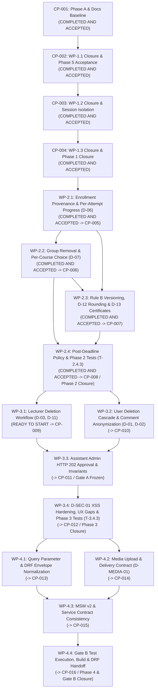

# MetroLMS — Living Master Plan (`active-roadmap.md`)

> **Document Status:** `ACTIVE — AUTHORITATIVE (LIVING MASTER PLAN)`
> **Canonical Role:** Single authoritative, continuously maintained execution plan for the MetroLMS project. Explains where the project stands, what is completed, what is in progress, how all remaining work is ordered, dependencies, acceptance criteria, checkpoint governance, and the exact next task.
> **Current Project Dashboard:** [`docs/project-state/CURRENT.md`](CURRENT.md)
> **Latest Accepted Checkpoint:** [`CP-012-2026-11-15-wp-5-5-checkpoint-3-closure.md`](checkpoints/CP-012-2026-11-15-wp-5-5-checkpoint-3-closure.md) (`CP-012` — REV6 Phase 5 `WP-5.5` Checkpoint 3 Closure; Frontend Track at `CP-008`)
> **Next Sequential Checkpoint:** `CP-013` *(per the sequential per-milestone checkpoint rule in [`checkpoints/README.md`](checkpoints/README.md))*
> **Last Updated:** 2026-11-15 (`REV6 Phase 5 WP-5.5 — Stage 3 / Cluster 3 CLOSED` [`CP-012`]; `WP-5.5 Stage 4: OWNER-APPROVED — CONTENT ACCEPTED — UNFROZEN` [`2026-11-15`]; `WP-5.5 Physical Types Review: CLOSED — COMPLETE WITH DEFERRED ITEMS`; `WP55-PT-01`–`WP55-PT-06` (`D-01`–`D-06`): `OWNER-APPROVED & INTEGRATED (DOC-ONLY)` [`2026-11-15`]; `WP-5.6: BLOCKED — NOT AUTHORIZED`; `Data Dictionary: UNFROZEN`; Frontend Track: `Phase 3` / `WP-3.1` / `T-3.1.1` `READY TO START`)

---

## Section 1 — Project Mission

The ultimate objective of the current MetroLMS development track is **Frontend Integration Readiness**:

**Deliver a complete, internally consistent, stable, integrated, and backend-integration-ready React 19 Single-Page Application (SPA) for the Cairo Metro Organization (الجهاز المصري لإدارة وتشغيل المترو), with all pages, role-aware workflows, domain business rules, client state boundaries, security controls, and REST API contracts normalized and verified for seamless integration with a future Python + Django + Microsoft SQL Server backend.**

### Core Mission Boundaries
1. **Frontend Readiness First:** All frontend UI workflows, 6-tier role permissions, multi-source enrollment provenance, per-attempt progress isolation, curriculum/certificate versioning, administrative approval flows (`HTTP 202`), deletion cascades, XSS defenses, and MSW v2 service contracts must be completed and verified before backend cutover.
2. **Strict Separation of Frontend Readiness vs. Production Backend Implementation:** Completing this Living Master Plan achieves **Frontend Integration & DRF Handoff Readiness (Gate B)**. Physical backend implementation (Django ORM models, Microsoft SQL Server migrations, server-side password hashing, persistent media storage, and background workers — tracked as Roadmap Phase 12) begins only after the frontend contracts are frozen and handed off.
3. **Permanent Out-of-Scope Fence:** Enterprise KMS/HSM hardware modules, PKCS#11 interfaces, PostgreSQL admission ledgers, `SECURITY DEFINER` daemons, signed JWKS anti-rollback manifests, and browser-side WebCrypto `AES-GCM` session encryption (`S8`) are permanently excluded from MetroLMS.

---

## Section 2 — Technology and Architectural Baseline

### 2.1 Confirmed Technology Stack

| Layer | Approved Technology | Authority & Status |
| :--- | :--- | :--- |
| **Frontend Framework & Language** | React 19, TypeScript 5.7, Vite, React Router v7 | Active (`frontend/`) |
| **Styling & RTL Design System** | Tailwind CSS v4 + Arabic RTL Tokens (`Cairo` / `Tajawal`) | Active ([`design-system.md`](../frontend/design-system.md)) |
| **Testing & Mock API Layer** | Vitest, React Testing Library, Mock Service Worker (MSW v2) | Active ([`verification-and-test-strategy.md`](verification-and-test-strategy.md)) |
| **Target Backend Framework** | Python 3.12+, Django 5+, Django REST Framework (DRF) | Target Contract ([`django-sqlserver-integration-contract.md`](../backend/django-sqlserver-integration-contract.md)) |
| **Target Relational Database** | **Microsoft SQL Server** (`mssql-django` / `pyodbc`) — *PostgreSQL is excluded* | Binding Decision **`D-DB-01`** |
| **Authentication & Session Model** | Django Authentication + DB-backed Server-Side Sessions (`HttpOnly`, `Secure`, `SameSite=Lax` cookie) + CSRF (`X-CSRFToken`) + `GET /api/auth/me` + `POST /api/auth/logout` | Binding Decision **`D-AUTH-01`** ([`authentication-and-session-contract.md`](../architecture/authentication-and-session-contract.md)) |
| **Frontend Security Baseline** | Safe React JSX rendering + centralized DOMPurify allowlist + `Content-Security-Policy-Report-Only` + server-side Django authorization | Binding Decision **`D-SEC-01`** ([`security-and-xss-baseline.md`](../architecture/security-and-xss-baseline.md)) |
| **Media & File Delivery Boundary** | Decoupled frontend `MediaAssetReference` contract; physical backend storage deferred to Phase 12 | Binding Decision **`D-MEDIA-01`** ([`system-architecture.md`](../architecture/system-architecture.md)) |

### 2.2 Canonical Architecture & Decision References
Do not duplicate architectural specifications in this plan; consult the single canonical source of truth for each domain:
- **Master Owner Decision Register (`D-AUTH-01`, `D-DB-01`, `D-SEC-01`, `D-MEDIA-01`, `D-01`–`D-14`, `OD-01`–`OD-02`, Phase 5 Decisions `A, B, C, D`):** [`docs/architecture/decision-register.md`](../architecture/decision-register.md)
- **System Architecture & Boundaries:** [`docs/architecture/system-architecture.md`](../architecture/system-architecture.md)
- **Authentication, Session, CSRF, Logout & Role Testing Contract:** [`docs/architecture/authentication-and-session-contract.md`](../architecture/authentication-and-session-contract.md)
- **Frontend Security, XSS & Role Invariants (`INV-R1`–`INV-R10`):** [`docs/architecture/security-and-xss-baseline.md`](../architecture/security-and-xss-baseline.md)
- **Canonical Domain & Business Rules:** [`docs/requirements/domain-business-rules.md`](../requirements/domain-business-rules.md)
- **Django + Microsoft SQL Server Integration Contract:** [`docs/backend/django-sqlserver-integration-contract.md`](../backend/django-sqlserver-integration-contract.md)
- **Frozen 46-MFR Baseline Roadmap (Rev 5):** [`docs/backend/pre-backend-migration-remediation-roadmap.md`](../backend/pre-backend-migration-remediation-roadmap.md)

---

## Section 3 — Overall Progress Dashboard

| Dashboard Metric | Current Verified Value | Evidence / Reference |
| :--- | :--- | :--- |
| **Historical Foundation Phases Completed** | **3 Major Tracks Completed** (`Frontend Increments 0–11`, `Remediation Phase 1`, `Phase A Scope Reset & Documentation Consolidation`) | [`CP-001-2026-11-07-phase-a-closure.md`](checkpoints/CP-001-2026-11-07-phase-a-closure.md) |
| **Prior Remediation Phases Implemented (Verification Deferred to Phase 4 / Gate B)** | **4 Phases Implemented (`Phases 2, 3, 4, 5`)** (Remediation Phase 5 closed and accepted in `WP-1.1` at `CP-002`; code & tests authored; runtime test execution deferred per governance) | [`phase-02`](../frontend/checklists/phase-02-role-architecture-checklist.md), [`phase-03`](../frontend/checklists/phase-03-assistant-admin-visibility-checklist.md), [`phase-04`](../frontend/checklists/phase-04-approval-lifecycle-checklist.md), [`phase-05`](../frontend/checklists/phase-05-developer-preview-and-isolated-testing-checklist.md) |
| **Total Remaining Frontend Execution Phases** | **4 Phases** (`Phase 1` through `Phase 4`, comprising **15 Active Work Packages** `WP-1.1`–`WP-4.4`) | Section 4 & Section 5.2 of this document |
| **Completed Execution Phases (of Remaining 4)** | **2 of 4** (`Phase A` prerequisite completed at `CP-001`; `Phase 1` completed at `CP-004`; `Phase 2` completed at `CP-008` across `CP-005`–`CP-008`) | Section 4 & Section 5 |
| **Current Planned Phase** | **`Phase 3 — Administrative Workflows & Mutation Safety`** (`READY TO START` — `WP-3.1` next) | [Section 4.4 (Phase 3)](#44-phase-3--administrative-workflows--mutation-safety) |
| **Pending Execution Phases** | **`Phase 3`** (`READY TO START` — `WP-3.1`–`WP-3.4`), **`Phase 4`** (`NOT STARTED`) | [Section 4.4](#44-phase-3--administrative-workflows--mutation-safety)–[Section 4.5](#45-phase-4--api-contract-normalization--drf-handoff) |
| **Blocked Phases** | **0 Phases Blocked** | [`verification-and-test-strategy.md`](verification-and-test-strategy.md) (§6) |
| **Current Active / Next Work Package** | **`WP-3.1 — Lecturer Deletion Workflow (D-03, D-11)`** (`READY TO START` — `T-3.1.1` next; Target Checkpoint: `CP-009`) | [Section 5.2](#52-active-execution-phases-work-package--task-status-phases-14) |
| **Latest Accepted Checkpoint & Next Checkpoint Rule** | **Latest: `CP-008`** (`2026-11-14` — `WP-2.4` & `Phase 2` Closure: Post-Deadline Policy `hide` vs. `keep_no_cert`, Video Player Regressions & Phase 2 Test Suites `MFR-23, 42`). **Next: `CP-009`** upon acceptance of **`WP-3.1`** *(Every accepted Work Package, separately accepted Increment, or Phase receives the next sequential `CP-NNN`)* | [`checkpoints/README.md`](checkpoints/README.md) |
| **Last Executed Test Baseline vs. Deferred Authored Suites** | **Last Full-Suite Executed Run:** `66` test files / `1,174` passing tests / `0` failures (Increment 11 Final Audit; `65` files / `1,153` tests in Subphase 5E; targeted subset runs of `139`, `195`, `125` in earlier subphases). **Post-Increment 11 Authored Suites (Remediation Phases 2–5, incl. `96` Phase 5 specs & 18 uncommitted `frontend/src/` files):** `WRITTEN — NOT YET EXECUTED — DEFERRED TO GATE B` *(historical runs do NOT verify current untested changes)* | [`verification-and-test-strategy.md`](verification-and-test-strategy.md) (§2.1 Traceability Table) |
| **Overall Project Readiness State** | **`IN PRE-BACKEND REMEDIATION — NOT YET READY FOR BACKEND CUTOVER`** (Requires completing Phases 1–4 and passing Gate B) | Section 9 of this document |

---

## Section 4 — Complete Execution Roadmap

### 4.1 Relationship Between the Frozen 13-Phase Remediation Baseline and the 4 Active Execution Phases

To ensure zero approved requirements or Master Finding Register items (`MFR-01`–`MFR-46`) from the frozen [`docs/backend/pre-backend-migration-remediation-roadmap.md`](../backend/pre-backend-migration-remediation-roadmap.md) (Revision 5) are lost, the table below maps all 13 Frozen Remediation Phases into the completed baseline and the **4 Active Execution Phases**:

| Frozen Remediation Phase (Rev 5) | MFRs Covered | Historical / Current State | Mapped Location in This Living Master Plan |
| :--- | :--- | :---: | :--- |
| **Remediation Phase 1:** Identity, Attribution & Mock Cleanup | `MFR-01, 07, 13, 20` | `COMPLETED AND ACCEPTED` | Historical Baseline (`HIST-02` in Section 5.1) |
| **Remediation Phase 2:** 6-Tier Role Model, Account Protection & 11 Confidentiality Surfaces | `MFR-37, 38, 39, 45` | `IMPLEMENTED — VERIFICATION PENDING` | Historical Baseline (`HIST-03` in Section 5.1); invariant & runtime verification in **Phase 3 (`WP-3.3`)** & **Phase 4 (`WP-4.4` Gate B)** |
| **Remediation Phase 3:** Scoped Permissions, Route Guards & `Rule A` / `D-14` | `MFR-03, 05, 06, 08, 16, 17, 21, 29, 30` | `IMPLEMENTED — VERIFICATION PENDING` | Historical Baseline (`HIST-04` in Section 5.1); runtime verification in **Phase 4 (`WP-4.4` Gate B)** |
| **Remediation Phase 4:** Approval Workflow State Machine & `202 Accepted` | `MFR-09, 31, 35, 36, 44` | `IMPLEMENTED — VERIFICATION PENDING` | Historical Baseline (`HIST-05` in Section 5.1); cross-workflow `202 Accepted` & approval completion in **Phase 3 (`WP-3.3`)** & **Phase 4 (`WP-4.4` Gate B)** |
| **Remediation Phase 5:** Developer Role Preview & Isolated Role Testing (`D-10`) | `MFR-25, 40` | Increments 5.1–5.3 & `WP-5.4.1`–`WP-5.4.4`: `IMPLEMENTED — VERIFICATION PENDING` (`HIST-06`); `WP-5.4.5` (`WP-1.1`): `COMPLETED AND ACCEPTED` (`CP-002`) | **Phase 1 — Session & Role Finalization (`WP-1.1` & `WP-1.2`)** |
| **Remediation Phase 6:** Unified Enrollment Provenance & Per-Attempt Progress (`D-06`) | `MFR-02, 32, 33, 41` | `COMPLETED AND ACCEPTED` (`CP-005`) | **Phase 2 — Core Domain Logic Reconciliation (`WP-2.1`)** |
| **Remediation Phase 7:** Curriculum Versioning (`Rule B`), Rounding (`D-12`) & Certificates (`D-13`) | `MFR-10, 46` | `COMPLETED AND ACCEPTED` (`CP-007`) | **Phase 2 — Core Domain Logic Reconciliation (`WP-2.3`)** |
| **Remediation Phase 8:** Group Member Removal & Per-Course Choice (`D-07`) | `MFR-24` | `COMPLETED AND ACCEPTED` (`CP-006`) | **Phase 2 — Core Domain Logic Reconciliation (`WP-2.2`)** |
| **Remediation Phase 9:** Post-Deadline Access Enforcement (`hide` vs. `keep_no_cert`) | `MFR-23, 42` | `COMPLETED AND ACCEPTED` (`CP-008`) | **Phase 2 — Core Domain Logic Reconciliation (`WP-2.4`)** |
| **Remediation Phase 10:** Permanent User & Lecturer Deletion (`D-01, D-02, D-03, D-11`) | `MFR-18, 34, 43` | `READY TO START` | **Phase 3 — Administrative Workflows & Mutation Safety (`WP-3.1` & `WP-3.2`)** |
| **Remediation Phase 11:** Functional Gaps, UX & Accessibility (+ `D-SEC-01` XSS Hardening) | `MFR-04, 15, 19` + `D-SEC-01` | `NOT STARTED` | **Phase 3 — Administrative Workflows & Mutation Safety (`WP-3.4`)** |
| **Remediation Phase 12:** Backend Implementation Track (Django + SQL Server) | `MFR-11, 12, 14, 27` | `DEFERRED` (Post-Gate A / Post-Phase 4) | **Section 8 — Deferred and Future Work (`DEF-01`)** |
| **Remediation Phase 13:** Pre-Backend Verification & Remediation Completion Gate (`Gate B`) | All 39 Pre-Backend Active MFRs | `NOT STARTED` | **Phase 4 — API Contract Normalization & DRF Handoff (`WP-4.4`)** |

---

### 4.2 Phase 1 — Session & Role Finalization

1. **Phase ID and Title:** `Phase 1 — Session & Role Finalization`
2. **Objective:** Close Remediation Phase 5 (`WP-5.4.5`) in **`WP-1.1`** by implementing the client-side `Decision C (SUP-01: S8 -> S7)` real-user logout lifecycle (preserving a credential-free, inert Developer origin snapshot while keeping `S3/S4 -> S12 -> S0` two-slot isolated persona logout unchanged and all 60 deferred test specifications intact), consolidate monotonic `sessionEpoch` (`S7`), account-switch race protection, and Developer Preview isolation across the 18 uncommitted working-tree files in **`WP-1.2`**, and align the frontend authentication transport, CSRF (`X-CSRFToken`), `GET /api/auth/me`, and `POST /api/auth/logout` (`LOGOUT_UNCONFIRMED` failure state & HTTP response semantics) with `D-AUTH-01` in **`WP-1.3`**.
3. **Included Work Packages (Strict Non-Overlapping Ownership):**
   - **`WP-1.1 — WP-5.4.5 Closure`:** Strictly owns `Decision C` real-user logout lifecycle (`S8 -> S7`), React authentication state cleanup (`user = null`, `clearSession()`), inert credential-free Developer origin snapshot preservation (`metro_lms_developer_origin_session` with zero stored tokens/credentials), `emergencyProof = null` cleanup, hiding Developer return controls, preserving isolated persona logout (`S3/S4 -> S12 -> S0` two-slot purge) unchanged, and traceability of historical `WP-5.4.5` acceptance requirements *(Target Checkpoint: `CP-002`)*.
   - **`WP-1.2 — Session Lifecycle and Developer Isolation`:** Strictly owns `sessionEpoch` consistency (`S7`), account-switch race conditions (`authOpSeqRef`, `StaleEpochError`, `<Outlet key>`, draft storage isolation), Developer Preview isolation (`RolePreviewContext`, `previewMutationBarrier`, `/design-system` 404 guard), session invalidation behavior, and existing role and isolated-session invariants across the 18 uncommitted working-tree files *(Target Checkpoint: `CP-003`)*.
   - **`WP-1.3 — Django Authentication Integration Contract`:** Strictly owns database-backed Django Sessions (`D-AUTH-01`), `HttpOnly` and `Secure` session cookies (and matching cookie-clearing scope attributes), CSRF integration (`X-CSRFToken`), `GET /api/auth/me`, the `POST /api/auth/logout` API contract (including `LOGOUT_UNCONFIRMED` failure handling and HTTP response semantics), centralized `apiClient` transport, and authentication/session integration test preparation *(Target Checkpoint: `CP-004` — closes `WP-1.3` & `Phase 1`)*.
4. **Individual Tasks:**
   - **`T-1.1.1` (`WP-1.1` — `Decision C: S8 -> S7` Client Logout State & Credential-Free Snapshot Persistence):** Update client-side logout state handling in [`frontend/src/core/auth/AuthContext.tsx`](../../frontend/src/core/auth/AuthContext.tsx) and [`frontend/src/core/auth/authStorage.ts`](../../frontend/src/core/auth/authStorage.ts) in accordance with [`authentication-and-session-contract.md`](../architecture/authentication-and-session-contract.md) (§2.2.E & §4.3):
     - Separate runtime/mock authentication data (`RuntimeDeveloperOriginSession`) from persisted Developer origin metadata (`PersistedDeveloperOriginSnapshot` and `InertDeveloperOriginSnapshot`) via an explicit field allowlist (`sanitizeToPersistedDeveloperOriginSnapshot()`) so `metro_lms_developer_origin_session` **never** persists `developerToken`, session IDs, Bearer tokens, access/refresh tokens, passwords, or any reusable authentication credential across **any** state (`S3`/`S4`/`S6`/`S8` or `S7`).
     - When logging out from a **real-user session** (`isIsolatedSession === false`), including State `S8` where an inert Developer origin snapshot exists (`S8 -> S7` per **Owner Decision C**), clear the real user's active React authentication state (`clearSession()`, `user = null`, `isAuthenticated = false`), **preserve** `metro_lms_developer_origin_session` as an inert, credential-free snapshot (`snapshotState: 'inert'`) in per-tab `sessionStorage` until tab termination while purging volatile runtime tokens, set `emergencyProof = null`, keep all normal and emergency Developer return controls hidden and inaccessible, and ensure no restoration path treats a credential-free or inert snapshot as an authenticated session.
     - When logging out from an **active isolated persona session** (`isIsolatedSession === true`, `S3/S4 -> S12 -> S0` per `INV-P5-7`), preserve the existing two-slot purge unchanged (`clearSession()` + `clearDeveloperOriginSession()`).
   - **`T-1.1.2` (`WP-1.1` — `WP-5.4.5` Test Traceability):** Verify/record test coverage traceability for `Decision C (S8 -> S7)` and `S3/S4 -> S12 -> S0` while strictly preserving all **60 deferred test specifications** in [`frontend/src/test/isolated-role-session.test.tsx`](../../frontend/src/test/isolated-role-session.test.tsx) (`WRITTEN — NOT YET EXECUTED — DEFERRED TO GATE B`).
   - **`T-1.1.3` (`WP-1.1` — Phase 5 Checklist & Report Closure):** Update [`docs/frontend/checklists/phase-05-developer-preview-and-isolated-testing-checklist.md`](../frontend/checklists/phase-05-developer-preview-and-isolated-testing-checklist.md) and [`docs/frontend/reports/phase-05-increment-04-wp-5.4.5-implementation-report.md`](../frontend/reports/phase-05-increment-04-wp-5.4.5-implementation-report.md) to reflect `WP-5.4.5` closure (`IMPLEMENTED — VERIFICATION PENDING` for Gate B).
   - **`T-1.2.1` (`WP-1.2` — `sessionEpoch` & Account-Switch Race Protection):** Audit and finalize monotonic `sessionEpoch` (`frontend/src/core/auth/sessionEpoch.ts`), account-switch race guards (`authOpSeqRef`, stale async response rejection via `StaleEpochError` in `apiClient.ts`), route subtree reset (`<Outlet key={...} />` in `AppLayout.tsx`), session invalidation behavior, and user/epoch-scoped draft storage (`courseBuilderDraftStorage.ts`, `stagedEditsStorage.ts`, `useStagedEditsAutosave.ts`) across the 18 uncommitted frontend files.
   - **`T-1.2.2` (`WP-1.2` — Developer Preview Isolation & Role Invariants):** Confirm `RolePreviewContext.tsx` and `previewMutationBarrier.ts` visual preview isolation (`INV-P5-1`, `INV-P5-2`, `INV-P5-6`), `/design-system` 404 route fencing (`INV-P5-5`, `MFR-25`), and existing role and isolated-session invariants (`S0`–`S15`) across the 18 uncommitted files.
   - **`T-1.3.1` (`WP-1.3` — `D-AUTH-01` Transport, Cookies, CSRF & `GET /api/auth/me`):** Align [`frontend/src/core/api/apiClient.ts`](../../frontend/src/core/api/apiClient.ts) and [`frontend/src/mocks/handlers/authHandlers.ts`](../../frontend/src/mocks/handlers/authHandlers.ts) with **`D-AUTH-01`**: enforce `credentials: 'same-origin'` (or `'include'`) for `HttpOnly`, `Secure` session cookies, extract `csrftoken` and attach `X-CSRFToken` on all mutating requests (`POST`, `PUT`, `PATCH`, `DELETE`), and align `GET /api/auth/me` and `POST /api/auth/login` with [`authentication-and-session-contract.md`](../architecture/authentication-and-session-contract.md) (§§1–2.1).
   - **`T-1.3.2` (`WP-1.3` — `POST /api/auth/logout` Contract, `LOGOUT_UNCONFIRMED` State & Cookie-Clearing Scope):** Align [`frontend/src/core/auth/authApi.ts`](../../frontend/src/core/auth/authApi.ts), `AuthContext.tsx`, and `authHandlers.ts` on the `POST /api/auth/logout` API contract (§2.2 of [`authentication-and-session-contract.md`](../architecture/authentication-and-session-contract.md)): enforce `X-CSRFToken` on logout, simulate server-side session row deletion and cookie clearing with matching scope attributes (`Path=/`, `Domain`, `HttpOnly`, `Secure`, `SameSite=Lax`, `Max-Age=0`), handle `200`/`204` and expired `401` idempotently as `LOGOUT_CONFIRMED`, treat `403` CSRF rejection, network errors, and `5xx` responses as **`LOGOUT_UNCONFIRMED`** (closing protected UI immediately without claiming server session destruction, blocking silent session restoration on subsequent `GET /api/auth/me`, and surfacing retry/recovery UI).
   - **`T-1.3.3` (`WP-1.3` — Auth, Session & Logout Test Preparation):** Author/update unit and integration test specifications for `D-AUTH-01` cookie/CSRF transport, credential-free origin snapshot validation, and the `POST /api/auth/logout` (`LOGOUT_CONFIRMED` vs. `LOGOUT_UNCONFIRMED`) contract (queued for execution at `Gate B` in `WP-4.4`).
5. **Dependencies:**
   - **Prerequisites:** `Phase A` & `CP-001` (`COMPLETED AND ACCEPTED`); Remediation Phases 1–4 and Phase 5 Increments 5.1–5.3 + `WP-5.4.1`–`WP-5.4.4` (`IMPLEMENTED — VERIFICATION PENDING`).
6. **Required Documentation:**
   - [`docs/architecture/authentication-and-session-contract.md`](../architecture/authentication-and-session-contract.md) (§§1–4, especially §2.2 Logout Contract)
   - [`docs/architecture/decision-register.md`](../architecture/decision-register.md)
   - [`docs/frontend/checklists/phase-05-developer-preview-and-isolated-testing-checklist.md`](../frontend/checklists/phase-05-developer-preview-and-isolated-testing-checklist.md)
   - [`docs/frontend/reports/phase-05-increment-04-wp-5.4.5-implementation-report.md`](../frontend/reports/phase-05-increment-04-wp-5.4.5-implementation-report.md)
7. **Relevant Source-Code Modules:**
   - [`frontend/src/core/auth/AuthContext.tsx`](../../frontend/src/core/auth/AuthContext.tsx)
   - [`frontend/src/core/auth/authApi.ts`](../../frontend/src/core/auth/authApi.ts)
   - [`frontend/src/core/auth/authStorage.ts`](../../frontend/src/core/auth/authStorage.ts)
   - [`frontend/src/core/auth/sessionEpoch.ts`](../../frontend/src/core/auth/sessionEpoch.ts)
   - [`frontend/src/core/auth/RolePreviewContext.tsx`](../../frontend/src/core/auth/RolePreviewContext.tsx)
   - [`frontend/src/core/auth/useIsolatedSession.ts`](../../frontend/src/core/auth/useIsolatedSession.ts)
   - [`frontend/src/core/auth/testPersonas.ts`](../../frontend/src/core/auth/testPersonas.ts)
   - [`frontend/src/core/api/apiClient.ts`](../../frontend/src/core/api/apiClient.ts)
   - [`frontend/src/app/layouts/AppLayout.tsx`](../../frontend/src/app/layouts/AppLayout.tsx)
   - [`frontend/src/features/course-builder/services/courseBuilderDraftStorage.ts`](../../frontend/src/features/course-builder/services/courseBuilderDraftStorage.ts)
   - [`frontend/src/features/course-review/services/stagedEditsStorage.ts`](../../frontend/src/features/course-review/services/stagedEditsStorage.ts)
   - [`frontend/src/mocks/handlers/authHandlers.ts`](../../frontend/src/mocks/handlers/authHandlers.ts)
   - [`frontend/src/test/isolated-role-session.test.tsx`](../../frontend/src/test/isolated-role-session.test.tsx)
8. **Acceptance Criteria:**
   - **Under `WP-1.1`:** `S8 -> S7` real-user logout clears the real user's active React session (`user = null`, `clearSession()`), preserves `metro_lms_developer_origin_session` inert and **credential-free** (zero session IDs, Bearer tokens, access/refresh tokens, or passwords) in `sessionStorage` with `emergencyProof = null` and zero visible return controls, and never allows the preserved snapshot to independently restore an authenticated session; isolated persona logout (`S3/S4 -> S12 -> S0`) preserves the two-slot purge (`INV-P5-7`); all 60 deferred test specifications in `isolated-role-session.test.tsx` remain intact.
   - **Under `WP-1.2`:** Monotonic `sessionEpoch` (`S7`) increments on every session transition, rejects stale in-flight responses (`StaleEpochError`), resets route subtrees and draft storage on account switches, and preserves `RolePreviewContext` visual preview isolation and `/design-system` 404 route fencing (`MFR-25`).
   - **Under `WP-1.3`:** `apiClient.ts` attaches `X-CSRFToken` on unsafe HTTP methods (`POST`, `PUT`, `PATCH`, `DELETE`) and supports `HttpOnly`/`Secure` cookie credentials and `GET /api/auth/me` session rehydration (`D-AUTH-01`); `POST /api/auth/logout` clears the server session and `HttpOnly` cookie with matching scope attributes on `200`/`204` (or idempotent `401`), while `403` CSRF rejection, network failure, or `5xx` enters **`LOGOUT_UNCONFIRMED`** (closing protected UI immediately without claiming server invalidation, preventing silent session restoration on `GET /api/auth/me`, and providing retry/recovery UX).
9. **Required Verification Evidence:**
   - Static source inspection and AST traceability in [`phase-05-increment-04-wp-5.4.5-implementation-report.md`](../frontend/reports/phase-05-increment-04-wp-5.4.5-implementation-report.md) and [`phase-05-developer-preview-and-isolated-testing-checklist.md`](../frontend/checklists/phase-05-developer-preview-and-isolated-testing-checklist.md), followed by full runtime test execution in **Phase 4 (`WP-4.4` / Gate B)**.
10. **Exit Conditions:**
    - Each accepted Work Package in Phase 1 (`WP-1.1`, `WP-1.2`, `WP-1.3`) reaches `IMPLEMENTED — VERIFICATION PENDING` (with documentation/contract deliverables `COMPLETED AND ACCEPTED`) and records its sequential immutable checkpoint (`CP-002` for `WP-1.1`, `CP-003` for `WP-1.2`, and `CP-004` for `WP-1.3` + `Phase 1 Closure`); `CURRENT.md` is updated to advance to `Phase 2`.
11. **Status:** **`COMPLETED AND ACCEPTED`** (`WP-1.1`, `WP-1.2`, and `WP-1.3` accepted across `CP-002`, `CP-003`, and `CP-004`; runtime verification deferred to Gate B)
12. **Next Phase Dependency:** Unblocks **`Phase 2 — Core Domain Logic Reconciliation`** (ensuring all subsequent learner/group/attempt operations execute under a finalized, race-free session and actor identity model).

---

### 4.3 Phase 2 — Core Domain Logic Reconciliation

1. **Phase ID and Title:** `Phase 2 — Core Domain Logic Reconciliation`
2. **Objective:** Reconcile all core learner and course domain models in `inMemoryStore.ts`, MSW handlers, and UI pages with the Owner's binding domain rules: multi-source enrollment provenance and isolated per-attempt progress (`D-06`, `MFR-02, 32, 33, 41`), per-course group removal and standalone continuation grants (`D-07`, `MFR-24`), authoritative progress calculation with `Math.round` (`D-12`), published curriculum versioning (`Rule B`, `MFR-10`), version-scoped certificates (`D-13`, `MFR-46`), and post-deadline access enforcement (`hide` vs. `keep_no_cert`, `MFR-23, 42`).
3. **Included Work Packages:**
   - **`WP-2.1`:** Enrollment Provenance & Per-Attempt Progress Isolation *(Frozen Roadmap Phase 6: `MFR-02, 32, 33, 41`, `D-06` — Target Checkpoint: `CP-005`)*.
   - **`WP-2.2`:** Group Member Removal & Per-Course Disenrollment / Continuation Behavior *(Frozen Roadmap Phase 8: `MFR-24`, `D-07` — Target Checkpoint: `CP-006`)*.
   - **`WP-2.3`:** Authoritative Progress Calculation (`D-12`), Published Curriculum Versioning (`Rule B`) & Version-Scoped Certificates (`D-13`) *(Frozen Roadmap Phase 7: `MFR-10, 46` — Target Checkpoint: `CP-007`)*.
   - **`WP-2.4`:** Post-Deadline Access Policy Enforcement (`hide` vs. `keep_no_cert`) & Phase 2 Regression Suite Authoring *(Frozen Roadmap Phase 9: `MFR-23, 42` — Target Checkpoint: `CP-008` — closes `WP-2.4` & `Phase 2`)*.
4. **Individual Tasks:**
   - **`T-2.1.1` (`MFR-41`, `D-06`):** Refactor `EnrollmentRecord` in `inMemoryStore.ts` to maintain `sources: EnrollmentSourceGrant[]` where `kind: 'self' | 'group'` is the grant category and each grant has a unique deterministic `sourceId` (`'self:catalog:${attemptId}'`, `'self:continued:${groupId}:${attemptId}'`, `'group:${groupId}:${cycleId}'`) bound to its own `attemptId`.
   - **`T-2.1.2` (`MFR-02`, `MFR-41`, `D-06`):** Key lesson progress by `attemptId` (`AttemptLessonProgress`) rather than shared `(userId, courseId)` so completing Course A in Group 1 never completes Course A in Group 2, and group renewal cycles start a fresh attempt at `0%` while sealing the prior cycle's attempt.
   - **`T-2.1.3` (`MFR-41`, §9.1):** Implement unambiguous Learning Player attempt resolution in `LearningPlayerPage.tsx` and `learningHandlers.ts`: explicit `?attemptId=<id>` wins; `?groupId=<groupId>` resolves to that group's active attempt; navigation without explicit context resolves directly when only one eligible attempt exists or presents an attempt context selector modal when multiple eligible (`full` or `review_only`) attempts exist.
   - **`T-2.1.4` (`MFR-32`, `MFR-33`):** Provision a standalone `CourseAttempt` upon self-enrollment, update `getCoursePerformanceReport` to include both standalone and group attempts, and unify `getCourseProgress`, `getGroupMetrics`, `getCoursePerformanceReport`, and `getUserTranscript` onto one authoritative calculator (removing the sticky `isCompleted = true` latch and `Math.max` guard).
   - **`T-2.2.1` (`MFR-24`, `D-07`):** Upgrade the trainee removal modal in `GroupMembersTab.tsx` (and `GroupMonitoringPage.tsx`) to display the exact `D-07` Arabic prompt (`هل تريد أيضًا إزالة تسجيل المتدرب من أي من المقررات التدريبية التابعة لهذه المجموعة؟ يمكنك تحديد المقررات التي تريد إزالة تسجيله منها.`) with independent, unchecked-by-default checkboxes per enrolled group course.
   - **`T-2.2.2` (`MFR-24`, `D-07`):** Update `DELETE /api/admin/groups/:groupId/members/:userId` and `inMemoryStore.removeGroupMember` to accept `removeCourseIds?: string[]`:
     - For **kept courses** (not in `removeCourseIds`): revoke the old group grant (`status: 'revoked_by_group_removal'`), create/reactivate idempotently a distinct standalone continuation grant (`kind: 'self'`, `sourceId: 'self:continued:${groupId}:${attemptId}'`, `convertedFromGroupId: groupId`) bound to the **same active `attemptId`** without overwriting or merging any pre-existing catalog self-enrollment `S1` (`sourceId: 'self:catalog:${attemptId}'`), preserve progress/lessons/playback position, lift the old group deadline, and retain immutable `originGroupId`/`originCycleId` provenance.
     - For **removed courses** (in `removeCourseIds`): revoke only the relevant group grant, seal/preserve historical attempt records, and retain active course access if another valid active grant exists.
   - **`T-2.3.1` (`MFR-10`, `Rule B`):** Implement `PublishedCourseVersion` (`versionNumber: 1, 2, ...`) created only upon approved publication; keep unapproved edits in `courseDrafts` isolated from active learner progress. Compare substantive `ChapterItem` fields (`type`, `videoUrl`, `pdfUrl`, `mediaId`, `content`, `durationSeconds`) on publication to increment `item.contentVersion` and reset completion of modified items in active unsealed attempts while preserving completion on metadata-only edits (`title`, `description`, `order`, `duration`).
   - **`T-2.3.2` (`D-12`, `D-13`, `MFR-46`):** Enforce `Math.round` clamped to `[0, 100]` for integer progress display (`D-12`, with `isCompleted` gated strictly on completing 100% of required items) and bind `CertificateRecord` to `courseVersionNumber` (`Certificate — Course Version N`, `D-13`) so publishing Version $N+1$ never invalidates Version $N$ certificates.
   - **`T-2.4.1` (`MFR-23`, `MFR-42`):** Implement `resolveCourseAccess(userId, courseId, now)` and remove the `&& !progress.isCompleted` exemption in `getMyEnrolledCourses` so `postDeadlinePolicy: 'hide'` hides expired group courses for all group trainees (including 100% completed trainees) unless another active grant exists.
   - **`T-2.4.2` (`MFR-23`, `MFR-42`):** Enforce `resolveCourseAccess` across `MyCoursesPage`, `DashboardPage`, `GroupDetailsPage`, `LearningPlayerPage`, and `learningHandlers.ts`: return `403 COURSE_ACCESS_EXPIRED` when effective access is `'none'`, and enforce read-only mode (`403 COURSE_ACCESS_REVIEW_ONLY` on lesson activity/completion `POST` calls, zero progress mutation, no new certificates) when effective access is `'review_only'` (`keep_no_cert`).
   - **`T-2.4.3` (Phase 2 Test Authoring — under `WP-2.4`):** Author unit, integration, and security test specifications covering `WP-2.1` through `WP-2.4` (queued for execution at Phase 4 / Gate B).
5. **Dependencies:**
   - **Prerequisites:** `Phase 1 — Session & Role Finalization` (`WP-1.1`–`WP-1.3`).
   - **Internal Ordering:** `WP-2.1` (Enrollment Provenance & Attempts) **must** complete before `WP-2.2` (Group Removal `D-07`) and `WP-2.3` (Curriculum & Certificate Versioning), which in turn **must** complete before `WP-2.4` (Post-Deadline Access Policy).
6. **Required Documentation:**
   - [`docs/requirements/domain-business-rules.md`](../requirements/domain-business-rules.md) (§§4–7)
   - [`docs/architecture/decision-register.md`](../architecture/decision-register.md) (`D-06`, `D-07`, `D-12`, `D-13`, `Rule B`)
   - [`docs/backend/pre-backend-migration-remediation-roadmap.md`](../backend/pre-backend-migration-remediation-roadmap.md) (§§8, 9, 12, and Phase 6–9 specifications)
7. **Relevant Source-Code Modules:**
   - [`frontend/src/mocks/store/inMemoryStore.ts`](../../frontend/src/mocks/store/inMemoryStore.ts)
   - [`frontend/src/mocks/handlers/learningHandlers.ts`](../../frontend/src/mocks/handlers/learningHandlers.ts)
   - [`frontend/src/mocks/handlers/groupHandlers.ts`](../../frontend/src/mocks/handlers/groupHandlers.ts)
   - [`frontend/src/pages/LearningPlayerPage.tsx`](../../frontend/src/pages/LearningPlayerPage.tsx)
   - [`frontend/src/pages/MyCoursesPage.tsx`](../../frontend/src/pages/MyCoursesPage.tsx)
   - [`frontend/src/features/performance/pages/CoursePerformancePage.tsx`](../../frontend/src/features/performance/pages/CoursePerformancePage.tsx)
   - [`frontend/src/pages/UserDetailsPage.tsx`](../../frontend/src/pages/UserDetailsPage.tsx)
   - [`frontend/src/pages/GroupMonitoringPage.tsx`](../../frontend/src/pages/GroupMonitoringPage.tsx)
   - [`frontend/src/features/groups/components/GroupMembersTab.tsx`](../../frontend/src/features/groups/components/GroupMembersTab.tsx)
   - [`frontend/src/features/groups/services/groupsApi.ts`](../../frontend/src/features/groups/services/groupsApi.ts)
   - [`frontend/src/features/learning-player/components/VideoPlayer.tsx`](../../frontend/src/features/learning-player/components/VideoPlayer.tsx)
8. **Acceptance Criteria:**
   - Zero cross-group or cross-cycle progress leakage (`D-06`); all 7 learner and admin views report identical `Math.round` (`D-12`) progress percentages for the same attempt.
   - Removing a trainee from a group prompts per course (`D-07`), preserves kept courses via an idempotent continuation grant (`self:continued:${groupId}:${attemptId}`) on the same `attemptId` without colliding with `S1` (`self:catalog:${attemptId}`), and lifts the group deadline.
   - Substantive curriculum edits reset modified item completion on publish (`Rule B`) while preserving `Certificate — Course Version 1` (`D-13`).
   - `postDeadlinePolicy: 'hide'` blocks access (`403`) even for 100%-completed group trainees unless another active source exists; `'keep_no_cert'` enforces strict read-only access (`403 COURSE_ACCESS_REVIEW_ONLY` on writes).
9. **Required Verification Evidence:**
   - Dedicated Phase 2 implementation & audit reports, checklist completion, and authored Vitest test suites (`T-2.4.3`) covering Suites 5 & 6 of [`pre-backend-migration-remediation-roadmap.md`](../backend/pre-backend-migration-remediation-roadmap.md) (§14), queued for Gate B execution in Phase 4.
10. **Exit Conditions:**
    - Each accepted Work Package in Phase 2 (`WP-2.1`–`WP-2.4`) reaches `IMPLEMENTED — VERIFICATION PENDING` and records its sequential immutable checkpoint (`CP-005` through `CP-008`, with `CP-008` recording both `WP-2.4` and `Phase 2 Closure`); `CURRENT.md` is updated to advance to `Phase 3`.
11. **Status:** **`COMPLETED AND ACCEPTED`** (`WP-2.1`, `WP-2.2`, `WP-2.3`, and `WP-2.4` accepted across `CP-005`, `CP-006`, `CP-007`, and `CP-008`; runtime verification deferred to Gate B)
12. **Next Phase Dependency:** Unblocks **`Phase 3 — Administrative Workflows & Mutation Safety`** (user and lecturer deletion cascades require finalized multi-source enrollment, attempt, and certificate structures from Phase 2).

---

### 4.4 Phase 3 — Administrative Workflows & Mutation Safety

1. **Phase ID and Title:** `Phase 3 — Administrative Workflows & Mutation Safety`
2. **Objective:** Implement the permanent user deletion cascade (`D-01`), course discussion comment anonymization (`مستخدم محذوف`, `D-02`), and the lecturer deletion supervision pre-check (`409 Conflict`) and interactive `مواصلة الحذف` workflow (`D-03`, `D-11`), verify end-to-end `Assistant Admin` `HTTP 202 Accepted` approval handling and administrative invariants (`INV-R1`–`INV-R10`, `D-04`/`OD-01`, `D-05`/`OD-02`) across all new and existing mutation surfaces, resolve remaining functional UX gaps (`MFR-04, 15, 19`), and enforce the `D-SEC-01` XSS/DOMPurify/CSP security baseline across all 11 content surfaces.
3. **Included Work Packages:**
   - **`WP-3.1`:** Lecturer Deletion Supervision Pre-Check (`409`), Nullable Ownership (`غير معين`) & Interactive `مواصلة الحذف` Workflow *(Frozen Roadmap Phase 10: `MFR-18, 43`, `D-03`, `D-11` — Target Checkpoint: `CP-009`)*.
   - **`WP-3.2`:** Permanent User Deletion Cascade (`D-01`), Tombstone Ledger & Comment Anonymization (`مستخدم محذوف`, `D-02`) *(Frozen Roadmap Phase 10: `MFR-18, 34`, `D-05`/`OD-02` — Target Checkpoint: `CP-010`)*.
   - **`WP-3.3`:** Assistant Admin `HTTP 202 Accepted` Approval Handling & Administrative Invariants Verification (`INV-R1`–`INV-R10`, `MFR-09, 31, 35, 36, 44` — satisfies **Gate A**) *(Target Checkpoint: `CP-011`)*.
   - **`WP-3.4`:** Frontend XSS & Mutation Safety Hardening (`D-SEC-01`), Functional UX/Accessibility Completion (`MFR-04, 15, 19`) & Phase 3 Regression Suite Authoring *(Frozen Roadmap Phase 11 — Target Checkpoint: `CP-012` — closes `WP-3.4` & `Phase 3`)*.
4. **Individual Tasks:**
   - **`T-3.1.1` (`D-11`, `MFR-43`):** Support nullable primary ownership (`Course.lecturerId: string | null` and `TrainingGroup.primaryInstructorId: string | null`, displayed as `غير معين`) across store types, `CourseBuilderPage.tsx`, and `GroupEditorPage.tsx` without magic `'unassigned'` user IDs.
   - **`T-3.1.2` (`D-03`, `D-11`, `MFR-43`):** Implement `getLecturerActiveAssignments` and the `409 LECTURER_HAS_ACTIVE_ASSIGNMENTS` deletion guard in `inMemoryStore.deleteUser` and `DELETE /api/admin/users/:id` whenever a lecturer participates in any course (`lecturerId`, `coLecturers`) or active group (`primaryInstructorId`, `assistantLecturerIds`, `supervisorIds`).
   - **`T-3.1.3` (`D-03`, `MFR-18`, `MFR-43`):** Build `DeleteUserModal.tsx` and wire Delete User actions into `UserTable.tsx` and `UserDetailsPage.tsx`, displaying the exact Arabic warning (`لا يمكن حذف هذا المحاضر لمشاركته في الإشراف على كورسات أو مجموعات. إن كنت تريد الحذف، يرجى إزالته من الإشراف أولاً.`), the `مواصلة الحذف` button, and clickable deep links to each supervised course and group.
   - **`T-3.2.1` (`D-01`, `D-02`, `MFR-34`):** Implement the 16-collection permanent deletion cascade in `inMemoryStore.deleteUser`: remove user identity, credentials, enrollments, course attempts, lesson progress, last-watched records, transcript history, certificates, group memberships, permissions/delegations, WhatsApp assignments, and notifications; auto-cancel pending approval/join requests; anonymize course discussion comments/replies to `مستخدم محذوف` with `userId: null` (`D-02`); preserve immutable security audit logs; and record deleted IDs/aliases in `deletedUserTombstones` so deleted demo accounts never resurrect.
   - **`T-3.3.1` (`MFR-31, 35, 36, 44`, `INV-R9`, `INV-R10`):** Verify and complete `approveApprovalRequest` and `202 Accepted` (`res.approvalRequired === true`) handling across all administrative mutation surfaces — including `assistant_admin` requests for `D-07` group member removal (persisting `removeCourseIds` in `ApprovalRequest.payload`) and `D-01`/`D-03` user/lecturer deletion (re-verifying `INV-R1`–`INV-R8` and lecturer supervision pre-checks at approval execution time per `INV-R10`).
   - **`T-3.3.2` (`INV-R1`–`INV-R8`, `D-04`/`OD-01`, `D-05`/`OD-02`):** Verify complete consistency of the 6-tier role management matrix (`developer`, `super_admin`, `admin`, `assistant_admin`, `lecturer`, `user`) across user directory actions, modals, and store guards. *(Completing `WP-3.1`–`WP-3.3` satisfies **Gate A — Domain Contract Freeze**).*
   - **`T-3.4.1` (`D-SEC-01`):** Audit all 11 content surfaces defined in [`security-and-xss-baseline.md`](../architecture/security-and-xss-baseline.md) (§2), enforce centralized DOMPurify sanitization (`sanitizeHtml.ts`) wherever rich HTML is rendered, validate external link protocols (`https:`, `http:`, `mailto:`, `tel:` with `rel="noopener noreferrer"`), and configure the `Content-Security-Policy-Report-Only` baseline.
   - **`T-3.4.2` (`MFR-04, 15, 19`):** Replace static `<Navigate to="/.../:param" />` routes in `router/index.tsx` with `useParams()` redirect wrappers (`MFR-04`), wire the Trainee Dashboard live-session `انضمام` button to `window.open(session.url, '_blank', 'noopener,noreferrer')` (`MFR-15`), remove hardcoded `totalLearningHours: 24` in profile/dashboard handlers (`MFR-19`), and verify modal focus trapping, `aria-labelledby`, Escape key handling, and RTL layout.
   - **`T-3.4.3` (Phase 3 Test Authoring — under `WP-3.4`):** Author unit, integration, and security test suites covering user/lecturer deletion cascades, `202 Accepted` approval flows, `D-SEC-01` XSS/DOMPurify sanitization, and Phase 11 UX fixes (queued for Phase 4 / Gate B execution).
5. **Dependencies:**
   - **Prerequisites:** `Phase 2 — Core Domain Logic Reconciliation` (`WP-2.1`–`WP-2.4`) and `Remediation Phase 4` baseline (`IMPLEMENTED — VERIFICATION PENDING`).
6. **Required Documentation:**
   - [`docs/requirements/domain-business-rules.md`](../requirements/domain-business-rules.md) (§§1–3, §§8–9)
   - [`docs/architecture/security-and-xss-baseline.md`](../architecture/security-and-xss-baseline.md)
   - [`docs/frontend/checklists/phase-04-approval-lifecycle-checklist.md`](../frontend/checklists/phase-04-approval-lifecycle-checklist.md)
   - [`docs/backend/pre-backend-migration-remediation-roadmap.md`](../backend/pre-backend-migration-remediation-roadmap.md) (§§10, 11, and Phases 4, 10, 11)
7. **Relevant Source-Code Modules:**
   - [`frontend/src/mocks/store/inMemoryStore.ts`](../../frontend/src/mocks/store/inMemoryStore.ts)
   - [`frontend/src/mocks/handlers/userManagementHandlers.ts`](../../frontend/src/mocks/handlers/userManagementHandlers.ts)
   - [`frontend/src/mocks/handlers/dashboardHandlers.ts`](../../frontend/src/mocks/handlers/dashboardHandlers.ts)
   - [`frontend/src/core/permissions/policy.ts`](../../frontend/src/core/permissions/policy.ts)
   - [`frontend/src/features/user-management/components/UserTable.tsx`](../../frontend/src/features/user-management/components/UserTable.tsx)
   - [`frontend/src/pages/UserDetailsPage.tsx`](../../frontend/src/pages/UserDetailsPage.tsx)
   - [`frontend/src/pages/CourseBuilderPage.tsx`](../../frontend/src/pages/CourseBuilderPage.tsx)
   - [`frontend/src/pages/GroupEditorPage.tsx`](../../frontend/src/pages/GroupEditorPage.tsx)
   - [`frontend/src/pages/DashboardPage.tsx`](../../frontend/src/pages/DashboardPage.tsx)
   - [`frontend/src/app/router/index.tsx`](../../frontend/src/app/router/index.tsx)
8. **Acceptance Criteria:**
   - Deleting a user permanently purges all 16 store collections (`D-01`), records a tombstone preventing resurrection, anonymizes comments to `مستخدم محذوف` (`D-02`), and preserves audit logs.
   - Deleting a lecturer with active course or group supervision returns `409 Conflict` (`D-03`, `D-11`), displays the exact warning and `مواصلة الحذف` links, never deletes courses/groups/trainees, and succeeds once supervision links are reassigned or cleared to `null` (`غير معين`).
   - All `assistant_admin` mutations return `202 Accepted` by default without premature UI mutation (`MFR-36`) and re-verify `INV-R1`–`INV-R10` upon approval execution.
   - Zero unsanitized HTML sinks or unsafe `javascript:`/`data:` URLs exist across all 11 content surfaces (`D-SEC-01`).
   - All **39 active pre-backend remediation MFRs** (`Phases 1–11`) are fully implemented in `frontend/src/`.
9. **Required Verification Evidence:**
   - Phase 3 implementation & security audit report, **Gate A** domain-contract freeze confirmation, and authored test suites (`T-3.4.3`) for Suites 4, 7 & `D-SEC-01`, queued for Phase 4 (Gate B) execution.
10. **Exit Conditions:**
    - Each accepted Work Package in Phase 3 (`WP-3.1`–`WP-3.4`) reaches `IMPLEMENTED — VERIFICATION PENDING` and records its sequential immutable checkpoint (`CP-009` through `CP-012`, with `CP-011` certifying **Gate A** and `CP-012` recording both `WP-3.4` and `Phase 3 Closure`); `CURRENT.md` is updated to advance to `Phase 4`.
11. **Status:** **`READY TO START`**
12. **Next Phase Dependency:** Unblocks **`Phase 4 — API Contract Normalization & DRF Handoff`** (and satisfies **Gate A** for backend schema/API design).

---

### 4.5 Phase 4 — API Contract Normalization & DRF Handoff

1. **Phase ID and Title:** `Phase 4 — API Contract Normalization & DRF Handoff`
2. **Objective:** Normalize all frontend API service modules and MSW v2 handlers to match the canonical Django REST Framework (DRF) + Microsoft SQL Server integration contract (`D-DB-01`, `D-AUTH-01`, `D-MEDIA-01`), execute the complete **Gate B (Roadmap Phase 13)** verification pipeline (`vitest run`, `tsc --noEmit`, `eslint`, `vite build`) across all baseline and newly authored test suites, resolve any runtime regressions, and publish the Final Frontend Handoff Checkpoint authorizing the start of the Django + SQL Server backend implementation track.
3. **Included Work Packages:**
   - **`WP-4.1`:** Query Parameter, Pagination & API Response/Error Contract Normalization (`DRF` Alignment — *Target Checkpoint: `CP-013`*).
   - **`WP-4.2`:** Media Upload & Asset Delivery Contract Normalization (`D-MEDIA-01` — *Target Checkpoint: `CP-014`*).
   - **`WP-4.3`:** MSW v2 Handler & Frontend Service Layer Contract Consistency Audit (*Target Checkpoint: `CP-015`*).
   - **`WP-4.4`:** Gate B Consolidated Test Execution, Build Verification & Final Django Integration Handoff *(Frozen Roadmap Phase 13 / Gate B — Target Checkpoint: `CP-016` — closes `WP-4.4`, `Phase 4`, and `Gate B`)*.
4. **Individual Tasks:**
   - **`T-4.1.1`:** Normalize query parameters (`page`, `pageSize`, `search`, `role`, `status`, `groupId`, `attemptId`) and paginated collection responses (`count`, `next`, `previous`, `results`) across `frontend/src/features/**/services/` and `frontend/src/mocks/handlers/` to match [`django-sqlserver-integration-contract.md`](../backend/django-sqlserver-integration-contract.md) (§2).
   - **`T-4.1.2`:** Normalize all API mutation, `202 Accepted` (`PendingApproval`), and error (`400`, `401`, `403`, `404` uniform Developer non-disclosure `INV-R8`, `409`, `422`) response envelopes across `apiClient.ts` and MSW handlers.
   - **`T-4.2.1` (`D-MEDIA-01`):** Audit and normalize all course video, PDF, thumbnail, group material, and certificate upload/playback payloads onto the decoupled `MediaAssetReference` contract (`assetId`, `url`, `mimeType`, `fileName`, `sizeBytes`, `disposition`) so no UI component depends on browser-only storage internals.
   - **`T-4.3.1`:** Verify 1:1 contract parity between every frontend service call, MSW v2 handler, and the documented DRF endpoint specification, ensuring zero direct imports of `inMemoryStore` from UI components outside `frontend/src/mocks/`.
   - **`T-4.4.1` (Gate B Test Execution — Roadmap Phase 13):** Execute the complete Vitest test suite (`npx vitest run`) covering:
     - The **1,174 baseline tests** across 66 files (Increment 11 Final Closure baseline).
     - All **Remediation Phase 1–4** authored test suites (`HIST-02`–`HIST-05`).
     - All **96 Phase 5 specifications** (`60` in [`frontend/src/test/isolated-role-session.test.tsx`](../../frontend/src/test/isolated-role-session.test.tsx) + `19` in `developer-surface-protection.test.tsx` + `17` in `role-preview.test.tsx` + `SUP-01: S8 -> S7` specs from `T-1.1.2`).
     - All **Active Phase 1 (`T-1.3.3`), Phase 2 (`T-2.4.3`), and Phase 3 (`T-3.4.3`)** authored auth/logout, domain, deletion, approval, and `D-SEC-01` security test suites.
   - **`T-4.4.2` (Gate B Static & Production Build Verification):** Execute `npx tsc --noEmit`, `npx eslint .`, and `npx vite build`, resolving any type, lint, or test failures until **100% of tests pass with 0 TypeScript errors and 0 ESLint errors**, and verify that production bundles exclude dev-only synthetic personas and Developer seed credentials (`MFR-45`).
   - **`T-4.4.3` (DRF Handoff Package & Final Gate B Checkpoint):** Document the final DRF endpoint inventory and backend handoff checklist in [`django-sqlserver-integration-contract.md`](../backend/django-sqlserver-integration-contract.md), create the Final Frontend Readiness & Gate B Closure Checkpoint (`CP-016` under sequential per-WP numbering), and update `CURRENT.md`.
5. **Dependencies:**
   - **Prerequisites:** Completion of **`Phase 1`**, **`Phase 2`**, and **`Phase 3`** (all 39 active pre-backend MFRs implemented).
6. **Required Documentation:**
   - [`docs/backend/django-sqlserver-integration-contract.md`](../backend/django-sqlserver-integration-contract.md)
   - [`docs/architecture/system-architecture.md`](../architecture/system-architecture.md)
   - [`docs/architecture/authentication-and-session-contract.md`](../architecture/authentication-and-session-contract.md)
   - [`docs/project-state/verification-and-test-strategy.md`](verification-and-test-strategy.md)
   - [`docs/backend/pre-backend-migration-remediation-roadmap.md`](../backend/pre-backend-migration-remediation-roadmap.md) (§13 Phase 13, §14, §15)
7. **Relevant Source-Code Modules:**
   - [`frontend/src/core/api/apiClient.ts`](../../frontend/src/core/api/apiClient.ts)
   - `frontend/src/features/**/services/*.ts`
   - `frontend/src/mocks/handlers/*.ts`
   - `frontend/src/test/**/*.test.ts(x)`
   - `frontend/package.json`, `frontend/vite.config.ts`, `frontend/tsconfig.json`
8. **Acceptance Criteria:**
   - All API request parameters, response/error envelopes, and media references match `django-sqlserver-integration-contract.md`.
   - `npx vitest run` passes **100% of test suites** (0 failed, 0 skipped/deferred).
   - `npx tsc --noEmit`, `npx eslint .`, and `npx vite build` succeed with **0 errors and 0 warnings**.
   - Production bundle inspection confirms `import.meta.env.DEV` fixtures (`USR_DEV_001`, `SYNTHETIC_TEST_PERSONA_REGISTRY`) are stripped from `dist/`.
9. **Required Verification Evidence:**
   - Captured CLI execution logs for `vitest run`, `tsc --noEmit`, `eslint`, and `vite build` recorded in the Gate B Final Verification Report and the Final Gate B Checkpoint (`CP-016`).
10. **Exit Conditions:**
    - Each accepted Work Package in Phase 4 (`WP-4.1`–`WP-4.4`) reaches `COMPLETED AND ACCEPTED` and records its sequential immutable checkpoint (`CP-013` through `CP-016`); **Gate B (Pre-Backend Remediation Completion)** is formally certified; Frontend is declared **Ready for Django + Microsoft SQL Server Integration**.
11. **Status:** **`NOT STARTED`**
12. **Next Phase Dependency:** Unlocks **Backend Implementation Track (Roadmap Phase 12 — Django + Microsoft SQL Server)**.

---

## Section 5 — Detailed Work Package Status

All work packages and tasks use only the 9 canonical statuses:
- `NOT STARTED`
- `READY TO START`
- `IN PROGRESS`
- `BLOCKED`
- `IMPLEMENTED — VERIFICATION PENDING`
- `VERIFICATION IN PROGRESS`
- `COMPLETED AND ACCEPTED`
- `DEFERRED`
- `CANCELLED BY OWNER`

### 5.1 Completed & Prior Pre-Backend Baseline Work Packages

| ID | Work Package / Track | MFRs / Decisions | Status | Authoritative Checklist / Evidence Link |
| :--- | :--- | :--- | :---: | :--- |
| **`HIST-01`** | **Frontend Core Increments 0–11** (UI, RTL Design System, Portals, Builder, Player, Analytics, Notifications) | Increment 11 Decisions 1–4 | `COMPLETED AND ACCEPTED` | [`implementation-roadmap-increment-11.md`](../frontend/implementation-roadmap-increment-11.md) (`1,174` passing tests across 66 files) |
| **`HIST-02`** | **Remediation Phase 1:** Identity, Attribution & Mock Cleanup | `MFR-01, 07, 13, 20` | `COMPLETED AND ACCEPTED` | [`pre-backend-migration-remediation-roadmap.md`](../backend/pre-backend-migration-remediation-roadmap.md) |
| **`HIST-03`** | **Remediation Phase 2 (Increments 2.1–2.4):** 6-Tier Role Hierarchy, Account Protection (`INV-R1`–`INV-R8`) & 11 Confidentiality Surfaces | `MFR-37, 38, 39, 45`, `D-04, D-05, D-08, D-09` | `IMPLEMENTED — VERIFICATION PENDING` | [`phase-02-role-architecture-checklist.md`](../frontend/checklists/phase-02-role-architecture-checklist.md) |
| **`HIST-04`** | **Remediation Phase 3 (Increments 3.1–3.4):** Assistant Admin `Rule A` Global Read, `D-14` Audit Access & Route Guards | `MFR-03, 05, 06, 08, 16, 17, 21, 29, 30`, `D-14` | `IMPLEMENTED — VERIFICATION PENDING` | [`phase-03-assistant-admin-visibility-checklist.md`](../frontend/checklists/phase-03-assistant-admin-visibility-checklist.md), [`increment-03-4-route-guards-and-navigation-report.md`](../frontend/reports/increment-03-4-route-guards-and-navigation-report.md) |
| **`HIST-05`** | **Remediation Phase 4 (Increments 4.1–4.3 / Tasks `4.1.1`–`4.3.10`):** Approval Workflow State Machine, `INV-R9`, `INV-R10` & `202 Accepted` Foundation | `MFR-09, 31, 35, 36, 44` | `IMPLEMENTED — VERIFICATION PENDING` | [`phase-04-approval-lifecycle-checklist.md`](../frontend/checklists/phase-04-approval-lifecycle-checklist.md), [`phase-04-final-closure-audit-report.md`](../frontend/reports/phase-04-final-closure-audit-report.md) |
| **`HIST-06`** | **Remediation Phase 5 (Increments 5.1–5.3 & `WP-5.4.1`–`WP-5.4.4`):** `/design-system` 404 Guard, Visual Role Preview, Isolated Role Test Sessions & 60 Deferred Test Specs | `MFR-25, 40`, `D-10`, Phase 5 Decisions `A, B, C, D` | `IMPLEMENTED — VERIFICATION PENDING` | [`phase-05-developer-preview-and-isolated-testing-checklist.md`](../frontend/checklists/phase-05-developer-preview-and-isolated-testing-checklist.md), [`phase-05-increment-04-wp-5.4.4-implementation-report.md`](../frontend/reports/phase-05-increment-04-wp-5.4.4-implementation-report.md) |
| **`HIST-07`** | **Phase A — Scope Reset, Architecture Alignment & Documentation Consolidation (`CP-001`)** | `D-AUTH-01`, `D-DB-01`, `D-SEC-01`, `D-MEDIA-01` | `COMPLETED AND ACCEPTED` | [`CP-001-2026-11-07-phase-a-closure.md`](checkpoints/CP-001-2026-11-07-phase-a-closure.md) |

---

### 5.2 Active Execution Phases: Work Package & Task Status (`Phases 1–4`)

Every task ID strictly matches its parent Work Package (`WP-<Phase>.<WP>` $\rightarrow$ `T-<Phase>.<WP>.<Task>`). Each accepted Work Package receives the next sequential checkpoint (`CP-002` through `CP-016`):

| Phase | Work Package ID, Title & Target Checkpoint | Task ID & Summary | Current Status | Acceptance Criteria / Checklist Link |
| :--- | :--- | :--- | :---: | :--- |
| **Phase 1** | **`WP-1.1`:** `WP-5.4.5` Closure (`Decision C: S8 -> S7` Client Logout & Phase 5 Acceptance) *(`COMPLETED AND ACCEPTED` -> `CP-002`)* | **`T-1.1.1`:** Update `AuthContext.tsx` & `authStorage.ts` (`sanitizeToPersistedDeveloperOriginSnapshot()`, `preserveInertDeveloperOriginSession()`, `getRuntimeDeveloperTokenForRestore()`) for `Decision C (S8 -> S7)` real-user React state cleanup, strict credential-free `metro_lms_developer_origin_session` persistence across all states (`PersistedDeveloperOriginSnapshot` / `InertDeveloperOriginSnapshot`), `emergencyProof = null`, hidden return controls, and unchanged `S3/S4 -> S12 -> S0` two-slot isolated purge | `IMPLEMENTED — VERIFICATION PENDING` | [`authentication-and-session-contract.md`](../architecture/authentication-and-session-contract.md) (§2.2.E, §4.3 & §5) & [`phase-05-increment-04-wp-5.4.5-implementation-report.md`](../frontend/reports/phase-05-increment-04-wp-5.4.5-implementation-report.md) |
| **Phase 1** | **`WP-1.1`** *(cont.)* | **`T-1.1.2`:** Record `S8 -> S7` & `S3/S4 -> S12 -> S0` test traceability while preserving all 60 deferred test specs in `isolated-role-session.test.tsx` | `COMPLETED AND ACCEPTED` | [`verification-and-test-strategy.md`](verification-and-test-strategy.md) (§6) & [`phase-05-developer-preview-and-isolated-testing-checklist.md`](../frontend/checklists/phase-05-developer-preview-and-isolated-testing-checklist.md) (§7) |
| **Phase 1** | **`WP-1.1`** *(cont.)* | **`T-1.1.3`:** Update Phase 5 checklist and `WP-5.4.5` report to close Phase 5 | `COMPLETED AND ACCEPTED` | [`phase-05-developer-preview-and-isolated-testing-checklist.md`](../frontend/checklists/phase-05-developer-preview-and-isolated-testing-checklist.md) (§8) |
| **Phase 1** | **`WP-1.2`:** Session Lifecycle and Developer Isolation *(`COMPLETED AND ACCEPTED` -> `CP-003`)* | **`T-1.2.1`:** Finalize `sessionEpoch.ts` (`S7`), account-switch race conditions (`authOpSeqRef`, `StaleEpochError`), `<Outlet key>` reset, session invalidation & draft storage isolation across the 18 uncommitted files | `IMPLEMENTED — VERIFICATION PENDING` | [`authentication-and-session-contract.md`](../architecture/authentication-and-session-contract.md) (§4.2 & §5) |
| **Phase 1** | **`WP-1.2`** *(cont.)* | **`T-1.2.2`:** Verify `RolePreviewContext` visual preview isolation (`INV-P5-1`–`INV-P5-7`), `/design-system` 404 guard (`MFR-25`), and role/isolated-session invariants | `COMPLETED AND ACCEPTED` | [`phase-05-developer-preview-and-isolated-testing-checklist.md`](../frontend/checklists/phase-05-developer-preview-and-isolated-testing-checklist.md) (§4 & §6) |
| **Phase 1** | **`WP-1.3`:** Django Authentication Integration Contract (`D-AUTH-01`) *(`COMPLETED AND ACCEPTED` -> `CP-004` — closes `Phase 1`)* | **`T-1.3.1`:** Align `apiClient.ts`, `AuthContext.tsx`, and `authHandlers.ts` with database-backed Django sessions (`HttpOnly`, `Secure` cookies, `credentials: 'same-origin'`), `X-CSRFToken`, and `GET /api/auth/me` | `IMPLEMENTED — VERIFICATION PENDING` | [`authentication-and-session-contract.md`](../architecture/authentication-and-session-contract.md) (§§1–2.1 & §5) |
| **Phase 1** | **`WP-1.3`** *(cont.)* | **`T-1.3.2`:** Align `authApi.ts`, `AuthContext.tsx`, and `authHandlers.ts` on `POST /api/auth/logout` (`X-CSRFToken`, matching cookie-clearing scope attributes, idempotent `200`/`204` vs. non-2xx/CSRF/network/`5xx` `LOGOUT_UNCONFIRMED` state & retry/revalidation) | `IMPLEMENTED — VERIFICATION PENDING` | [`authentication-and-session-contract.md`](../architecture/authentication-and-session-contract.md) (§2.2.A–D & §5) |
| **Phase 1** | **`WP-1.3`** *(cont.)* | **`T-1.3.3`:** Author/update `D-AUTH-01` session, CSRF, credential-free snapshot & `LOGOUT_UNCONFIRMED` test specifications and reconcile 9 Phase 5 specifications (queued for Gate B) | `COMPLETED AND ACCEPTED` | [`verification-and-test-strategy.md`](verification-and-test-strategy.md) (§5) |
| **Phase 2** | **`WP-2.1`:** Enrollment Provenance & Per-Attempt Progress (`D-06`) *(`COMPLETED AND ACCEPTED` -> `CP-005`)* | **`T-2.1.1`:** Refactor `EnrollmentRecord` with `sources: EnrollmentSourceGrant[]` (`MFR-41`) | `IMPLEMENTED — VERIFICATION PENDING` | [Section 4.3](#43-phase-2--core-domain-logic-reconciliation) & [`domain-business-rules.md`](../requirements/domain-business-rules.md) (§5) |
| **Phase 2** | **`WP-2.1`** *(cont.)* | **`T-2.1.2`:** Key `AttemptLessonProgress` by `attemptId` across groups and renewal cycles (`MFR-02, 41`, `D-06`) | `IMPLEMENTED — VERIFICATION PENDING` | [Section 4.3](#43-phase-2--core-domain-logic-reconciliation) & [`domain-business-rules.md`](../requirements/domain-business-rules.md) (§6) |
| **Phase 2** | **`WP-2.1`** *(cont.)* | **`T-2.1.3`:** Implement Learning Player attempt resolution (`?attemptId`, `?groupId`, selector modal) | `IMPLEMENTED — VERIFICATION PENDING` | [Section 4.3](#43-phase-2--core-domain-logic-reconciliation) & [`pre-backend-migration-remediation-roadmap.md`](../backend/pre-backend-migration-remediation-roadmap.md) (§9.1) |
| **Phase 2** | **`WP-2.1`** *(cont.)* | **`T-2.1.4`:** Provision standalone attempts & unify all 7 progress readers onto one calculator (`MFR-32, 33`) | `IMPLEMENTED — VERIFICATION PENDING` | [Section 4.3](#43-phase-2--core-domain-logic-reconciliation) |
| **Phase 2** | **`WP-2.2`:** Group Member Removal & Disenrollment (`D-07`) *(`COMPLETED AND ACCEPTED` -> `CP-006`)* | **`T-2.2.1`:** Upgrade trainee removal modal with per-course unchecked checkboxes (`MFR-24`, `D-07`) | `IMPLEMENTED — VERIFICATION PENDING` | [Section 4.3](#43-phase-2--core-domain-logic-reconciliation) & [`domain-business-rules.md`](../requirements/domain-business-rules.md) (§5) |
| **Phase 2** | **`WP-2.2`** *(cont.)* | **`T-2.2.2`:** Implement `removeCourseIds` continuation grant conversion (`self:continued:...`) & group-source revocation (`MFR-24`, `D-07`) | `IMPLEMENTED — VERIFICATION PENDING` | [Section 4.3](#43-phase-2--core-domain-logic-reconciliation) & [`pre-backend-migration-remediation-roadmap.md`](../backend/pre-backend-migration-remediation-roadmap.md) (§8) |
| **Phase 2** | **`WP-2.3`:** Progress Rounding (`D-12`), Curriculum Versioning (`Rule B`) & Certificates (`D-13`) *(`COMPLETED AND ACCEPTED` -> `CP-007`)* | **`T-2.3.1`:** Implement `PublishedCourseVersion` snapshots & substantive vs. metadata `ChapterItem` diffing (`MFR-10`, `Rule B`) | `IMPLEMENTED — VERIFICATION PENDING` | [`t-2-3-1-published-course-versions-and-diffing-checklist.md`](../frontend/checklists/t-2-3-1-published-course-versions-and-diffing-checklist.md), [`t-2-3-1-published-course-versions-and-diffing-report.md`](../frontend/reports/t-2-3-1-published-course-versions-and-diffing-report.md), [Section 4.3](#43-phase-2--core-domain-logic-reconciliation) & [`domain-business-rules.md`](../requirements/domain-business-rules.md) (§4) |
| **Phase 2** | **`WP-2.3`** *(cont.)* | **`T-2.3.2`:** Enforce `Math.round` clamping (`D-12`) & version-scoped `CertificateRecord` (`D-13`, `MFR-46`) | `IMPLEMENTED — VERIFICATION PENDING` | [`t-2-3-2-authoritative-progress-rounding-and-version-scoped-certificates-checklist.md`](../frontend/checklists/t-2-3-2-authoritative-progress-rounding-and-version-scoped-certificates-checklist.md), [`t-2-3-2-authoritative-progress-rounding-and-version-scoped-certificates-report.md`](../frontend/reports/t-2-3-2-authoritative-progress-rounding-and-version-scoped-certificates-report.md), [Section 4.3](#43-phase-2--core-domain-logic-reconciliation) & [`domain-business-rules.md`](../requirements/domain-business-rules.md) (§6) |
| **Phase 2** | **`WP-2.4`:** Post-Deadline Policy (`hide` vs. `keep_no_cert`) & Phase 2 Tests *(`COMPLETED AND ACCEPTED` -> `CP-008` — closes `Phase 2`)* | **`T-2.4.1`:** Implement `resolveCourseAccess` & remove completed-trainee exemption under `'hide'` (`MFR-23, 42`) *(Owner Accepted 2026-11-11; two follow-up test notes assigned to T-2.4.2/3)* | `OWNER ACCEPTED (IMPLEMENTED — VERIFICATION PENDING / GATE B)` | [`t-2-4-1-post-deadline-access-enforcement-checklist.md`](../frontend/checklists/t-2-4-1-post-deadline-access-enforcement-checklist.md), [`t-2-4-1-post-deadline-access-enforcement-report.md`](../frontend/reports/t-2-4-1-post-deadline-access-enforcement-report.md), [Section 4.3](#43-phase-2--core-domain-logic-reconciliation) & [`domain-business-rules.md`](../requirements/domain-business-rules.md) (§7) |
| **Phase 2** | **`WP-2.4`** *(cont.)* | **`T-2.4.2`:** Enforce `'none'` (`403`) and `'review_only'` (`403` on writes, no new cert) across all 7 surfaces (`MFR-23, 42`), incl. multi-attempt cross-mutation & mounted UI/MSW integration follow-ups *(Owner Accepted 2026-11-11; two review notes assigned to T-2.4.3 / Gate B)* | `OWNER ACCEPTED (IMPLEMENTED — VERIFICATION PENDING / GATE B)` | [`t-2-4-2-seven-surface-enforcement-checklist.md`](../frontend/checklists/t-2-4-2-seven-surface-enforcement-checklist.md), [`t-2-4-2-seven-surface-enforcement-report.md`](../frontend/reports/t-2-4-2-seven-surface-enforcement-report.md), [Section 4.3](#43-phase-2--core-domain-logic-reconciliation) & [`domain-business-rules.md`](../requirements/domain-business-rules.md) (§7) |
| **Phase 2** | **`WP-2.4`** *(cont.)* | **`T-2.4.3`:** Author Phase 2 unit/integration/security test suites for `WP-2.1`–`WP-2.4` (incl. multi-attempt cross-mutation, mounted player & GroupDetail DOM tests, review-only video sync elimination, seek-restriction notification recovery, and Phase 2 Gate B suites) *(Owner Accepted 2026-11-14; `GoogleDrivePlayer` `isReadOnly` telemetry parity accepted as non-blocking follow-up)* | `OWNER ACCEPTED (IMPLEMENTED — VERIFICATION PENDING / GATE B)` | [`t-2-4-3-phase-2-test-suites-and-player-regressions-checklist.md`](../frontend/checklists/t-2-4-3-phase-2-test-suites-and-player-regressions-checklist.md), [`t-2-4-3-phase-2-test-suites-and-player-regressions-report.md`](../frontend/reports/t-2-4-3-phase-2-test-suites-and-player-regressions-report.md), [`METROLMS-WP-2.4-LOGIC-AND-DOCUMENTATION-REVIEW.md`](METROLMS-WP-2.4-LOGIC-AND-DOCUMENTATION-REVIEW.md), [`verification-and-test-strategy.md`](verification-and-test-strategy.md) (§3) |
| **Phase 3** | **`WP-3.1`:** Lecturer Deletion Workflow (`D-03`, `D-11`) *(`CP-009`)* | **`T-3.1.1`:** Support nullable `lecturerId` & `primaryInstructorId` (`غير معين`, `D-11`, `MFR-43`) | `READY TO START` | [Section 4.4](#44-phase-3--administrative-workflows--mutation-safety) & [`domain-business-rules.md`](../requirements/domain-business-rules.md) (§8) |
| **Phase 3** | **`WP-3.1`** *(cont.)* | **`T-3.1.2`:** Implement `409 LECTURER_HAS_ACTIVE_ASSIGNMENTS` pre-check across courses and groups (`D-03`, `MFR-43`) | `NOT STARTED` | [Section 4.4](#44-phase-3--administrative-workflows--mutation-safety) |
| **Phase 3** | **`WP-3.1`** *(cont.)* | **`T-3.1.3`:** Build `DeleteUserModal.tsx` with `مواصلة الحذف` and clickable course/group supervision deep links (`MFR-18, 43`) | `NOT STARTED` | [Section 4.4](#44-phase-3--administrative-workflows--mutation-safety) |
| **Phase 3** | **`WP-3.2`:** User Deletion Cascade & Comment Anonymization (`D-01`, `D-02`) *(`CP-010`)* | **`T-3.2.1`:** Implement 16-collection deletion cascade, tombstones, and comment anonymization (`مستخدم محذوف`, `MFR-34`) | `NOT STARTED` | [Section 4.4](#44-phase-3--administrative-workflows--mutation-safety) & [`domain-business-rules.md`](../requirements/domain-business-rules.md) (§8) |
| **Phase 3** | **`WP-3.3`:** Assistant Admin `HTTP 202` Approval & Role Invariants *(`CP-011` — certifies `Gate A`)* | **`T-3.3.1`:** Complete `202 Accepted` approval execution branches & UI non-mutation for `D-07`, `D-01`, `D-03` (`MFR-31, 35, 36, 44`, `INV-R9, R10`) | `NOT STARTED` | [`phase-04-approval-lifecycle-checklist.md`](../frontend/checklists/phase-04-approval-lifecycle-checklist.md) |
| **Phase 3** | **`WP-3.3`** *(cont.)* | **`T-3.3.2`:** Verify 6-tier role management invariants (`INV-R1`–`INV-R8`, `D-04`/`OD-01`, `D-05`/`OD-02`) & freeze **Gate A** domain contracts | `NOT STARTED` | [`security-and-xss-baseline.md`](../architecture/security-and-xss-baseline.md) (§6 & §7) |
| **Phase 3** | **`WP-3.4`:** Security/XSS Hardening (`D-SEC-01`), UX Gaps (`MFR-04, 15, 19`) & Phase 3 Tests *(`CP-012` — closes `Phase 3`)* | **`T-3.4.1`:** Audit all 11 content surfaces, enforce DOMPurify wrapper, validate link protocols & configure `CSP-Report-Only` (`D-SEC-01`) | `NOT STARTED` | [`security-and-xss-baseline.md`](../architecture/security-and-xss-baseline.md) (§§2–4) |
| **Phase 3** | **`WP-3.4`** *(cont.)* | **`T-3.4.2`:** Fix parameterized route redirects (`MFR-04`), live-session `انضمام` button (`MFR-15`), `totalLearningHours` (`MFR-19`) & modal accessibility | `NOT STARTED` | [Section 4.4](#44-phase-3--administrative-workflows--mutation-safety) |
| **Phase 3** | **`WP-3.4`** *(cont.)* | **`T-3.4.3`:** Author Phase 3 unit/integration/security test suites for `WP-3.1`–`WP-3.4` (queued for Gate B) | `NOT STARTED` | [`verification-and-test-strategy.md`](verification-and-test-strategy.md) (§3 & §5) |
| **Phase 4** | **`WP-4.1`:** Query Parameter & Response/Error Contract Normalization *(`CP-013`)* | **`T-4.1.1`:** Normalize query parameters & DRF pagination envelopes across services and MSW handlers | `NOT STARTED` | [`django-sqlserver-integration-contract.md`](../backend/django-sqlserver-integration-contract.md) (§2) |
| **Phase 4** | **`WP-4.1`** *(cont.)* | **`T-4.1.2`:** Normalize `200`/`201`, `202 Accepted`, and `400`/`401`/`403`/`404`/`409`/`422` error envelopes | `NOT STARTED` | [`django-sqlserver-integration-contract.md`](../backend/django-sqlserver-integration-contract.md) (§2.4) |
| **Phase 4** | **`WP-4.2`:** Media Upload & Delivery Contract (`D-MEDIA-01`) *(`CP-014`)* | **`T-4.2.1`:** Normalize all media/file payloads onto `MediaAssetReference` (`D-MEDIA-01`) | `NOT STARTED` | [`django-sqlserver-integration-contract.md`](../backend/django-sqlserver-integration-contract.md) (§3) |
| **Phase 4** | **`WP-4.3`:** MSW v2 & Service Layer Consistency *(`CP-015`)* | **`T-4.3.1`:** Verify 1:1 service-to-MSW contract parity and zero direct store bypasses in UI components | `NOT STARTED` | [Section 4.5](#45-phase-4--api-contract-normalization--drf-handoff) |
| **Phase 4** | **`WP-4.4`:** Gate B Verification & Final DRF Handoff *(`CP-016` — closes `Phase 4` & `Gate B`)* | **`T-4.4.1`:** Execute full Vitest regression suite (`1,174` baseline + Phases 1–4 & 96 Phase 5 specs) (`Gate B`) | `NOT STARTED` | [`verification-and-test-strategy.md`](verification-and-test-strategy.md) |
| **Phase 4** | **`WP-4.4`** *(cont.)* | **`T-4.4.2`:** Execute `tsc --noEmit`, `eslint`, and `vite build` (0 errors, dev fixtures excluded from prod bundle) | `NOT STARTED` | [`verification-and-test-strategy.md`](verification-and-test-strategy.md) |
| **Phase 4** | **`WP-4.4`** *(cont.)* | **`T-4.4.3`:** Finalize Django/DRF handoff documentation and publish Final Gate B Checkpoint (`CP-016`) | `NOT STARTED` | [Section 9](#section-9--completion-definition) |

---

### 5.3 Historical-to-Active Work Package & Task ID Traceability Mapping

To preserve historical traceability across frozen checklists/reports while maintaining strict 1:1 parent-child Task ID numbering (`WP-<Phase>.<WP>` $\rightarrow$ `T-<Phase>.<WP>.<Task>`) in this Living Master Plan:

| Historical / Prior Identifier | Source Document | Active Living Master Plan Identifier | Reconciliation / Mapping Note |
| :--- | :--- | :--- | :--- |
| `Increments 0`–`11` (incl. `Subphases 5A`–`5E`) | [`implementation-roadmap.md`](../frontend/implementation-roadmap.md), [`implementation-roadmap-increment-11.md`](../frontend/implementation-roadmap-increment-11.md), [`phase-5-implementation-plan.md`](../frontend/checklists/phase-5-implementation-plan.md) | **`HIST-01`** | Preserved as completed historical baseline (`66` test files / `1,174` passing tests). |
| `Remediation Phase 1` | [`pre-backend-migration-remediation-roadmap.md`](../backend/pre-backend-migration-remediation-roadmap.md) | **`HIST-02`** | Preserved as completed historical baseline (`MFR-01, 07, 13, 20`). |
| `Increment 2.1`–`Increment 2.4` | [`phase-02-role-architecture-checklist.md`](../frontend/checklists/phase-02-role-architecture-checklist.md) | **`HIST-03`** (verified in **`WP-3.3`** & **`WP-4.4`**) | Preserved in frozen Phase 2 checklist; cross-checked in `T-3.3.2` and `T-4.4.1`. |
| `Increment 3.1`–`Increment 3.4` | [`phase-03-assistant-admin-visibility-checklist.md`](../frontend/checklists/phase-03-assistant-admin-visibility-checklist.md) | **`HIST-04`** (verified in **`WP-4.4`**) | Preserved in frozen Phase 3 checklist & reports; queued for `Gate B` in `T-4.4.1`. |
| `Increment 4.1` (`4.1.1`–`4.1.5`), `Increment 4.2` (`4.2.1`–`4.2.10`), `Increment 4.3` (`4.3.1`–`4.3.10`) | [`phase-04-approval-lifecycle-checklist.md`](../frontend/checklists/phase-04-approval-lifecycle-checklist.md) | **`HIST-05`** (extended for `D-01, D-03, D-07` in **`WP-3.3`** / **`T-3.3.1`**) | Preserved in frozen Phase 4 checklist & reports; queued for `Gate B` in `T-4.4.1`. |
| `Increment 5.1`, `Increment 5.2`, `Increment 5.3`, `WP-5.4.1`–`WP-5.4.4` | [`phase-05-developer-preview-and-isolated-testing-checklist.md`](../frontend/checklists/phase-05-developer-preview-and-isolated-testing-checklist.md) | **`HIST-06`** (consolidated in **`WP-1.2`** / **`T-1.2.1`–`T-1.2.2`**) | Preserved in Phase 5 checklist & `WP-5.4.2`–`WP-5.4.4` reports; 18 uncommitted files consolidated in `WP-1.2`. |
| **`WP-5.4.5`** (Remediation Phase 5 Final Closure) | [`phase-05-increment-04-wp-5.4.5-implementation-report.md`](../frontend/reports/phase-05-increment-04-wp-5.4.5-implementation-report.md) | **`WP-1.1`** (`T-1.1.1`, `T-1.1.2`, `T-1.1.3`) | 1:1 mapping: `WP-1.1` in Active Phase 1 closes historical `WP-5.4.5`. |
| *Prior Draft Task ID* `T-2.5.1` (under `WP-2.4`) | Initial Living Master Plan draft (`active-roadmap.md`) | **`T-2.4.3`** (under **`WP-2.4`**) | **Corrected Task ID:** Eliminated orphaned `2.5` prefix (since Phase 2 has 4 Work Packages `WP-2.1`–`WP-2.4`). |
| *Prior Draft Task ID* `T-3.5.1` (under `WP-3.4`) | Initial Living Master Plan draft (`active-roadmap.md`) | **`T-3.4.3`** (under **`WP-3.4`**) | **Corrected Task ID:** Eliminated orphaned `3.5` prefix (since Phase 3 has 4 Work Packages `WP-3.1`–`WP-3.4`). |
| *Added Logout & Auth Test Tasks* (`WP-1.3`) | Living Master Plan Consistency Correction | **`T-1.3.2`**, **`T-1.3.3`** (under **`WP-1.3`**) | Added dedicated task IDs for `POST /api/auth/logout` contract alignment (`T-1.3.2`) and `D-AUTH-01` test authoring (`T-1.3.3`). |

---

## Section 6 — Current Position

This section is synchronized with [`docs/project-state/CURRENT.md`](CURRENT.md):

1. **What was the last completed milestone?**
   - **Checkpoint `CP-008` (`2026-11-14`) — WP-2.4 & Phase 2 Closure (Post-Deadline Policy `hide` vs. `keep_no_cert`, Video Player Regressions & Phase 2 Regression Suites `MFR-23, 42`)** (`COMPLETED AND ACCEPTED`), following Checkpoint `CP-007` (WP-2.3 Closure), Checkpoint `CP-006` (WP-2.2 Closure), Checkpoint `CP-005` (WP-2.1 Closure), Checkpoint `CP-004` (WP-1.3 & Phase 1 Closure), Checkpoint `CP-003` (WP-1.2 Closure), Checkpoint `CP-002` (WP-1.1 Closure), and Checkpoint `CP-001` (Phase A Scope Reset).
2. **What is the current active phase?**
   - **`Phase 3 — Administrative Workflows & Mutation Safety`** (`READY TO START`).
3. **Which work package is currently active?**
   - **`WP-3.1 — Lecturer Deletion Workflow (D-03, D-11)`** (`READY TO START` — `T-3.1.1` next; Target Checkpoint: `CP-009`).
4. **What has already been implemented?**
   - All **Frontend Feature Increments 0–11** (`66` passing test suites / `1,174` passing tests at Increment 11 closure).
   - **Remediation Phase 1** (`MFR-01, 07, 13, 20` — `COMPLETED AND ACCEPTED`).
   - **Phase A — Scope Reset, Owner Decisions Reconciliation & Documentation Consolidation** (`COMPLETED AND ACCEPTED` at `CP-001`).
   - **Phase 1 — Session & Role Finalization** (`COMPLETED AND ACCEPTED` at `CP-004`):
     * `WP-1.1`: `T-1.1.1` (Decision C: S8 -> S7 client logout React state cleanup, credential-free Developer origin snapshot persistence, hidden return controls), `T-1.1.2` (60-specification traceability), `T-1.1.3` (Phase 5 checklist & report closure) (`CP-002`).
     * `WP-1.2`: `T-1.2.1` (monotonic session epoch advancement, stale response rejection via `StaleEpochError`, `<Outlet key>` reset, draft storage isolation), `T-1.2.2` (Role Preview presentation isolation, mutation barrier with logout exemption, `/design-system` 404 guard) (`CP-003`).
     * `WP-1.3`: `T-1.3.1` (Django cookie-first session bootstrap, same-origin credentials, CSRF injection, `authenticatedSessionEpochRef`), `T-1.3.2` (logout state machine, `LOGOUT_UNCONFIRMED` per-tab persistence, fail-closed revalidation barrier, retry reconciliation), `T-1.3.3` (authored D-AUTH-01 transport, login, lifecycle, and logout suites in `apiClient.test.ts` & `auth.test.tsx`, reconciled 9 Phase 5 misaligned specs in `isolated-role-session.test.tsx`) (`CP-004`).
   - **Phase 2 — Core Domain Logic Reconciliation** (`COMPLETED AND ACCEPTED` at `CP-008`; runtime verification deferred to Gate B):
     * `WP-2.1`: `T-2.1.1` (multi-source enrollment provenance with deterministic `sourceId` and `attemptId` bound to `EnrollmentSourceGrant[]`), `T-2.1.2` (per-attempt progress isolation refactoring `userProgress` to `attemptProgress[attemptId]`), `T-2.1.3` (unambiguous Learning Player attempt resolution & context selector modal), `T-2.1.4` (standalone attempt provisioning on self-enrollment/grant upsert, progress reader unification across all 7 readers onto authoritative `calculateTraineeProgress`, `0%` self-enrolled reporting fix `MFR-32`, sticky completion latch & `Math.max` removal `MFR-33`, and 63 authored test specifications in `frontend/src/test/enrollment-provenance.test.ts`) (`CP-005`).
     * `WP-2.2`: `T-2.2.1` (upgraded trainee removal modal with per-course independent checkboxes defaulting to unchecked, D-07 authoritative prompt, live decision counter, independent self-grant distinction, and 14 authored test specifications in `frontend/src/test/group-member-removal-modal.test.tsx`), and `T-2.2.2` (continuation grant conversion `self:continued:${groupId}:${attemptId}`, group-source revocation, group deadline lifting, D-07 post-audit access remediation, and 29 authored test specifications in `frontend/src/test/group-member-removal-domain.test.ts`) (`CP-006`).
     * `WP-2.3` (`COMPLETED AND ACCEPTED` at `CP-007`): `T-2.3.1` (`PublishedCourseVersion` immutable snapshot ledger, deterministic substantive `ChapterItem` fingerprinting, `Rule B` substantive vs. metadata diffing on approved publication across `executeReviewDecision` and `approveApprovalRequest`, selective item completion reset in active unsealed attempts, sealed historical attempt preservation, and 15 authored test specifications in `frontend/src/test/course-versioning-and-diffing.test.ts`; `IMPLEMENTED — VERIFICATION PENDING` at Gate B), and `T-2.3.2` (`D-12` authoritative progress rounding clamped to `[0, 100]` with `99%` cap and `0%` on empty curriculum, unification of all 7 progress readers, `D-13` / `MFR-46` version-scoped `CertificateRecord` issuance with idempotency and historical certificate preservation upon version publication, and 22 authored test specifications in `frontend/src/test/progress-rounding-and-versioned-certificates.test.ts`; `IMPLEMENTED — VERIFICATION PENDING` at Gate B). Formally closed and accepted at `CP-007`.
     * `WP-2.4` (`COMPLETED AND ACCEPTED` at `CP-008` — closes `Phase 2`): `T-2.4.1` (`resolveCourseAccess` domain resolver enforcing `full > review_only > none` multi-source precedence, `MFR-42` completed-trainee exemption removal under `'hide'`, `keep_no_cert` read-only mutation barrier with `403 COURSE_ACCESS_REVIEW_ONLY`, `'hide'` route/API denial with `403 COURSE_ACCESS_EXPIRED`, historical certificate preservation per `D-13`, and 33 authored test specifications in [`frontend/src/test/post-deadline-access-enforcement.test.ts`](../../frontend/src/test/post-deadline-access-enforcement.test.ts); OWNER ACCEPTED on `2026-11-11`; `IMPLEMENTED — VERIFICATION PENDING` at Gate B), `T-2.4.2` (seven-surface post-deadline enforcement across My Courses, Dashboard, Group Details, Player, Read API, Mutation APIs, and Certificate Issuance; Scenarios A, B, C cross-mutation isolation; and 23 authored test specifications in [`frontend/src/test/seven-surface-post-deadline-enforcement.test.ts`](../../frontend/src/test/seven-surface-post-deadline-enforcement.test.ts); OWNER ACCEPTED on `2026-11-11`; `IMPLEMENTED — VERIFICATION PENDING` at Gate B), and `T-2.4.3` (restored video seek-restriction feedback and timer management, review-only video activity sync elimination with smooth playback continuity, mounted React DOM tests for player and group details, direct MSW HTTP route interception, and Phase 2 Gate B regression consolidation with 18 authored test specifications in [`frontend/src/test/phase-2-post-deadline-dom-and-msw.test.tsx`](../../frontend/src/test/phase-2-post-deadline-dom-and-msw.test.tsx); OWNER ACCEPTED on `2026-11-14` following [`METROLMS-WP-2.4-LOGIC-AND-DOCUMENTATION-REVIEW.md`](METROLMS-WP-2.4-LOGIC-AND-DOCUMENTATION-REVIEW.md), with `GoogleDrivePlayer` `isReadOnly` telemetry parity recorded as a non-blocking follow-up; `IMPLEMENTED — VERIFICATION PENDING` at Gate B). Formally closed and accepted at `CP-008`.
5. **What remains incomplete?**
   - **`Phase 3`:** `WP-3.1` (lecturer deletion workflow `D-03, D-11`), `WP-3.2` (user deletion cascade `D-01` & comment anonymization `D-02`), `WP-3.3` (`HTTP 202` approval completion & role invariant verification — `Gate A`), and `WP-3.4` (`D-SEC-01` XSS hardening, Phase 11 UX fixes & Phase 3 tests `T-3.4.3`).
   - **`Phase 4`:** `WP-4.1`–`WP-4.3` (API, media `D-MEDIA-01`, and MSW contract normalization) and `WP-4.4` (Gate B full test/build verification and DRF handoff).
   - **Non-Blocking Follow-Up:** `GoogleDrivePlayer` `isReadOnly` telemetry parity in `LearningPlayerPage.tsx` (accepted as non-blocking at `CP-008`).
6. **What is preventing completion?**
   - **Zero architectural or decision blockers exist for `Phase 3`–`Phase 4`** (all Owner Decisions `D-AUTH-01`, `D-DB-01`, `D-SEC-01`, `D-MEDIA-01`, `D-01`–`D-14`, `OD-01`–`OD-02`, and Phase 5 Decisions `A, B, C, D` are finalized). Completion requires only sequential execution of the remaining tasks in Phases 3–4 when authorized by the Owner. *(Separate `A-03c` / `FRD-MEDIA-001` §7 items remain `OPEN` outside Phase 3–4 baseline and block Phase 5 schema freeze.)*
7. **What is the exact next task?**
   - **`Phase 3 — Administrative Workflows & Mutation Safety` → `WP-3.1 — Lecturer Deletion Workflow (D-03, D-11)` → `Task T-3.1.1`:** Support nullable `lecturerId` & `primaryInstructorId` (`غير معين`, `D-11`, `MFR-43`) (`READY TO START`).

---

## Section 7 — Global Dependencies and Critical Path

### 7.1 Dependency Graph & Sequential Per-Milestone Checkpoints (`CP-001`–`CP-016`)

### 7.2 Mandatory Sequencing Rules
1. **Why Phase 1 Must Precede Phase 2:** All domain store mutations and attempt queries rely on deterministic actor identity (`currentUserId`), isolated test persona boundaries (`D-10`), and stale-response epoch protection (`sessionEpoch.ts`).
2. **Why `WP-2.1` Must Precede `WP-2.2`, `WP-2.3`, and `WP-2.4`:**
   - Group member removal (`D-07` in `WP-2.2`) converts a group enrollment source into a standalone continuation source (`self:continued:${groupId}:${attemptId}`) bound to the same `attemptId` — which requires `EnrollmentRecord.sources` and `CourseAttempt` from `WP-2.1`.
   - Curriculum versioning (`Rule B` in `WP-2.3`) and post-deadline policy (`WP-2.4`) both evaluate per-attempt progress and active vs. expired enrollment sources.
3. **Why Phase 2 Must Precede Phase 3:** Permanent user deletion (`D-01` in `WP-3.2`) and lecturer deletion (`D-03, D-11` in `WP-3.1`) must cascade cleanly across the finalized multi-source `EnrollmentRecord`, `CourseAttempt`, and `CertificateRecord` collections created in Phase 2.
4. **Why Phases 1–3 Must Precede Phase 4 (`Gate B`):** Per the Two-Gate Verification Governance model ([`verification-and-test-strategy.md`](verification-and-test-strategy.md)), all 39 pre-backend remediation MFRs and their test suites must be authored and API contracts normalized before executing the consolidated **Gate B** verification suite (`WP-4.4`).

---

## Section 8 — Deferred and Future Work

The items below are explicitly deferred outside the active 4-phase Frontend Readiness track. Each item records its exact deferral reason and the condition under which it may be reconsidered:

| Deferred Item ID | Description | Status | Reason for Deferral | When to Reconsider |
| :--- | :--- | :---: | :--- | :--- |
| **`DEF-01` (`Phase 12` — `MFR-11, 12, 14, 27`)** | **Django + Microsoft SQL Server Backend Implementation Track:** Replacing `inMemoryStore` with SQL Server tables (`D-DB-01`), server-side `argon2id`/`bcrypt` password hashing (`MFR-12`), persistent media storage (`MFR-11, 27`, `D-MEDIA-01`), and server-side auto-renewal background jobs (`MFR-14`). | `DEFERRED` | Current mission is **Frontend Integration Readiness** first. Backend implementation requires frozen frontend contracts. | After **Gate A** (`CP-011`, for backend schema design) and **Phase 4 / Gate B** (`CP-016`, for full backend implementation and integration cutover). |
| **`DEF-02` (`D-MEDIA-01` Backend Storage Engine)** | Physical backend storage engine selection for videos/PDFs (`MEDIA_ROOT` + Nginx/IIS vs. SQL Server `FILESTREAM` vs. S3-compatible object storage). | `DEFERRED` | Per Owner Decision `D-MEDIA-01`, the frontend is decoupled via `MediaAssetReference`. | During **Roadmap Phase 12** backend infrastructure setup. |
| **`DEF-03` (`D-AUTH-01` External SSO / IdP)** | Enterprise Single Sign-On (SAML / OIDC / Active Directory integration). | `DEFERRED` | Per Owner Decision `D-AUTH-01`, Django native authentication + server-side sessions is the sole approved auth mechanism for initial release. | Only if explicitly requested by the Owner in a future post-launch phase. |
| **`DEF-04` (`MFR-22, 26, 28`)** | Optional prototype polish items classified in Revision 5 (§1.3) as `Deferred Features / Optional / No Action Required` (`MFR-22`, `MFR-26`, `MFR-28`). | `DEFERRED` | Explicitly excluded from Gate A and Gate B exit criteria in the frozen Revision 5 roadmap. | Only if explicitly re-scoped by Owner decision. |
| **`FU-2.4.3-01` (`GoogleDrivePlayer` `isReadOnly` Parity)** | Pass `isReadOnly={progress?.accessMode === 'review_only'}` to `GoogleDrivePlayer` in `LearningPlayerPage.tsx` to suppress redundant `POST /activity` telemetry in `review_only` mode (store/MSW already fails closed with `403 COURSE_ACCESS_REVIEW_ONLY`). | `DEFERRED` *(Non-Blocking Follow-Up)* | Accepted by Owner on `2026-11-14` (`CP-008`) as a non-blocking telemetry parity item without altering accepted business rules. | During `Phase 3` / `Phase 4` (`WP-4.3`) cleanup when authorized. |
| **`OUT-OF-SCOPE` (`SUP-01` v1.3–v3.26 Hardware/DB Drift)** | Enterprise KMS/HSM hardware fencing, PKCS#11 modules, PostgreSQL `SERIALIZABLE` quota ledgers, `SECURITY DEFINER` archival daemons, signed JWKS anti-rollback manifests, and browser WebCrypto `AES-GCM` session encryption (`S8`). | `CANCELLED BY OWNER` *(Archived — Historical)* | Permanently superseded by Phase A Scope Reset and Owner Decisions `Decision C (S8 -> S7)`, `D-AUTH-01`, `D-DB-01`, and `D-SEC-01`. | **Never.** Must not re-enter the active roadmap. |

---

## Section 9 — Completion Definition

The MetroLMS Frontend may be declared **Ready for Django & Microsoft SQL Server Integration (Frontend Readiness Complete / Gate B Passed)** **only** when all 9 conditions below are simultaneously satisfied and evidenced in the final Gate B checkpoint (`CP-016`):

1. **Core Workflows Completed:** All Trainee, Lecturer, Assistant Admin, Admin, Super Admin (`Superior`), and Developer workflows across all portals operate end-to-end without stubbed actions or broken route redirects (`MFR-04, 15, 19`).
2. **Business Rules Consistent:** Multi-source enrollment provenance (`D-06`), per-course group removal continuation (`D-07`), `Rule B` curriculum versioning, `D-12` rounding, `D-13` versioned certificates, `hide` vs. `keep_no_cert` post-deadline enforcement, `D-01`/`D-02` user deletion cascade, and `D-03`/`D-11` lecturer deletion supervision checks are 100% implemented and consistent across all 7 UI and store views.
3. **Authentication and Session Lifecycle Stable:** `AuthContext`, `authStorage`, `sessionEpoch` (`S7`), `RolePreviewContext`, and isolated role test sessions (`S0`–`S15`, including `Decision C: S8 -> S7` vs. `S3/S4 -> S12 -> S0`) are complete and aligned with `D-AUTH-01` (`GET /api/auth/me`, `POST /api/auth/logout` server-side session invalidation, `HttpOnly` cookie session model, `X-CSRFToken`).
4. **Role-Aware UI & Confidentiality Consistent:** The 6-tier role hierarchy (`INV-R1`–`INV-R10`), 11 Developer Confidentiality surfaces (`MFR-39`), `/design-system` 404 route guard (`MFR-25`), and `Assistant Admin` `Rule A` global read + `HTTP 202 Accepted` approval gating (`MFR-35, 36`) are enforced uniformly.
5. **API Contracts Normalized:** Query parameters, DRF pagination envelopes, `202 Accepted` approval envelopes, standard error payloads, and `MediaAssetReference` (`D-MEDIA-01`) contracts are normalized across all `frontend/src/` service modules.
6. **MSW v2 Handlers Aligned:** All MSW v2 mock handlers in `frontend/src/mocks/handlers/` enforce the exact status codes, authorization guards, and response shapes specified in [`django-sqlserver-integration-contract.md`](../backend/django-sqlserver-integration-contract.md).
7. **Security Review Completed (`D-SEC-01`):** All 11 content surfaces are audited for XSS safety, rich HTML is routed exclusively through the central DOMPurify utility, external links enforce protocol validation and `rel="noopener noreferrer"`, and `Content-Security-Policy-Report-Only` is configured.
8. **Required Regression Verification Completed (`Gate B`):**
   - `npx vitest run` passes **100% of test suites** (all 1,174 baseline tests + all Phase 1–4 & Phase 5 96 specifications + new Phase 1–3 suites) with **0 failures**.
   - `npx tsc --noEmit`, `npx eslint .`, and `npx vite build` pass with **0 errors and 0 warnings**, and production build artifacts exclude dev-only credentials (`MFR-45`).
9. **Remaining Backend Dependencies Explicitly Documented:** All server-only implementation tasks for Roadmap Phase 12 (`MFR-11, 12, 14, 27`, Django ORM + Microsoft SQL Server migrations, `python manage.py bootstrap_developer`) are clearly cataloged for the backend engineering track. *(Frontend Readiness `Gate B` certifies the React SPA and API boundary; final production cutover additionally requires completing Roadmap Phase 12).*

---

## Section 10 — Mandatory Continuous Update Protocol & Checkpoint Governance

This Living Master Plan must remain synchronized with actual project progress across every future development session:

1. **Before Starting Any Task:**
   - Read [`docs/project-state/CURRENT.md`](CURRENT.md), the latest checkpoint in [`docs/project-state/checkpoints/`](checkpoints/README.md), and Sections 4, 5, and 6 of this document.
   - Verify task scope, upstream dependencies, and acceptance criteria before modifying any file.
2. **During Task Execution:**
   - Update work-package and task statuses in **Section 5.2** and **Section 6** whenever a meaningful state transition occurs (`READY TO START` $\rightarrow$ `IN PROGRESS` $\rightarrow$ `BLOCKED` or `IMPLEMENTED — VERIFICATION PENDING` $\rightarrow$ `VERIFICATION IN PROGRESS` $\rightarrow$ `COMPLETED AND ACCEPTED`).
   - Never mark a task `COMPLETED AND ACCEPTED` merely because coding paused.
3. **Upon Completing and Accepting a Work Package, Increment, or Phase (Sequential Checkpoint Rule):**
   - Record the actual outcome and verification evidence link in **Section 5.2**.
   - Update **Section 3 (Overall Progress Dashboard)** and **Section 6 (Current Position)**.
   - Synchronize [`docs/project-state/CURRENT.md`](CURRENT.md) so its active position and immediate next task match Section 6.
   - **Create a New Sequential Immutable Checkpoint (`CP-002`, `CP-003`, ...):** Every successfully completed and accepted **Work Package**, **separately accepted Increment**, or **Phase** must generate the next available sequential checkpoint file in [`docs/project-state/checkpoints/`](checkpoints/README.md) without modifying earlier checkpoints (`CP-001`). When the final Work Package of a Phase (`WP-1.3`, `WP-2.4`, `WP-3.4`, `WP-4.4`) also closes its parent Phase, a single checkpoint records both the Work Package acceptance and the Phase closure. Incomplete or blocked work updates `active-roadmap.md` and `CURRENT.md` without creating a completion checkpoint.
   - If any task is deferred or re-sequenced, record the reason in **Section 8** — never silently delete work.
